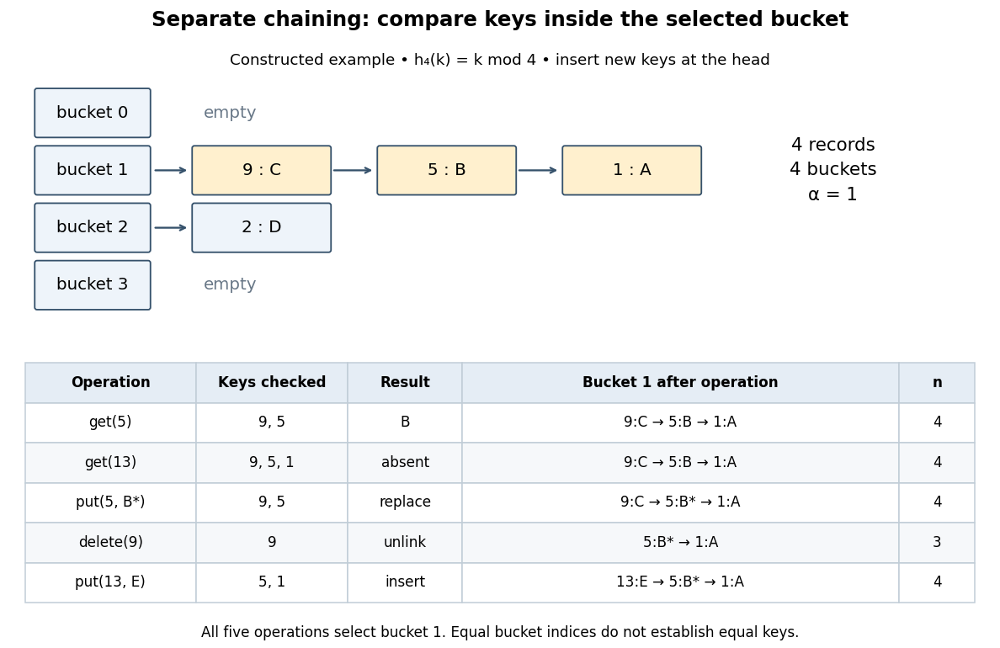

# Separate chaining

↑ **Parent:** [Hash table](hash-table.md)

With [separate chaining](separate-chaining.md), each [hash bucket](hash-bucket.md) in a [hash table](hash-table.md) contains a collection of records, often a [linked list](linked-list.md). Lookup computes the bucket index, then follows that chain until a [key equality](key-equality.md) comparison succeeds or the chain ends. A [hash collision](hash-collision.md) therefore affects the search work without merging unequal keys. Deletion searches the same chain and unlinks the matching record; in a singly [linked list](linked-list.md), remembering the preceding record during the search permits the unlink.[5.1 ChainedHashTable: Hashing with Chaining](open-data-structures-an-introduction-by-pat-morin/5-1-chainedhashtable-hashing-with-chaining.md)

For the four-key [integer](integer-split.md) example in [hash table](hash-table.md), insert a new record at the head of its chain after checking that its key is absent. Inserting $(1,A),(5,B),(9,C),(2,D)$ in that order makes [hash bucket](hash-bucket.md) $1$ hold $(9,C)\to(5,B)\to(1,A)$, [hash bucket](hash-bucket.md) $2$ hold $(2,D)$, and the other two [hash buckets](hash-bucket.md) empty. All five subsequent operations below select [hash bucket](hash-bucket.md) $1$ because $5\bmod4=13\bmod4=9\bmod4=1$:

**[Figure 6](#hash-table-chain-operations). Separate chaining traces lookup, replacement, deletion and insertion through key equality**. Original deterministic model with $h_4(k)=k\bmod4$. The table counts actual keys inspected, not elapsed machine time. Operations occur from top to bottom; only an absent key adds a new record, and the untouched record $(2,D)$ remains in [hash bucket](hash-bucket.md) $2$.

`get(5)` rejects key $9$, accepts key $5$, and returns $B$ after two [key equality](key-equality.md) comparisons. `get(13)` rejects $9,5,1$ and reports absence after three comparisons. `put(5,B*)` examines $9,5$ and replaces the value without changing $n=4$. `delete(9)` examines just the head record, removes it, and gives $n=3$. Finally, `put(13,E)` rejects $5,1$ before inserting the new head record; $n$ returns to $4$ and the chain is $(13,E)\to(5,B*)\to(1,A)$. The successive [hash table load factors](load-factor-of-a-hash-table.md) are $1,1,1,3/4,1$. These counts follow from the stipulated chain order; a different insertion policy changes the successful-search counts.

For a chain of length $\ell$, lookup and deletion by key take $O(1+\ell)$ [time complexity](time-complexity.md) in [Big O notation](big-o-notation.md). The same applies to `put` before any resizing, since replacement semantics require checking for an existing equal key. Head insertion alone is $O(1)$ if absence is already known; that is a different precondition. These bounds assume $O(1)$ bucket-index hashing, [array](array-data-structure.md) access, [key equality](key-equality.md) comparisons, allocation and link updates. A long [string](string.md) or large [integer](integer-split.md) can make hashing or comparison depend on its encoded length, so counting record visits alone does not establish constant running time.

Under [simple uniform hashing](simple-uniform-hashing.md), each distinct key's bucket index is an independent [random variable](random-variable-split.md) with a [uniform distribution on a finite set](discrete-uniform-distribution.md) of $m$ indices. The keys and query are fixed independently of this random assignment. Then lookup has expected $O(1+\alpha)$ [time complexity](time-complexity.md), where $\alpha=n/m$ is the [hash table load factor](load-factor-of-a-hash-table.md); it is expected $O(1)$ when $\alpha$ stays bounded. These are model assumptions, not an automatic consequence of using a deterministic [hash function](hash-function.md).[6.006 Introduction to Algorithms, Fall 2011 by Massachusetts Institute of Technology, 6.006 course staff; pp. 4–5, chaining worst case and simple uniform hashing assumption](6-006-introduction-to-algorithms-fall-2011-by-massachusetts-institute-of-technology-6-006-course-staff/lecture-8-hashing-i.md)

Here is the short calculation. For an absent query $q$ and stored keys $k_1,\ldots,k_n$, let $I_i$ be the [indicator random variable](indicator-random-variable.md) of $h_m(k_i)=h_m(q)$. The number $C$ of records inspected has [expected value](expected-value-split.md)

$$
C=\sum_{i=1}^{n}I_i,\qquad \mathbb E[C]=\sum_{i=1}^{n}\mathbb E[I_i]=\frac{n}{m}=\alpha,
$$

by [linearity of expectation](linearity-of-expectation.md). For a present fixed query, scanning its entire chain inspects at most itself plus all other colliding records, with [expected value](expected-value-split.md) $1+(n-1)/m$; stopping at the match only decreases this upper bound. Adding constant hashing and bucket access yields expected $O(1+\alpha)$ for either query. The argument needs pairwise collision bounds; it does not require all the [indicator random variables](indicator-random-variable.md) to be independent. A [universal hash family](universal-hash-family.md) can provide a related bound by random choice of a [hash function](hash-function.md) for a fixed key set, as explained in that article.

The worst case remains $O(n)$, and an absent query takes $n$ comparisons if all $n$ records occupy its [hash bucket](hash-bucket.md). For instance, $1,1+m,1+2m,\ldots,1+(n-1)m$ all collide under $h_m(k)=k\bmod m$. [Separate chaining](separate-chaining.md) remains correct, but a [sequence](sequence.md) of insertions that each checks the existing chain can take quadratic total work. [Amortized analysis](amortized-analysis.md) of resizing does not remove this search cost, and an adaptive choice of keys based on a known [hash function](hash-function.md) is outside the stated [simple uniform hashing](simple-uniform-hashing.md) model.

**Table of contents**

- [Simple uniform hashing](simple-uniform-hashing.md)

## ↑ Ancestors (4)

1. [Hash table](hash-table.md)
2. [Data structure](data-structure-split.md)
3. [Computer science](computer-science-split.md)
4. [Codex Wiki](split.md)

## ← Incoming links (9)

- [Hash bucket](hash-bucket.md)
- [Hash collision](hash-collision.md)
- [Hash function](hash-function.md)
- [Hash table](hash-table.md)
- [Hash table resizing](hash-table-resizing.md)
- [Load factor of a hash table](load-factor-of-a-hash-table.md)
- [Open addressing](open-addressing.md)
- [Separate chaining](separate-chaining.md)
- [Simple uniform hashing](simple-uniform-hashing.md)
