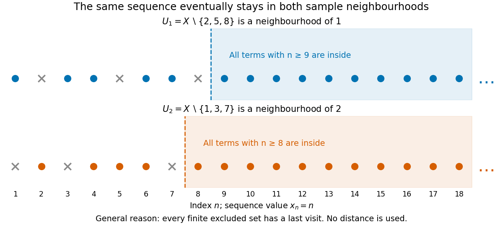

# Sequence convergence in the cofinite topology

↑ **Parent:** [Cofinite topology](cofinite-topology.md)

By [convergence of a sequence in a topological space](convergence-of-a-sequence-in-a-topological-space.md), $x_n\to a$ means that every [open](open-set.md) [neighbourhood](neighbourhood-mathematics.md) of $a$ contains all sufficiently late terms. In the [cofinite topology](cofinite-topology.md), this is equivalent to the condition that, for every $b\ne a$, the value $b$ occurs only finitely often. Necessity uses the [open](open-set.md) [neighbourhood](neighbourhood-mathematics.md) $X\setminus\{b\}$; sufficiency chooses an index beyond every last occurrence of the finitely many points excluded by a given [open](open-set.md) [neighbourhood](neighbourhood-mathematics.md).

Consequently a [sequence](sequence.md) with distinct terms converges to every point of $X$. For the original choice $x_n=n$ on $X=\mathbb N_{>0}$, take the two [open](open-set.md) [neighbourhoods](neighbourhood-mathematics.md)

$$
U_1=X\setminus\{2,5,8\}\ni1,\qquad U_2=X\setminus\{1,3,7\}\ni2.
$$

All terms with $n\geq9$ lie in $U_1$ and all terms with $n\geq8$ lie in $U_2$. More generally, each finite excluded [set](set-split.md) has a last visit, so $x_n\to1$ and $x_n\to2$, and in fact $x_n\to a$ for every $a\in X$. No numerical distance is tending to zero here; the [open sets](open-set.md) specify the meaning of convergence.

**[Figure 4](#image-the-same-sequence-eventually-stays-in-neighbourhoods-of-two-different-limits). The same sequence eventually stays in neighbourhoods of two different limits**. Original sequence $x_n=n$ in the [cofinite topology](cofinite-topology.md). Two sample [neighbourhoods](neighbourhood-mathematics.md) have different finite exclusions and different last-visit indices. Their memberships illustrate the general finite-exclusion argument; testing just these two neighbourhoods would not by itself prove convergence.

Distinct terms are sufficient, not necessary. The [sequence](sequence.md) $1,1,2,2,3,3,\ldots$ also converges to every point, since each value occurs only twice. By contrast, the [constant sequence](constant-sequence.md) $x_n=1$ converges only to $1$: an [open](open-set.md) [neighbourhood](neighbourhood-mathematics.md) of any $a\ne1$ can exclude $1$. The alternating [sequence](sequence.md) $1,2,1,2,\ldots$ converges to no point, since some value different from any proposed limit occurs infinitely often.

## ↑ Ancestors (6)

1. [Cofinite topology](cofinite-topology.md)
2. [Topology](topology-split.md)
3. [Geometry and topology](geometry-and-topology-split.md)
4. [Area of mathematics](area-of-mathematics.md)
5. [Mathematics](mathematics-split.md)
6. [Codex Wiki](split.md)

## ← Incoming links (2)

- [Cofinite topology](cofinite-topology.md)
- [Convergence of a sequence in a topological space](convergence-of-a-sequence-in-a-topological-space.md)
