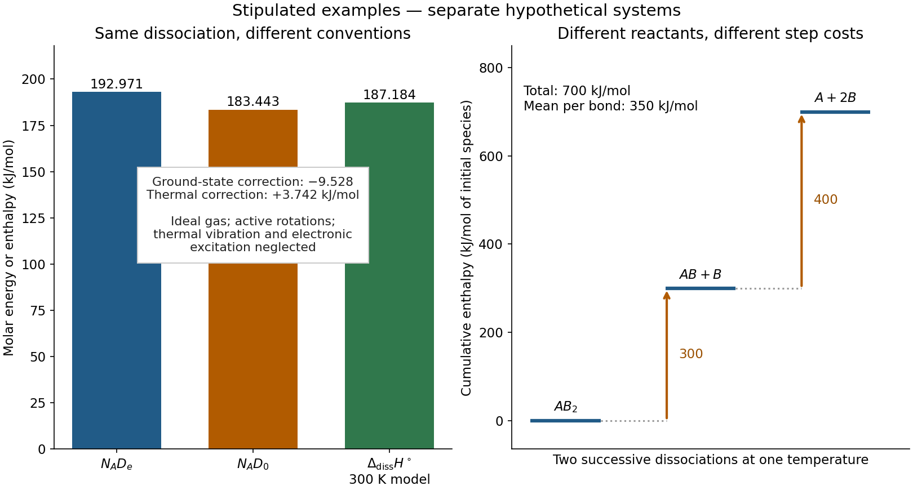

# Sequential bond-dissociation energies

↑ **Parent:** [Bond-dissociation energy](bond-dissociation-energy.md)

Equivalent [chemical bonds](chemical-bond-split.md) in an intact [molecule](molecule-split.md) need not have equal successive [bond-dissociation enthalpies](bond-dissociation-enthalpy.md). Once one [chemical bond](chemical-bond-split.md) is removed, the next reactant has a different electronic [quantum state](quantum-state.md) and may relax to a different [molecular geometry](molecular-geometry.md). The successive steps compare different species. This distinction also explains why a tabulated average [chemical bond](chemical-bond-split.md) strength is not necessarily the cost of the first cleavage.[“Bond Strength: Covalent Bonds”, methane paragraph: equivalent initial bonds and unequal sequential breaking costs](chemistry-2e-by-paul-flowers-and-others/7-5-strengths-of-ionic-and-covalent-bonds.md)

For an invented species $AB_2$, stipulate the following gas-phase steps, with all [enthalpies](enthalpy-split.md) at the same [temperature](temperature-split.md) and the same [standard states](standard-state.md):

$$
\begin{aligned}
AB_2(g)&\longrightarrow AB(g)+B(g),&D_1&=300\,\mathrm{kJ\,mol^{-1}},\\
AB(g)&\longrightarrow A(g)+B(g),&D_2&=400\,\mathrm{kJ\,mol^{-1}}.
\end{aligned}
$$

The symbols stand for hypothetical species with consistently chosen electronic states. They are not values for [water](water.md) or another measured [molecule](molecule-split.md). By [Hess's law](hess-s-law.md), the total [enthalpy of atomization](enthalpy-of-atomization.md) for $AB_2(g)\to A(g)+2B(g)$ is $700\,\mathrm{kJ\,mol^{-1}}$; the [arithmetic mean](arithmetic-mean.md) per broken [chemical bond](chemical-bond-split.md) is $350\,\mathrm{kJ\,mol^{-1}}$. Neither individual step equals that mean. Nor must the second step be cheaper: here it is deliberately more expensive. An exact sequence sums exactly; substituting averages taken from other [molecules](molecule-split.md) generally gives only an estimate.

**[Figure 2](#image-bond-energy-conventions-and-sequential-cleavage). Two stipulated examples: changing the energy convention for one dissociation, and changing the reactant during sequential cleavage**. Left: $N_{\rm A}D_e$, $N_{\rm A}D_0$, and the model [bond-dissociation enthalpy](bond-dissociation-enthalpy.md) at $300\,\mathrm K$. Right: cumulative [enthalpy](enthalpy-split.md) levels $0,300,700\,\mathrm{kJ\,mol^{-1}}$ for two successive steps, with costs $300$ and $400$ and mean $350$. The panels are separate hypothetical systems; neither contains molecular measurements.

## ↑ Ancestors (4)

1. [Bond-dissociation energy](bond-dissociation-energy.md)
2. [Chemical bond](chemical-bond-split.md)
3. [Chemistry](chemistry-split.md)
4. [Codex Wiki](split.md)
