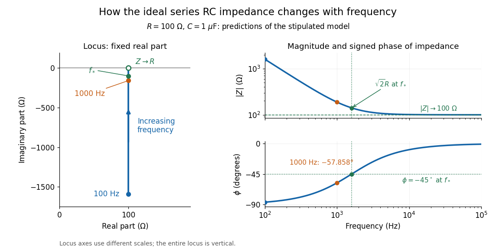

# Series RC impedance

↑ **Parent:** [Electrical impedance](electrical-impedance.md)

Consider a stipulated [series circuit](series-circuit.md) containing an ideal [resistor](resistor.md) of [electrical resistance](electrical-resistance.md) $R=100\,\Omega$ and an ideal [capacitor](capacitor.md) of [capacitance](capacitance.md) $C=1\,\mu\mathrm F$. The same [electric current](electric-current.md) passes through both. Their terminal [electric potential differences](electric-potential-difference.md) add by [Kirchhoff's voltage law](kirchhoff-cycle-law.md), so

$$
\widehat V=\widehat V_R+\widehat V_C
=R\widehat I+\frac{\widehat I}{\mathrm i\omega C},\qquad
Z=R-\frac{\mathrm i}{\omega C}.
$$

A quick derivation uses $i=C\,dv_C/dt$: taking the [derivative](derivative.md) of the [complex exponential](complex-exponential-function.md) multiplies the capacitor voltage [phasor](phasor.md) by $\mathrm i\omega$, hence $\widehat V_C=\widehat I/(\mathrm i\omega C)$. Dimensionally, $1/(\omega C)$ has units $\mathrm{s/F}=\mathrm{V/A}=\Omega$, matching $R$.

At [frequency](frequency.md) $f=1000\,\mathrm{Hz}$, the [angular frequency](angular-frequency.md) is $\omega=2\pi f$. The signed capacitive [electrical reactance](electrical-reactance.md), [modulus](modulus.md) and [complex argument](argument-complex-analysis.md) of the total [electrical impedance](electrical-impedance.md) are

$$
X_C=-159.154943\,\Omega,\qquad
|Z|=187.963549\,\Omega,\qquad
\phi=-57.858092^\circ.
$$

Apply $V_{\rm rms}=1.00\,\mathrm V$ across the complete [series circuit](series-circuit.md). Its [root mean square](root-mean-square.md) [electric current](electric-current.md) is

$$
I_{\rm rms}=\frac{1.00\,\mathrm V}{187.963549\,\Omega}
=5.320180\,\mathrm{mA}.
$$

With voltage as the zero-phase reference, the current [phasor](phasor.md) has [complex argument](argument-complex-analysis.md) $+57.858092^\circ$: [electric current](electric-current.md) leads. The [phasor](phasor.md) drops have [moduli](modulus.md) $V_{R,\rm rms}=0.532018\,\mathrm V$ and $V_{C,\rm rms}=0.846733\,\mathrm V$; these add as [complex numbers](complex-number.md), not as positive magnitudes. Their squared magnitudes sum to $(1.00\,\mathrm V)^2$.

**[Figure 8](#image-series-rc-impedance-moving-in-the-complex-plane-as-frequency-changes). Series RC impedance moving in the complex plane as frequency changes**. Original calculated ideal $R=100\,\Omega$, $C=1\,\mu\mathrm F$ model, not measured data or a filter transfer function. Left: the [electrical impedance](electrical-impedance.md) remains on $\operatorname{Re}Z=100\,\Omega$ and approaches the real axis as [frequency](frequency.md) increases. Right: its [modulus](modulus.md) and voltage-minus-current [phase difference](phase-difference.md). The marked $1000\,\mathrm{Hz}$ case matches the worked example; $f_*=1/(2\pi RC)=1591.55\,\mathrm{Hz}$ marks $|X_C|=R$, $|Z|=\sqrt2R$, and $\phi=-45^\circ$.

The mean absorbed [power](power.md) uses the [root mean square](root-mean-square.md) values:

$$
P=V_{\rm rms}I_{\rm rms}\cos\phi
=RI_{\rm rms}^2
=2.830432\,\mathrm{mW},\qquad
\cos\phi=\frac R{|Z|}=0.532018.
$$

The ideal [capacitor](capacitor.md) has zero cycle-averaged absorbed [power](power.md); all the mean absorbed [power](power.md) becomes [Joule heating](joule-heating.md) in the [resistor](resistor.md).[§15.4, equations 15.12–15.14 and the capacitor/inductor paragraph: RMS average power and zero ideal reactive average power](university-physics-volume-2-by-samuel-j-ling-and-others.md) To see why the phase factor appears, average $p(t)=v(t)i(t)$ over a full cycle with $v(t)=\sqrt2V_{\rm rms}\cos\omega t$ and $i(t)=\sqrt2I_{\rm rms}\cos(\omega t-\phi)$. The [cosine addition formula](cosine-addition-formula.md) reduces the average to $V_{\rm rms}I_{\rm rms}\cos\phi$; the term at $2\omega$ averages to zero. Independently, $p_C=d(Cv_C^2/2)/dt$, and the [capacitor energy](capacitor-energy.md) returns to its starting value after each cycle.

At fixed applied $V_{\rm rms}$, the [limit](limit-of-a-function.md) $\omega\to0^+$ gives $|Z|\to\infty$, $\phi\to-\pi/2$ and $I_{\rm rms}\to0$: the ideal [capacitor](capacitor.md) blocks steady [electric current](electric-current.md). The [limit](limit-of-a-function.md) $\omega\to\infty$ gives $Z\to R$, $\phi\to0$ and $I_{\rm rms}\to V_{\rm rms}/R$. These are [limits](limit-of-a-function.md) of the ideal lumped [electrical circuit](electrical-circuit-split.md); unwanted lead [inductance](inductance.md) and component losses can invalidate that model at high [frequency](frequency.md). At $\omega RC=1$, the equal legs of the impedance [right triangle](right-triangle.md) give $|Z|=\sqrt2R$ and $\phi=-\pi/4$ without numerical evaluation. Measuring both the magnitude and the sign of the [phase difference](phase-difference.md) distinguishes this [capacitor](capacitor.md) response from an equally large positive [electrical reactance](electrical-reactance.md).

## ↑ Ancestors (6)

1. [Electrical impedance](electrical-impedance.md)
2. [Electrical circuit](electrical-circuit-split.md)
3. [Electromagnetism](electromagnetism-split.md)
4. [Branches of physics](branches-of-physics.md)
5. [Physics](physics-split.md)
6. [Codex Wiki](split.md)

## ← Incoming links (4)

- [Electrical impedance](electrical-impedance.md)
- [Electrical impedance phase measurement](electrical-impedance-phase-measurement.md)
- [Solution](past-exam-of-the-physics-course-of-the-year-1-of-the-natural-sciences-course-of-the-university-of-cambridge/2017/section-a/2/solution.md)
- [Series RC impedance](series-rc-impedance.md)
