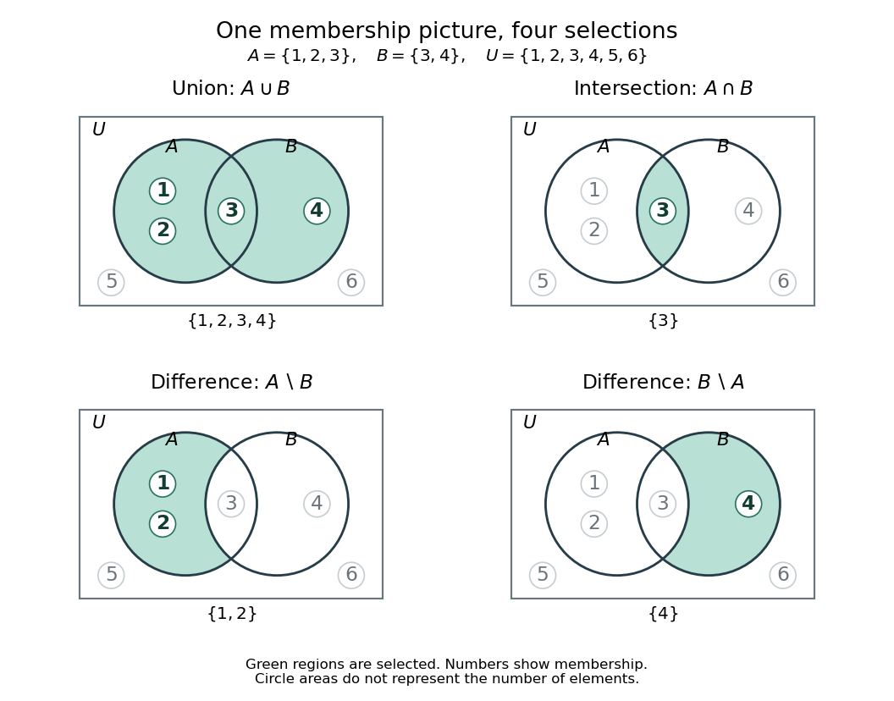

# Set union

↑ **Parent:** [Set](set-split.md)  
ⓦ [Wiki](https://en.wikipedia.org/wiki/Union_(set_theory))

The union $A\cup B$ collects the [set elements](element-of-a-set.md) belonging to either [set](set-split.md), including those belonging to both:

$$
A\cup B=\{x:x\in A\text{ or }x\in B\},\qquad x\in A\cup B\iff(x\in A)\vee(x\in B).
$$

Thus membership in a [union](set-union.md) uses [logical disjunction](logical-disjunction.md) (OR). For $A=\{1,2,3\}$ and $B=\{3,4\}$, the [union](set-union.md) is $A\cup B=\{1,2,3,4\}$: the shared member $3$ occurs only once, because a [set](set-split.md) records membership without repeated entries.

**[Figure 4](#image-union-intersection-and-the-two-directions-of-set-difference-for-the-same-numbered-sets). Union, intersection, and the two directions of set difference for the same numbered sets**.

In this [Venn diagram](venn-diagram.md), $1,2$ belong only to $A$, $3$ belongs to both [sets](set-split.md), $4$ belongs only to $B$, and $5,6$ belong to neither. The surrounding [universal set](universal-set.md) is $U=\{1,2,3,4,5,6\}$. Numbers are placed by membership; circle areas do not represent [cardinalities](cardinality.md). Each panel shades the region selected by its operation.

For a database illustration, let $A$ collect records matching one condition and $B$ collect records matching another. Their [union](set-union.md) selects records matching at least one condition, with a record satisfying both still appearing once. This interpretation turns an abstract operation into a reusable rule for combining selections. For an authored treatment of [union](set-union.md), [intersection](set-intersection.md), [set difference](set-difference.md), and [complement](complement-of-a-set.md), see [Lehman, Leighton and Meyer, Mathematics for Computer Science (2015), Definition 4.1.1, pp. 82–83](https://ocw.mit.edu/courses/6-042j-mathematics-for-computer-science-spring-2015/mit6_042js15_textbook.pdf#page=90).

More generally, the [union](set-union.md) $\bigcup_{i\in I}A_i$ contains exactly the [set elements](element-of-a-set.md) belonging to at least one [set](set-split.md) $A_i$:

$$
x\in\bigcup_{i\in I}A_i\iff\exists i\in I:\ x\in A_i.
$$

The [existential quantification](existential-quantification.md) expresses “at least one”. With no indexing members, the [union](set-union.md) is the [empty set](empty-set.md). Combining a [set](set-split.md) with the [empty set](empty-set.md) leaves it unchanged: $A\cup\varnothing=A$.

**Table of contents**

- [Countable union](countable-union.md)

## ↑ Ancestors (6)

1. [Set](set-split.md)
2. [Set theory](set-theory-split.md)
3. [Foundations of mathematics](foundations-of-mathematics-split.md)
4. [Area of mathematics](area-of-mathematics.md)
5. [Mathematics](mathematics-split.md)
6. [Codex Wiki](split.md)

## ← Incoming links (24)

- [Axis-aligned bounding box](axis-aligned-bounding-box.md)
- [Bounded-size transversal kernel](bounded-size-transversal-kernel.md)
- [Bounding volume hierarchy](bounding-volume-hierarchy.md)
- [Capture-recapture model](capture-recapture-model.md)
- [Characteristic vector of a set](characteristic-vector-of-a-set.md)
- [Copy-on-write page accounting](copy-on-write-page-accounting.md)
- [Finite relation closure for set-theoretic coding](finite-relation-closure-for-set-theoretic-coding.md)
- [Mark and recapture](mark-and-recapture.md)
- [Measurable Hall theorem](measurable-hall-theorem.md)
- [Minkowski addition](minkowski-addition.md)
- [Solution](past-exam-of-the-mathematics-course-of-the-university-of-cambridge/2008/iii/paper-14/4/solution.md)
- [Solution](past-exam-of-the-mathematics-course-of-the-university-of-cambridge/2016/iii/paper-121/5/c/solution.md)
- [Solution](past-exam-of-the-mathematics-course-of-the-university-of-cambridge/2017/ia/paper-4/2d/b/i/solution.md)
- [Solution](past-exam-of-the-mathematics-course-of-the-university-of-cambridge/2017/iii/paper-121/1/iii/solution.md)
- [Solution](past-exam-of-the-mathematics-course-of-the-university-of-cambridge/2017/iii/paper-121/2/iii/solution.md)
- [Solution](past-exam-of-the-mathematics-course-of-the-university-of-cambridge/2017/iii/paper-121/4/ii/solution.md)
- [Solution](past-exam-of-the-mathematics-course-of-the-university-of-cambridge/2020/ii/paper-4/2h/solution.md)
- [Solution](past-exam-of-the-mathematics-course-of-the-university-of-cambridge/2024/iii/paper-128/1/a/solution.md)
- [Solution](past-exam-of-the-mathematics-course-of-the-university-of-cambridge/2025/iii/paper-164/3/i/solution.md)
- [Prime omega function](prime-omega-function.md)
- [Set difference](set-difference.md)
- [Set intersection](set-intersection.md)
- [Sigma-finite measure](sigma-finite-measure.md)
- [Venn diagram](venn-diagram.md)
