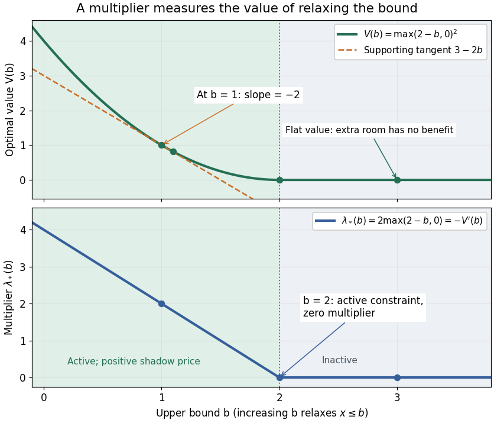

# Shadow price of an inequality constraint

↑ **Parent:** [Karush-Kuhn-Tucker conditions](karush-kuhn-tucker-conditions.md)

A shadow price measures the marginal improvement from relaxing an inequality [optimization constraint](optimization-constraint.md). Use $L=f+\sum_i\lambda_i(g_i-b_i)+\sum_j\mu_jh_j$ for $g_i(x)\leq b_i$ in a [minimization problem](minimization-problem.md). With [strong duality](strong-duality.md) and a [differentiable](differentiable-function.md) optimal [value function](value-function.md), $\partial V/\partial b_i=-\lambda_i$.[§5.6.3, printed pp. 251–252, equation (5.58): local sensitivity](convex-optimization-by-stephen-boyd-and-lieven-vandenberghe.md)

In the [quadratic minimization with a moving upper bound](quadratic-minimization-with-a-moving-upper-bound.md), direct [differentiation](differentiation.md) gives

$$
V'(b)=
\begin{cases}
-2(2-b),&b<2,\\
0,&b\geq2,
\end{cases}
\qquad V'(b)=-\lambda_*(b).
$$

The [derivative](derivative.md) at $b=2$ is zero from both sides, although $x_*(b)$ has different one-sided [derivatives](derivative.md) there. The value of additional room has faded continuously to zero just as the [active constraint](active-constraint.md) stops restricting the optimizer.

At $b=1$, $x_*=1$, $V=1$ and $\lambda_*=2$. Raising the bound to $1.1$ lowers the value to $0.81$: the first-order prediction is a change of $-2(0.1)=-0.2$, while the exact change is $-0.19$. At $b=3$, the same relaxation leaves $x_*=2$ and $V=0$. At $b=2$, tightening by $0.1$ costs $0.01$, a second-order effect despite the zero [Lagrange multiplier](lagrange-multiplier.md).

**[Figure 13](#image-the-derivative-of-the-optimal-value-is-the-negative-inequality-multiplier). The derivative of the optimal value is the negative inequality multiplier**.

There is also a global statement in this example. Keeping the [Lagrange multiplier](lagrange-multiplier.md) at the value associated with $b_0$, the [Lagrange dual function](lagrange-dual-function.md) changes by $-\lambda_*(b_0)(b-b_0)$. [Weak duality](weak-duality.md) therefore gives

$$
V(b)\geq V(b_0)-\lambda_*(b_0)(b-b_0).
$$

At $b_0=1$ this is $V(b)\geq3-2b$, the supporting tangent shown in the diagram. This bound remains valid for large changes, whereas the [derivative](derivative.md) predicts only the first-order effect. If the [value function](value-function.md) is not [differentiable](differentiable-function.md), an optimal [Lagrange multiplier](lagrange-multiplier.md) can instead supply a supporting [subgradient](subgradient.md), rather than a unique marginal rate. This is the same idea used in [sensitivity analysis in convex perturbation duality](sensitivity-analysis-in-convex-perturbation-duality.md).

## ↑ Ancestors (5)

1. [Karush-Kuhn-Tucker conditions](karush-kuhn-tucker-conditions.md)
2. [Mathematical optimization](mathematical-optimization-split.md)
3. [Area of mathematics](area-of-mathematics.md)
4. [Mathematics](mathematics-split.md)
5. [Codex Wiki](split.md)
