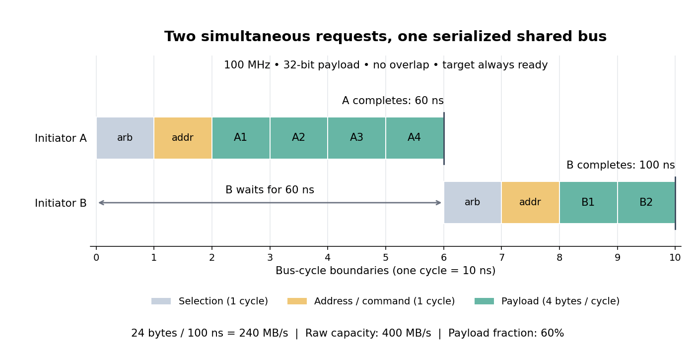

# Shared-bus timing example

↑ **Parent:** [Bus throughput](bus-throughput.md)

Consider a stipulated synchronous [shared computer bus](shared-computer-bus.md), rather than a timing claim about any named hardware protocol. Assume a 32-[bit](bit.md) [data bus](data-bus.md), a 100 MHz clock, and one four-[byte](byte.md) payload transfer per [bus cycle](bus-cycle.md) during the data phase. Both initiators $A$ and $B$ request at time zero. $A$ has one four-transfer write [bus burst](bus-burst.md) and $B$ one two-transfer write [bus burst](bus-burst.md), to an immediately ready target in [computer memory](computer-memory.md). Each [bus burst](bus-burst.md) pays one [bus cycle](bus-cycle.md) for [bus arbitration](bus-arbitration.md) and one for its starting address and command; subsequent addresses advance implicitly. The arbiter chooses $A$ first, owners finish their entire [bus bursts](bus-burst.md), and no phases overlap. There are no [bus wait states](bus-wait-state.md), retries, extra completion cycles, direction changes or intervening requests. Payload is counted when each data phase completes; the observation interval starts at the first [bus arbitration](bus-arbitration.md) cycle and ends at the last payload completion.

**[Figure 24](#image-stipulated-bus-arbitration-and-payload-timing-for-two-competing-bus-bursts). Stipulated bus arbitration and payload timing for two competing bus bursts**.

A [bus cycle](bus-cycle.md) lasts

$$
T=\frac{1}{100\times10^6\ \mathrm{s}^{-1}}=10\ \mathrm{ns}.
$$

The timeline uses half-open intervals of [bus cycles](bus-cycle.md): $A$ has [bus arbitration](bus-arbitration.md) on $[0,1)$, address and command on $[1,2)$, and four payload transfers on $[2,6)$. Then $B$ has [bus arbitration](bus-arbitration.md) on $[6,7)$, address and command on $[7,8)$, and two payload transfers on $[8,10)$. Their final payload completions are at 60 ns and 100 ns respectively. $B$ waits 60 ns before its own selection cycle even though both requests arrived together.

The six payload transfers contain 24 [bytes](byte.md). Ten [bus cycles](bus-cycle.md) take 100 ns, giving finite-interval [bus throughput](bus-throughput.md)

$$
R=\frac{24\ \mathrm{bytes}}{100\ \mathrm{ns}}=240\times10^6\ \mathrm{bytes/s}=240\ \mathrm{MB/s},
$$

where MB means $10^6$ [bytes](byte.md). The raw [data bus](data-bus.md) rate is $4\ \mathrm{bytes}\times100\times10^6\ \mathrm{s}^{-1}=400\ \mathrm{MB/s}$. Payload occupies $6/10=60\%$ of the interval. If this same pair repeats with no gaps, its long-run [bus throughput](bus-throughput.md) equals the finite-interval value; isolated observations need not predict a later workload.

Reverse the [bus arbitration](bus-arbitration.md) order, keeping these assumptions. $B$ finishes after four [bus cycles](bus-cycle.md), at 40 ns; $A$ finishes at 100 ns. Aggregate [bus throughput](bus-throughput.md) stays 240 MB/s, but $B$'s request-to-completion time falls from 100 ns to 40 ns and $A$'s rises from 60 ns to 100 ns. Scheduling changes who waits without changing the available payload capacity in this example.

For an independent perturbation, retain $A$ first and add two [bus wait states](bus-wait-state.md) before $B$'s final payload transfer. The interval grows to 120 ns with the same 24 [bytes](byte.md), so [bus throughput](bus-throughput.md) falls to 200 MB/s. For another workload, one initiator sends all six transfers in a single [bus burst](bus-burst.md): the stipulated overhead is paid once, giving eight [bus cycles](bus-cycle.md), 80 ns and 300 MB/s. This latter comparison assumes one combined request is valid; combining different initiators' operations is not automatically permitted.

## ↑ Ancestors (4)

1. [Bus throughput](bus-throughput.md)
2. [Computer bus](computer-bus.md)
3. [Computer science](computer-science-split.md)
4. [Codex Wiki](split.md)

## ← Incoming links (2)

- [Bus throughput](bus-throughput.md)
- [Shared buses and point-to-point links](shared-buses-and-point-to-point-links.md)
