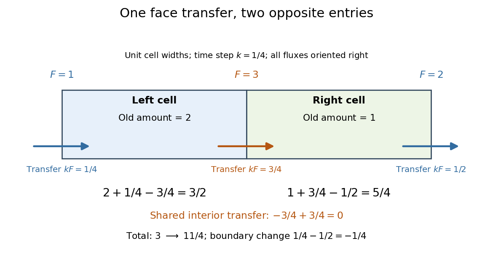

# Shared face flux cancellation

↑ **Parent:** [Finite volume method](finite-volume-method-split.md)

In a [finite volume method](finite-volume-method-split.md), orient every face [numerical flux](numerical-flux.md) to the right. For cells $1,\ldots,N$, write the discrete total as $M^n=\sum_{j=1}^N h_jU_j^n$. If $u$ is a mass per unit length, this total approximates [mass](mass.md); for a different conserved field, it measures that field's [integral](integral-split.md). Multiplying the update by the cell width gives an amount balance, so adjacent cells contribute

$$
\begin{aligned}
h_j(U_j^{n+1}-U_j^n)&=kF_{j-1/2}^n-kF_{j+1/2}^n,\\
h_{j+1}(U_{j+1}^{n+1}-U_{j+1}^n)&=kF_{j+1/2}^n-kF_{j+3/2}^n.
\end{aligned}
$$

The interior face contributes $-kF_{j+1/2}^n+kF_{j+1/2}^n=0$. Summing all cells gives

$$
M^{n+1}-M^n=k\bigl(F_{1/2}^n-F_{N+1/2}^n\bigr).
$$

With [periodic boundary conditions](periodic-boundary-conditions.md), the two boundary labels denote the same physical face and must use the same [numerical flux](numerical-flux.md); then $M^{n+1}=M^n$. On an open interval the total changes by the boundary transfers. Unequal widths require the weighted total $\sum h_jU_j$, not the unweighted [sum](sum.md) of [cell averages](average-value-of-a-function.md).

**[Figure 1](#image-one-oriented-face-transfer-leaves-the-left-cell-and-enters-the-right-cell-with-opposite-signs). One oriented face transfer leaves the left cell and enters the right cell with opposite signs**.

The diagram uses two unit-width cells, $k=1/4$, [cell averages](average-value-of-a-function.md) $(2,1)$ and right-oriented [numerical fluxes](numerical-flux.md) $(1,3,2)$ at their three faces. The updated [cell averages](average-value-of-a-function.md) are $(3/2,5/4)$: the total changes from $3$ to $11/4$, exactly $k(1-2)=-1/4$. The shared interior transfer $k\cdot3=3/4$ cancels. If the receiving cell instead used $3+\varepsilon$ for that same face, the total would acquire the spurious term $k\varepsilon$. Conservation is therefore an algebraic property of sharing the transfer, even when the [numerical flux](numerical-flux.md) is a poor approximation. In [floating-point arithmetic](floating-point-arithmetic-split.md), independently rounded cell updates may still leave small [roundoff errors](round-off-error.md) in the computed total.

## ↑ Ancestors (6)

1. [Finite volume method](finite-volume-method-split.md)
2. [Numerical analysis](numerical-analysis-split.md)
3. [Analysis](analysis-split.md)
4. [Area of mathematics](area-of-mathematics.md)
5. [Mathematics](mathematics-split.md)
6. [Codex Wiki](split.md)

## ← Incoming links (3)

- [Finite volume method](finite-volume-method-split.md)
- [Numerical flux](numerical-flux.md)
- [Periodic upwind finite volume advection](periodic-upwind-finite-volume-advection.md)
