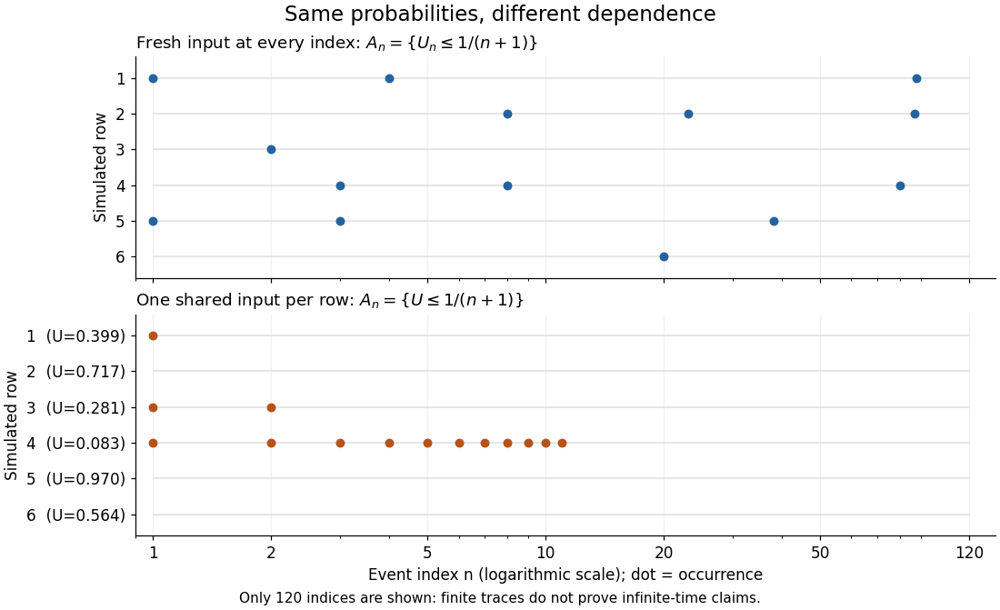

# Shared-uniform counterexample to the second Borel-Cantelli lemma

↑ **Parent:** [Borel-Cantelli second lemma](borel-cantelli-second-lemma.md)

Choose one [random variable](random-variable-split.md) $U$ with the [continuous uniform distribution](continuous-uniform-distribution.md) on $[0,1]$, and reuse it in every [event](event.md):

$$
A_n=\left\{U\leq\frac1{n+1}\right\},\qquad n\geq1.
$$

Each [probability](probability.md) is $1/(n+1)$, so their [harmonic series](harmonic-series.md) diverges, just as in [summable and harmonic event probabilities](summable-and-harmonic-event-probabilities.md). But the [events](event.md) are decreasing: $A_{n+1}\subseteq A_n$. For every outcome $U=u>0$, all indices with $n+1>1/u$ fail. Only finitely many [events](event.md) occur on that outcome. The [limsup of events](limsup-of-events.md) is exactly $\{U=0\}$, a [zero-probability event](zero-probability-event.md). This is a concrete closed-interval version of the shrinking-interval dependence example.[§2.3, Example 2.3.6, printed p. 70: shrinking intervals with divergent total probability](probability-theory-and-examples-fifth-edition-by-rick-durrett.md)

The missing assumption is visible already in two [events](event.md). For $i<j$, their [intersection](set-intersection.md) is $A_j$, hence

$$
\mathbb P(A_i\cap A_j)=\frac1{j+1}
\ne\frac1{(i+1)(j+1)}=\mathbb P(A_i)\mathbb P(A_j).
$$

Moreover, the whole tail [union](set-union.md) is just $A_m$, with [probability](probability.md) $1/(m+1)\to0$. This calculation explains directly why divergence alone fails: overlapping [events](event.md) keep spending their individual [probabilities](probability.md) on the same outcomes.

Let $N=\sum_{n\geq1}\mathbf1_{A_n}$ be the total number of occurrences, a sum of [indicator random variables](indicator-random-variable.md). Although $N<\infty$ [almost surely](almost-sure-convergence.md), [Tonelli theorem](tonelli-theorem.md) gives $\mathbb E[N]=\sum_{n\geq1}1/(n+1)=\infty$. More explicitly, $\mathbb P(N\geq k)=1/(k+1)$ for $k\geq1$: very small positive values of $U$ give very long, but finite, initial runs. Infinite [expected value](expected-value-split.md) does not imply a positive [probability](probability.md) of an infinite count.

**[Figure 10](#image-equal-harmonic-event-probabilities-with-fresh-independent-inputs-or-one-shared-input). Equal harmonic event probabilities with fresh independent inputs or one shared input**. Each row is one finite simulation of the [indicator random variables](indicator-random-variable.md) of $A_n$ for $1\leq n\leq120$; a dot means the [event](event.md) occurred. Fresh [independent random variables](independent-random-variables.md) allow scattered returns; a shared [uniform random variable](uniform-random-variable.md) yields an initial run followed by zeros. The horizontal axis uses a [logarithmic scale](logarithmic-scale.md) to show early runs clearly. These finite simulations illustrate the two models and cannot prove infinitely many occurrences or eventual stopping.

## ↑ Ancestors (7)

1. [Borel-Cantelli second lemma](borel-cantelli-second-lemma.md)
2. [Borel-Cantelli lemmas](borel-cantelli-lemmas.md)
3. [Probability theory](probability-theory-split.md)
4. [Probability and statistics](probability-and-statistics-split.md)
5. [Area of mathematics](area-of-mathematics.md)
6. [Mathematics](mathematics-split.md)
7. [Codex Wiki](split.md)

## ← Incoming links (2)

- [Borel-Cantelli lemmas](borel-cantelli-lemmas.md)
- [Summable and harmonic event probabilities](summable-and-harmonic-event-probabilities.md)
