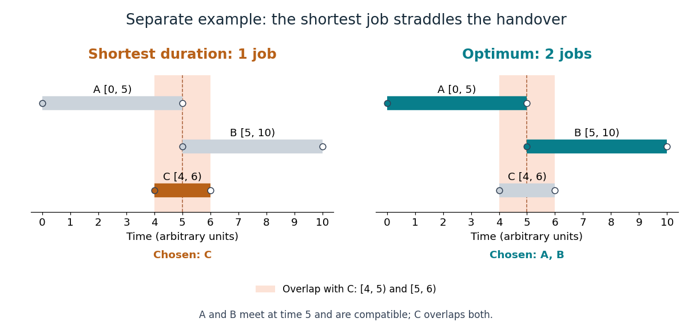

# Shortest-duration interval scheduling counterexample

↑ **Parent:** [Interval scheduling](interval-scheduling.md)

In this separate three-job example, labels $A,B,C$ denote new jobs:

$$
A=[0,5),\qquad B=[5,10),\qquad C=[4,6).
$$

Their durations are five, five and two. Consider the rule "accept a shortest remaining job, discard all jobs conflicting with it, and repeat". It selects $C$ first. But $C$ overlaps $A$ on $[4,5)$ and $B$ on $[5,6)$, so both are discarded. The rule returns one job, while the compatible [subset](subset.md) $\{A,B\}$ contains two. The common endpoint five is allowed, and no [feasible solution](feasible-point.md) contains all three jobs, so two is the [maximum](maximum-of-a-subset-of-a-total-order.md).

**[Figure 4](#image-a-two-unit-job-blocks-two-compatible-five-unit-jobs). A two-unit job blocks two compatible five-unit jobs**. A separate three-job [counterexample](counterexample.md) to choosing shortest duration. The left panel accepts only $C=[4,6)$; the right panel accepts $A=[0,5)$ and $B=[5,10)$. Shaded bands mark the two positive-length overlaps with $C$.

Duration alone ignores where a job sits. Here the shortest job straddles the useful handover time. Earliest finish instead chooses $A$, then $B$, and attains two. A [counterexample](counterexample.md) can refute a proposed [greedy-choice property](greedy-choice-property.md) even when the rule succeeds on many other [inputs](input-computer-science.md).

## ↑ Ancestors (5)

1. [Interval scheduling](interval-scheduling.md)
2. [Greedy algorithm](greedy-algorithm.md)
3. [Algorithm](algorithm-split.md)
4. [Computer science](computer-science-split.md)
5. [Codex Wiki](split.md)

## ← Incoming links (1)

- [Exchange argument](exchange-argument.md)
