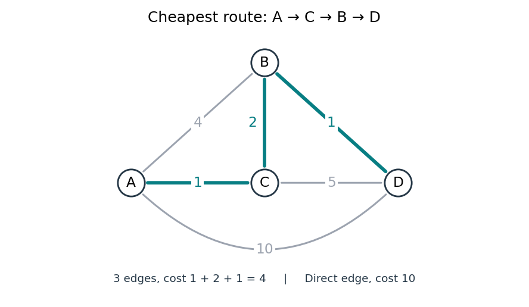

# Shortest path problem

↑ **Parent:** [Graph theory](graph-theory-split.md)

The [shortest path problem](shortest-path-problem.md) asks for a [graph path](path-in-a-graph.md) from a source [vertex](vertex-graph-theory.md) $s$ to a destination [vertex](vertex-graph-theory.md) $t$ minimizing its total [edge](edge-of-a-graph.md) weight. Here $w_e$ is the cost of traversing [edge](edge-of-a-graph.md) $e$, and costs add along the [graph path](path-in-a-graph.md). If no route exists, its shortest-path distance is $\infty$. With nonnegative [edge](edge-of-a-graph.md) weights, deleting [cycles in a graph](cycle-in-a-graph.md) from a [walk](walk-in-a-graph.md) never increases its cost, so repetitions cannot improve the optimum.

Consider the [undirected graph](undirected-graph.md) with [vertex set](vertex-set.md) $V=\{A,B,C,D\}$ and the six [edge](edge-of-a-graph.md) weights

$$
w_{AB}=4,\quad w_{AC}=1,\quad w_{CB}=2,\quad w_{BD}=1,\quad w_{CD}=5,\quad w_{AD}=10.
$$

Each [edge](edge-of-a-graph.md) can be traversed in either direction at the same cost. The direct [graph path](path-in-a-graph.md) $A,D$ costs $10$; $A,B,D$ costs $4+1=5$; $A,C,D$ costs $1+5=6$. The cheapest [graph path](path-in-a-graph.md) is $A,C,B,D$, costing $1+2+1=4$. The remaining [graph path](path-in-a-graph.md) $A,B,C,D$ costs $11$, exhausting the possibilities without repeated [vertices](vertex-graph-theory.md).

**[Figure 3](#image-the-shortest-path-problem-three-highlighted-edges-cost-less-than-the-direct-connection). The shortest path problem: three highlighted edges cost less than the direct connection**.

Thus fewest [edges](edge-of-a-graph.md) and least total cost are different objectives. [Breadth-first search](breadth-first-search.md) minimizes the number of [edges](edge-of-a-graph.md), which suffices when every [edge](edge-of-a-graph.md) has the same positive cost. Unequal nonnegative costs call for the [Dijkstra algorithm](dijkstra-algorithm.md). On a map, weights might be minutes rather than kilometres: a longer-looking route can arrive sooner. This is why a [weighted graph](weighted-graph.md) separates the network's connections from what a particular journey costs.

**Table of contents**

- [Label-setting shortest-path algorithm](label-setting-shortest-path-algorithm.md)
- [Bellman inequalities](bellman-inequalities.md)
- [Label-correcting shortest-path algorithm](label-correcting-shortest-path-algorithm.md)
- [Bellman-Ford algorithm](bellman-ford-algorithm.md)
- [Dijkstra algorithm](dijkstra-algorithm.md)
  - [Tentative distance](tentative-distance.md)
  - [Edge relaxation](edge-relaxation.md)
  - [Shortest-path predecessor](shortest-path-predecessor.md)

## ↑ Ancestors (5)

1. [Graph theory](graph-theory-split.md)
2. [Foundations of mathematics](foundations-of-mathematics-split.md)
3. [Area of mathematics](area-of-mathematics.md)
4. [Mathematics](mathematics-split.md)
5. [Codex Wiki](split.md)

## ← Incoming links (12)

- [Bellman-Ford algorithm](bellman-ford-algorithm.md)
- [Bellman inequalities](bellman-inequalities.md)
- [Breadth-first search](breadth-first-search.md)
- [Dijkstra algorithm](dijkstra-algorithm.md)
- [Graph theory](graph-theory-split.md)
- [Solution](past-exam-of-the-mathematics-course-of-the-university-of-cambridge/2001/iii/paper-31/4/solution.md)
- [Solution](past-exam-of-the-mathematics-course-of-the-university-of-cambridge/2009/iii/paper-35/2/solution.md)
- [Path-constraint separation by shortest paths](path-constraint-separation-by-shortest-paths.md)
- [Shortest path problem](shortest-path-problem.md)
- [Tentative distance](tentative-distance.md)
- [Walk in a graph](walk-in-a-graph.md)
- [Weighted Hamilton cycle](weighted-hamilton-cycle.md)
