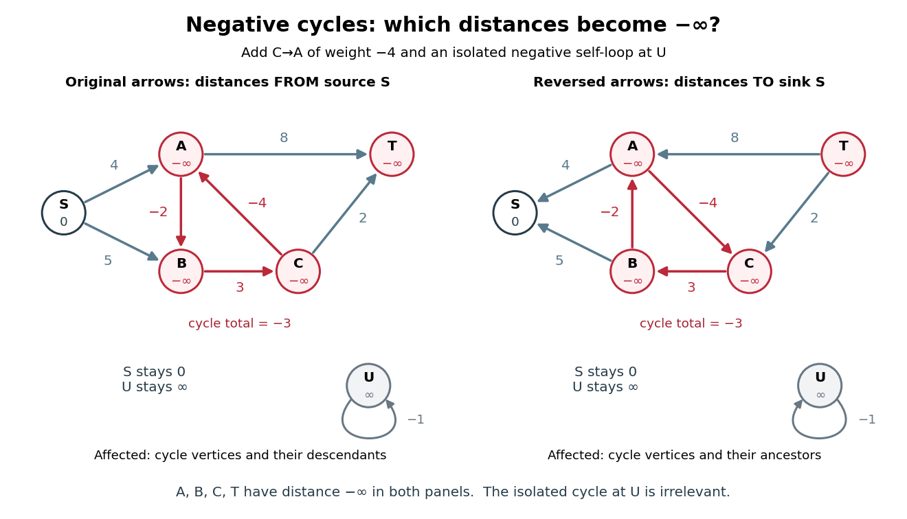
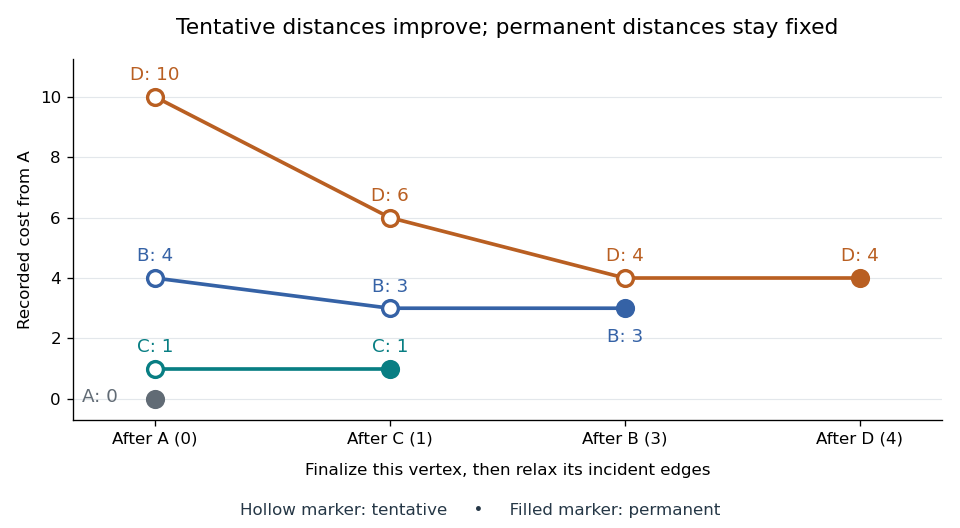

# Shortest path problem

↑ **Parent:** [Graph theory](graph-theory.md)

The [shortest path problem](shortest-path-problem.md) asks for a [graph path](graph-theory.md#path-in-a-graph) from a source [vertex](graph.md#vertex-graph-theory) $s$ to a destination [vertex](graph.md#vertex-graph-theory) $t$ minimizing its total [edge](graph-theory.md#edge-of-a-graph) weight. Here $w_e$ is the cost of traversing [edge](graph-theory.md#edge-of-a-graph) $e$, and costs add along the [graph path](graph-theory.md#path-in-a-graph). If no route exists, its shortest-path distance is $\infty$. With nonnegative [edge](graph-theory.md#edge-of-a-graph) weights, deleting [cycles in a graph](graph-theory.md#cycle-in-a-graph) from a [walk](graph-theory.md#walk-in-a-graph) never increases its cost, so repetitions cannot improve the optimum.

Consider the [undirected graph](graph-theory.md#undirected-graph) with [vertex set](graph.md#vertex-set) $V=\{A,B,C,D\}$ and the six [edge](graph-theory.md#edge-of-a-graph) weights

$$
w_{AB}=4,\quad w_{AC}=1,\quad w_{CB}=2,\quad w_{BD}=1,\quad w_{CD}=5,\quad w_{AD}=10.
$$

Each [edge](graph-theory.md#edge-of-a-graph) can be traversed in either direction at the same cost. The direct [graph path](graph-theory.md#path-in-a-graph) $A,D$ costs $10$; $A,B,D$ costs $4+1=5$; $A,C,D$ costs $1+5=6$. The cheapest [graph path](graph-theory.md#path-in-a-graph) is $A,C,B,D$, costing $1+2+1=4$. The remaining [graph path](graph-theory.md#path-in-a-graph) $A,B,C,D$ costs $11$, exhausting the possibilities without repeated [vertices](graph.md#vertex-graph-theory).

**[Figure 1](#image-the-shortest-path-problem-three-highlighted-edges-cost-less-than-the-direct-connection). The shortest path problem: three highlighted edges cost less than the direct connection**.

Thus fewest [edges](graph-theory.md#edge-of-a-graph) and least total cost are different objectives. [Breadth-first search](tree-graph-theory.md#breadth-first-search) minimizes the number of [edges](graph-theory.md#edge-of-a-graph), which suffices when every [edge](graph-theory.md#edge-of-a-graph) has the same positive cost. Unequal nonnegative costs call for the [Dijkstra algorithm](#dijkstra-algorithm). On a map, weights might be minutes rather than kilometres: a longer-looking route can arrive sooner. This is why a [weighted graph](random-walk.md#weighted-graph) separates the network's connections from what a particular journey costs.

**Table of contents**

- [Shortest path](#shortest-path)
- [Label-setting shortest-path algorithm](#label-setting-shortest-path-algorithm)
- [Bellman inequalities](#bellman-inequalities)
- [Label-correcting shortest-path algorithm](#label-correcting-shortest-path-algorithm)
- [Bellman-Ford algorithm](#bellman-ford-algorithm)
  - [Synchronous Bellman-Ford recurrence](#synchronous-bellman-ford-recurrence)
  - [Bellman-Ford negative-cycle detection](#bellman-ford-negative-cycle-detection)
  - [All-to-one Bellman-Ford recurrence](#all-to-one-bellman-ford-recurrence)
- [Dijkstra algorithm](#dijkstra-algorithm)
  - [Tentative distance](#tentative-distance)
  - [Edge relaxation](#edge-relaxation)
  - [Shortest-path predecessor](#shortest-path-predecessor)

## Shortest path

↑ **Parent:** [Shortest path problem](shortest-path-problem.md)

A [graph path](graph-theory.md#path-in-a-graph) of minimum total edge weight between its endpoints, among the permitted paths. In an unweighted graph, its weight is the number of edges. A shortest path need not be unique.

## Label-setting shortest-path algorithm

↑ **Parent:** [Shortest path problem](shortest-path-problem.md)

An algorithm that makes each vertex's distance permanent once it is selected. With nonnegative [directed edge](graph-theory.md#directed-edge) lengths, the [Dijkstra algorithm](#dijkstra-algorithm) selects the unfinalized vertex with least tentative distance; a shorter route through another unfinalized vertex is impossible because its remaining route has at least that next tentative distance. For an all-to-one problem, incoming [directed edges](graph-theory.md#directed-edge) to the selected vertex are relaxed. Negative lengths can invalidate this finalization argument.

## Bellman inequalities

↑ **Parent:** [Shortest path problem](shortest-path-problem.md)

The Bellman inequalities turn local [directed edge](graph-theory.md#directed-edge) checks into a global certificate for the [shortest path problem](shortest-path-problem.md). Here the convention is _all-to-one_: every journey ends at a fixed [vertex](graph.md#vertex-graph-theory) $r$, and $c_{ij}$ is the cost of the original [directed edge](graph-theory.md#directed-edge) $i\to j$. Work in a finite [directed graph](graph-theory.md#directed-graph) with finite real costs. Write $L_i$ for candidate labels, normalized by $L_r=0$, on the [vertices](graph.md#vertex-graph-theory) that can reach $r$. A feasible potential means precisely that these finite labels satisfy

$$
L_i\le c_{ij}+L_j
$$

for every [directed edge](graph-theory.md#directed-edge) within that set. These labels give [lower bounds](set.md#lower-bound-in-a-partially-ordered-set) on costs _to_ $r$. A discovered [directed path](graph-theory.md#directed-path) of cost $U_i$ instead gives an [upper bound](set.md#upper-bound-in-a-partially-ordered-set). The following constructed [graph](graph.md) shows both bounds and the exact distances between them; its weights are illustrative costs, not measured travel data.

**[Figure 2](#image-bellman-inequalities-and-explicit-directed-paths-certify-distances-to-r-from-opposite-sides). Bellman inequalities and explicit directed paths certify distances to $r$ from opposite sides**.

The arrows in the picture point toward the destination, whereas [edge relaxation](#edge-relaxation) propagates an improved label in the opposite direction: an improved $d_j$ can lower $d_i$. In the pictured [graph](graph.md), the [directed paths](graph-theory.md#directed-path) from $a$ to $r$ cost $7$, $2+3=5$, and $2-2+4=4$. Thus $\delta(a,r)=4$. The candidate $L=(3,1,3,0)$ in [vertex](graph.md#vertex-graph-theory) order $(a,b,c,r)$ is feasible, but underestimates the exact distances $(4,2,4,0)$. Merely satisfying the [Bellman inequalities](#bellman-inequalities) does not make a candidate exact.

Why do they give [lower bounds](set.md#lower-bound-in-a-partially-ordered-set)? Along any [directed path](graph-theory.md#directed-path) $i=v_0\to v_1\to\cdots\to v_k=r$, successive substitution gives

$$
L_i\le\sum_{\ell=0}^{k-1}c_{v_\ell v_{\ell+1}}+L_r=\sum_{\ell=0}^{k-1}c_{v_\ell v_{\ell+1}}.
$$

The same calculation works for a [directed walk](graph-theory.md#directed-walk), with repeated [vertices](graph.md#vertex-graph-theory) allowed. Taking the [infimum](real-analysis.md#infimum) of route costs gives $L_i\le\delta(i,r)$. A discovered route gives $\delta(i,r)\le U_i$. If the bounds meet, $L_i=U_i$, they certify an optimum without enumerating routes. Equivalently, check the [Bellman inequalities](#bellman-inequalities) for the proposed distances and exhibit [directed paths](graph-theory.md#directed-path) realizing them. The authored [Bellman-Ford algorithm](#bellman-ford-algorithm) implementation checks the corresponding single-source inequalities and equality on recorded route [edges](graph-theory.md#edge-of-a-graph); reversing every [directed edge](graph-theory.md#directed-edge) gives this all-to-one convention.[Algorithms, 4th edition by Robert Sedgewick and others; Sedgewick and Wayne, BellmanFordSP.java, optimality checks](mathematics-bibliography.md#algorithms-4th-edition-by-robert-sedgewick-and-others/bellmanfordsp-java)

For the exact labels in the picture, the slack $c_{ij}+d_j-d_i$ is respectively $0,3,1,0,0$ on $a\to b$, $a\to r$, $b\to r$, $b\to c$, $c\to r$. Zero slack means equality; the zero-slack [directed path](graph-theory.md#directed-path) $a\to b\to c\to r$ realizes the cost $4$. This is the useful beauty of the certificate: a few local [inequalities](arithmetic.md#inequality-mathematics) rule out every cheaper journey, while one explicit journey attains the bound.

Keep unreachable [vertices](graph.md#vertex-graph-theory) separate: $\delta(i,r)=\infty$ when no [directed path](graph-theory.md#directed-path) to $r$ exists, and a finite [lower bound](set.md#lower-bound-in-a-partially-ordered-set) alone cannot certify that fact. Extended labels can use $\infty+c=\infty$ for finite $c$, but never compute a slack as $\infty-\infty$. If $i$ can reach a negative-cost [directed cycle](graph-theory.md#directed-cycle) and then reach $r$, repeatedly traversing the [directed cycle](graph-theory.md#directed-cycle) makes route costs unbounded below: their [infimum](real-analysis.md#infimum) is $-\infty$, with no finite shortest [directed walk](graph-theory.md#directed-walk). A finite feasible potential on such a [directed cycle](graph-theory.md#directed-cycle) is impossible, since summing its [Bellman inequalities](#bellman-inequalities) would give $0\le\sum c_{ij}<0$. A negative-cost [directed cycle](graph-theory.md#directed-cycle) that cannot reach $r$ does not affect distances to $r$. These are statements about unrestricted [directed walks](graph-theory.md#directed-walk); requiring a [directed path](graph-theory.md#directed-path) with no repeated [vertices](graph.md#vertex-graph-theory) is a different optimization problem when negative-cost [directed cycles](graph-theory.md#directed-cycle) exist.[6.006 Introduction to Algorithms, Fall 2011 by Massachusetts Institute of Technology, 6.006 course staff; MIT 6.006, Lecture 17, pp. 1 and 5: relevant negative cycles and simple paths](computer-science-bibliography.md#6-006-introduction-to-algorithms-fall-2011-by-massachusetts-institute-of-technology-6-006-course-staff/lecture-17-shortest-paths-iii-bellman-ford)

For the single-source convention, the same original [directed edge](graph-theory.md#directed-edge) $u\to v$ instead gives $L(v)\le L(u)+w_{uv}$ with $L(s)=0$, a [lower bound](set.md#lower-bound-in-a-partially-ordered-set) on distance _from_ $s$. The endpoint carrying the label on the left therefore changes with the direction of the problem.

## Label-correcting shortest-path algorithm

↑ **Parent:** [Shortest path problem](shortest-path-problem.md)

An algorithm whose tentative distance labels may be revised repeatedly until all relevant [Bellman inequalities](#bellman-inequalities) hold. [Bellman-Ford algorithm](#bellman-ford-algorithm) uses this approach: a label is an upper bound supplied by a discovered [directed path](graph-theory.md#directed-path), and relaxing an [directed edge](graph-theory.md#directed-edge) can replace it with a shorter discovered [directed path](graph-theory.md#directed-path). A finite label is not declared permanent merely because it has been processed.

## Bellman-Ford algorithm

↑ **Parent:** [Shortest path problem](shortest-path-problem.md)  
ⓦ [Wiki](https://en.wikipedia.org/wiki/Bellman-Ford_algorithm)

The [Bellman-Ford algorithm](#bellman-ford-algorithm) solves the single-source [shortest path problem](shortest-path-problem.md) in a finite [directed graph](graph-theory.md#directed-graph) with finite real [edge](graph-theory.md#edge-of-a-graph) weights, allowing negative weights. It repeatedly applies [edge relaxation](#edge-relaxation), so an improved [tentative distance](#tentative-distance) can improve its neighbours on a later visit. This makes it a [label-correcting shortest-path algorithm](#label-correcting-shortest-path-algorithm).[Algorithms, 4th edition by Robert Sedgewick and others; Robert Sedgewick and Kevin Wayne, BellmanFordSP.java, signed-weight single-source solver and queue-based relaxation](mathematics-bibliography.md#algorithms-4th-edition-by-robert-sedgewick-and-others/bellmanfordsp-java) If no negative-cost [directed cycle](graph-theory.md#directed-cycle) is reachable from the source, at most $|V|-1$ complete passes suffice for all distances; a further check detects a reachable negative-cost [directed cycle](graph-theory.md#directed-cycle).[6.006 Introduction to Algorithms, Fall 2011 by Massachusetts Institute of Technology, 6.006 course staff; MIT 6.006, Lecture 17, pp. 3–4: complete-pass algorithm, proof and reachable-cycle corollary](computer-science-bibliography.md#6-006-introduction-to-algorithms-fall-2011-by-massachusetts-institute-of-technology-6-006-course-staff/lecture-17-shortest-paths-iii-bellman-ford)

There are two orientations to keep distinct. The usual single-source problem asks for distances _from_ $s$, extending routes along outgoing [directed edges](graph-theory.md#directed-edge). The [Bellman inequalities](#bellman-inequalities) above instead concern distances _to_ a sink $r$, prepending incoming [directed edges](graph-theory.md#directed-edge) to known routes. The [All-to-one Bellman-Ford recurrence](#all-to-one-bellman-ford-recurrence) below preserves that convention. Reversing every [directed edge](graph-theory.md#directed-edge), with its weight unchanged, converts one problem into the other.

Here is an original single-source example with source $S$, [vertex set](graph.md#vertex-set) $V=\{S,A,B,C,T\}$, and precisely these [directed edges](graph-theory.md#directed-edge):

$$
w_{SA}=4,\qquad w_{SB}=5,\qquad w_{AB}=-2,\qquad w_{BC}=3,\qquad w_{CT}=2,\qquad w_{AT}=8.
$$

The negative [edge](graph-theory.md#edge-of-a-graph) $A\to B$ is harmless: this [directed graph](graph-theory.md#directed-graph) has no [directed cycle](graph-theory.md#directed-cycle). Its best route to $T$ is $S\to A\to B\to C\to T$, of cost $4-2+3+2=7$. The other routes to $T$ cost $12$ through $S,A,T$ and $10$ through $S,B,C,T$.

**[Figure 3](#image-four-in-place-bellman-ford-algorithm-passes-propagate-an-improvement-across-a-negative-weight-edge). Four in-place Bellman-Ford algorithm passes propagate an improvement across a negative-weight edge**.

Initialize $d(S)=0$ and the other [tentative distances](#tentative-distance) to $\infty$. In each pass apply single-source [edge relaxation](#edge-relaxation), $d(v)\gets\min\{d(v),d(u)+w_{uv}\}$, scanning in the order $A\to T$, $C\to T$, $B\to C$, $A\to B$, $S\to B$, $S\to A$. Skip a candidate with $d(u)=\infty$. The figure records labels _after_ each complete pass and uses current labels immediately: it is an in-place trace. In pass 2, $B\to C$ still uses $d(B)=5$, giving $8$; only later does $A\to B$ lower $B$ to $2$. Pass 3 carries that improvement to $C$, and pass 4 carries it to $T$. The final labels in order $(S,A,B,C,T)$ are $(0,4,2,5,7)$; the final [shortest-path predecessors](#shortest-path-predecessor) are $S,A,B,C$ for $A,B,C,T$ respectively.

The scan order explains the delay. Scanning instead as $S\to A$, $S\to B$, $A\to B$, $B\to C$, $C\to T$, $A\to T$ gives those same final labels in just one in-place pass. The [Synchronous Bellman-Ford recurrence](#synchronous-bellman-ford-recurrence) has a precise bound on the number of [edges](graph-theory.md#edge-of-a-graph) used by a recorded route; an in-place pass can propagate along several [edges](graph-theory.md#edge-of-a-graph) and need not have that interpretation. Both implementations have the $|V|-1$ pass guarantee under the stated no-reachable-negative-cycle hypothesis.

With a stored list of [edges](graph-theory.md#edge-of-a-graph), complete-pass [Bellman-Ford algorithm](#bellman-ford-algorithm) has [time complexity](theoretical-computer-science.md#time-complexity) $O(|V||E|+|V|)$ and uses $O(|V|)$ extra space for labels and [shortest-path predecessors](#shortest-path-predecessor), using [Big O notation](real-analysis.md#big-o-notation) and constant-cost arithmetic. The extra $|V|$ accounts for initialization even when $E$ is empty. A pass with no strict decrease permits early termination. A queue variant instead revisits outgoing [edges](graph-theory.md#edge-of-a-graph) of [vertices](graph.md#vertex-graph-theory) whose labels improved; the authored implementation provides this alternative and has $O(|V||E|)$ worst-case running time on its usual nontrivial instances.[Algorithms, 4th edition by Robert Sedgewick and others; Robert Sedgewick and Kevin Wayne, BellmanFordSP.java, class documentation, constructor and relax method](mathematics-bibliography.md#algorithms-4th-edition-by-robert-sedgewick-and-others/bellmanfordsp-java) For nonnegative weights, the [Dijkstra algorithm](#dijkstra-algorithm) and its existing distance-frontier figure explain how permanent labels can avoid these repeated passes; the existing [edge relaxation](#edge-relaxation) figure illustrates one update at a time.

### Synchronous Bellman-Ford recurrence

↑ **Parent:** [Bellman-Ford algorithm](#bellman-ford-algorithm)

For the single-source problem, let $D_k(v)$ be the minimum cost of a [directed walk](graph-theory.md#directed-walk) from $s$ to $v$ using at most $k$ [edges](graph-theory.md#edge-of-a-graph). Set $D_0(s)=0$ and $D_0(v)=\infty$ for $v\ne s$, use $\infty+c=\infty$ for finite $c$, and let a [minimum](set.md#minimum-of-a-subset-of-a-total-order) over an empty [set](set.md) be $\infty$. Then

$$
D_k(v)=\min\left\{D_{k-1}(v),\ \min_{(u,v)\in E}\bigl(D_{k-1}(u)+w_{uv}\bigr)\right\}.
$$

Every entry on the right comes from the previous round, requiring separate old and new arrays. The proof is the last-[edge](graph-theory.md#edge-of-a-graph) decomposition: a permitted [directed walk](graph-theory.md#directed-walk) either already uses at most $k-1$ [edges](graph-theory.md#edge-of-a-graph), or ends with some $u\to v$ after a prefix using at most $k-1$. Conversely, each candidate describes a permitted [directed walk](graph-theory.md#directed-walk). This [dynamic programming](mathematical-optimization.md#dynamic-programming) viewpoint gives an exact meaning to every intermediate label, even when negative-cost [directed cycles](graph-theory.md#directed-cycle) exist. Apply the formula to the source too: its initial zero is not a permanent constraint.

If no negative-cost [directed cycle](graph-theory.md#directed-cycle) is reachable from $s$, removing repeated-[vertex](graph.md#vertex-graph-theory) portions of a [directed walk](graph-theory.md#directed-walk) cannot increase its cost. Whenever a destination is reachable, some shortest [directed path](graph-theory.md#directed-path) therefore uses at most $|V|-1$ [edges](graph-theory.md#edge-of-a-graph), and $D_{|V|-1}(v)=\delta(s,v)$. Unreachable [vertices](graph.md#vertex-graph-theory) keep distance $\infty$. For in-place passes, every finite label still comes from a discovered [directed walk](graph-theory.md#directed-walk); moreover, pass $k$ has offered every prefix of length $k$ of a shortest [directed path](graph-theory.md#directed-path), regardless of scan order. Its labels can improve faster than the synchronous labels, while the same $|V|-1$ upper bound on passes remains valid. This is why repeated local corrections eventually settle a global [shortest path problem](shortest-path-problem.md).

### Bellman-Ford negative-cycle detection

↑ **Parent:** [Bellman-Ford algorithm](#bellman-ford-algorithm)

A negative-cost [directed cycle](graph-theory.md#directed-cycle) matters to a particular destination $v$ precisely when it is reachable from $s$ and can itself reach $v$.[6.006 Introduction to Algorithms, Fall 2011 by Massachusetts Institute of Technology, 6.006 course staff; MIT 6.006, Lecture 17, p. 1: cycle between source and destination; p. 4: reachable-cycle corollary](computer-science-bibliography.md#6-006-introduction-to-algorithms-fall-2011-by-massachusetts-institute-of-technology-6-006-course-staff/lecture-17-shortest-paths-iii-bellman-ford) Repeating it $m$ times adds $m$ times its negative total cost to a route. Thus the [infimum](real-analysis.md#infimum) of [directed walk](graph-theory.md#directed-walk) costs is $-\infty$, rather than the cost of a finite shortest [directed walk](graph-theory.md#directed-walk). The distinction is about [reachability](graph.md#reachability-in-a-graph), not simply the presence of a negative [edge](graph-theory.md#edge-of-a-graph) or a negative-cost [directed cycle](graph-theory.md#directed-cycle) anywhere in the [graph](graph.md).

Add $C\to A$ of weight $-4$ to the worked example. Now $A\to B\to C\to A$ has total weight $-2+3-4=-3$. Add also an isolated [vertex](graph.md#vertex-graph-theory) $U$ with a [self-loop](graph.md#loop-graph-theory) of weight $-1$. From $S$, the distances of $A,B,C,T$ are $-\infty$, because all four are reachable from the first negative-cost [directed cycle](graph-theory.md#directed-cycle). The source retains distance $0$: no [directed edge](graph-theory.md#directed-edge) leads back to $S$. The unreachable $U$ retains distance $\infty$, despite its negative-cost [self-loop](graph.md#loop-graph-theory).

**[Figure 4](#image-relevant-negative-cost-directed-cycles-descendants-from-a-source-become-ancestors-when-every-directed-edge-is-reversed). Relevant negative-cost directed cycles: descendants from a source become ancestors when every directed edge is reversed**.

For example, $m$ extra laps before proceeding to $T$ give costs $7-3m$. This construction also shows why requiring a [directed path](graph-theory.md#directed-path) with no repeated [vertices](graph.md#vertex-graph-theory) would change the problem: only [directed walks](graph-theory.md#directed-walk) permit arbitrarily many laps. Merely finding one reachable negative-cost [directed cycle](graph-theory.md#directed-cycle) does not justify setting every reachable label to $-\infty$; $S$ in the figure is a counterexample.

To detect and classify, perform $|V|-1$ full passes without clamping any label, then test all [directed edges](graph-theory.md#directed-edge) against a fixed copy of the resulting labels. Collect heads $v$ of [edges](graph-theory.md#edge-of-a-graph) $u\to v$ satisfying $d(u)<\infty$ and $d(u)+w_{uv}<d(v)$. An empty collection certifies that no negative-cost [directed cycle](graph-theory.md#directed-cycle) is reachable from $s$. Otherwise run [graph search](graph.md#graph-search) forwards from all collected [vertices](graph.md#vertex-graph-theory): precisely the reached [vertices](graph.md#vertex-graph-theory) have distance $-\infty$. A [vertex](graph.md#vertex-graph-theory) unreachable from $s$ still has distance $\infty$; each remaining [vertex](graph.md#vertex-graph-theory) has its finite shortest distance.

Why is this classification exact? Every unaffected reachable [vertex](graph.md#vertex-graph-theory) already has its shortest distance after $|V|-1$ passes, since any route ending there avoids reachable negative-cost [directed cycles](graph-theory.md#directed-cycle). Thus it cannot be the head of a strict improvement, or be reached from such a head. Conversely, all [vertices](graph.md#vertex-graph-theory) on a reachable negative-cost [directed cycle](graph-theory.md#directed-cycle) have finite labels by that time. If none of its [edges](graph-theory.md#edge-of-a-graph) could improve a label, summing $d(v)\le d(u)+w_{uv}$ around it would imply $0\le\sum w_{uv}<0$. At least one of its heads is therefore collected, and the forward [graph search](graph.md#graph-search) reaches the entire [directed cycle](graph-theory.md#directed-cycle) and every affected descendant. Detecting a [directed cycle](graph-theory.md#directed-cycle) alone and marking its descendants are separate tasks; finite intermediate labels in the affected region are not answers.

### All-to-one Bellman-Ford recurrence

↑ **Parent:** [Bellman-Ford algorithm](#bellman-ford-algorithm)

Keep the original all-to-one orientation of the [Bellman inequalities](#bellman-inequalities): $d_i^{(k)}$ concerns routes _from_ $i$ _to_ a fixed sink $r$, and $c_{ij}$ belongs to the original [directed edge](graph-theory.md#directed-edge) $i\to j$. Initialize $d_r^{(0)}=0$ and $d_i^{(0)}=\infty$ for $i\ne r$. The synchronous [dynamic programming](mathematical-optimization.md#dynamic-programming) recurrence is

$$
d_i^{(k)}=\min\left\{d_i^{(k-1)},\ \min_{(i,j)\in E}\bigl(c_{ij}+d_j^{(k-1)}\bigr)\right\}.
$$

It prepends the first [edge](graph-theory.md#edge-of-a-graph) of a route instead of appending the last: $d_i^{(k)}$ is the minimum cost of a [directed walk](graph-theory.md#directed-walk) from $i$ to $r$ using at most $k$ [edges](graph-theory.md#edge-of-a-graph). In particular, improving $d_j$ can improve labels on incoming [directed edges](graph-theory.md#directed-edge) $i\to j$. The same original [directed edge](graph-theory.md#directed-edge) therefore updates its tail in this convention, whereas single-source [edge relaxation](#edge-relaxation) updates its head.

If no negative-cost [directed cycle](graph-theory.md#directed-cycle) can reach $r$, $|V|-1$ rounds suffice for every distance to $r$, and $d_r^{(k)}=0$ automatically. This hypothesis concerns [directed paths](graph-theory.md#directed-path) _from the cycle to the sink_, not paths from the sink to the cycle. In the base example with its original arrows and sink $T$, the distances in order $(S,A,B,C,T)$ are $(7,3,5,2,0)$. Once $C\to A$ of weight $-4$ is added, $S,A,B,C$ instead have distance $-\infty$ to $T$, while $T$ keeps distance $0$ and $U$ keeps $\infty$.

More generally, $\delta(i,r)=-\infty$ precisely when $i$ can reach a negative-cost [directed cycle](graph-theory.md#directed-cycle) that can reach $r$. Thus the affected [vertices](graph.md#vertex-graph-theory) are the ancestors of such a [directed cycle](graph-theory.md#directed-cycle). A negative-cost [directed cycle](graph-theory.md#directed-cycle) unable to reach $r$ is irrelevant. Reversing all arrows makes $r$ a single source, turns these ancestors into descendants, and makes the detection and forward [graph search](graph.md#graph-search) above directly applicable. The right panel of the figure uses that reversal with sink $S$; its distances to $S$ equal the left panel's distances from $S$.

Do not force the root to remain zero outside the hypothesis. Consider the two [directed edges](graph-theory.md#directed-edge) $r\to a$ of cost $0$ and $a\to r$ of cost $-1$, with sink $r$. The recurrence gives $d_a^{(1)}=-1$ and $d_r^{(2)}=-1$: the latter records one lap of a negative-cost [directed cycle](graph-theory.md#directed-cycle) through $r$. Repetition makes both unrestricted distances $-\infty$. Clamping $d_r$ at zero and omitting its update would instead leave the stationary labels $(d_r,d_a)=(0,-1)$, concealing that behaviour. Initialization specifies the cost of the empty [directed walk](graph-theory.md#directed-walk); it does not forbid cheaper nonempty returns to the root. Cycle detection must test every relevant [directed edge](graph-theory.md#directed-edge), including those whose relaxation updates the root.

## Dijkstra algorithm

↑ **Parent:** [Shortest path problem](shortest-path-problem.md)  
ⓦ [Wiki](https://en.wikipedia.org/wiki/Dijkstra's_algorithm)

The [Dijkstra algorithm](#dijkstra-algorithm) solves the single-source [shortest path problem](shortest-path-problem.md) in a finite [graph](graph.md) with nonnegative [edge](graph-theory.md#edge-of-a-graph) weights, finding distances to all reachable [vertices](graph.md#vertex-graph-theory). Start with [tentative distance](#tentative-distance) $d(A)=0$ and $d(v)=\infty$ elsewhere. Repeatedly choose the unfinalized [vertex](graph.md#vertex-graph-theory) with least [tentative distance](#tentative-distance), declare that label permanent, and perform [edge relaxation](#edge-relaxation) on its outgoing [edges](graph-theory.md#edge-of-a-graph). For an [undirected graph](graph-theory.md#undirected-graph), inspect both directions. A finite [tentative distance](#tentative-distance) always records the cost of a discovered [graph path](graph-theory.md#path-in-a-graph), but can improve before finalization.

In our example, finalizing $A$ discovers $C$ at $1$, $B$ at $4$, and $D$ at $10$. Choose $C$ next: [edge relaxation](#edge-relaxation) through $C$ lowers $B$ to $1+2=3$ and $D$ to $1+5=6$. Choose $B$: [edge relaxation](#edge-relaxation) through $B$ lowers $D$ to $3+1=4$. Finally choose $D$. The permanent distances are therefore $A:0$, $C:1$, $B:3$, $D:4$; the evolving [tentative distances](#tentative-distance) were $B:4\to3$ and $D:10\to6\to4$.

**[Figure 5](#image-tentative-distances-fall-until-the-dijkstra-algorithm-makes-each-label-permanent). Tentative distances fall until the Dijkstra algorithm makes each label permanent**.

Store a [shortest-path predecessor](#shortest-path-predecessor) whenever [edge relaxation](#edge-relaxation) improves a label. The final table contains enough information to reconstruct routes, rather than merely their costs:

| [Vertex](graph.md#vertex-graph-theory) | Distance from $A$ | [Shortest-path predecessor](#shortest-path-predecessor) | Finalization order |
| --- | --- | --- | --- |
| $A$ | $0$ | None: source | $1$ |
| $C$ | $1$ | $A$ | $2$ |
| $B$ | $3$ | $C$ | $3$ |
| $D$ | $4$ | $B$ | $4$ |

Following [shortest-path predecessors](#shortest-path-predecessor) backwards gives $D,B,C,A$; reversing the order gives $A,C,B,D$. If only this destination matters, stop when $D$ is finalized. Stopping when $D$ is first discovered would incorrectly return $10$. If the smallest remaining [tentative distance](#tentative-distance) is $\infty$, all remaining [vertices](graph.md#vertex-graph-theory) are unreachable.

Why is the permanent choice safe? Suppose the selected [vertex](graph.md#vertex-graph-theory) $u$ had a cheaper [graph path](graph-theory.md#path-in-a-graph). Let $y$ be the first unfinalized [vertex](graph.md#vertex-graph-theory) on that [graph path](graph-theory.md#path-in-a-graph). Its preceding [vertex](graph.md#vertex-graph-theory) was finalized, so [edge relaxation](#edge-relaxation) has already offered $y$ a label no larger than that prefix's cost. Nonnegative remaining [edge](graph-theory.md#edge-of-a-graph) weights make the whole cost at least this prefix's cost; selection gives $d(u)\le d(y)$. A cheaper [graph path](graph-theory.md#path-in-a-graph) would contradict these comparisons. Zero weights are allowed; ties can be resolved arbitrarily. This is the reason the [label-setting shortest-path algorithm](#label-setting-shortest-path-algorithm) works, rather than a lucky feature of the drawing.

Negative weights break that reasoning. In a [directed graph](graph-theory.md#directed-graph) with $s\to u$ costing $2$, $s\to v$ costing $5$, and $v\to u$ costing $-4$, the [Dijkstra algorithm](#dijkstra-algorithm) would finalize $u$ at $2$ before discovering the cheaper cost $1$. The [Bellman-Ford algorithm](#bellman-ford-algorithm) handles negative [edge](graph-theory.md#edge-of-a-graph) weights when no relevant negative [directed cycle](graph-theory.md#directed-cycle) exists.

With an [adjacency list](data-structure.md#adjacency-list) and an indexed [binary heap](data-structure.md#binary-heap) implementing a [priority queue](data-structure.md#priority-queue), the [time complexity](theoretical-computer-science.md#time-complexity) is $O((|V|+|E|)\log |V|)$ for $|V|\ge2$, using [Big O notation](real-analysis.md#big-o-notation). Each [vertex](graph.md#vertex-graph-theory) is extracted at most once, each [edge](graph-theory.md#edge-of-a-graph) is inspected once per direction, and each successful [edge relaxation](#edge-relaxation) decreases a heap key in $O(\log |V|)$ time. This assumes constant-cost arithmetic and comparisons; exact computation with very large weights adds their representation cost. The queue uses $O(|V|)$ space beyond the [graph](graph.md). Simply scanning all remaining [vertices](graph.md#vertex-graph-theory) gives $O(|V|^2+|E|)$ instead.[Princeton, DijkstraSP implementation](https://algs4.cs.princeton.edu/44sp/DijkstraSP.java.html)[Princeton, indexed binary heap operations](https://algs4.cs.princeton.edu/code/javadoc/edu/princeton/cs/algs4/IndexMinPQ.html)

The 1959 paper presents the [shortest path problem](shortest-path-problem.md) as its second problem, after the [minimum spanning tree](tree-graph-theory.md#minimum-spanning-tree) problem, and grows known shortest routes in increasing distance order.[Dijkstra, A note on two problems in connexion with graphs, pp. 269–271](https://www.cs.yale.edu/homes/lans/readings/routing/dijkstra-routing-1959.pdf) In his later recollection, Dijkstra dated the shortest-route discovery to 1956: a demonstration for the ARMAC computer used a simplified Dutch railway map and printed the route between towns. A practical request became an enduring [algorithm](algorithm.md) because the same distance rule applies to any suitable [graph](graph.md).[Dijkstra's recollection, published in 1983](https://garfield.library.upenn.edu/classics1983/A1983QA19900001.pdf)

### Tentative distance

↑ **Parent:** [Dijkstra algorithm](#dijkstra-algorithm)

A tentative distance $d(v)$ is the cheapest cost so far recorded by a [shortest path problem](shortest-path-problem.md) [algorithm](algorithm.md). For the single-source convention, initialize $d(s)=0$ and $d(v)=\infty$ elsewhere. Every finite label is the cost of a discovered route from $s$ to $v$, so

$$
\delta(s,v)\le d(v).
$$

It is an [upper bound](set.md#upper-bound-in-a-partially-ordered-set) supplied by an actual route, not a guess that might be too low. The [loop invariant](algorithm.md#loop-invariant) follows directly from [edge relaxation](#edge-relaxation): extending a discovered route to $u$ by $u\to v$ supplies another discovered route. The usual label initialization and this safety property are stated and proved in the authored MIT notes.[MIT 6.006, Lecture 16, p. 1: relaxation safety](https://ocw.mit.edu/courses/6-006-introduction-to-algorithms-fall-2011/6277a1f06100c26a7ff21031af6757b5_MIT6_006F11_lec16.pdf)

In the trace under [edge relaxation](#edge-relaxation), $d(t)=10$ first records the direct [directed path](graph-theory.md#directed-path) $s\to t$. Later $d(t)=8$ records $s\to a\to t$, and finally $d(t)=3$ records $s\to b\to a\to t$. Each label is a usable route cost, but the first two are not shortest. An infinite [tentative distance](#tentative-distance) means no route has yet been discovered; only a completed search establishes unreachability. The isolated [vertex](graph.md#vertex-graph-theory) $z$ in that example remains at $\infty$.

In a [directed graph](graph-theory.md#directed-graph), the discovered route is formally a [directed walk](graph-theory.md#directed-walk), which may repeat [vertices](graph.md#vertex-graph-theory); in the pictured acyclic [graph](graph.md) it is always a [directed path](graph-theory.md#directed-path). Negative-cost [directed cycles](graph-theory.md#directed-cycle) can keep supplying cheaper [directed walks](graph-theory.md#directed-walk) without a finite optimum. In the all-to-one convention, the same meaning applies to discovered routes _from_ $i$ _to_ $r$. Do not confuse either version with the [lower bounds](set.md#lower-bound-in-a-partially-ordered-set) supplied by feasible potentials in the [Bellman inequalities](#bellman-inequalities): one records something achievable, the other rules out anything cheaper.

### Edge relaxation

↑ **Parent:** [Dijkstra algorithm](#dijkstra-algorithm)

Edge relaxation tests whether extending a recorded route by one [directed edge](graph-theory.md#directed-edge) improves a [tentative distance](#tentative-distance). For a single source $s$ and an original [directed edge](graph-theory.md#directed-edge) $u\to v$ of weight $w_{uv}$, form the candidate $q=d(u)+w_{uv}$. If $d(u)$ is finite and $q<d(v)$, replace $d(v)$ by $q$ and record the [shortest-path predecessor](#shortest-path-predecessor) $\pi(v)=u$. Otherwise leave both unchanged. The [minimum](set.md#minimum-of-a-subset-of-a-total-order) formula in the header gives the resulting label in either case. The authored implementation uses this strict comparison and records the incoming [directed edge](graph-theory.md#directed-edge).[Sedgewick and Wayne, DijkstraSP.java, relax method](https://raw.githubusercontent.com/kevin-wayne/algs4/master/src/main/java/edu/princeton/cs/algs4/DijkstraSP.java)

**[Figure 6](#image-edge-relaxation-lowers-discovered-route-costs-including-across-a-negative-weight-directed-edge). Edge relaxation lowers discovered-route costs, including across a negative-weight directed edge**.

The table lists labels _after_ each specified operation, keeping $d(s)=0$ throughout this constructed acyclic [graph](graph.md). Relaxing $a\to t$ first offers $6+2=8$. Relaxing $b\to a$ then offers $2-1=1$, lowering $a$ from $6$ to $1$; revisiting $a\to t$ now offers $1+2=3$. Finally $b\to t$ offers $2+7=9$, so the label $3$ stays. Changing a label can make a previously checked outgoing [directed edge](graph-theory.md#directed-edge) worth checking again. This trace illustrates the operation itself, with a deliberately specified order, rather than a run of the [Dijkstra algorithm](#dijkstra-algorithm).

A single [edge relaxation](#edge-relaxation) does not require nonnegative weights: its candidate is the cost of a real extended [directed walk](graph-theory.md#directed-walk), even when the last [directed edge](graph-theory.md#directed-edge) has negative weight. Nonnegative weights are needed by the [Dijkstra algorithm](#dijkstra-algorithm) to make its selected minimum [tentative distance](#tentative-distance) permanent. The [Bellman-Ford algorithm](#bellman-ford-algorithm) permits negative weights and revisits labels; its authored implementation also checks for reachable negative-cost [directed cycles](graph-theory.md#directed-cycle).[Sedgewick and Wayne, DijkstraSP.java, nonnegative-weight precondition](https://raw.githubusercontent.com/kevin-wayne/algs4/master/src/main/java/edu/princeton/cs/algs4/DijkstraSP.java)[Algorithms, 4th edition by Robert Sedgewick and others; Sedgewick and Wayne, BellmanFordSP.java, signed weights and cycle detection](mathematics-bibliography.md#algorithms-4th-edition-by-robert-sedgewick-and-others/bellmanfordsp-java)

For the all-to-one convention of the [Bellman inequalities](#bellman-inequalities), relax the same original [directed edge](graph-theory.md#directed-edge) $i\to j$ by $d_i\gets\min\{d_i,c_{ij}+d_j\}$. This prepends $i\to j$ to a discovered route from $j$ to $r$, and improves the tail label $d_i$, not the head label $d_j$. Skip the operation when $d_j=\infty$. In exact arithmetic, a full pass over all relevant [directed edges](graph-theory.md#directed-edge) with no improvement establishes all their [Bellman inequalities](#bellman-inequalities); combined with the discovered-route [upper bounds](set.md#upper-bound-in-a-partially-ordered-set), this certifies finite distances. One unsuccessful operation establishes only that this particular candidate did not improve its label at that moment.

### Shortest-path predecessor

↑ **Parent:** [Dijkstra algorithm](#dijkstra-algorithm)

A shortest-path predecessor $\pi(v)$ records the previous [vertex](graph.md#vertex-graph-theory) on a chosen route from source $s$ to $v$. When [edge relaxation](#edge-relaxation) strictly improves $d(v)$ through $u\to v$, set $\pi(v)=u$. For a [multigraph](graph.md#multigraph), store the actual [directed edge](graph-theory.md#directed-edge), since two [edges](graph-theory.md#edge-of-a-graph) with the same endpoints can have different weights. Initialize all [vertices](graph.md#vertex-graph-theory), including the source, without a [shortest-path predecessor](#shortest-path-predecessor). The authored implementation reconstructs a route by following these incoming [edges](graph-theory.md#edge-of-a-graph) backwards, then reversing their order.[Sedgewick and Wayne, DijkstraSP.java, edgeTo and pathTo](https://raw.githubusercontent.com/kevin-wayne/algs4/master/src/main/java/edu/princeton/cs/algs4/DijkstraSP.java)

At the end of the [edge relaxation](#edge-relaxation) trace, $\pi(t)=a$, $\pi(a)=b$, and $\pi(b)=s$. Following them gives $t,a,b,s$, so the forward [directed path](graph-theory.md#directed-path) is $s\to b\to a\to t$, of cost $2-1+2=3$. This makes the distance useful: a number tells us the best cost, whereas the [shortest-path predecessors](#shortest-path-predecessor) tell us which connections to take. In the [Dijkstra algorithm](#dijkstra-algorithm), reconstruct a destination's shortest route after its label becomes permanent. In a [label-correcting shortest-path algorithm](#label-correcting-shortest-path-algorithm), wait for convergence and the appropriate negative-cost [directed cycle](graph-theory.md#directed-cycle) check. During correction, a predecessor's label may have changed since its child's last update: immediately after $b\to a$ in the trace, the current chain to $t$ costs $3$ although $d(t)$ still records the earlier discovered route of cost $8$.

Strict improvement is a useful guard against [directed cycles](graph-theory.md#directed-cycle) in the recorded pointers. Consider $s\to a$ and $s\to b$ of cost zero, followed by $a\to b$ and $b\to a$, also of cost zero. After the first two [edge relaxations](#edge-relaxation), both labels are zero and both [shortest-path predecessors](#shortest-path-predecessor) are $s$. If equality also allows pointer replacement, the last two operations can set $\pi(b)=a$ and $\pi(a)=b$: following pointers loops forever despite correct distance labels. Keeping the old pointer on ties prevents this example; choosing among equal-cost routes requires a separate rule that preserves a route to the source. Strict improvement alone does not protect against reachable negative-cost [directed cycles](graph-theory.md#directed-cycle), which can force endless decreases. Equality on recorded [edges](graph-theory.md#edge-of-a-graph) plus the [Bellman inequalities](#bellman-inequalities) certifies route costs only when the pointer chains actually terminate at the source.

For all-to-one distances to $r$, record a next [vertex](graph.md#vertex-graph-theory) $j$ whenever relaxing $i\to j$ improves $d_i$. Follow these successors forward in the original [directed graph](graph-theory.md#directed-graph) to reach $r$. They are [shortest-path predecessors](#shortest-path-predecessor) when viewed in the reversed [directed graph](graph-theory.md#directed-graph); keeping the direction convention explicit prevents returning a route whose arrows point the wrong way.

## ↑ Ancestors (5)

1. [Graph theory](graph-theory.md)
2. [Foundations of mathematics](foundations-of-mathematics.md)
3. [Area of mathematics](mathematics.md#area-of-mathematics)
4. [Mathematics](mathematics.md)
5. [Codex Wiki](README.md)

## ← Incoming links (13)

- [Bellman-Ford algorithm](#bellman-ford-algorithm)
- [Bellman inequalities](#bellman-inequalities)
- [Breadth-first search](tree-graph-theory.md#breadth-first-search)
- [Dijkstra algorithm](#dijkstra-algorithm)
- [Graph theory](graph-theory.md)
- [Solution](past-exam-of-the-mathematics-course-of-the-university-of-cambridge/2001/iii/paper-31.md#4/solution)
- [Solution](past-exam-of-the-mathematics-course-of-the-university-of-cambridge/2009/iii/paper-35.md#2/solution)
- [Path-constraint separation by shortest paths](convex-optimization.md#path-constraint-separation-by-shortest-paths)
- [Shortest path problem](shortest-path-problem.md)
- [Synchronous Bellman-Ford recurrence](#synchronous-bellman-ford-recurrence)
- [Tentative distance](#tentative-distance)
- [Walk in a graph](graph-theory.md#walk-in-a-graph)
- [Weighted Hamilton cycle](graph-theory.md#weighted-hamilton-cycle)
