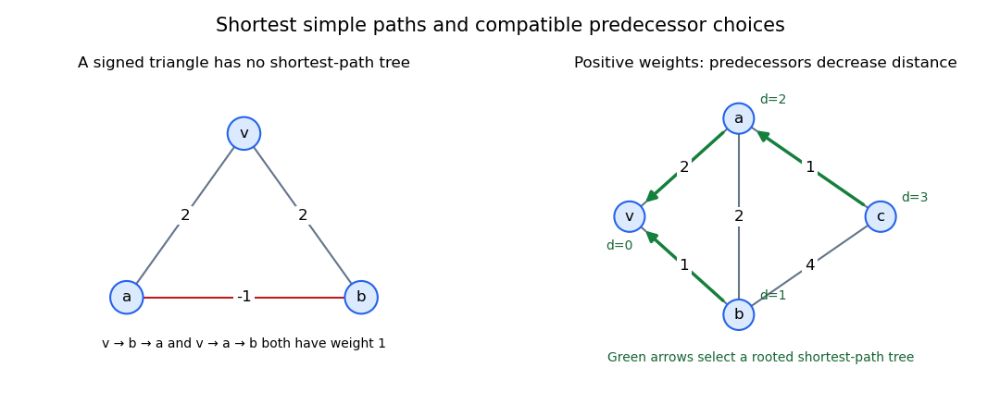

# Shortest-path tree

↑ **Parent:** [Shortest path problem](shortest-path-problem-split.md)

A [shortest-path tree](shortest-path-tree.md) rooted at a source vertex is a [spanning tree](spanning-tree.md) whose unique tree route from the source to every [vertex](vertex-graph-theory.md) solves the [shortest path problem](shortest-path-problem-split.md) in the original [weighted graph](weighted-graph.md). [Dijkstra's algorithm](dijkstra-algorithm.md) constructs one for a finite connected [graph](graph-split.md) with nonnegative [edge](edge-of-a-graph.md) lengths, recording a predecessor whenever a distance improves. It need not be a [minimum spanning tree](minimum-spanning-tree.md): one minimizes each source-route length, the other the total weight of the tree's edges.

**[Figure 2](#image-signed-shortest-paths-can-conflict-positive-predecessor-choices-form-a-tree). Signed shortest paths can conflict; positive predecessor choices form a tree**. Original diagrams and generic model calculations generated by the adjacent Python script.

**Table of contents**

- [Positive-weight shortest-path predecessors form a tree](positive-weight-shortest-path-predecessors-form-a-tree.md)
- [Signed edge weights can prevent a shortest-path tree](signed-edge-weights-can-prevent-a-shortest-path-tree.md)

## ↑ Ancestors (6)

1. [Shortest path problem](shortest-path-problem-split.md)
2. [Graph theory](graph-theory-split.md)
3. [Foundations of mathematics](foundations-of-mathematics-split.md)
4. [Area of mathematics](area-of-mathematics.md)
5. [Mathematics](mathematics-split.md)
6. [Codex Wiki](split.md)

## ← Incoming links (17)

- [Solution](past-exam-of-the-computer-science-course-of-the-university-of-oxford/2015/computer-networks/2/e/solution.md)
- [Solution](past-exam-of-the-short-options-course-of-the-university-of-oxford/2017/7/a/iii/solution.md)
- [Solution](past-exam-of-the-short-options-course-of-the-university-of-oxford/2017/7/b/solution.md)
- [Solution](past-exam-of-the-short-options-course-of-the-university-of-oxford/2017/7/d/ii/solution.md)
- [2021](past-exam-of-the-short-options-course-of-the-university-of-oxford/2021-split.md)
- [Solution](past-exam-of-the-short-options-course-of-the-university-of-oxford/2021/7/a/solution.md)
- [Solution](past-exam-of-the-short-options-course-of-the-university-of-oxford/2021/7/b/solution.md)
- [Solution](past-exam-of-the-short-options-course-of-the-university-of-oxford/2021/7/c/ii/solution.md)
- [Solution](past-exam-of-the-short-options-course-of-the-university-of-oxford/2023/7/a/ii/solution.md)
- [Solution](past-exam-of-the-short-options-course-of-the-university-of-oxford/2023/7/a/iii/solution.md)
- [Solution](past-exam-of-the-short-options-course-of-the-university-of-oxford/2023/7/a/iv/solution.md)
- [Solution](past-exam-of-the-year-1-of-the-computer-science-course-of-the-university-of-oxford/2015/functional-programming-design-and-analysis-of-algorithms/8/b/solution.md)
- [Solution](past-exam-of-the-year-1-of-the-computer-science-course-of-the-university-of-oxford/2019/functional-programming-design-and-analysis-of-algorithms/8/b/solution.md)
- [Positive-weight shortest-path predecessors form a tree](positive-weight-shortest-path-predecessors-form-a-tree.md)
- [Shortest cycle by repeated shortest-path trees](shortest-cycle-by-repeated-shortest-path-trees.md)
- [Shortest-path tree](shortest-path-tree.md)
- [Signed edge weights can prevent a shortest-path tree](signed-edge-weights-can-prevent-a-shortest-path-tree.md)
