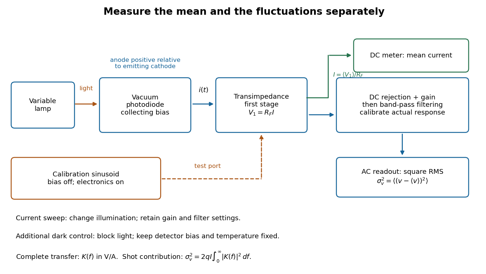

# Shot noise photocurrent measurement

↑ **Parent:** [Shot noise](shot-noise.md)

MIT's guide uses an illuminated [vacuum photodiode](vacuum-photodiode.md), with collecting [anode](anode.md) positive relative to the emitting [cathode](cathode.md). A [transimpedance amplifier](transimpedance-amplifier.md) gives $V_1=R_F I$; a [multimeter](multimeter.md) reads its mean. The fluctuation path rejects below $100\,\mathrm{Hz}$, adds roughly tenfold [voltage gain](voltage-gain.md), then nominal hundredfold preamplification and a $1$–$50\,\mathrm{kHz}$ [band-pass filter](band-pass-filter.md); the readout measures [root mean square](root-mean-square.md) voltage. With diode bias off, a sinusoid at the test port calibrates $g(f)$. Restore bias, retain gain settings, vary lamp brightness, and repeat both readings. The guide warns about overload; it supplies a procedure, not measured results.[pp. 3, 11–12: Fig. 1; §§V–VI, Figs. 6–7](johnson-noise-and-shot-noise-the-determination-of-the-boltzmann-constant-absolute-zero-temperature-and-the-charge-of-the-electron-by-mit-department-of-physics.md)

**[Figure 17](#image-functional-photocurrent-measurement-separate-mean-current-fluctuation-and-calibration-paths). Functional photocurrent measurement: separate mean-current, fluctuation and calibration paths**. Original functional diagram organizing the laboratory's measurement roles; it is not a component-level circuit reproduction. $K(f)$ includes current-to-voltage conversion and the complete fluctuation path. The dark comparison below is an additional control.

The inference can be expressed without relying on nominal passband edges. Let $g(f)$ denote the calibrated voltage transfer after the $R_F$ conversion, so $K(f)=R_Fg(f)$ and define $\mathcal K=\int_0^\infty|K(f)|^2\,df$. Under independent arrivals and an unchanged additive background,

$$
\sigma_{v,\rm measured}^2(I)=2q\mathcal K I+\sigma_{v,\rm background}^2,\qquad
q=\frac{1}{2\mathcal K}\frac{d\sigma_{v,\rm measured}^2}{dI}.
$$

The slope of voltage [variance](variance-split.md) against mean [electric current](electric-current.md) can therefore estimate $q$. A free intercept accounts for a constant background; forcing the line through zero generally biases the slope. The [root mean square](root-mean-square.md) readings must have their mean removed and then be squared. Subtracting two [root mean square](root-mean-square.md) amplitudes does not subtract independent [variances](variance-split.md). Estimate the [variance](variance-split.md) from successive records; averaging the waveforms first would suppress the fluctuation being measured.

Additional controls sharpen this interpretation. Block the [light](light.md) with detector bias, [temperature](temperature-split.md), and gain unchanged; this preserves [dark current](dark-current-physics.md) and electronics while removing [photocurrent](photocurrent.md). Repeat this dark comparison between illumination settings to check drift. If independent dark arrivals have mean magnitude $I_d$ and illuminated arrivals add $I_{\rm ph}$, their spectra add: $2q(I_d+I_{\rm ph})$. Subtracting the unchanged dark [variance](variance-split.md) isolates $2qI_{\rm ph}\mathcal K$. This subtraction model assumes unchanged transfers and [independence](independent-random-variables.md); switching off bias for gain calibration is a different control and need not preserve the dark background.

Vary measured $I_{\rm ph}$ rather than assuming lamp knob position is proportional to [photocurrent](photocurrent.md). Check collection versus bias to identify a range where incomplete collection is negligible; a [space charge](space-charge.md) limited tube can correlate transfers. Verify that the [transimpedance amplifier](transimpedance-amplifier.md) remains linear and that its [frequency response](frequency-response.md) is unchanged over the illumination range. Changing [signal bandwidth](signal-bandwidth.md) should change the excess [variance](variance-split.md) through $\mathcal K$; compare inferred input spectra in several bands. Correlated fluctuations of the light source can add a contribution scaling approximately as $I_{\rm ph}^2$, while an electronics floor can hide the linear term at small [electric currents](electric-current.md). A fitted line over a short range alone does not establish independent transfers.

The gain calibration must include the same detector-to-readout path used for [noise](noise-signal-processing.md), or explicitly supply any omitted transfer. Detector [capacitance](capacitance.md), finite collection time, [amplifier](amplifier.md) voltage and current [noise](noise-signal-processing.md), [thermal electrical noise](thermal-electrical-noise.md), pickup, clipping, and finite recording precision limit the inference. Current-dependent [electrical impedance](electrical-impedance.md) or heating can make a background current-dependent too. Since $\mathcal K$ contains squared gain, a small fractional error in gain produces approximately twice that fractional error in the predicted [variance](variance-split.md) scale. Knowing a nominal gain and two cutoff settings is insufficient.

## ↑ Ancestors (6)

1. [Shot noise](shot-noise.md)
2. [Noise (signal processing)](noise-signal-processing.md)
3. [Signal](signal.md)
4. [Signal processing](signal-processing.md)
5. [Electrical engineering](electrical-engineering-split.md)
6. [Codex Wiki](split.md)

## ← Incoming links (1)

- [Shot noise](shot-noise.md)
