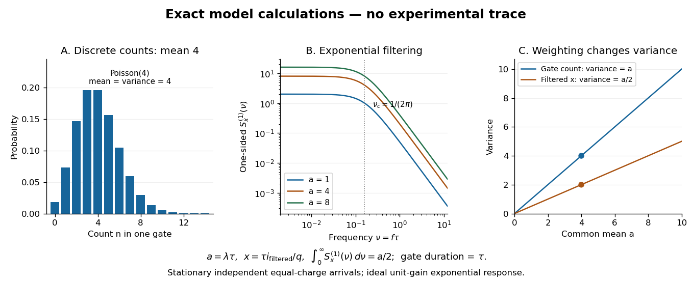

# Shot noise worked example

↑ **Parent:** [Shot noise](shot-noise.md)

For an original model, set $q=1.602176634\times10^{-19}\,\mathrm C$, $I=1\,\mu\mathrm A$, $R_F=100\,\mathrm{k}\Omega$, $G=10$, and the exponential [low-pass filter](low-pass-filter.md)'s $\tau=100\,\mu\mathrm s$. Assume an ideal detector without charge multiplication and omit all additive [noise](noise-signal-processing.md) for this calculation. Then

$$
f_c\approx1591.55\,\mathrm{Hz},\quad B_{\rm n}=2500\,\mathrm{Hz},\quad
S_I^{(1)}=3.204353268\times10^{-25}\,\mathrm{A^2/Hz},
$$

$$
\sqrt{S_I^{(1)}}\approx0.56607\,\mathrm{pA}/\sqrt{\mathrm{Hz}},\quad
\sigma_{v,\rm shot}^2=8.01088317\times10^{-10}\,\mathrm{V^2},\quad
\sigma_{v,\rm shot}\approx28.3035\,\mu\mathrm V.
$$

Doubling $I$ doubles the voltage [variance](variance-split.md) and multiplies its [standard deviation](standard-deviation.md) by $\sqrt2$. Halving $\tau$ also doubles the [variance](variance-split.md), provided the detector remains approximately white throughout the enlarged passband. Using $f_c$ in place of $B_{\rm n}$ underestimates the [variance](variance-split.md) by the factor $2/\pi$. These are calculated predictions, not measured values or settings claimed for the laboratory below.

**[Figure 16](#image-discrete-counts-a-filtered-shot-noise-spectrum-and-two-distinct-mean-variance-laws). Discrete counts, a filtered shot-noise spectrum, and two distinct mean–variance laws**. Original exact model calculations, with no experimental trace. Left: [Poisson distribution](poisson-distribution.md) for mean count $4$. Middle: normalized one-sided [power spectral densities](power-spectral-density.md) after an exponential [low-pass filter](low-pass-filter.md). Right: count [variance](variance-split.md) and normalized filtered-current [variance](variance-split.md) versus their common normalized mean.

To read the dimensionless figure, set $a=\lambda\tau$ and $x=\tau i_{\rm filtered}/q$, with [frequency](frequency.md) $\nu=f\tau$ in cycles per unit $t/\tau$. A gate of duration $\tau$ has count mean and [variance](variance-split.md) $a$. The continuously filtered $x$ instead has

$$
\mathbb E[x]=a,\qquad \operatorname{Var}(x)=a/2,\qquad
S_x^{(1)}(\nu)=\frac{2a}{1+(2\pi\nu)^2},\qquad
\int_0^\infty S_x^{(1)}(\nu)\,d\nu=a/2.
$$

The count and the filtered [electric current](electric-current.md) are different observables. The factor $1/2$ comes from the exponential weighting, not from non-Poisson arrivals. The dimensionless count illustration is a separate choice of rate; it does not assert that the $1\,\mu\mathrm A$ example has only four [electrons](electron.md) per $100\,\mu\mathrm s$.

## ↑ Ancestors (6)

1. [Shot noise](shot-noise.md)
2. [Noise (signal processing)](noise-signal-processing.md)
3. [Signal](signal.md)
4. [Signal processing](signal-processing.md)
5. [Electrical engineering](electrical-engineering-split.md)
6. [Codex Wiki](split.md)
