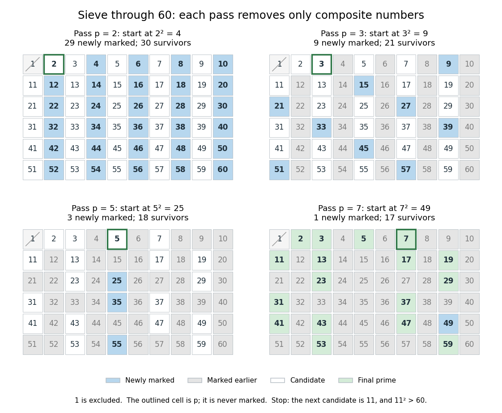
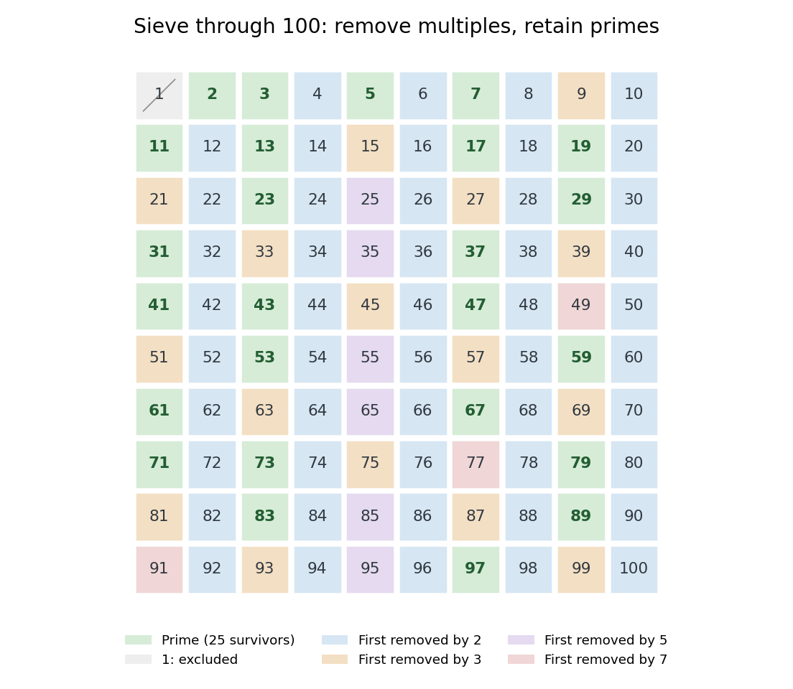

# Sieve of Eratosthenes

↑ **Parent:** [Prime number](prime-number.md)  
ⓦ [Wiki](https://en.wikipedia.org/wiki/Sieve_of_Eratosthenes)

The [sieve of Eratosthenes](sieve-of-eratosthenes.md) finds all [prime numbers](prime-number.md) at most an [integer](integer.md) $N\geq2$. Start with the [integers](integer.md) $2,\ldots,N$ marked as candidates. For each surviving candidate $p$ in increasing order, mark the multiples $p^2,p^2+p,\ldots$ up to $N$ as [composite numbers](composite-number.md). Stop processing candidates once $p^2>N$: the surviving candidates are exactly the [prime numbers](prime-number.md). Starting at $p^2$ saves work because any smaller proper multiple of $p$ already has a smaller [prime factor](prime-factor.md). [Jerry Cain, Stanford CS106AJ, Section Handout 6, Problem 4: the sieve of Eratosthenes](https://web.stanford.edu/class/cs106aj/res/handouts/36-Section-6.pdf).

For a complete run with $N=60$, the only [prime numbers](prime-number.md) at most $\sqrt{60}$ are $2,3,5,7$, since $7^2\leq60<8^2$. Exclude one before starting; it is not a [prime number](prime-number.md). The four marking passes are:
- $p=2$: mark $4,6,8,\ldots,60$, removing 29 candidates.
- $p=3$: mark $9,12,15,\ldots,60$. The nine newly removed candidates are $9,15,21,27,33,39,45,51,57$; the [even integers](even-number.md) were already marked.
- $p=5$: mark $25,30,35,40,45,50,55,60$. Only $25,35,55$ are newly removed.
- $p=7$: mark $49,56$. Only $49$ is newly removed.

There are $59-29-9-3-1=17$ surviving [prime numbers](prime-number.md):

$$
2,3,5,7,11,13,17,19,23,29,31,37,41,43,47,53,59.
$$

The next surviving candidate is $11$, and $11^2>60$, so no further marking pass is necessary. A [prime number](prime-number.md) used for marking remains a candidate: starting at $p^2$ never marks $p$ itself.

**[Figure 34](#image-four-passes-of-the-sieve-of-eratosthenes-through-60-leave-seventeen-prime-numbers). Four passes of the sieve of Eratosthenes through 60 leave seventeen prime numbers**. Blue cells are newly marked [composite numbers](composite-number.md); gray cells were removed earlier. White cells are candidates in the first three panels, and green cells are the final [prime numbers](prime-number.md). The outlined cell identifies the [prime number](prime-number.md) used for that pass. One is excluded throughout.

The saving from starting at $p^2$ is justified by the smaller multiplier: if $p k<p^2$ with $2\leq k<p$, then $k$ has a [prime factor](prime-factor.md) $q<p$, so $q$ has already marked $p k$. For $p=7$, the earlier multiples $14,21,28,35,42$ have already been marked using $2,3$ or $5$. The first new possibility is $49$.

For $N=100$, only the [prime numbers](prime-number.md) $2,3,5,7$ need marking passes. They remove all the [composite numbers](composite-number.md), leaving **25 [prime numbers](prime-number.md)**. The diagram colors each [composite number](composite-number.md) by its smallest [prime factor](prime-factor.md), so it shows which marking pass removes it first. The excluded [integer](integer.md) one is shown separately.

**[Figure 35](#image-the-sieve-of-eratosthenes-leaves-25-prime-numbers-among-the-integers-from-one-to-100). The sieve of Eratosthenes leaves 25 prime numbers among the integers from one to 100**. Each colored [composite number](composite-number.md) is assigned to its smallest [prime factor](prime-factor.md), one of $2,3,5,7$. The green survivors are [prime numbers](prime-number.md); one is neither a [prime number](prime-number.md) nor a [composite number](composite-number.md).

Why does the [algorithm](algorithm.md) work? A surviving candidate cannot be a [composite number](composite-number.md), since its smaller [prime factor](prime-factor.md) would already have removed it. Conversely, marking proper multiples never removes a [prime number](prime-number.md). Every [composite number](composite-number.md) at most $N$ has a [prime factor](prime-factor.md) at most $\sqrt N$, so no later pass is needed. The [sieve of Eratosthenes](sieve-of-eratosthenes.md) is useful when an entire bounded list is wanted; [primality testing](primality-testing.md) of one large [integer](integer.md) is a different computational task.

The historical name is supported by a surviving primary account: Nicomachus, in Book I, chapter 13 of _Introduction to Arithmetic_, names Eratosthenes and describes separating [prime numbers](prime-number.md) from [composite numbers](composite-number.md) by marking multiples among the [odd integers](odd-integer.md) beginning with three. That passage documents the sieve tradition; the bounded [algorithm](algorithm.md) above and its $p^2$ starting rule are the formulation explained here, rather than instructions quoted from [Euclid's Elements](euclid-s-elements.md). [Nicomachus, Introduction to Arithmetic I.13.2–8, Martin Luther D'Ooge translation (1926), revised classroom edition by Nathanael Hahn (2025), pp. 24–25](https://stoicheiamath.com/wp-content/uploads/2025/09/Nicomachus-Introduction-to-Arithmetic-Student-Edition.pdf#page=28)

## ↑ Ancestors (5)

1. [Prime number](prime-number.md)
2. [Number theory](number-theory-split.md)
3. [Area of mathematics](area-of-mathematics.md)
4. [Mathematics](mathematics-split.md)
5. [Codex Wiki](split.md)

## ← Incoming links (3)

- [Composite number](composite-number.md)
- [Prime number](prime-number.md)
- [Sieve of Eratosthenes](sieve-of-eratosthenes.md)
