# Signal transduction

↑ **Parent:** [Biology](biology.md)  
ⓦ [Wiki](https://en.wikipedia.org/wiki/Signal_transduction)

[Signal transduction](signal-transduction.md) converts a detected signal into a change inside a [biological cell](biological-cell.md). For chemical signals, distinguish reception by a [receptor](protein.md#receptor-biochemistry), intracellular [signal transduction](signal-transduction.md), and the response: altered [gene expression](molecular-genetics.md#gene-expression), [enzyme](enzyme.md) activity or [ion channel](cell-membrane.md#ion-channel) opening, for example. A [cell-surface receptor](protein.md#cell-surface-receptor) can relay a [ligand](protein.md#ligand-biochemistry)'s presence across a [cell membrane](cell-membrane.md) without the [ligand](protein.md#ligand-biochemistry) entering the [cytoplasm](biological-cell.md#cytoplasm). Thus a [hydrophilic](physical-chemistry.md#hydrophilicity) signal need not cross the membrane to influence the interior. See [Clark, Douglas and Choi, Biology 2e, 9.2: intracellular signal propagation](https://openstax.org/books/biology-2e/pages/9-2-propagation-of-the-signal).

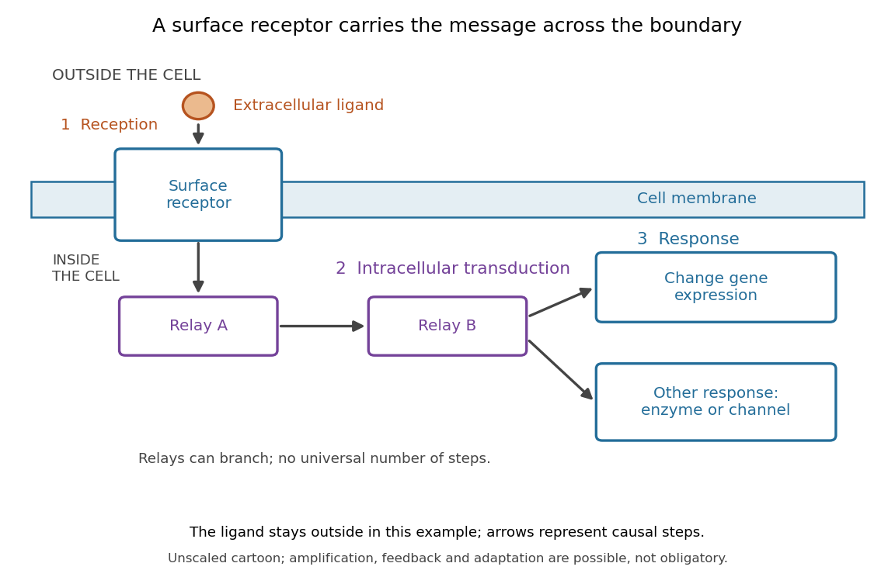

**[Figure 1](#image-reception-intracellular-signal-transduction-and-a-cellular-response). Reception, intracellular signal transduction and a cellular response**. Original cartoon of a [ligand](protein.md#ligand-biochemistry) outside a [biological cell](biological-cell.md), a [cell-surface receptor](protein.md#cell-surface-receptor) spanning its [cell membrane](cell-membrane.md), and intracellular relays branching toward [gene expression](molecular-genetics.md#gene-expression) or another response. Arrows denote causal steps, not transport of the [ligand](protein.md#ligand-biochemistry) through the membrane. Shapes, distances and relay counts are illustrative.

For a computed example of possible [signal amplification](#signal-amplification), suppose one activated [receptor](protein.md#receptor-biochemistry) activates five relay [proteins](protein.md), and each relay activates twenty target [proteins](protein.md) during a chosen interval. If the targets are distinct and available, $1\times5\times20=100$ targets are activated. Those assumed counts illustrate multiplication, not a measured pathway or a universal gain. Actual [signal transduction](signal-transduction.md) can branch, saturate or inhibit activity. Changes in [gene expression](molecular-genetics.md#gene-expression) and changes in existing [enzyme](enzyme.md) activity are different responses. See [Clark, Douglas and Choi, Biology 2e, 9.3: cellular responses](https://openstax.org/books/biology-2e/pages/9-3-response-to-the-signal).

[Signal amplification](#signal-amplification), [signaling feedback](#signaling-feedback) and [signaling adaptation](#signaling-adaptation) are possible properties of [signal transduction](signal-transduction.md), rather than requirements of every cascade. Intracellular relays can use [proteins](protein.md) or [second messengers](#second-messenger); different [biological cells](biological-cell.md) can interpret the same [ligand](protein.md#ligand-biochemistry) differently because they contain different [receptors](protein.md#receptor-biochemistry) and relay machinery. The useful and striking idea is that recognition and response are separable: an extracellular chemical message can control many internal tasks without itself performing those tasks. See [General Principles of Cell Communication](biology-bibliography.md#molecular-biology-of-the-cell-4th-edition-by-bruce-alberts-and-others/general-principles-of-cell-communication).

An original experimental route to this separation appears in T. W. Rall and Earl W. Sutherland's 1958 work on [cAMP](#cyclic-adenosine-monophosphate). They described a heat-stable factor formed from [ATP](molecule.md#adenosine-triphosphate) in separated [biological cell](biological-cell.md) preparations; it affected [enzyme](enzyme.md) activity in other preparations where the initiating chemical signals had no direct effect. This helped distinguish an initial signal from a molecule carrying its effect to another target. [Rall and Sutherland, Formation of a cyclic adenine ribonucleotide by tissue particles, Journal of Biological Chemistry 232 (1958), pp. 1065–1076, introduction](https://doi.org/10.1016/S0021-9258(19)77422-5)

**Table of contents**

- [CLE peptide](#cle-peptide)
- [Common symbiosis signaling pathway](#common-symbiosis-signaling-pathway)
- [Nod factor](#nod-factor)
- [Calcium signaling](#calcium-signaling)
  - [Calcineurin B-like protein](#calcineurin-b-like-protein)
  - [Calcium reporter](#calcium-reporter)
  - [Calcium microdomain](#calcium-microdomain)
  - [Calcium signal decoding](#calcium-signal-decoding)
    - [Calcium sensor kinetics](#calcium-sensor-kinetics)
  - [Calcium signature](#calcium-signature)
- [Quorum sensing](#quorum-sensing)
  - [Pqs quorum-sensing system](#pqs-quorum-sensing-system)
  - [Rhl quorum-sensing system](#rhl-quorum-sensing-system)
  - [Las quorum-sensing system](#las-quorum-sensing-system)
- [Biological growth factor](#biological-growth-factor)
  - [Insulin-like growth factor 2](#insulin-like-growth-factor-2)
- [Pertussis toxin](#pertussis-toxin)
- [Cholera toxin](#cholera-toxin)
- [JAK-STAT signalling](#jak-stat-signalling)
- [JNK signalling](#jnk-signalling)
- [Redox signalling](#redox-signalling)
- [BMP signalling](#bmp-signalling)
- [Hedgehog signalling](#hedgehog-signalling)
  - [Cyclopamine](#cyclopamine)
- [Hippo signaling](#hippo-signaling)
- [Mechanotransduction](#mechanotransduction)
  - [Mechanical control of cell fate](#mechanical-control-of-cell-fate)
  - [Mechanochemical feedback](#mechanochemical-feedback)
- [Interferon-gamma signalling](#interferon-gamma-signalling)
- [Interleukin-2](#interleukin-2)
- [PI3K-AKT signalling](#pi3k-akt-signalling)
- [RAS-MAPK signalling](#ras-mapk-signalling)
- [Cytokine](#cytokine)
  - [Interferon-gamma](#interferon-gamma)
- [VEGF](#vegf)
- [CSF1](#csf1)
- [CXCL12](#cxcl12)
- [Chemokine](#chemokine)
- [Rag GTPase](#rag-gtpase)
- [GATOR2](#gator2)
- [Sestrin2](#sestrin2)
- [mTORC1](#mtorc1)
- [BMP4](#bmp4)
- [LIF signalling](#lif-signalling)
- [TGF-beta signalling](#tgf-beta-signalling)
- [Nodal signalling](#nodal-signalling)
- [MEK](#mek)
- [Grb2](#grb2)
- [FGF4](#fgf4)
- [Hippo signalling](#hippo-signalling)
- [ERK](#erk)
- [Decapentaplegic](#decapentaplegic)
- [FGF signalling](#fgf-signalling)
- [Wnt signalling](#wnt-signalling)
  - [Dishevelled](#dishevelled)
  - [Wnt-beta-catenin asymmetry pathway](#wnt-beta-catenin-asymmetry-pathway)
  - [Wnt protein](#wnt-protein)
    - [MOM-2](#mom-2)
    - [Wnt7a](#wnt7a)
- [Notch signalling](#notch-signalling)
- [Second messenger](#second-messenger)
  - [Inositol trisphosphate](#inositol-trisphosphate)
    - [IP3 production by phospholipase C](#ip3-production-by-phospholipase-c)
    - [Inositol trisphosphate receptor](#inositol-trisphosphate-receptor)
    - [IP3-sensitive calcium store](#ip3-sensitive-calcium-store)
      - [Pancreatic IP3 store fractionation experiment](#pancreatic-ip3-store-fractionation-experiment)
      - [Finite calcium-store release model](#finite-calcium-store-release-model)
  - [Cyclic adenosine monophosphate](#cyclic-adenosine-monophosphate)
- [Signal amplification](#signal-amplification)
- [Hormone](#hormone)
  - [Plant hormone](#plant-hormone)
    - [Strigolactone](#strigolactone)
    - [DELLA protein](#della-protein)
    - [Gibberellin](#gibberellin)
    - [Auxin](#auxin)
      - [Polar auxin transport](#polar-auxin-transport)
    - [Abscisic acid](#abscisic-acid)
  - [Steroid hormone](#steroid-hormone)
  - [Adrenaline](#adrenaline)
    - [Adrenergic adipocyte assay](#adrenergic-adipocyte-assay)
  - [Glucagon](#glucagon)
    - [Islet perifusion experiment](#islet-perifusion-experiment)
  - [Peptide hormone](#peptide-hormone)
    - [Somatostatin](#somatostatin)
- [Signaling feedback](#signaling-feedback)
  - [Negative feedback](#negative-feedback)
    - [Delayed negative feedback model](#delayed-negative-feedback-model)
      - [Delayed feedback characteristic root](#delayed-feedback-characteristic-root)
    - [Chemotaxis feedback regulation](#chemotaxis-feedback-regulation)
      - [Robust perfect adaptation](#robust-perfect-adaptation)
      - [Receptor methylation](#receptor-methylation)
      - [Tar receptor](#tar-receptor)
      - [Chemotaxis feedback proteins](#chemotaxis-feedback-proteins)
        - [CheW](#chew)
        - [CheA](#chea)
        - [CheB](#cheb)
        - [CheR](#cher)
        - [CheY](#chey)
        - [CheZ](#chez)
      - [Chemotaxis FRET assay](#chemotaxis-fret-assay)
  - [Positive feedback](#positive-feedback)
    - [Double-negative feedback](#double-negative-feedback)
    - [Saturating positive feedback](#saturating-positive-feedback)
    - [Cell-cycle activation feedback](#cell-cycle-activation-feedback)
      - [Cell-cycle hysteresis experiment](#cell-cycle-hysteresis-experiment)
        - [Xenopus laevis egg extract](#xenopus-laevis-egg-extract)
        - [Histone H1](#histone-h1)
        - [Phosphorimager](#phosphorimager)
      - [Cyclin-dependent kinase 1](#cyclin-dependent-kinase-1)
        - [CDK1 phosphorylation state](#cdk1-phosphorylation-state)
          - [CDK-activating kinase](#cdk-activating-kinase)
          - [Myt1](#myt1)
        - [Histone H1 kinase assay](#histone-h1-kinase-assay)
        - [CDK1 activity and protein abundance](#cdk1-activity-and-protein-abundance)
      - [Cyclin B](#cyclin-b)
      - [Cdc25](#cdc25)
      - [Wee1](#wee1)
- [Signaling adaptation](#signaling-adaptation)
- [Incoherent feedforward loop](#incoherent-feedforward-loop)
- [Phytochrome](#phytochrome)

## CLE peptide

↑ **Parent:** [Signal transduction](signal-transduction.md)

A member of the CLAVATA3-EMBRYO SURROUNDING REGION-related peptide family. Selected root-produced CLE peptides participate in [autoregulation of nodulation](biology.md#autoregulation-of-nodulation); the family has many other developmental functions.

## Common symbiosis signaling pathway

↑ **Parent:** [Signal transduction](signal-transduction.md)

A partly shared plant signaling route used in arbuscular mycorrhizal and root-nodule symbioses. Nuclear calcium oscillations and [CCaMK](enzyme.md#calcium-and-calmodulin-dependent-protein-kinase) are central elements; partner-specific reception and downstream programs remain distinct.

## Nod factor

↑ **Parent:** [Signal transduction](signal-transduction.md)

A rhizobial lipochitooligosaccharide signal recognized by compatible host receptors during many legume symbioses. Recognition does not by itself establish effective nitrogen fixation.

## Calcium signaling

↑ **Parent:** [Signal transduction](signal-transduction.md)

Regulation by changes in free intracellular [calcium ion](chemical-substance.md#calcium-ion) concentration. [Calcium signatures](#calcium-signature) are interpreted through calcium-binding sensors and downstream targets; calcium concentration is not itself the final response.

### Calcineurin B-like protein

↑ **Parent:** [Calcium signaling](#calcium-signaling)

A plant calcium sensor, often abbreviated CBL, that works with a [CBL-interacting protein kinase](enzyme.md#cbl-interacting-protein-kinase). Sensor localization and partner selection help confer response specificity.

### Calcium reporter

↑ **Parent:** [Calcium signaling](#calcium-signaling)

A probe whose measurable output depends on [calcium ion](chemical-substance.md#calcium-ion) binding. Its affinity, binding kinetics, localization and buffering influence what aspect of a [calcium signature](#calcium-signature) can be observed.

### Calcium microdomain

↑ **Parent:** [Calcium signaling](#calcium-signaling)

A localized region with calcium concentration differing from the surrounding compartment, for example close to an open [ion channel](cell-membrane.md#ion-channel). A whole-cell average can miss such local signals.

### Calcium signal decoding

↑ **Parent:** [Calcium signaling](#calcium-signaling)

Conversion of a [calcium signature](#calcium-signature) into downstream molecular activity. A causal decoding mechanism must explain how sensor kinetics, localization and targets distinguish relevant features of the signal.

#### Calcium sensor kinetics

↑ **Parent:** [Calcium signal decoding](#calcium-signal-decoding)

The binding, activation and inactivation rates through which a calcium sensor transforms a [calcium signature](#calcium-signature). Slow reversal can integrate closely spaced pulses, whereas rapid reversal permits recovery between them.

### Calcium signature

↑ **Parent:** [Calcium signaling](#calcium-signaling)

The temporal and spatial pattern of free intracellular [calcium ion](chemical-substance.md#calcium-ion) concentration during a response, including amplitude, duration, frequency and compartment. Calling a pattern a signature does not establish that it uniquely specifies a stimulus.

## Quorum sensing

↑ **Parent:** [Signal transduction](signal-transduction.md)

Regulation involving production, accumulation and detection of extracellular signals. Signal concentration depends on transport and environment as well as population density.

### Pqs quorum-sensing system

↑ **Parent:** [Quorum sensing](#quorum-sensing)

The Pseudomonas aeruginosa quinolone-signaling network involving HHQ/PQS, PqsR and the pqs biosynthetic locus.

### Rhl quorum-sensing system

↑ **Parent:** [Quorum sensing](#quorum-sensing)

The Pseudomonas aeruginosa RhlI/RhlR system, whose regulation of virulence-factor production is linked to PqsE and the broader signaling network.

### Las quorum-sensing system

↑ **Parent:** [Quorum sensing](#quorum-sensing)

The Pseudomonas aeruginosa LasI/LasR acyl-homoserine-lactone signaling system, often upstream of additional quorum-sensing circuits in laboratory strains.

## Biological growth factor

↑ **Parent:** [Signal transduction](signal-transduction.md)

A signalling substance that affects cellular growth, proliferation or survival. A developmental growth effect should be distinguished from arithmetic multiplicative growth.

### Insulin-like growth factor 2

↑ **Parent:** [Biological growth factor](#biological-growth-factor)

A mammalian [biological growth factor](#biological-growth-factor) encoded by the Igf2 gene. Parent-of-origin-dependent expression in mice makes it an important experimental system for [genomic imprinting](molecular-genetics.md#genomic-imprinting).

## Pertussis toxin

↑ **Parent:** [Signal transduction](signal-transduction.md)

A bacterial ADP-ribosylating toxin that prevents normal receptor coupling of Gi/o proteins. Its action differs from the persistent active-Gs signalling caused by [cholera toxin](#cholera-toxin).

## Cholera toxin

↑ **Parent:** [Signal transduction](signal-transduction.md)

A bacterial toxin whose catalytic component ADP-ribosylates the stimulatory G-protein alpha subunit. Impaired shutoff increases adenylyl-cyclase activity, linking a persistent signal to intestinal ion secretion.

## JAK-STAT signalling

↑ **Parent:** [Signal transduction](signal-transduction.md)

Signalling that connects receptor-associated Janus kinases to STAT transcriptional regulators. In epithelial mosaics, ligand production and response can influence growth of both affected and neighbouring populations.

## JNK signalling

↑ **Parent:** [Signal transduction](signal-transduction.md)

Stress-responsive signalling involving c-Jun N-terminal kinases. Effects on proliferation, apoptosis and competitive behaviour depend on the experimental context.

## Redox signalling

↑ **Parent:** [Signal transduction](signal-transduction.md)

Regulation of cellular activity through oxidation-reduction-sensitive processes. A stress-response reporter measures a downstream response and need not directly report the concentration of a particular oxidant.

## BMP signalling

↑ **Parent:** [Signal transduction](signal-transduction.md)

Signalling by bone morphogenetic proteins, with context-dependent effects on specification, growth and spatial organization. A developmental patterning function is distinct from a generic effect on differentiation.

## Hedgehog signalling

↑ **Parent:** [Signal transduction](signal-transduction.md)

A developmental signalling system activated by Hedgehog-family ligands. Its outputs depend on the receiving tissue, exposure history and downstream regulatory state.

### Cyclopamine

↑ **Parent:** [Hedgehog signalling](#hedgehog-signalling)

A small-molecule inhibitor of Hedgehog pathway activity used in experimental patterning studies. Vehicle controls, developmental timing and checks for generalized toxicity are needed when interpreting its effects.

## Hippo signaling

↑ **Parent:** [Signal transduction](signal-transduction.md)

[hippo signaling](#hippo-signaling) regulates growth-related transcriptional outputs, including the activity and localization of [YAP](molecular-genetics.md#yap) and [TAZ](protein.md#wwtr1). Mechanical inputs can intersect with this network through context-dependent routes.

## Mechanotransduction

↑ **Parent:** [Signal transduction](signal-transduction.md)

[mechanotransduction](#mechanotransduction) converts mechanical input into altered molecular activity or cellular behavior. A causal test separates applied mechanics from accompanying chemical changes and identifies a force-sensitive step.

### Mechanical control of cell fate

↑ **Parent:** [Mechanotransduction](#mechanotransduction)

Dependence of cell-state decisions on forces, deformation or the mechanical environment. Experiments must separate physical input from altered ligand presentation, survival and selection of pre-existing states.

### Mechanochemical feedback

↑ **Parent:** [Mechanotransduction](#mechanotransduction)

A reciprocal relation in which molecular state changes tissue mechanics and mechanically altered conditions change molecular activity. Time-resolved perturbations distinguish feedback from correlated changes.

## Interferon-gamma signalling

↑ **Parent:** [Signal transduction](signal-transduction.md)

Cellular responses to interferon gamma, including context-dependent effects on proliferation and [antigen presentation](biology.md#antigen-presentation). Loss of responsiveness can contribute to immune-therapy escape.

## Interleukin-2

↑ **Parent:** [Signal transduction](signal-transduction.md)

A cytokine influencing T-cell growth and function, including use in some adoptive-cell-therapy regimens.

## PI3K-AKT signalling

↑ **Parent:** [Signal transduction](signal-transduction.md)

A growth- and survival-associated signalling pathway that can be activated by receptor inputs or oncogenic changes in its components.

## RAS-MAPK signalling

↑ **Parent:** [Signal transduction](signal-transduction.md)

A signalling cascade connecting RAS-family switches and downstream kinases to regulatory outputs including proliferation and differentiation.

## Cytokine

↑ **Parent:** [Signal transduction](signal-transduction.md)

A secreted signalling [protein](protein.md) influencing cellular behaviour, especially in immune and tissue responses. Its effect depends on the responding cells and local context.

### Interferon-gamma

↑ **Parent:** [Cytokine](#cytokine)

A [cytokine](#cytokine) involved in immune and other signalling, including studied effects on neural physiology. Its physiological effects depend on source, target, dose and timing.

## VEGF

↑ **Parent:** [Signal transduction](signal-transduction.md)

Vascular endothelial growth factor, a family of signals that regulate vascular development and function, including angiogenic responses in [tumours](biology.md#tumour).

## CSF1

↑ **Parent:** [Signal transduction](signal-transduction.md)

Colony-stimulating factor 1, a signal promoting survival and differentiation within monocyte/macrophage lineages and participating in some [tumour](biology.md#tumour)–macrophage interactions.

## CXCL12

↑ **Parent:** [Signal transduction](signal-transduction.md)

A [chemokine](#chemokine) also called SDF-1, involved in cell recruitment and stromal–[tumour](biology.md#tumour) signalling in several experimental settings.

## Chemokine

↑ **Parent:** [Signal transduction](signal-transduction.md)

A signalling [protein](protein.md) that influences cell recruitment and positioning, often by inducing directed cell movement through a compatible receptor.

## Rag GTPase

↑ **Parent:** [Signal transduction](signal-transduction.md)

A member of a nutrient-responsive [GTP](molecule.md#guanosine-triphosphate)-binding regulatory family involved in positioning [mTORC1](#mtorc1) at the [lysosome](biological-cell.md#lysosome).

## GATOR2

↑ **Parent:** [Signal transduction](signal-transduction.md)

A regulatory complex in nutrient signaling upstream of [Rag GTPases](#rag-gtpase) and [mTORC1](#mtorc1).

## Sestrin2

↑ **Parent:** [Signal transduction](signal-transduction.md)

A [leucine](chemical-substance.md#leucine)-binding sensor upstream of [mTORC1](#mtorc1). Its nutrient-dependent interaction with [GATOR2](#gator2) helps couple [leucine](chemical-substance.md#leucine) availability to growth signaling.[Abstract](biology-bibliography.md#sestrin2-is-a-leucine-sensor-for-the-mtorc1-pathway-by-rachel-l-wolfson-and-others)

## mTORC1

↑ **Parent:** [Signal transduction](signal-transduction.md)

Mechanistic target of rapamycin complex 1, a nutrient-responsive [protein kinase](enzyme.md#protein-kinase) complex. Its activity affects initiation through [4E-BP proteins](molecular-genetics.md#4e-bp-protein) and other substrates, and also regulates [autophagy](biological-cell.md#autophagy) and growth investment.

## BMP4

↑ **Parent:** [Signal transduction](signal-transduction.md)

Bone morphogenetic protein 4, a signalling ligand with developmental functions including induction of mouse [primordial germ cells](biological-cell.md#primordial-germ-cell) from competent [epiblast](biology.md#epiblast).

## LIF signalling

↑ **Parent:** [Signal transduction](signal-transduction.md)

Signalling initiated by leukaemia inhibitory factor, important in some mouse pluripotent-cell culture conditions. A culture dependency is not automatically an embryonic lineage-specification dependency.

## TGF-beta signalling

↑ **Parent:** [Signal transduction](signal-transduction.md)

A family of signalling pathways with context-dependent developmental and cell-state functions. Ligand, receptor and downstream requirements should be distinguished experimentally.

## Nodal signalling

↑ **Parent:** [Signal transduction](signal-transduction.md)

Developmental [signal transduction](signal-transduction.md) initiated by Nodal-family ligands, belonging to the broader [TGF-beta signalling](#tgf-beta-signalling) system.

## MEK

↑ **Parent:** [Signal transduction](signal-transduction.md)

A kinase upstream of [ERK](#erk). A failure of a MEK inhibitor to change fate does not alone establish that ERK is dispensable without testing effective pathway inhibition in the embryo.

## Grb2

↑ **Parent:** [Signal transduction](signal-transduction.md)

An adaptor protein linking activated receptors to downstream signalling, including a pathway required for normal mouse [hypoblast](biology.md#hypoblast) allocation.

## FGF4

↑ **Parent:** [Signal transduction](signal-transduction.md)

A fibroblast growth factor important in signalling between early mammalian lineages, including promotion of mouse hypoblast development.

## Hippo signalling

↑ **Parent:** [Signal transduction](signal-transduction.md)

A signalling system regulating factors such as [YAP](molecular-genetics.md#yap). In early mouse embryos it connects cellular position and polarity to lineage-associated transcription.

## ERK

↑ **Parent:** [Signal transduction](signal-transduction.md)

Extracellular signal-regulated kinase, a kinase downstream of [MEK](#mek). Phosphorylation and downstream activity must be assayed in the relevant cells when testing inhibitor effects.

## Decapentaplegic

↑ **Parent:** [Signal transduction](signal-transduction.md)

A BMP-family signalling ligand in [Drosophila melanogaster](organism.md#drosophila-melanogaster), including an early dorsal embryonic expression domain repressed ventrally by nuclear [Dorsal protein](molecular-genetics.md#dorsal-protein).

## FGF signalling

↑ **Parent:** [Signal transduction](signal-transduction.md)

[Signal transduction](signal-transduction.md) initiated by fibroblast growth factors acting through [FGF receptors](protein.md#fgf-receptor). A major downstream branch involves [MEK](#mek) and [ERK](#erk), but receptor activation can engage other pathways.

## Wnt signalling

↑ **Parent:** [Signal transduction](signal-transduction.md)

[Signal transduction](signal-transduction.md) initiated by Wnt-family ligands. Distinct pathway branches regulate [gene expression](molecular-genetics.md#gene-expression), [cell polarity](biological-cell.md#cell-polarity) and cell behaviour; their effects depend on developmental context.

### Dishevelled

↑ **Parent:** [Wnt signalling](#wnt-signalling)

A signalling [protein](protein.md) involved in canonical Wnt and [planar cell polarity](biological-cell.md#planar-cell-polarity) pathways. Perturbations can disrupt oriented [cell](biological-cell.md) movement without abolishing the associated [cell fate](organism.md#cell-fate).

### Wnt-beta-catenin asymmetry pathway

↑ **Parent:** [Wnt signalling](#wnt-signalling)

A signalling system that produces different transcriptional states in sister [cells](biological-cell.md). In the [Caenorhabditis elegans](organism.md#caenorhabditis-elegans) EMS division, nuclear [POP-1](molecular-genetics.md#pop-1) and [SYS-1](molecular-genetics.md#sys-1) levels establish different coactivator-to-[transcription](molecular-genetics.md#transcription-biology)-factor ratios.

### Wnt protein

↑ **Parent:** [Wnt signalling](#wnt-signalling)

A member of a secreted signaling-protein family acting through [Wnt signalling](#wnt-signalling) pathways. Adding ligand need not produce a measurable reporter change if the responding machinery or assay range is unsuitable.

#### MOM-2

↑ **Parent:** [Wnt protein](#wnt-protein)

The Wnt [ligand](protein.md#ligand-biochemistry) participating in the P2-to-EMS interaction during early [Caenorhabditis elegans](organism.md#caenorhabditis-elegans) development.

#### Wnt7a

↑ **Parent:** [Wnt protein](#wnt-protein)

A Wnt-family ligand with a role in dorsal limb patterning through induction of a dorsal transcriptional programme in competent mesenchyme.

## Notch signalling

↑ **Parent:** [Signal transduction](signal-transduction.md)

A contact-dependent signalling system. During vertebrate [somitogenesis](biology.md#somitogenesis), coupling through Notch can coordinate neighbouring oscillators without being identical to the intracellular oscillation mechanism.

## Second messenger

↑ **Parent:** [Signal transduction](signal-transduction.md)

A [second messenger](#second-messenger) is a small intracellular [molecule](molecule.md) or [ion](chemistry.md#ion) that relays a received signal to target [proteins](protein.md). Its production, release, removal or binding changes its availability after signal reception. For a [cell-surface receptor](protein.md#cell-surface-receptor), distinguish the extracellular [ligand](protein.md#ligand-biochemistry), often called the first messenger, from the intracellular [second messenger](#second-messenger). An activated relay [protein](protein.md) is not thereby a [second messenger](#second-messenger): the term identifies small chemical mediators, rather than every downstream component of [signal transduction](signal-transduction.md). [Newton, Bootman and Scott, Second Messengers (2016): definition and classes](https://pubmed.ncbi.nlm.nih.gov/27481708/)

Two examples clarify what changes. A [biological cell](biological-cell.md) can make [cAMP](#cyclic-adenosine-monophosphate) from [ATP](molecule.md#adenosine-triphosphate); alternatively, release of stored [calcium](chemical-substance.md#calcium) [ions](chemistry.md#ion) can raise the free [calcium](chemical-substance.md#calcium) [concentration](mathematical-physics.md#concentration) in its [cytoplasm](biological-cell.md#cytoplasm). The latter need not increase the total [calcium](chemical-substance.md#calcium) content of the [biological cell](biological-cell.md). Availability to target [proteins](protein.md), not merely the total amount present, carries the message. Removal and sequestration help terminate such signals. [Purves et al., Neuroscience, 2nd edition: second messengers and calcium storage](https://www.ncbi.nlm.nih.gov/books/NBK10794/) [Pathways of Intracellular Signal Transduction](biology-bibliography.md#the-cell-a-molecular-approach-2nd-edition-by-geoffrey-m-cooper/pathways-of-intracellular-signal-transduction)

The experimental motivation is unusually tangible: can a [hormone](#hormone)'s effect be transferred to machinery that barely responds to the [hormone](#hormone) itself? In Rall, Sutherland and Berthet's 1957 experiment, washed cat-liver particles were incubated with [ATP](molecule.md#adenosine-triphosphate) and [magnesium](chemical-substance.md#magnesium) [ions](chemistry.md#ion), with or without [epinephrine](#adrenaline) and [glucagon](#glucagon), two [hormones](#hormone). After five minutes at $30\,{}^{\circ}\mathrm C$, the mixtures were heated in boiling water for three minutes, chilled, and separated to remove insoluble material. Small samples of the clarified extracts were transferred to a separate soluble dog-liver preparation, again supplied with [ATP](molecule.md#adenosine-triphosphate) and [magnesium](chemical-substance.md#magnesium) [ions](chemistry.md#ion). The readout was the change in [glycogen phosphorylase](enzyme.md#glycogen-phosphorylase) activity over five minutes, not the amount of newly synthesized [protein](protein.md). [Rall, Sutherland and Berthet (1957), Figure 4 and pp. 470–471: preparation and transfer](https://doi.org/10.1016/S0021-9258(18)65045-8)

The [hormone](#hormone)-conditioned extract caused a larger increase in [glycogen phosphorylase](enzyme.md#glycogen-phosphorylase) activity. Water, extract made without [hormones](#hormone), and [hormones](#hormone) added directly to the soluble preparation produced smaller effects. These comparisons distinguish transferred activity from baseline activity, preparation effects and simple [hormone](#hormone) carryover. [Rall, Sutherland and Berthet (1957), Figure 4: controls and observations](https://doi.org/10.1016/S0021-9258(18)65045-8)

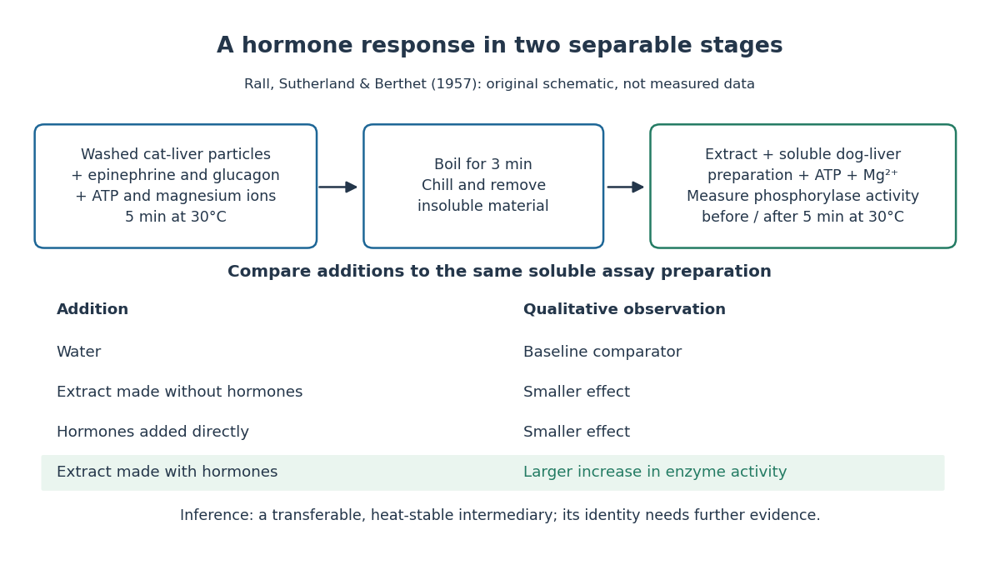

**[Figure 2](#image-separating-hormone-reception-from-a-transferable-intracellular-effect). Separating hormone reception from a transferable intracellular effect**. Original schematic of the classical extract-transfer experiment. Responses are qualitative comparisons, not reconstructed measurements; details of the separation and assay are abbreviated. See the primary references in the surrounding text.

The inference is a transferable, heat-stable intermediary between the [hormone](#hormone)-sensitive particles and the soluble machinery. This does not identify the intermediary merely from heat resistance, establish its direct target, or show that every [hormone](#hormone) uses the same mechanism. Rall and Sutherland's 1958 paper reports the factor's identification as [cAMP](#cyclic-adenosine-monophosphate) in accompanying chemical work, and follows its production from [ATP](molecule.md#adenosine-triphosphate). It also reports an important limit: washed heart and skeletal-muscle particles produced detectable [cAMP](#cyclic-adenosine-monophosphate) with [epinephrine](#adrenaline) under their test conditions, whereas brain particles produced similar amounts with and without it. Tissue and preparation matter. [Rall and Sutherland (1958), introduction and Table IV: cAMP identity and tissue-dependent responses](https://doi.org/10.1016/S0021-9258(19)77422-5)

The useful and beautiful separation is between recognition and execution: an extracellular [ligand](protein.md#ligand-biochemistry) can control intracellular [enzymes](enzyme.md) through a chemically different intermediary. Making many [second messenger](#second-messenger) [molecules](molecule.md) can support [signal amplification](#signal-amplification), while different target [proteins](protein.md) give the same mediator different consequences. A [second messenger](#second-messenger) identifies a mode of relaying information; its presence alone does not specify the size or direction of the response. [Newton, Bootman and Scott (2016): second messengers and their targets](https://pubmed.ncbi.nlm.nih.gov/27481708/)

### Inositol trisphosphate

↑ **Parent:** [Second messenger](#second-messenger)  
ⓦ [Wiki](https://en.wikipedia.org/wiki/Inositol_trisphosphate)

In [signal transduction](signal-transduction.md), [inositol trisphosphate](#inositol-trisphosphate) usually means inositol 1,4,5-trisphosphate: a soluble intracellular [second messenger](#second-messenger). An extracellular [ligand](protein.md#ligand-biochemistry), its [cell-surface receptor](protein.md#cell-surface-receptor), [IP3](#inositol-trisphosphate) and the released [calcium](chemical-substance.md#calcium) [ions](chemistry.md#ion) are distinct components. [IP3](#inositol-trisphosphate) binds an [IP3 receptor](#inositol-trisphosphate-receptor) on the [endoplasmic reticulum](biological-cell.md#endoplasmic-reticulum), promoting stored $\mathrm{Ca}^{2+}$ release into the [cytosol](biological-cell.md#cytosol).[Phospholipids and Ca2+, Figure 13.27: soluble IP3 and intracellular calcium release](biology-bibliography.md#the-cell-a-molecular-approach-2nd-edition-by-geoffrey-m-cooper/pathways-of-intracellular-signal-transduction)

The useful separation is spatial: an extracellular message can control an internal store without entering it. The existing intracellular-injection experiment under [metabotropic receptor](protein.md#metabotropic-receptor) tests bypassing reception; the [Pancreatic IP3 store fractionation experiment](#pancreatic-ip3-store-fractionation-experiment) below tests which internal compartment supplies the released [calcium](chemical-substance.md#calcium). Neither question is answered merely by observing a downstream membrane [electric current](electric-charge.md#electric-current).

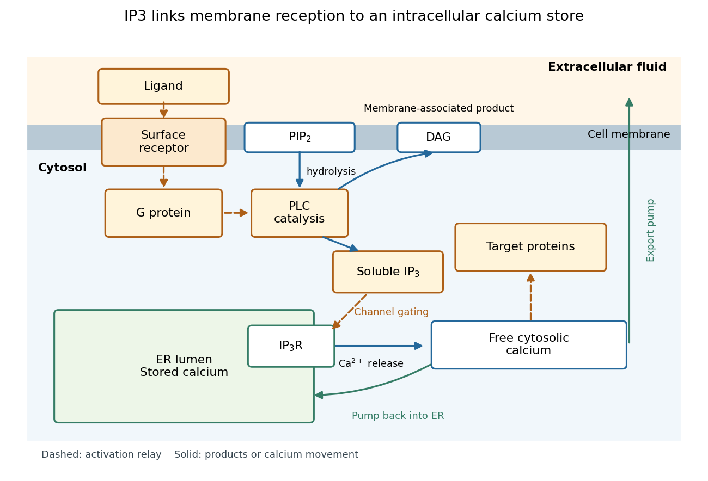

**[Figure 3](#image-from-extracellular-reception-to-ip3-dependent-release-of-stored-calcium). From extracellular reception to IP3-dependent release of stored calcium**. Original [G protein-coupled receptor](protein.md#g-protein-coupled-receptor) pathway schematic. Dashed arrows relay activation; solid arrows show products or [calcium](chemical-substance.md#calcium) movement. Membrane-associated [PIP2](chemical-substance.md#phosphatidylinositol-4-5-bisphosphate) yields soluble [IP3](#inositol-trisphosphate) and membrane-associated [diacylglycerol](chemical-substance.md#diacylglycerol). Release, pumping into the [ER](biological-cell.md#endoplasmic-reticulum) and export are separate flows; shapes encode no measured geometry or timing.

#### IP3 production by phospholipase C

↑ **Parent:** [Inositol trisphosphate](#inositol-trisphosphate)

[Phospholipase C](enzyme.md#phospholipase-c) catalyzes [hydrolysis](chemical-reaction.md#hydrolysis) of membrane [PIP2](chemical-substance.md#phosphatidylinositol-4-5-bisphosphate), producing soluble [IP3](#inositol-trisphosphate) and membrane-associated [diacylglycerol](chemical-substance.md#diacylglycerol). This consumes a [phospholipid](chemical-substance.md#phospholipid) [substrate](enzyme.md#substrate-biochemistry), rather than manufacturing [calcium](chemical-substance.md#calcium). [G protein](protein.md#g-protein)-regulated and [receptor tyrosine kinase](protein.md#receptor-tyrosine-kinase)-regulated forms of [PLC](enzyme.md#phospholipase-c) provide different routes to this reaction.[Phospholipids and Ca2+, Figures 13.24–13.25: PIP2 hydrolysis and distinct PLC activation routes](biology-bibliography.md#the-cell-a-molecular-approach-2nd-edition-by-geoffrey-m-cooper/pathways-of-intracellular-signal-transduction)

#### Inositol trisphosphate receptor

↑ **Parent:** [Inositol trisphosphate](#inositol-trisphosphate)  
ⓦ [Wiki](https://en.wikipedia.org/wiki/Inositol_trisphosphate_receptor)

An [IP3 receptor](#inositol-trisphosphate-receptor) is an intracellular [ligand](protein.md#ligand-biochemistry)-gated [ion channel](cell-membrane.md#ion-channel), rather than the extracellular signal's [cell-surface receptor](protein.md#cell-surface-receptor). Its opening is regulated by both [IP3](#inositol-trisphosphate) and cytosolic [calcium](chemical-substance.md#calcium): [IP3](#inositol-trisphosphate) binding is not a command that fixes one constant release rate. Mammalian [IP3 receptors](#inositol-trisphosphate-receptor) have three subtypes, with possible mixed assemblies and splice variants; these need not have identical regulation or cellular roles. The 2010 authored account distinguishes established channel behavior from then-unresolved structural explanations.[Taylor and Tovey, IP3 Receptors: Toward Understanding Their Activation, Abstract; regulation by cytosolic Ca2+ and Structural Determinants of IP3R Activation: three subtypes and tetrameric assemblies](biology-bibliography.md#ip3-receptors-toward-understanding-their-activation-by-colin-w-taylor-and-stephen-c-tovey)

#### IP3-sensitive calcium store

↑ **Parent:** [Inositol trisphosphate](#inositol-trisphosphate)

An [IP3-sensitive calcium store](#ip3-sensitive-calcium-store) contains releasable [calcium](chemical-substance.md#calcium) behind a membrane bearing functional [IP3 receptors](#inositol-trisphosphate-receptor). The [endoplasmic reticulum](biological-cell.md#endoplasmic-reticulum) is an important example. Pumping [calcium](chemical-substance.md#calcium) into it or exporting [calcium](chemical-substance.md#calcium) across the [cell membrane](cell-membrane.md) lowers free cytosolic [calcium](chemical-substance.md#calcium); intracellular redistribution and loss from the whole [biological cell](biological-cell.md) are different balances.[Phospholipids and Ca2+, paragraph accompanying Figure 13.27: calcium pumps across plasma and ER membranes](biology-bibliography.md#the-cell-a-molecular-approach-2nd-edition-by-geoffrey-m-cooper/pathways-of-intracellular-signal-transduction)

Finite availability matters: a release pathway cannot deliver more [calcium](chemical-substance.md#calcium) than its accessible store contains unless replenishment occurs. A falling cytosolic [calcium](chemical-substance.md#calcium) response can reflect reduced release, increased removal, or both. Store content, release rate and free cytosolic [concentration](mathematical-physics.md#concentration) therefore answer different questions. Binding to [proteins](protein.md) can also change the free fraction without changing the total number of [calcium](chemical-substance.md#calcium) [ions](chemistry.md#ion).

##### Pancreatic IP3 store fractionation experiment

↑ **Parent:** [IP3-sensitive calcium store](#ip3-sensitive-calcium-store)

A 1984 primary experiment localized [IP3](#inositol-trisphosphate)-evoked release using [pancreatic acinar cells](physiology.md#pancreatic-acinar-cell) isolated from rat [pancreas](physiology.md#pancreas) with [collagenase](enzyme.md#collagenase). A homogenized preparation was separated by [differential centrifugation](biology.md#differential-centrifugation), then by a [sucrose](chemical-substance.md#sucrose) step [density gradient](gravity-wave.md#density-gradient) or precipitation with [magnesium](chemical-substance.md#magnesium) chloride. The readout was [IP3](#inositol-trisphosphate)-induced [calcium](chemical-substance.md#calcium) release per mass of [protein](protein.md) across fractions. Release tracked two [endoplasmic reticulum](biological-cell.md#endoplasmic-reticulum) markers, [RNA](polymer.md#ribonucleic-acid) content and an [enzyme](enzyme.md) activity, across several separation methods. Marker activities for [mitochondria](biological-cell.md#mitochondria) and the [cell membrane](cell-membrane.md) supplied contrasting comparisons: release correlated negatively with them.[Streb, Bayerdörffer, Haase, Irvine and Schulz, Effect of inositol-1,4,5-trisphosphate on isolated subcellular fractions of rat pancreas (1984), abstract: preparation, separation methods, protein-normalized release and marker correlations](biology-bibliography.md#effect-of-inositol-1-4-5-trisphosphate-on-isolated-subcellular-fractions-of-rat-pancreas-by-h-streb-and-others)

Agreement across distinct fractionations supports an [endoplasmic reticulum](biological-cell.md#endoplasmic-reticulum)-associated source in this preparation. “Nonmitochondrial” alone only excludes a candidate; positive compartment markers add localization evidence. Marker comparisons control the localization inference, rather than replacing a no-[IP3](#inositol-trisphosphate) release comparison. Fractionation may mix or damage compartments, and correlation does not itself identify the [IP3 receptor](#inositol-trisphosphate-receptor) [protein](protein.md). This [calcium](chemical-substance.md#calcium) release readout also does not directly measure secretion or establish identical responses in every [biological cell](biological-cell.md).

##### Finite calcium-store release model

↑ **Parent:** [IP3-sensitive calcium store](#ip3-sensitive-calcium-store)

For an original [mathematical model](mathematics.md#mathematical-model), imagine a sustained, imposed release pathway, with no store refill during the plotted interval. Let $S$ be releasable store [amount of substance](physics.md#amount-of-substance), $X$ excess freely dissolved cytosolic [calcium](chemical-substance.md#calcium) [amount of substance](physics.md#amount-of-substance), and $Q$ the cumulative amount removed from $X$ into a separate sink. Choose $S(0)=1\,\mathrm{amol}$, $X(0)=Q(0)=0$, cytosolic [volume](geometry-and-topology.md#volume) $V_c=1\,\mathrm{pL}$, release [rate constant](chemical-kinetics.md#rate-constant) $k=0.4\,\mathrm{s^{-1}}$ and clearance [rate constant](chemical-kinetics.md#rate-constant) $h=0.8\,\mathrm{s^{-1}}$. These are stipulated values, not physiological measurements or a model of [IP3 receptor](#inositol-trisphosphate-receptor) gating.

Assume fixed [volume](geometry-and-topology.md#volume), uniform mixing, no binding, no reverse transfer, no outside entry and first-order loss from each donating compartment. Then

$$
\frac{dS}{dt}=-kS,\qquad \frac{dX}{dt}=kS-hX,\qquad \frac{dQ}{dt}=hX,\qquad S+X+Q=S(0).
$$

The last equality is [conservation of mass](continuum-mechanics.md#mass-conservation) for the tracked [calcium](chemical-substance.md#calcium) across the store, mobile excess and sink together; it does not assert conservation inside a [biological cell](biological-cell.md) if the sink represents export. A constant background $c_b=0.1\,\mathrm{\mu M}$ is held separate from this excess bookkeeping. Since $1\,\mathrm{amol}/1\,\mathrm{pL}=1\,\mathrm{\mu M}$, the response is $c=c_b+X/V_c$.

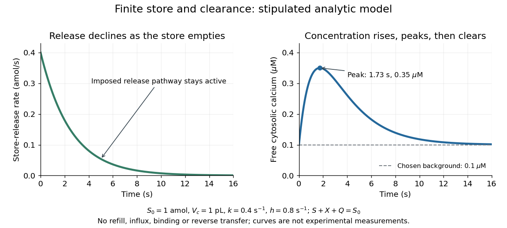

**[Figure 4](#image-declining-store-release-rate-and-a-delayed-cytosolic-calcium-peak). Declining store-release rate and a delayed cytosolic calcium peak**. Original analytic toy-model curves with $S(0)=1\,\mathrm{amol}$, $V_c=1\,\mathrm{pL}$, $k=0.4\,\mathrm{s^{-1}}$, $h=0.8\,\mathrm{s^{-1}}$ and background $c_b=0.1\,\mathrm{\mu M}$. The left panel plots release rate $kS$; the right plots $c_b+X/V_c$. Sustained effective release permeability is imposed even as the store empties. These are different quantities with different units, not reconstructed experimental data or physiological timings. The sink receives all cleared excess; refill, binding and [IP3 receptor](#inositol-trisphosphate-receptor) regulation are omitted.

Solving these [ordinary differential equations](differential-equation.md#ordinary-differential-equation) gives

$$
S=S(0)e^{-kt},\qquad X=\frac{kS(0)}{h-k}\left(e^{-kt}-e^{-ht}\right),\qquad Q=S(0)-S-X.
$$

Release $kS$ declines from the start, yet $X$ initially rises because delivery exceeds clearance. Its peak occurs when $kS=hX$, at $t_*=\log(h/k)/(h-k)=\log(2)/0.4\approx1.73\,\mathrm{s}$. There $X=0.25\,\mathrm{amol}$ and $c=0.35\,\mathrm{\mu M}$. Ultimately $S$ and $X$ tend to zero, $Q$ tends to $1\,\mathrm{amol}$ and $c$ returns to $c_b$. The delayed peak is a consequence of material balance, even though this model has no delayed channel activation.

This distinction guides interpretation: a large released amount need not mean a large simultaneous free cytosolic [concentration](mathematical-physics.md#concentration). Clearance and [volume](geometry-and-topology.md#volume) intervene. Real [biological cells](biological-cell.md) add binding, store refilling, [IP3](#inositol-trisphosphate) turnover and [IP3 receptor](#inositol-trisphosphate-receptor) regulation; the two plotted curves isolate one finite-store effect rather than explaining every [calcium](chemical-substance.md#calcium) response.

### Cyclic adenosine monophosphate

↑ **Parent:** [Second messenger](#second-messenger)  
ⓦ [Wiki](https://en.wikipedia.org/wiki/Cyclic_adenosine_monophosphate)

[Cyclic adenosine monophosphate](#cyclic-adenosine-monophosphate) is a cyclic [nucleotide](molecule.md#nucleotide) made from [ATP](molecule.md#adenosine-triphosphate). It can serve as an intracellular [second messenger](#second-messenger), changing the activity of target [proteins](protein.md) after a signal has been received. Different [biological cells](biological-cell.md) can respond differently because they contain different targets. [Clark, Douglas and Choi, Biology 2e, §9.2: cyclic AMP as a second messenger](https://openstax.org/books/biology-2e/pages/9-2-propagation-of-the-signal)

## Signal amplification

↑ **Parent:** [Signal transduction](signal-transduction.md)

[Signal amplification](#signal-amplification) is an increase in a specified downstream response relative to an initiating signal. In a molecular-count description, one activated component can generate or activate many downstream [molecules](molecule.md). Repeated [catalysis](chemical-kinetics.md#catalysis) by an [enzyme](enzyme.md) supplies a mechanism: the [enzyme](enzyme.md) remains available for another [chemical reaction](chemical-reaction.md). Successive stages can multiply the response. For a biological example, Cooper describes the [epinephrine](#adrenaline)-to-[glycogen phosphorylase](enzyme.md#glycogen-phosphorylase) pathway, where production of many [cAMP](#cyclic-adenosine-monophosphate) [molecules](molecule.md) and repeated downstream [protein](protein.md) [phosphorylation](chemical-reaction.md#phosphorylation) provide opportunities for [signal amplification](#signal-amplification). This is an example, not a claim that every [signal transduction](signal-transduction.md) pathway has the same stages or gain. [Pathways of Intracellular Signal Transduction](biology-bibliography.md#the-cell-a-molecular-approach-2nd-edition-by-geoffrey-m-cooper/pathways-of-intracellular-signal-transduction)

Here is a counting toy extending the example under [signal transduction](signal-transduction.md). Suppose $N_0$ activated [receptors](protein.md#receptor-biochemistry) each activate $a=5$ distinct relay [proteins](protein.md) during a first interval. During a subsequent interval, each relay activates $b=20$ distinct target [proteins](protein.md). Assume enough inactive relays and targets, no shared targets, and no loss of activity during the count. Then

$$
N_1=aN_0,\qquad N_2=bN_1=abN_0.
$$

For $N_0=1$, this gives $N_1=5$ and $N_2=100$: the target-to-[receptor](protein.md#receptor-biochemistry) count [ratio](arithmetic.md#ratio) is $100$. These are assumed integer counts, not measured rates or a universal physiological amplification factor. The intervals are sequential; the equations do not specify a time course.

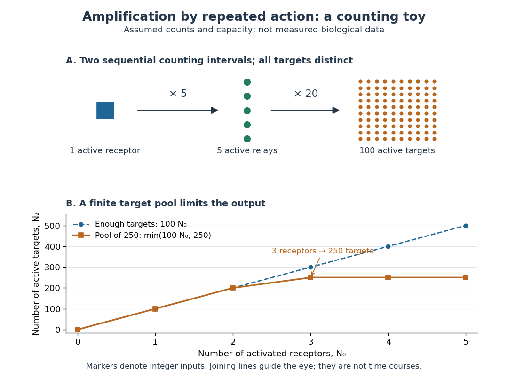

**[Figure 5](#image-a-counting-toy-for-signal-amplification-and-a-finite-target-pool). A counting toy for signal amplification and a finite target pool**. Original schematic and computed count curves, not measured biological data. The upper cascade assumes five relays per activated [receptor](protein.md#receptor-biochemistry) and twenty distinct targets per relay. The lower comparison limits the entire target pool to $T=250$ initially inactive [proteins](protein.md), with enough time and access to activate every reachable target and no deactivation. The joining lines only guide the eye between integer counts.

Availability limits the multiplication. As a second toy assumption, let there be only $T=250$ initially inactive target [proteins](protein.md) shared by all branches, and suppose the branches can activate distinct targets until this pool is exhausted. Then

$$
N_2=\min(abN_0,T)=\min(100N_0,250).
$$

Two activated [receptors](protein.md#receptor-biochemistry) give $200$ active targets, whereas three give $250$, not $300$. At three activated [receptors](protein.md#receptor-biochemistry), the total count [ratio](arithmetic.md#ratio) is $250/3\simeq83.3$; adding a fourth activates no additional targets. Thus total output per input and the increment caused by an extra input are different notions of gain. This finite-pool rule is an illustrative bound, not an [enzyme kinetics](mathematical-biology.md#enzyme-kinetics) law.

[Signal amplification](#signal-amplification) makes a small initiating signal capable of a larger response, but it does not supply the material or [energy](energy.md) for downstream [chemical reactions](chemical-reaction.md). In the [second messenger](#second-messenger) transfer experiment, both stages still required added [ATP](molecule.md#adenosine-triphosphate) and [magnesium](chemical-substance.md#magnesium) [ions](chemistry.md#ion). Counts, changes in [concentration](mathematical-physics.md#concentration), and changes in [enzyme](enzyme.md) activity are different readouts; an amplification claim should name its input, output and observation interval. [Rall and Sutherland (1958), methods: production and assay of cAMP](https://doi.org/10.1016/S0021-9258(19)77422-5)

## Hormone

↑ **Parent:** [Signal transduction](signal-transduction.md)  
ⓦ [Wiki](https://en.wikipedia.org/wiki/Hormone)

A [hormone](#hormone) is a chemical messenger released by [biological cells](biological-cell.md) that regulates target [biological cells](biological-cell.md) bearing suitable [receptors](protein.md#receptor-biochemistry). In endocrine signaling, [hormones](#hormone) travel to distant targets through the bloodstream. The extract-transfer experiment under [second messenger](#second-messenger) isolates part of this [signal transduction](signal-transduction.md) from intact [biological cells](biological-cell.md). [Clark, Douglas and Choi, Biology 2e, 9.1: hormonal signaling](https://openstax.org/books/biology-2e/pages/9-1-signaling-molecules-and-cellular-receptors)

### Plant hormone

↑ **Parent:** [Hormone](#hormone)

An endogenous chemical regulator coordinating [plant](organism.md#plant) growth, development or environmental responses. Its effect depends on concentration, tissue and the receiving [signal transduction](signal-transduction.md) network.

#### Strigolactone

↑ **Parent:** [Plant hormone](#plant-hormone)

A class of plant signals with developmental roles and functions in the rhizosphere, including stimulation of arbuscular mycorrhizal fungal branching.

#### DELLA protein

↑ **Parent:** [Plant hormone](#plant-hormone)

A family of growth-regulatory proteins whose degradation is promoted by gibberellin signaling. Direct interactions with [phytochrome-interacting factors](molecular-genetics.md#phytochrome-interacting-factor) connect hormone status to light-regulated growth.

#### Gibberellin

↑ **Parent:** [Plant hormone](#plant-hormone)

A class of plant growth regulators. Gibberellin perception can promote degradation of [DELLA proteins](#della-protein), releasing constraints on selected growth responses.

#### Auxin

↑ **Parent:** [Plant hormone](#plant-hormone)

A class of growth regulators whose synthesis, directional transport and perception help organize plant growth. A change in auxin abundance and a change in auxin sensitivity are distinct mechanisms.

##### Polar auxin transport

↑ **Parent:** [Auxin](#auxin)

Directional cell-to-cell transport of auxin. Transporter abundance, polarity and activity influence local hormone distribution.

#### Abscisic acid

↑ **Parent:** [Plant hormone](#plant-hormone)

A [plant hormone](#plant-hormone) involved in water-stress responses, seed dormancy and other processes. In guard cells, ABA-dependent receptor inhibition of phosphatases permits kinase activation and [stomatal closure](organism.md#stomatal-closure).

### Steroid hormone

↑ **Parent:** [Hormone](#hormone)

A [hormone](#hormone) based on a steroid scaffold. Many act through an intracellular [nuclear receptor](protein.md#nuclear-receptor) to regulate [gene expression](molecular-genetics.md#gene-expression).

### Adrenaline

↑ **Parent:** [Hormone](#hormone)  
ⓦ [Wiki](https://en.wikipedia.org/wiki/Adrenaline)

[Adrenaline](#adrenaline), also called [epinephrine](#adrenaline), is an endogenous [catecholamine](biology.md#catecholamine) messenger: the body makes it and can release it into blood as a [hormone](#hormone). The [adrenal medulla](physiology.md#adrenal-medulla), the inner region of an [adrenal gland](physiology.md#adrenal-gland), secretes [adrenaline](#adrenaline) in response to [sympathetic nervous system](physiology.md#sympathetic-nervous-system) stimulation. A circulating [hormone](#hormone) broadcasts a signal, but each receiving [biological cell](biological-cell.md) interprets it through its own [receptors](protein.md#receptor-biochemistry) and intracellular machinery. [Adrenaline](#adrenaline) activates both [alpha-adrenergic receptors](protein.md#alpha-adrenergic-receptor) and [beta-adrenergic receptors](protein.md#beta-adrenergic-receptor); it does not command one identical response everywhere.[Hormones of the Adrenal Medulla: secretion in response to sympathetic stimulation](biology-bibliography.md#adrenal-gland-by-national-cancer-institute)[Epinephrine, D004837: Scope Note, entry term Adrenaline and Catecholamines tree placement](biology-bibliography.md#epinephrine-mesh-descriptor-by-national-library-of-medicine)

Fuel mobilization is a useful example. A [beta-adrenergic receptor](protein.md#beta-adrenergic-receptor) can increase [adenylyl cyclase](enzyme.md#adenylyl-cyclase) activity through a stimulatory [G protein](protein.md#g-protein), increasing the intracellular [second messenger](#second-messenger) [cAMP](#cyclic-adenosine-monophosphate). [Protein kinase A](enzyme.md#protein-kinase-a) responds to [cAMP](#cyclic-adenosine-monophosphate); a [phosphorylation](chemical-reaction.md#phosphorylation) relay through [phosphorylase kinase](enzyme.md#phosphorylase-kinase) activates [glycogen phosphorylase](enzyme.md#glycogen-phosphorylase), favoring [glycogenolysis](biology.md#glycogenolysis). Here [adrenaline](#adrenaline) is the extracellular message, [cAMP](#cyclic-adenosine-monophosphate) is the intracellular message, and [glycogen](biology.md#glycogen) is the reserve being mobilized. These are three different roles.[Abstract, properties 2-4: purified guanine-nucleotide regulatory component reconstitutes hormone-stimulated adenylyl cyclase](biology-bibliography.md#the-regulatory-component-of-adenylate-cyclase-purification-and-properties-by-p-c-sternweis-and-others)[Walsh, Perkins and Krebs, 1968, printed p. 3763 Summary and introductory paragraphs: cAMP-dependent kinase and phosphorylase kinase activation](biology-bibliography.md#an-adenosine-3′-5′-monophosphate-dependant-protein-kinase-from-rabbit-skeletal-muscle-by-d-a-walsh-and-others)[Abstract, second paragraph: positive beta-receptor coupling to adenylyl cyclase](biology-bibliography.md#pharmacological-characterizations-of-adrenergic-receptors-in-human-adipocytes-by-thomas-w-burns-and-others)

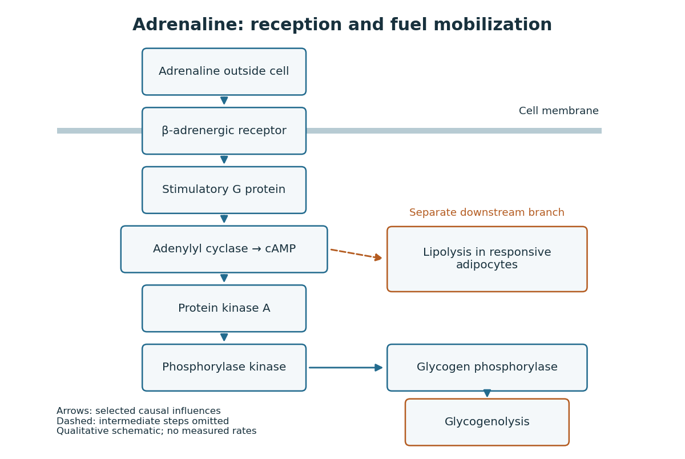

**[Figure 6](#image-adrenaline-reception-and-camp-dependent-fuel-mobilization). Adrenaline reception and cAMP-dependent fuel mobilization**. Original pathway schematic. Solid arrows show a selected activating relay to [glycogenolysis](biology.md#glycogenolysis); the dashed branch summarizes promotion of [lipolysis](biology.md#lipolysis) in responsive [adipocytes](physiology.md#adipocyte), omitting its intermediate steps. Arrows denote causal influences, not transport of [adrenaline](#adrenaline) into the [biological cell](biological-cell.md), reaction rates or measured yields.

The two reserves provide different material. [Glycogenolysis](biology.md#glycogenolysis) draws on [glycogen](biology.md#glycogen); [lipolysis](biology.md#lipolysis) breaks down stored [triglycerides](chemical-substance.md#triglyceride), releasing [fatty acids](chemical-substance.md#fatty-acid) and [glycerol](chemical-substance.md#glycerol). A [skeletal muscle](physiology.md#skeletal-muscle) [biological cell](biological-cell.md)'s own reserve and fuel released by [adipose tissue](physiology.md#adipose-tissue) are different supplies. Increasing a signal cannot mobilize an empty reserve: receptor activation changes the use of available material rather than creating fuel. The [adrenergic adipocyte assay](#adrenergic-adipocyte-assay) below gives direct human evidence for the [lipolysis](biology.md#lipolysis) branch.[Abstract: epinephrine-stimulated glycerol release as an index of lipolysis](biology-bibliography.md#pharmacological-characterizations-of-adrenergic-receptors-in-human-adipocytes-by-thomas-w-burns-and-others)

Receptor context can even oppose this branch. In the human [adipocyte](physiology.md#adipocyte) preparation below, [beta-adrenergic receptors](protein.md#beta-adrenergic-receptor) promoted [cAMP](#cyclic-adenosine-monophosphate) accumulation, whereas [alpha-2 adrenergic receptors](protein.md#alpha-2-adrenergic-receptor) opposed it. [Alpha-1 adrenergic receptors](protein.md#alpha-1-adrenergic-receptor) were associated with a different [phospholipid](chemical-substance.md#phospholipid) readout. The balance of these responses matters more than the name of the messenger alone.[Abstract: opposing beta and alpha-2 coupling; separate alpha-1 phospholipid response](biology-bibliography.md#pharmacological-characterizations-of-adrenergic-receptors-in-human-adipocytes-by-thomas-w-burns-and-others)

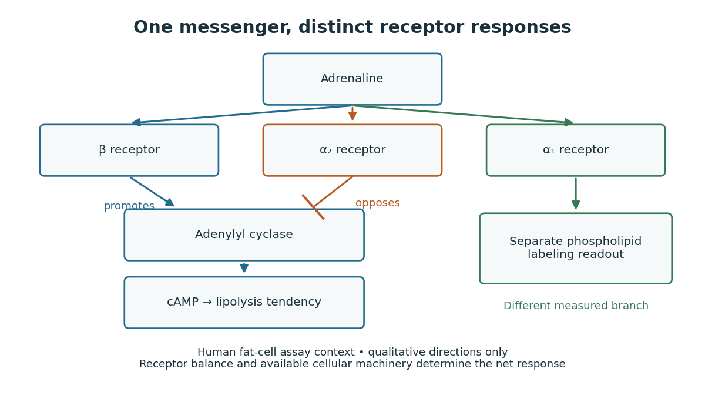

**[Figure 7](#image-different-adrenergic-receptors-interpret-the-same-adrenaline-signal). Different adrenergic receptors interpret the same adrenaline signal**. Original qualitative receptor-context schematic based on the human [adrenergic adipocyte assay](#adrenergic-adipocyte-assay). An arrow denotes promotion; a flat-ended line denotes opposition. The separate [alpha-1 adrenergic receptor](protein.md#alpha-1-adrenergic-receptor) branch represents the [phospholipid](chemical-substance.md#phospholipid) readout, not a second activating arrow to [cAMP](#cyclic-adenosine-monophosphate). No response magnitude, universal tissue distribution or experimental curve is implied.

This separation is useful when explaining [signal transduction](signal-transduction.md): ask which [receptor](protein.md#receptor-biochemistry) is present, which relay it controls, which reserve or target is available, and which response was actually measured. [Receptor binding occupancy](protein.md#receptor-binding-occupancy), [second messenger](#second-messenger) production and final fuel release are distinct observations. A stronger [cAMP](#cyclic-adenosine-monophosphate) signal need not imply an equally large change in every downstream process; substrate availability and the rest of the receiving [biological cell](biological-cell.md) still matter.

The extract-transfer experiment under [second messenger](#second-messenger) supplies the earlier experimental separation between [hormone](#hormone) reception and an intracellular intermediary. Its existing account includes the preparations and controls. The complementary [adrenergic adipocyte assay](#adrenergic-adipocyte-assay) asks a different question: can the same [adrenaline](#adrenaline) stimulus engage opposing [receptors](protein.md#receptor-biochemistry) within a human preparation?

#### Adrenergic adipocyte assay

↑ **Parent:** [Adrenaline](#adrenaline)

In the 1981 study, investigators incubated human [adipocytes](physiology.md#adipocyte) or their [cell membranes](cell-membrane.md) from fat near the abdominal lining with [epinephrine](#adrenaline). They combined detection of bound [ligands](protein.md#ligand-biochemistry) by [radioactive decay](physics.md#radioactive-decay) with biochemical readouts: [adenylyl cyclase](enzyme.md#adenylyl-cyclase) activity, [cAMP](#cyclic-adenosine-monophosphate) and released [glycerol](chemical-substance.md#glycerol). Blocking [alpha-2 adrenergic receptors](protein.md#alpha-2-adrenergic-receptor) increased the [epinephrine](#adrenaline) response; blocking [alpha-1 adrenergic receptors](protein.md#alpha-1-adrenergic-receptor) did not. A separate labeled-[phosphate](chemical-substance.md#phosphate) incorporation readout in a [phospholipid](chemical-substance.md#phospholipid) showed the reverse blocker sensitivity. Thus the comparisons separated response branches.[Abstract, first through fourth paragraphs: human properitoneal preparations, radioligand binding, biochemical readouts; yohimbine versus prazosin comparisons](biology-bibliography.md#pharmacological-characterizations-of-adrenergic-receptors-in-human-adipocytes-by-thomas-w-burns-and-others)

The [glycerol](chemical-substance.md#glycerol) readout indicates [lipolysis](biology.md#lipolysis), rather than directly measuring whole-body fuel use. Isolated [adipocytes](physiology.md#adipocyte) omit circulation and nervous input; blocker selectivity also limits the inference. These comparisons support receptor-specific responses in that preparation, not identical behavior in all [biological cells](biological-cell.md).

### Glucagon

↑ **Parent:** [Hormone](#hormone)  
ⓦ [Wiki](https://en.wikipedia.org/wiki/Glucagon)

[Glucagon](#glucagon) is a [peptide hormone](#peptide-hormone) made by [alpha cells](physiology.md#alpha-cell) in the [pancreatic islets](physiology.md#pancreatic-islets). Its mature [polypeptide](protein.md#polypeptide) has 29 [amino acid residues](protein.md#amino-acid-residue). [Alpha cells](physiology.md#alpha-cell) store [glucagon](#glucagon) in [secretory granules](biological-cell.md#secretory-granule) and release it by [exocytosis](cell-membrane.md#exocytosis). [Glucagon](#glucagon) is a message about fuel availability; [glucose](chemical-substance.md#glucose) is the [sugar](chemical-substance.md#sugar) whose supply it helps regulate. A falling [blood glucose](physiology.md#blood-sugar) [concentration](mathematical-physics.md#concentration) favors [glucagon](#glucagon) release, whereas a rise usually suppresses it. [Amino acids](chemical-substance.md#amino-acid) can also stimulate release, so a meal containing [protein](protein.md) need not produce the same [hormone](#hormone) pattern as a meal dominated by [carbohydrates](chemical-substance.md#carbohydrate). [Glucagon Physiology](biology-bibliography.md#endotext/glucagon-physiology)

The principal [blood glucose](physiology.md#blood-sugar)-raising target is the [liver](physiology.md#liver). In a [hepatocyte](physiology.md#hepatocyte), the [glucagon receptor](protein.md#glucagon-receptor) is a [G protein-coupled receptor](protein.md#g-protein-coupled-receptor): activation of a stimulatory [G protein](protein.md#g-protein) drives [adenylyl cyclase](enzyme.md#adenylyl-cyclase), increasing the [second messenger](#second-messenger) [cAMP](#cyclic-adenosine-monophosphate) and activating [protein kinase A](enzyme.md#protein-kinase-a). Downstream [phosphorylation](chemical-reaction.md#phosphorylation), including the [phosphorylase kinase](enzyme.md#phosphorylase-kinase) relay to [glycogen phosphorylase](enzyme.md#glycogen-phosphorylase), favors [glycogenolysis](biology.md#glycogenolysis). [Glucagon](#glucagon) also supports [gluconeogenesis](biology.md#gluconeogenesis). These are different supplies: [glycogenolysis](biology.md#glycogenolysis) draws on a finite [glycogen](biology.md#glycogen) reserve, whereas [gluconeogenesis](biology.md#gluconeogenesis) makes [glucose](chemical-substance.md#glucose) from other [substrates](enzyme.md#substrate-biochemistry) and depends on their availability. Longer fasting depletes the [glycogen](biology.md#glycogen) reserve; a stronger [hormone](#hormone) signal cannot release material that is no longer there. [Glucagon Physiology](biology-bibliography.md#endotext/glucagon-physiology) [17.9 The Endocrine Pancreas](biology-bibliography.md#anatomy-and-physiology-2e-by-j-gordon-betts-and-others/17-9-the-endocrine-pancreas)

Do not copy the [liver](physiology.md#liver) pathway into every target of [insulin](protein.md#insulin). [Skeletal muscle](physiology.md#skeletal-muscle) uses its own [glycogen](biology.md#glycogen) reserve locally; its [glucose](chemical-substance.md#glucose) uptake and the [liver](physiology.md#liver)'s [glucose](chemical-substance.md#glucose) output are different flows. Nor is direct [glucagon](#glucagon)-stimulated [lipolysis](biology.md#lipolysis) in human [adipose tissue](physiology.md#adipose-tissue) as firmly established as its action in the [liver](physiology.md#liver). [Glucagon](#glucagon) action depends on the tissue, other [hormones](#hormone), and available [substrates](enzyme.md#substrate-biochemistry). [Glucagon Physiology](biology-bibliography.md#endotext/glucagon-physiology)

There is a useful surprise inside the [pancreatic islets](physiology.md#pancreatic-islets): local [glucagon](#glucagon) can support [insulin](protein.md#insulin) release from neighboring [beta cells](physiology.md#beta-cell). The [islet perifusion experiment](#islet-perifusion-experiment) distinguishes that interaction from [glucagon](#glucagon)'s action on the [liver](physiology.md#liver). Thus the two [hormones](#hormone) can oppose each other's effects on [blood glucose](physiology.md#blood-sugar) while cooperating locally. [Delta cells](physiology.md#delta-cell) supply another local brake through [somatostatin](#somatostatin). [Intraislet glucagon signaling is critical for maintaining glucose homeostasis by Lu Zhu and others](biology-bibliography.md#intraislet-glucagon-signaling-is-critical-for-maintaining-glucose-homeostasis-by-lu-zhu-and-others) [17.9 The Endocrine Pancreas](biology-bibliography.md#anatomy-and-physiology-2e-by-j-gordon-betts-and-others/17-9-the-endocrine-pancreas)

#### Islet perifusion experiment

↑ **Parent:** [Glucagon](#glucagon)

[Intraislet glucagon signaling is critical for maintaining glucose homeostasis by Lu Zhu and others](biology-bibliography.md#intraislet-glucagon-signaling-is-critical-for-maintaining-glucose-homeostasis-by-lu-zhu-and-others) tested whether local [glucagon](#glucagon) supports [insulin](protein.md#insulin) release. For human [pancreatic islets](physiology.md#pancreatic-islets), a computer-controlled flow system delivered a [buffer solution](acid-base-chemistry.md#buffer-solution) at $1\,\mathrm{ml}/\mathrm{min}$ through a chamber holding 500 [pancreatic islets](physiology.md#pancreatic-islets) on a nylon filter at $37\,{}^\circ\mathrm C$. A fraction collector sampled the outgoing fluid. With an [amino acid](chemical-substance.md#amino-acid) mixture present, the experiment changed [glucose](chemical-substance.md#glucose) from $3$ to $16.7\,\mathrm{mM}$ and compared [GLP-1 receptor](protein.md#glucagon-like-peptide-1-receptor) blockade with fluid lacking the blocker. The readout was released [insulin](protein.md#insulin) and [glucagon](#glucagon): blockade reduced [glucose](chemical-substance.md#glucose)-stimulated [insulin](protein.md#insulin) release without significantly changing [glucagon](#glucagon) release. [Intraislet glucagon signaling is critical for maintaining glucose homeostasis by Lu Zhu and others](biology-bibliography.md#intraislet-glucagon-signaling-is-critical-for-maintaining-glucose-homeostasis-by-lu-zhu-and-others)

Complementary mouse experiments suppressed [alpha cell](physiology.md#alpha-cell) activity using an engineered [G protein-coupled receptor](protein.md#g-protein-coupled-receptor). [ELISA](biology.md#elisa) assays of minute-by-minute effluent samples measured [insulin](protein.md#insulin) and [glucagon](#glucagon) [concentrations](mathematical-physics.md#concentration), providing the [hormone](#hormone) release readout. Drug-treated control [pancreatic islets](physiology.md#pancreatic-islets) lacking that engineered [receptor](protein.md#receptor-biochemistry) checked for drug effects; adding [glucagon](#glucagon) restored [insulin](protein.md#insulin) release in the suppressed preparation. Together, blockade and rescue support local [signal transduction](signal-transduction.md) from [alpha cells](physiology.md#alpha-cell) to [beta cells](physiology.md#beta-cell). Isolated [pancreatic islets](physiology.md#pancreatic-islets) omit intact circulation and nervous input; the human preparation came from five donors, and blocker specificity and donor variation limit generalization. A chamber response does not directly measure whole-body [blood glucose](physiology.md#blood-sugar) control. [Intraislet glucagon signaling is critical for maintaining glucose homeostasis by Lu Zhu and others](biology-bibliography.md#intraislet-glucagon-signaling-is-critical-for-maintaining-glucose-homeostasis-by-lu-zhu-and-others)

### Peptide hormone

↑ **Parent:** [Hormone](#hormone)  
ⓦ [Wiki](https://en.wikipedia.org/wiki/Peptide_hormone)

#### Somatostatin

↑ **Parent:** [Peptide hormone](#peptide-hormone)  
ⓦ [Wiki](https://en.wikipedia.org/wiki/Somatostatin)

## Signaling feedback

↑ **Parent:** [Signal transduction](signal-transduction.md)

[Signaling feedback](#signaling-feedback) returns the effect of a downstream event to an earlier stage of [signal transduction](signal-transduction.md), closing a loop analogous to [feedback control](control-theory.md#closed-loop-control). Trace the causal arrows: if an earlier relay activates a later relay and the later relay changes the earlier relay's activity, the return path closes the loop. [Negative feedback](#negative-feedback) opposes the initiating change; [positive feedback](#positive-feedback) reinforces it. [Signaling feedback](#signaling-feedback) is a possible property of [signal transduction](signal-transduction.md), not a requirement of every pathway.

For a schematic example, let relay $A$ activate relay $B$. If $B$ inhibits $A$, increased $A$ eventually produces an opposing influence: [negative feedback](#negative-feedback). If $B$ activates $A$, increased $A$ produces a reinforcing influence: [positive feedback](#positive-feedback). These signs describe effects on activity, rather than the direction in which [molecules](molecule.md) travel. A closed loop containing two inhibitions can have [positive feedback](#positive-feedback), because inhibiting an inhibitor reinforces the original change. The sign belongs to the whole loop.

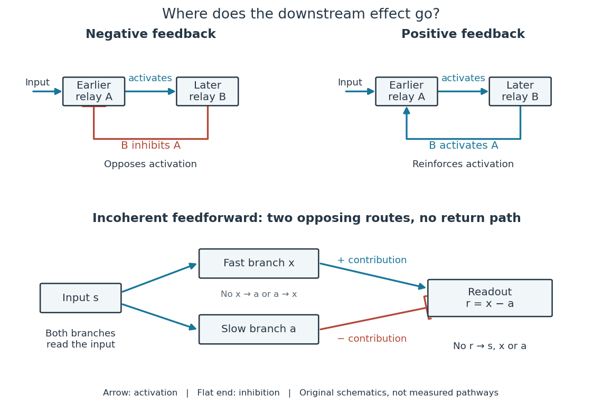

**[Figure 8](#image-negative-feedback-positive-feedback-and-an-incoherent-feedforward-loop). Negative feedback, positive feedback and an incoherent feedforward loop**. Original causal schematics. Arrows activate; flat-ended lines inhibit. The upper loops return from downstream relay $B$ to earlier relay $A$. In the lower [incoherent feedforward loop](#incoherent-feedforward-loop), input $s$ drives both a fast activating branch $x$ and a slower inhibitory branch $a$; their contributions meet at readout $r$. There is no return arrow from $r$ to either branch or to $s$. Shapes and connections illustrate the distinction, rather than a measured pathway.

[Negative feedback](#negative-feedback) can restrain excessive activation and help preserve a usable range of responses. [Positive feedback](#positive-feedback) can support a decisive transition: Alberts and colleagues describe an [enzyme](enzyme.md) whose product increases its own activity. Such reinforcement can contribute to switchlike behavior, but a [positive feedback](#positive-feedback) arrow alone does not prove [bistability](dynamical-systems.md#bistability). A different structure, an [incoherent feedforward loop](#incoherent-feedforward-loop), sends opposing influences forward from the same input; inhibition there is not a downstream return. [General Principles of Cell Communication](biology-bibliography.md#molecular-biology-of-the-cell-4th-edition-by-bruce-alberts-and-others/general-principles-of-cell-communication) [Ma et al., Defining Network Topologies that Can Achieve Biochemical Adaptation, Cell 138 (2009), pp. 760–773: definitions on p. 764](https://cqb.pku.edu.cn/tanglab/pdf/78.pdf)

A worked [mathematical model](mathematics.md#mathematical-model) shows why [negative feedback](#negative-feedback) does not automatically produce complete [signaling adaptation](#signaling-adaptation). Let $s$ be a fixed normalized input, $r$ a normalized response, $g\geq0$ a dimensionless [feedback gain](control-theory.md#feedback-gain), and $\tau>0$ a [time constant](analysis.md#time-constant). Suppose response removal contributes $-r$ and a return proportional to the response contributes $-gr$. The [ordinary differential equation](differential-equation.md#ordinary-differential-equation) is

$$
\tau\frac{dr}{dt}=s-r-gr=s-(1+g)r.
$$

Setting the [derivative](calculus.md#derivative) to zero gives the [equilibrium point](dynamical-systems.md#equilibrium-point-of-a-dynamical-system) $r_*=s/(1+g)$. A displacement $\delta r=r-r_*$ obeys $\tau\,d(\delta r)/dt=-(1+g)\delta r$, so its decaying [exponential function](calculus.md#exponential-function) establishes [asymptotic stability](dynamical-systems.md#asymptotic-stability). For a unit input switched on at $t=0$, [initial condition](differential-equation.md#initial-condition) $r(0)=0$, $g=2$ and $\tau=1$ second,

$$
r(t)=\frac{1-e^{-3t/\tau}}{3},\qquad r(1\,\mathrm{s})\simeq0.316737,\qquad \lim_{t\to\infty}r(t)=\frac13.
$$

The [negative feedback](#negative-feedback) reduces the eventual response from $1$ to $1/3$, but this response rises monotonically and never returns to its zero baseline. Attenuation and complete [signaling adaptation](#signaling-adaptation) are different properties. This deliberately simple [mathematical model](mathematics.md#mathematical-model) specifies no molecular pathway; [integral action](control-theory.md#integral-action) provides a contrasting way to remove a lasting offset in a stable [feedback control](control-theory.md#closed-loop-control) system. [Åström and Murray, Feedback Systems, Chapter 2: proportional and integral feedback](https://www.fbswiki.org/wiki/index.php/Feedback_Principles)

### Negative feedback

↑ **Parent:** [Signaling feedback](#signaling-feedback)

[Negative feedback](#negative-feedback) closes a causal loop whose net effect opposes an initiating change. In [signal transduction](signal-transduction.md), activation followed by a downstream inhibition of the earlier activating stage is one example of [negative feedback](#negative-feedback). Loop sign alone does not establish [asymptotic stability](dynamical-systems.md#asymptotic-stability) or complete [signaling adaptation](#signaling-adaptation); see the worked [signaling feedback](#signaling-feedback) example.

A useful biological example is [chemotaxis feedback regulation](#chemotaxis-feedback-regulation): an [Escherichia coli](organism.md#escherichia-coli) [biological cell](biological-cell.md) adjusts its response to a sustained attractant instead of remaining at its immediate response. Increased [CheA](#chea) activity promotes [CheB](#cheb) [phosphorylation](chemical-reaction.md#phosphorylation); [CheB](#cheb) reverses [receptor methylation](#receptor-methylation), opposing their activation. After attractant addition, reduced activity instead favors [receptor methylation](#receptor-methylation) by [CheR](#cher), restoring activity. This is a return from [receptor](protein.md#receptor-biochemistry) activity to the machinery regulating that activity. The response need not return exactly at every dose. [Precision and Kinetics of Adaptation in Bacterial Chemotaxis by Yigal Meir and others](biology-bibliography.md#precision-and-kinetics-of-adaptation-in-bacterial-chemotaxis-by-yigal-meir-and-others)

A motivating measurement is the [chemotaxis FRET assay](#chemotaxis-fret-assay). [CheY](#chey) and [CheZ](#chez) carrying yellow and cyan fluorescent tags were observed in immobilized [Escherichia coli](organism.md#escherichia-coli) [biological cells](biological-cell.md) on a coverslip in a flow chamber. Adding and removing attractant changed the yellow-to-cyan emission [ratio](arithmetic.md#ratio), reporting the association of phosphorylated [CheY](#chey) with [CheZ](#chez). This measures a molecular readout upstream of motor behavior. Comparisons with [biological cells](biological-cell.md) lacking [CheR](#cher), [CheB](#cheb), or both tested the dependence on [receptor](protein.md#receptor-biochemistry) modification; these perturbations also change starting activity and sensitivity, so they are not pure changes of one [feedback gain](control-theory.md#feedback-gain). [Receptor sensitivity in bacterial chemotaxis by Victor Sourjik and others](biology-bibliography.md#receptor-sensitivity-in-bacterial-chemotaxis-by-victor-sourjik-and-others)

The later [chemotaxis feedback regulation](#chemotaxis-feedback-regulation) experiment used only the [Tar receptor](#tar-receptor) and nonmetabolizable methylaspartate, supplied and removed by flow. Long recordings separated slow recovery from incomplete [signaling adaptation](#signaling-adaptation); correction for bleaching addressed drift in the optical readout. Activity recovered incompletely after sufficiently large additions, with detectable imprecision already at $10\,\mathrm{\mu M}$ in that preparation. Restricting the [receptor](protein.md#receptor-biochemistry) type and preventing consumption of the stimulus help interpret the perturbation, but limit transfer to other [receptors](protein.md#receptor-biochemistry) and conditions. The readout infers [CheA](#chea) activity through [CheY](#chey)-[CheZ](#chez) association, rather than directly measuring every molecular step. [Precision and Kinetics of Adaptation in Bacterial Chemotaxis by Yigal Meir and others](biology-bibliography.md#precision-and-kinetics-of-adaptation-in-bacterial-chemotaxis-by-yigal-meir-and-others)

[Negative feedback](#negative-feedback) can also overshoot or sustain [oscillations](wave.md#oscillation) if its return arrives too late. The worked [signaling feedback](#signaling-feedback) example gives the contrasting instantaneous case; the [delayed negative feedback model](#delayed-negative-feedback-model) below isolates the effect of timing. Loop sign describes causation, while [asymptotic stability](dynamical-systems.md#asymptotic-stability) describes what happens to displacements over time.

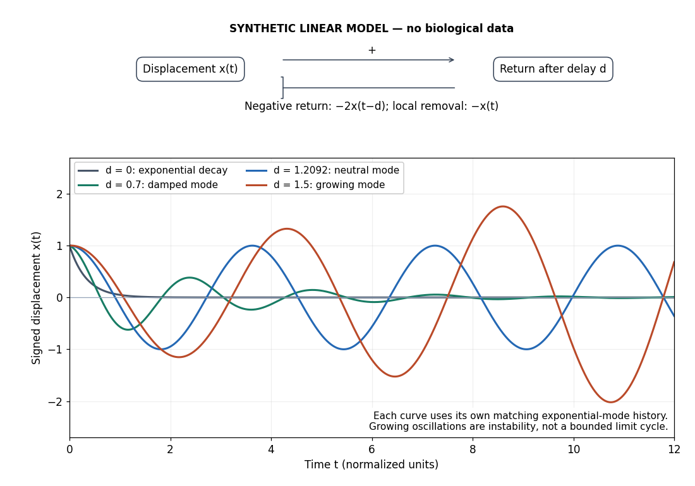

**[Figure 9](#image-negative-feedback-with-an-instantaneous-or-delayed-return). Negative feedback with an instantaneous or delayed return**. Original synthetic [delay differential equation](differential-equation.md#delay-differential-equation) modes, not measured [chemotaxis](mathematical-biology.md#chemotaxis) responses. All variables and time are normalized. The same negative return coefficient is used throughout; only its delay changes. Each curve has its own matching history. A growing [oscillation](wave.md#oscillation) signals instability of this linear [mathematical model](mathematics.md#mathematical-model), not a bounded biological rhythm.

#### Delayed negative feedback model

↑ **Parent:** [Negative feedback](#negative-feedback)

A [feedback delay](control-theory.md#feedback-delay) is a time interval between an event and its returning influence. Multiple biochemical steps can introduce an effective lag; a fixed delay is an idealization, not a universal description of [signal transduction](signal-transduction.md). To isolate timing, let $x$ be a signed displacement from an [equilibrium point](dynamical-systems.md#equilibrium-point-of-a-dynamical-system) and use normalized [dimensionless variables](mathematics.md#dimensionless-variable):

$$
\frac{dx}{dt}=-x(t)-2x(t-d),\qquad d\geq0.
$$

The local removal is $-x$ and the returning influence is negative at every delay. At $d=0$ the [ordinary differential equation](differential-equation.md#ordinary-differential-equation) reduces to the decay already illustrated under [signaling feedback](#signaling-feedback). For $d>0$ a [delay differential equation](differential-equation.md#delay-differential-equation) requires a history on $[-d,0]$, not just an [initial condition](differential-equation.md#initial-condition) at one instant. Negative values of $x$ are displacements, not negative chemical [concentrations](mathematical-physics.md#concentration).

An [exponential function](calculus.md#exponential-function) $x=e^{\lambda t}$ gives the [characteristic equation of a delay differential equation](mathematical-biology.md#characteristic-equation-of-a-delay-differential-equation)

$$
\lambda+1+2e^{-\lambda d}=0.
$$

Putting $\lambda=i\omega$ and equating real and imaginary parts gives $\cos(\omega d)=-1/2$ and $\omega=2\sin(\omega d)$. The first crossing with $\omega>0$ therefore occurs at

$$
\omega=\sqrt3,\qquad d_c=\frac{2\pi}{3\sqrt3}\simeq1.20920.
$$

For this particular [mathematical model](mathematics.md#mathematical-model), the [equilibrium point](dynamical-systems.md#equilibrium-point-of-a-dynamical-system) is [asymptotically stable](dynamical-systems.md#asymptotic-stability) for $0\leq d<d_c$. No nonnegative real [delayed feedback characteristic root](#delayed-feedback-characteristic-root) can satisfy the equation; the first loss of [asymptotic stability](dynamical-systems.md#asymptotic-stability) is the indicated pair of imaginary [delayed feedback characteristic roots](#delayed-feedback-characteristic-root). Differentiating the [characteristic equation of a delay differential equation](mathematical-biology.md#characteristic-equation-of-a-delay-differential-equation) along a root yields

$$
\frac{d\lambda}{dd}=-\frac{\lambda(\lambda+1)}{1+d(\lambda+1)},\qquad \operatorname{Re}\left(\frac{d\lambda}{dd}\right)_{d=d_c}=\frac{3}{(1+d_c)^2+3d_c^2}>0.
$$

Thus the pair moves into growth as the delay increases through $d_c$. The neutral mode at $d_c$ is a [periodic function](function.md#periodic-function), but its amplitude depends on history: this linear [mathematical model](mathematics.md#mathematical-model) does not select an attracting [limit cycle](dynamical-systems.md#limit-cycle).

The figure plots $x(t)=e^{at}\cos(bt)$ using a [delayed feedback characteristic root](#delayed-feedback-characteristic-root) $\lambda=a+ib$ and that same formula on the history interval. At $d=0.7$ the displayed mode decays; at $d=1.5$ it grows. These are exact modes up to numerical root accuracy, not step responses with identical histories. Molecular bounds and a changed return law would be needed to interpret what happens after an unstable biological response becomes large.

##### Delayed feedback characteristic root

↑ **Parent:** [Delayed negative feedback model](#delayed-negative-feedback-model)

A [delayed feedback characteristic root](#delayed-feedback-characteristic-root) solves the [characteristic equation of a delay differential equation](mathematical-biology.md#characteristic-equation-of-a-delay-differential-equation) and supplies an [exponential function](calculus.md#exponential-function) mode. Its [real part](complex-analysis.md#real-part) determines decay or growth of that mode.

#### Chemotaxis feedback regulation

↑ **Parent:** [Negative feedback](#negative-feedback)

In [Escherichia coli](organism.md#escherichia-coli), [chemotaxis feedback regulation](#chemotaxis-feedback-regulation) couples [receptor](protein.md#receptor-biochemistry) activity to modification of the [receptors](protein.md#receptor-biochemistry) by [CheR](#cher) and [CheB](#cheb). It is a molecular example of [negative feedback](#negative-feedback) supporting [signaling adaptation](#signaling-adaptation), with precision and kinetics assessed by the [chemotaxis FRET assay](#chemotaxis-fret-assay) above.

##### Robust perfect adaptation

↑ **Parent:** [Chemotaxis feedback regulation](#chemotaxis-feedback-regulation)

Return of an output to its original steady value after a persistent input change, with the adaptation property persisting over a range of model parameters. [integral action](control-theory.md#integral-action) can implement this property under stability and operating-range assumptions.

##### Receptor methylation

↑ **Parent:** [Chemotaxis feedback regulation](#chemotaxis-feedback-regulation)

##### Tar receptor

↑ **Parent:** [Chemotaxis feedback regulation](#chemotaxis-feedback-regulation)

##### Chemotaxis feedback proteins

↑ **Parent:** [Chemotaxis feedback regulation](#chemotaxis-feedback-regulation)

###### CheW

↑ **Parent:** [Chemotaxis feedback proteins](#chemotaxis-feedback-proteins)

[CheW](#chew) is a coupling protein linking chemotaxis receptor arrays to CheA-associated signalling complexes. Removing it from a reconstituted system can test its functional requirement, while a physical-interface assay addresses direct contacts.

###### CheA

↑ **Parent:** [Chemotaxis feedback proteins](#chemotaxis-feedback-proteins)

[CheA](#chea) is the signaling [enzyme](enzyme.md) that promotes [phosphorylation](chemical-reaction.md#phosphorylation) of [CheY](#chey) and [CheB](#cheb) in the [chemotaxis feedback regulation](#chemotaxis-feedback-regulation) pathway.

###### CheB

↑ **Parent:** [Chemotaxis feedback proteins](#chemotaxis-feedback-proteins)

[CheB](#cheb) is an [enzyme](enzyme.md) that reverses [receptor methylation](#receptor-methylation) in [chemotaxis](mathematical-biology.md#chemotaxis); its regulation contributes to [negative feedback](#negative-feedback).

###### CheR

↑ **Parent:** [Chemotaxis feedback proteins](#chemotaxis-feedback-proteins)

[CheR](#cher) is an [enzyme](enzyme.md) that catalyzes [receptor methylation](#receptor-methylation) in [chemotaxis](mathematical-biology.md#chemotaxis), contributing to [signaling adaptation](#signaling-adaptation).

###### CheY

↑ **Parent:** [Chemotaxis feedback proteins](#chemotaxis-feedback-proteins)

The [phosphorylation](chemical-reaction.md#phosphorylation) state of the [protein](protein.md) [CheY](#chey) connects [receptor](protein.md#receptor-biochemistry) signaling to motor behavior in [Escherichia coli](organism.md#escherichia-coli).

###### CheZ

↑ **Parent:** [Chemotaxis feedback proteins](#chemotaxis-feedback-proteins)

[CheZ](#chez) is an [enzyme](enzyme.md) that binds phosphorylated [CheY](#chey) and accelerates removal of its [phosphate](chemical-substance.md#phosphate).

##### Chemotaxis FRET assay

↑ **Parent:** [Chemotaxis feedback regulation](#chemotaxis-feedback-regulation)

The [chemotaxis FRET assay](#chemotaxis-fret-assay) uses [Förster resonance energy transfer](biology.md#forster-resonance-energy-transfer) between fluorescent tags on [CheY](#chey) and [CheZ](#chez) to report their association. Interpreting this emission [ratio](arithmetic.md#ratio) as [CheA](#chea) activity requires the coupling between [CheY](#chey) [phosphorylation](chemical-reaction.md#phosphorylation) and [CheZ](#chez) binding described in the experimental sources above.

### Positive feedback

↑ **Parent:** [Signaling feedback](#signaling-feedback)

[Positive feedback](#positive-feedback) closes a causal loop whose net effect reinforces an initiating change. A loop with two inhibitory links can therefore have [positive feedback](#positive-feedback). In [signal transduction](signal-transduction.md), a product that increases the activity of the [enzyme](enzyme.md) making it illustrates reinforcement; the consequences depend on the full [mathematical model](mathematics.md#mathematical-model), not just the loop sign. See [signaling feedback](#signaling-feedback).

A biological example is [cell-cycle activation feedback](#cell-cycle-activation-feedback). [Cyclin B](#cyclin-b) binds [Cdc2](#cyclin-dependent-kinase-1), whose activity promotes activation of [Cdc25](#cdc25); [Cdc25](#cdc25) removes inhibitory [phosphorylation](chemical-reaction.md#phosphorylation) from [Cdc2](#cyclin-dependent-kinase-1), permitting further activation. [Cdc2](#cyclin-dependent-kinase-1) also inhibits [Wee1](#wee1), an [enzyme](enzyme.md) that inhibits [Cdc2](#cyclin-dependent-kinase-1) through [phosphorylation](chemical-reaction.md#phosphorylation). That second return contains two inhibitions and therefore also has [positive feedback](#positive-feedback). These are regulatory paths, not a claim that every connection is a single direct molecular encounter. [Multisite phosphoregulation of Cdc25 activity refines the mitotic entrance and exit switches by Lucy X. Lu and others](biology-bibliography.md#multisite-phosphoregulation-of-cdc25-activity-refines-the-mitotic-entrance-and-exit-switches-by-lucy-x-lu-and-others)

Reinforcement can preserve a decision after its initiating stimulus weakens: returning from the high state may require a lower input than entering it. The [cell-cycle hysteresis experiment](#cell-cycle-hysteresis-experiment) below tests this history dependence at matched [cyclin B](#cyclin-b) [concentrations](mathematical-physics.md#concentration). A steep response alone is insufficient evidence of [bistability](dynamical-systems.md#bistability), and finite observation times can make slow relaxation look like memory. A proposed switch must specify its input, readout and observation interval.

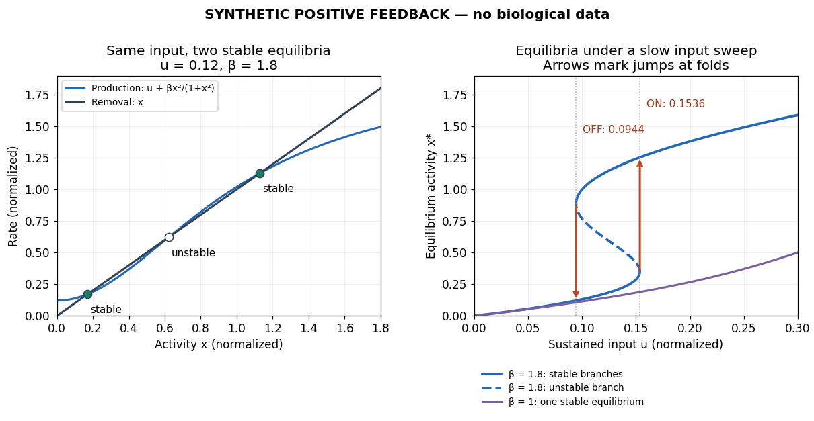

**[Figure 10](#image-a-synthetic-positive-feedback-switch-and-its-hysteresis-thresholds). A synthetic positive feedback switch and its hysteresis thresholds**. Original computed [equilibrium points](dynamical-systems.md#equilibrium-point-of-a-dynamical-system) of a normalized saturating [mathematical model](mathematics.md#mathematical-model), not [cyclin B](#cyclin-b) measurements or a fit to [Cdc2](#cyclin-dependent-kinase-1). Filled intersections are [asymptotically stable](dynamical-systems.md#asymptotic-stability); the open intersection is unstable. With $\beta=1.8$, a slow sweep follows stable branches until their folds; with $\beta=1$, the same positive return has only one stable [equilibrium point](dynamical-systems.md#equilibrium-point-of-a-dynamical-system).

#### Double-negative feedback

↑ **Parent:** [Positive feedback](#positive-feedback)

A reinforcing circuit in which two activities inhibit one another, potentially stabilizing mutually exclusive states.

#### Saturating positive feedback

↑ **Parent:** [Positive feedback](#positive-feedback)

[Saturating positive feedback](#saturating-positive-feedback) limits the reinforcing rate as activity increases. Here is an explicitly synthetic [ordinary differential equation](differential-equation.md#ordinary-differential-equation) for normalized nonnegative input $u$, response $x$, and return strength $\beta$:

$$
\frac{dx}{dt}=f(x;u,\beta)=u+\frac{\beta x^2}{1+x^2}-x,\qquad u\geq0,\quad\beta\geq0.
$$

The return is an increasing, nonproportional function of $x$, while removal is proportional to $x$. Time and activities are [dimensionless variables](mathematics.md#dimensionless-variable). At $x=0$ the [vector field](multivariable-calculus.md#vector-field) points into the nonnegative domain, and $dx/dt\leq u+\beta-x$ prevents unbounded growth there. This makes the toy useful for asking about a bounded switch; it supplies no molecular mechanism for the chosen rate law.

At an [equilibrium point](dynamical-systems.md#equilibrium-point-of-a-dynamical-system), $f=0$. For a simple [equilibrium point](dynamical-systems.md#equilibrium-point-of-a-dynamical-system), the sign of the [derivative](calculus.md#derivative)

$$
f_x=\frac{2\beta x}{(1+x^2)^2}-1
$$

determines local [asymptotic stability](dynamical-systems.md#asymptotic-stability). If $\beta=1$, the maximum reinforcing slope is $3\sqrt3/8<1$, so $f$ decreases strictly: every $u\geq0$ has one [asymptotically stable](dynamical-systems.md#asymptotic-stability) [equilibrium point](dynamical-systems.md#equilibrium-point-of-a-dynamical-system) despite [positive feedback](#positive-feedback).

Three [equilibrium points](dynamical-systems.md#equilibrium-point-of-a-dynamical-system) become possible only if the reinforcing slope exceeds removal's slope somewhere. Its maximum is $3\sqrt3\beta/8$, at $x=1/\sqrt3$. Consequently this toy requires

$$
\beta>\frac{8}{3\sqrt3}\simeq1.53960
$$

for two distinct folds. This is a necessary threshold for a [bistability](dynamical-systems.md#bistability) interval in this toy, not a universal biochemical number. At a fold, both $f=0$ and $f_x=0$, giving

$$
(1+x^2)^2=2\beta x,\qquad u=x-\frac{\beta x^2}{1+x^2}.
$$

For $\beta=1.8$, the folds are at $(x,u)\simeq(0.350003,0.153563)$ and $(0.887240,0.094405)$. Between these input values there are two [asymptotically stable](dynamical-systems.md#asymptotic-stability) [equilibrium points](dynamical-systems.md#equilibrium-point-of-a-dynamical-system) separated by an unstable one. At $u=0.12$, the three activities are approximately $0.171331$, $0.621230$ and $1.127439$; the low and high ones are stable.

A sufficiently slow increasing sweep follows the low branch to $u_{\mathrm{on}}\simeq0.153563$ and then jumps upward. A decreasing sweep follows the high branch to $u_{\mathrm{off}}\simeq0.094405$ and then jumps downward: [hysteresis](critical-phenomenon.md#hysteresis). These are limiting quasistatic thresholds, with relaxation between input changes and negligible perturbations that could cause earlier switching. Finite sweep rates and fluctuations can alter observed thresholds. A switchlike response with only one stable [equilibrium point](dynamical-systems.md#equilibrium-point-of-a-dynamical-system) does not have this equilibrium [hysteresis](critical-phenomenon.md#hysteresis) mechanism.

#### Cell-cycle activation feedback

↑ **Parent:** [Positive feedback](#positive-feedback)

[Cell-cycle activation feedback](#cell-cycle-activation-feedback) is the reinforcement of [Cdc2](#cyclin-dependent-kinase-1) activation through [Cdc25](#cdc25) and suppression of [Wee1](#wee1). Its role is to help make transitions in the [cell cycle](cell-cycle.md) decisive; the [cell-cycle hysteresis experiment](#cell-cycle-hysteresis-experiment) tests the resulting states rather than inferring them solely from circuit arrows.

##### Cell-cycle hysteresis experiment

↑ **Parent:** [Cell-cycle activation feedback](#cell-cycle-activation-feedback)

A 2003 study split a [Xenopus laevis egg extract](#xenopus-laevis-egg-extract) into portions with different histories. One received [calcium](chemical-substance.md#calcium) to destroy endogenous [cyclin B](#cyclin-b) before receiving nondegradable [cyclin B](#cyclin-b); the other received nondegradable [cyclin B](#cyclin-b) first, then [calcium](chemical-substance.md#calcium). The same sustained [cyclin B](#cyclin-b) dose was approached from low or high [Cdc2](#cyclin-dependent-kinase-1) activity. A [phosphorimager](#phosphorimager) quantified [histone H1](#histone-h1) [phosphorylation](chemical-reaction.md#phosphorylation), sampling every $15$–$30$ minutes until an apparent stationary response. At $45$–$60\,\mathrm{nM}$, the dose maintained high activity but failed to induce it from the low state.[pp. 3–4, Figure 3a–c: history protocols and H1 readout; p. 6, Methods: phosphorimaging](biology-bibliography.md#building-a-cell-cycle-oscillator-hysteresis-and-bistability-in-the-activation-of-cdc2-by-joseph-r-pomerening-and-others)

Controls tracked labeled endogenous [cyclin B](#cyclin-b) disappearance after [calcium](chemical-substance.md#calcium) treatment and persistence of nondegradable [cyclin B](#cyclin-b), addressing unequal remaining input. The comparison supports [hysteresis](critical-phenomenon.md#hysteresis) under extract conditions; finite observations cannot establish indefinite persistence. It does not isolate each reinforcing path or establish thresholds in intact [biological cells](biological-cell.md).[p. 3, control discussion; p. 4, Figure 3h; reported 60–90 minute approach to apparent steady state](biology-bibliography.md#building-a-cell-cycle-oscillator-hysteresis-and-bistability-in-the-activation-of-cdc2-by-joseph-r-pomerening-and-others)

###### Xenopus laevis egg extract

↑ **Parent:** [Cell-cycle hysteresis experiment](#cell-cycle-hysteresis-experiment)

A [Xenopus laevis egg extract](#xenopus-laevis-egg-extract) is a preparation of egg contents retaining biochemical machinery of the [cell cycle](cell-cycle.md) outside intact [biological cells](biological-cell.md).

###### Histone H1

↑ **Parent:** [Cell-cycle hysteresis experiment](#cell-cycle-hysteresis-experiment)

[Histone H1](#histone-h1) is the [protein](protein.md) used as a substrate for the [Cdc2](#cyclin-dependent-kinase-1) activity readout in the [cell-cycle hysteresis experiment](#cell-cycle-hysteresis-experiment).

###### Phosphorimager

↑ **Parent:** [Cell-cycle hysteresis experiment](#cell-cycle-hysteresis-experiment)

##### Cyclin-dependent kinase 1

↑ **Parent:** [Cell-cycle activation feedback](#cell-cycle-activation-feedback)  
ⓦ [Wiki](https://en.wikipedia.org/wiki/Cyclin-dependent_kinase_1)

[Cyclin-dependent kinase 1](#cyclin-dependent-kinase-1), abbreviated [CDK1](#cyclin-dependent-kinase-1) and historically called [Cdc2](#cyclin-dependent-kinase-1), is the catalytic [protein kinase](enzyme.md#protein-kinase) in the [CDK1](#cyclin-dependent-kinase-1)–[cyclin B](#cyclin-b) assembly. [CDK1](#cyclin-dependent-kinase-1) transfers a [phosphate](chemical-substance.md#phosphate) group from [ATP](molecule.md#adenosine-triphosphate) to a [protein](protein.md) [substrate](enzyme.md#substrate-biochemistry); [cyclin B](#cyclin-b) supplies a regulatory binding partner. Binding and [phosphorylation](chemical-reaction.md#phosphorylation) regulate catalytic competence, so detecting [CDK1](#cyclin-dependent-kinase-1) [protein](protein.md) alone does not establish activity. The distinction makes a durable catalytic component reusable as the [cell cycle](cell-cycle.md) changes its regulatory inputs.[Molecular Biology of the Cell, 4th edition, Components of the Cell-Cycle Control System: “The Cell-Cycle Control System Is Based on Cyclically Activated Protein Kinases”, Figures 17-15–17-16](biology-bibliography.md#molecular-biology-of-the-cell-4th-edition-by-bruce-alberts-and-others/components-of-the-cell-cycle-control-system)

The [cell-cycle activation feedback](#cell-cycle-activation-feedback) uses [CDK1](#cyclin-dependent-kinase-1) activity as both an output and a regulatory input: activity promotes [Cdc25](#cdc25) activation and suppresses [Wee1](#wee1), reinforcing release from inhibitory [phosphorylation](chemical-reaction.md#phosphorylation). The already described [cell-cycle hysteresis experiment](#cell-cycle-hysteresis-experiment) tests how that output depends on history at matched [cyclin B](#cyclin-b) input; the [histone H1 kinase assay](#histone-h1-kinase-assay) below explains what its output measures. A binding diagram alone cannot establish [hysteresis](critical-phenomenon.md#hysteresis).

###### CDK1 phosphorylation state

↑ **Parent:** [Cyclin-dependent kinase 1](#cyclin-dependent-kinase-1)

A [CDK1 phosphorylation state](#cdk1-phosphorylation-state) identifies modified [amino acid residues](protein.md#amino-acid-residue). Different sites have opposite effects: in studied [Xenopus laevis](organism.md#xenopus-laevis) [Cdc2](#cyclin-dependent-kinase-1), Thr14/Tyr15 are inhibitory, while Thr161 [phosphorylation](chemical-reaction.md#phosphorylation) is activating. T denotes a [threonine residue](protein.md#threonine-residue), Y a [tyrosine residue](protein.md#tyrosine-residue), and numbers are [protein primary structure](protein.md#protein-primary-structure) positions. Do not assume this numbering for every [species](biology.md#species).[Solomon, Lee and Kirschner (1992), abstract: mapped Xenopus Thr14/Tyr15, loss of activation with Thr161→Ala, and cyclin binding by the triple mutant](biology-bibliography.md#role-of-phosphorylation-in-p34cdc2-activation-identification-of-an-activating-kinase-by-m-j-solomon-and-others)

The 1992 study supplies a useful separation of mechanisms: replacing Thr14, Tyr15 and Thr161 still permitted [cyclin B](#cyclin-b) binding, but replacing Thr161 prevented activation of [histone H1](#histone-h1) [phosphorylation](chemical-reaction.md#phosphorylation). Binding therefore did not suffice for catalytic activity in that preparation. Activating [phosphorylation](chemical-reaction.md#phosphorylation) also occurred with catalytically inactive [Cdc2](#cyclin-dependent-kinase-1), supporting a separate [CDK-activating kinase](#cdk-activating-kinase) rather than a requirement for intramolecular [autophosphorylation](enzyme.md#autophosphorylation).[Solomon, Lee and Kirschner (1992), abstract: cyclin-binding triple mutant and activating phosphorylation of the kinase-inactive K33R mutant](biology-bibliography.md#role-of-phosphorylation-in-p34cdc2-activation-identification-of-an-activating-kinase-by-m-j-solomon-and-others)

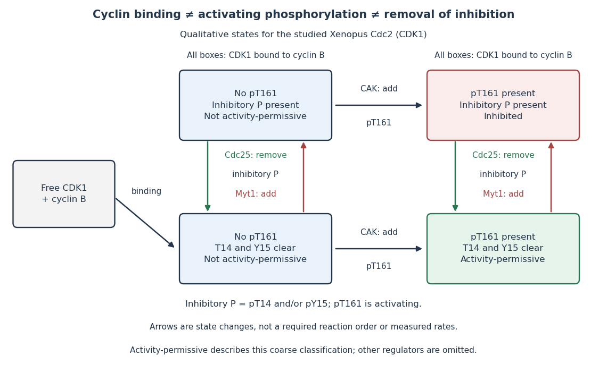

**[Figure 11](#image-cyclin-b-binding-and-site-specific-cdk1-phosphorylation-states-answer-different-questions). Cyclin B binding and site-specific CDK1 phosphorylation states answer different questions**. Original qualitative schematic for the studied [Xenopus laevis](organism.md#xenopus-laevis) [Cdc2](#cyclin-dependent-kinase-1). All four right-hand boxes contain bound [cyclin B](#cyclin-b); only the green box has activating Thr161 [phosphorylation](chemical-reaction.md#phosphorylation) with both inhibitory sites clear. “Inhibitory P present” groups Thr14 and/or Tyr15 modification. Arrows show changes of state, not an obligatory sequence, measured rates, or a complete [cell cycle](cell-cycle.md) model. [Myt1](#myt1) can add either inhibitory modification; [Cdc25](#cdc25) removes inhibitory [phosphate](chemical-substance.md#phosphate) groups.

In this deliberately coarse classification, bound [cyclin B](#cyclin-b), activating [phosphorylation](chemical-reaction.md#phosphorylation), and cleared inhibitory sites must coincide for the activity-permissive state. Removing inhibitory [phosphate](chemical-substance.md#phosphate) groups does not supply missing [cyclin B](#cyclin-b) or activating [phosphorylation](chemical-reaction.md#phosphorylation). Conversely, adding activating [phosphorylation](chemical-reaction.md#phosphorylation) does not erase inhibitory modification. Actual preparations contain mixtures of states and additional regulators; this classification gives no numerical [reaction rate](chemical-kinetics.md#reaction-rate).

###### CDK-activating kinase

↑ **Parent:** [CDK1 phosphorylation state](#cdk1-phosphorylation-state)

A [CDK-activating kinase](#cdk-activating-kinase) is a [protein kinase](enzyme.md#protein-kinase) supplying activating [phosphorylation](chemical-reaction.md#phosphorylation) to a [cyclin-dependent kinase 1](#cyclin-dependent-kinase-1) preparation. The [Xenopus laevis](organism.md#xenopus-laevis) experiment above distinguished this activity from the catalytic activity of [Cdc2](#cyclin-dependent-kinase-1) itself. [CAK](#cdk-activating-kinase) names that function here, without asserting that every [species](biology.md#species) uses the same [protein](protein.md) assembly.

###### Myt1

↑ **Parent:** [CDK1 phosphorylation state](#cdk1-phosphorylation-state)

[Myt1](#myt1) is a [protein kinase](enzyme.md#protein-kinase) distinct from [Wee1](#wee1). The cloned [Xenopus laevis](organism.md#xenopus-laevis) [Myt1](#myt1) phosphorylated [Cdc2](#cyclin-dependent-kinase-1) at both inhibitory sites Thr14 and Tyr15; depletion experiments implicated it as the predominant Thr14-directed activity in [Xenopus laevis egg extracts](#xenopus-laevis-egg-extract).[Mueller, Coleman, Kumagai and Dunphy (1995), abstract: Xenopus clone, both inhibitory sites and immunodepletion result](biology-bibliography.md#myt1-a-membrane-associated-inhibitory-kinase-that-phosphorylates-cdc2-on-both-threonine-14-and-tyrosine-15-by-p-r-mueller-and-others)

###### Histone H1 kinase assay

↑ **Parent:** [Cyclin-dependent kinase 1](#cyclin-dependent-kinase-1)

A [histone H1 kinase assay](#histone-h1-kinase-assay) measures [protein kinase](enzyme.md#protein-kinase) action on supplied [histone H1](#histone-h1), a [protein](protein.md) [substrate](enzyme.md#substrate-biochemistry). When the transferred [phosphate](chemical-substance.md#phosphate) carries a radioactive [isotope](chemical-substance.md#isotope) label, label incorporated into [histone H1](#histone-h1) reports catalytic action over the assay interval. It does not count [CDK1](#cyclin-dependent-kinase-1) [molecules](molecule.md), and a crude preparation can contain other [protein kinases](enzyme.md#protein-kinase) acting on [histone H1](#histone-h1). Attribution therefore needs controls.

A 2010 study prepared human [HeLa](biological-cell.md#hela) S3 extracts after a [double thymidine block](cell-cycle.md#double-thymidine-block), using swelling, a [Dounce homogenizer](physics.md#dounce-homogenizer), [centrifugation](biology.md#centrifugation), [dialysis](biochemistry.md#dialysis-biochemistry) and concentration. Added recombinant [cyclin B](#cyclin-b)1 incubated for $20$ minutes.[Deibler and Kirschner (2010), Experimental Procedures, “Tissue Culture, Flow Cytomtery, and Somatic Cell Extract Preparation”; Figure 2A](biology-bibliography.md#quantitative-reconstitution-of-mitotic-cdk1-activation-in-somatic-cell-extracts-by-richard-w-deibler-and-others)

Aliquots received [histone H1](#histone-h1) and terminal-$^{32}\mathrm{P}$-labeled [ATP](molecule.md#adenosine-triphosphate) for a $15$-minute room-[temperature](temperature.md) reaction, stopped with Laemmli buffer. Dried [SDS-PAGE](biology.md#sds-page) gels exposed a [phosphorimager](#phosphorimager) screen; a BioRad Molecular Imager FX quantified labeling. No-added-[cyclin B](#cyclin-b) activity set the normalization baseline; RO-3306 reduced H1 activity approximately $85\%$. Companion [Western blots](protein.md#western-blot) monitored Tyr15 [phosphorylation](chemical-reaction.md#phosphorylation), with [actin](protein.md#actin) [Western blot loading control](protein.md#western-blot-loading-control).[Deibler and Kirschner (2010), “H1 Kinase Assays”; Results, “A Three-Stage Activation Profile of CDK1 by Cyclin B”, reported Figure S2A inhibitor result; Figure 2B](biology-bibliography.md#quantitative-reconstitution-of-mitotic-cdk1-activation-in-somatic-cell-extracts-by-richard-w-deibler-and-others)

Mixed extracts lose compartment boundaries; inhibitor sensitivity supports a major [CDK1](#cyclin-dependent-kinase-1) contribution, with residual signal.[Results, “Establishing a Somatic Cell Extract System for Mitotic Entry”; “A Three-Stage Activation Profile of CDK1 by Cyclin B”](biology-bibliography.md#quantitative-reconstitution-of-mitotic-cdk1-activation-in-somatic-cell-extracts-by-richard-w-deibler-and-others) [Substrate](enzyme.md#substrate-biochemistry) choice and inhibitor specificity limit attribution. The [cell-cycle hysteresis experiment](#cell-cycle-hysteresis-experiment) supplies a separate history comparison with this kind of [histone H1](#histone-h1) readout; its dose thresholds should not be transferred to human [biological cells](biological-cell.md).

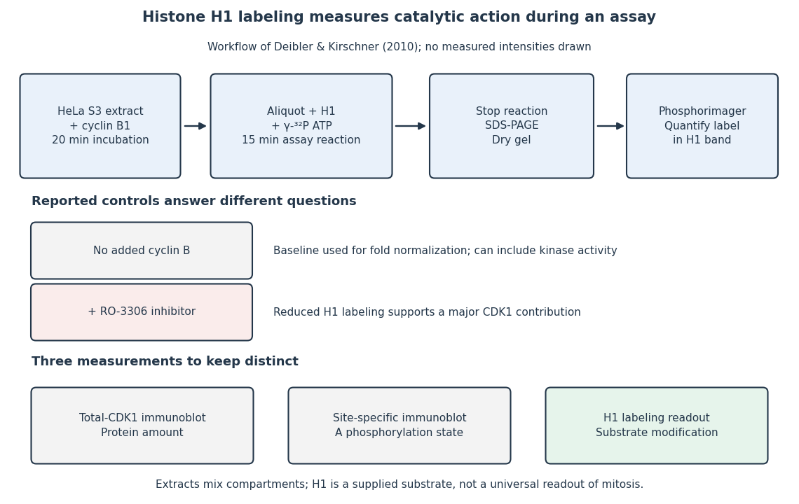

**[Figure 12](#image-the-histone-h1-kinase-assay-transferred-label-controls-and-distinct-protein-measurements). The histone H1 kinase assay: transferred label, controls and distinct protein measurements**. Original explanatory workflow of the inspected 2010 assay. The $20$-minute extract incubation and $15$-minute assay reaction are separate intervals. No gel lanes or measured intensities are simulated. The no-added-[cyclin B](#cyclin-b) baseline and RO-3306 perturbation have different purposes; neither a total-[CDK1](#cyclin-dependent-kinase-1) [Western blot](protein.md#western-blot) nor a site-specific [phosphorylation](chemical-reaction.md#phosphorylation) [Western blot](protein.md#western-blot) replaces the catalytic readout.

###### CDK1 activity and protein abundance

↑ **Parent:** [Cyclin-dependent kinase 1](#cyclin-dependent-kinase-1)

[CDK1 activity and protein abundance](#cdk1-activity-and-protein-abundance) are different observables. A total-[CDK1](#cyclin-dependent-kinase-1) [Western blot](protein.md#western-blot) estimates [protein](protein.md) amount under its calibration and loading assumptions. A phosphosite-specific [Western blot](protein.md#western-blot) asks about a particular [CDK1 phosphorylation state](#cdk1-phosphorylation-state). A [histone H1 kinase assay](#histone-h1-kinase-assay) asks how much [substrate](enzyme.md#substrate-biochemistry) modification occurs under specified assay conditions. Any conversion between them needs a model and suitable controls.

An original counting example stipulates $100$ [CDK1](#cyclin-dependent-kinase-1) [molecules](molecule.md), with $60$ bound to [cyclin B](#cyclin-b) in each of two hypothetical samples. In sample A, $10$ bound [molecules](molecule.md) are activity-permissive and $50$ are inhibited; in sample B, $40$ are activity-permissive and $20$ are inhibited. The other $40$ are unbound in both samples. Total [CDK1](#cyclin-dependent-kinase-1) and bound [CDK1](#cyclin-dependent-kinase-1) agree, but activity-permissive counts differ fourfold. These are invented counts for bookkeeping, not measured biological populations.

If each activity-permissive [molecule](molecule.md) contributes the same [reaction rate](chemical-kinetics.md#reaction-rate), [substrate](enzyme.md#substrate-biochemistry) and [ATP](molecule.md#adenosine-triphosphate) remain available, and the assay stays linear in time, a simple illustrative readout is

$$
R-R_0=\alpha N_{\mathrm{active}}t.
$$

Here $R$ is the recorded signal, $R_0$ is a matched blank signal, $N_{\mathrm{active}}$ is the activity-permissive count, $t$ the reaction interval, and $\alpha$ a common signal contribution per active [molecule](molecule.md) per unit time. The corrected signals in the stipulated samples have [ratio](arithmetic.md#ratio) $40/10=4$, although their total [protein](protein.md) amounts agree. This is an assay accounting assumption, not an [ordinary differential equation](differential-equation.md#ordinary-differential-equation) for the [cell cycle](cell-cycle.md). The no-added-[cyclin B](#cyclin-b) baseline in the inspected experiment can itself contain catalytic activity; it need not equal an enzyme-free blank $R_0$.

[Substrate](enzyme.md#substrate-biochemistry) depletion, differing inhibitory conditions or a saturated detector can break the simple proportionality. Comparing samples therefore requires matched reaction intervals, [substrate](enzyme.md#substrate-biochemistry) supply, loading and detector response, rather than assuming that brighter [histone H1](#histone-h1) labeling automatically means more total [CDK1](#cyclin-dependent-kinase-1).

##### Cyclin B

↑ **Parent:** [Cell-cycle activation feedback](#cell-cycle-activation-feedback)  
ⓦ [Wiki](https://en.wikipedia.org/wiki/Cyclin_B)

[Cyclin B](#cyclin-b) is a regulatory [protein](protein.md) partner of [CDK1](#cyclin-dependent-kinase-1). The [protein kinase](enzyme.md#protein-kinase) catalytic component is [CDK1](#cyclin-dependent-kinase-1); bound [cyclin B](#cyclin-b) helps make that component competent to act. Changes in [cyclin B](#cyclin-b) synthesis and destruction regulate how much assembly can form, while [CDK1 phosphorylation states](#cdk1-phosphorylation-state) determine whether bound assemblies are inhibited. This separates the supply of regulatory partners from release of an already assembled brake.[Components of the Cell-Cycle Control System: cyclically activated protein kinases, Figures 17-15–17-17, and “Cdk Activity Can Be Suppressed Both by Inhibitory Phosphorylation and by Inhibitory Proteins”](biology-bibliography.md#molecular-biology-of-the-cell-4th-edition-by-bruce-alberts-and-others/components-of-the-cell-cycle-control-system)

More [cyclin B](#cyclin-b) therefore need not give a proportional increase in [CDK1](#cyclin-dependent-kinase-1) activity. Compare the matched-input [cell-cycle hysteresis experiment](#cell-cycle-hysteresis-experiment), where different histories produced different activities, and the distinct measurements under [CDK1 activity and protein abundance](#cdk1-activity-and-protein-abundance). Neither comparison makes [cyclin B](#cyclin-b) itself the catalytic [protein kinase](enzyme.md#protein-kinase).

##### Cdc25

↑ **Parent:** [Cell-cycle activation feedback](#cell-cycle-activation-feedback)  
ⓦ [Wiki](https://en.wikipedia.org/wiki/Cdc25)

[Cdc25](#cdc25) is a [protein phosphatase](enzyme.md#protein-phosphatase): it removes inhibitory [phosphate](chemical-substance.md#phosphate) groups from [CDK1](#cyclin-dependent-kinase-1), relieving inhibition of an appropriately prepared [cyclin B](#cyclin-b)–[CDK1](#cyclin-dependent-kinase-1) assembly. Its reaction is removal, whereas [Wee1](#wee1) is a [protein kinase](enzyme.md#protein-kinase) adding inhibitory modification. Removing the inhibitory sites is different from removing the activating [phosphorylation](chemical-reaction.md#phosphorylation) supplied by [CAK](#cdk-activating-kinase).[Components of the Cell-Cycle Control System: inhibitory phosphorylation and Figure 17-18, Cdc25-mediated removal of inhibitory phosphates](biology-bibliography.md#molecular-biology-of-the-cell-4th-edition-by-bruce-alberts-and-others/components-of-the-cell-cycle-control-system)

[Cdc25](#cdc25) action on [CDK1](#cyclin-dependent-kinase-1) must also be distinguished from [phosphorylation](chemical-reaction.md#phosphorylation) of [Cdc25](#cdc25) itself. In [cell-cycle activation feedback](#cell-cycle-activation-feedback), [CDK1](#cyclin-dependent-kinase-1)-dependent regulation promotes [Cdc25](#cdc25) activity, which can then activate additional inhibited [CDK1](#cyclin-dependent-kinase-1). The complete regulatory path can involve intermediates. A [histone H1 kinase assay](#histone-h1-kinase-assay) of a mixture reports downstream [protein kinase](enzyme.md#protein-kinase) action; assigning its change to [Cdc25](#cdc25) requires a perturbation or an independent [protein phosphatase](enzyme.md#protein-phosphatase) assay, rather than interpreting [histone H1](#histone-h1) labeling as phosphate removal.

##### Wee1

↑ **Parent:** [Cell-cycle activation feedback](#cell-cycle-activation-feedback)  
ⓦ [Wiki](https://en.wikipedia.org/wiki/Wee1)

[Wee1](#wee1) is a [protein kinase](enzyme.md#protein-kinase) that inhibits [CDK1](#cyclin-dependent-kinase-1) by adding a [phosphate](chemical-substance.md#phosphate) group at an inhibitory site. Purified human [Wee1](#wee1) phosphorylated [Cdc2](#cyclin-dependent-kinase-1) at Tyr15 in the reported in vitro assay, with no Thr14 modification detected. A catalytic-site [mutation](genetics.md#mutation) abolished both the measured [protein kinase](enzyme.md#protein-kinase) activity and the ability to inhibit division. This identifies a catalytic brake rather than merely a correlated [protein](protein.md) amount.[McGowan and Russell (1993), abstract: purified human Wee1, Tyr15 specificity, no detectable Thr14 phosphorylation, and Lys114 mutant control](biology-bibliography.md#human-wee1-kinase-inhibits-cell-division-by-phosphorylating-p34cdc2-exclusively-on-tyr15-by-clare-mcgowan-and-others)

Do not attribute all inhibitory [CDK1](#cyclin-dependent-kinase-1) [phosphorylation](chemical-reaction.md#phosphorylation) to [Wee1](#wee1): the [Xenopus laevis](organism.md#xenopus-laevis) [Myt1](#myt1) experiment separately identified activity toward both Thr14 and Tyr15. Nor does every [phosphorylation](chemical-reaction.md#phosphorylation) inhibit its target: activating Thr161 modification in the studied [Xenopus laevis](organism.md#xenopus-laevis) [Cdc2](#cyclin-dependent-kinase-1) has the opposite role. In [cell-cycle activation feedback](#cell-cycle-activation-feedback), suppression of [Wee1](#wee1) removes a brake on [CDK1](#cyclin-dependent-kinase-1), reinforcing the transition without implying that the total amount of either [protein](protein.md) instantly disappears.

## Signaling adaptation

↑ **Parent:** [Signal transduction](signal-transduction.md)

[Signaling adaptation](#signaling-adaptation) is a decline of a response toward its earlier level while the initiating [signal](electrical-engineering.md#signal) remains present. Specify which response is measured and its baseline: complete [signaling adaptation](#signaling-adaptation) means eventual return to that baseline; partial [signaling adaptation](#signaling-adaptation) leaves a lasting displacement. The continuing [signal](electrical-engineering.md#signal) distinguishes [signaling adaptation](#signaling-adaptation) from simply switching off the stimulus. [Signaling adaptation](#signaling-adaptation) describes behavior, while [signaling feedback](#signaling-feedback) describes a causal arrangement, so neither implies the other.

By reducing a persistent response to background [ligand](protein.md#ligand-biochemistry) [concentration](mathematical-physics.md#concentration), [signaling adaptation](#signaling-adaptation) can make a [biological cell](biological-cell.md) sensitive to changes rather than only to absolute levels. Resetting the response helps leave room for another change over a useful range of [ligand](protein.md#ligand-biochemistry) [concentrations](mathematical-physics.md#concentration). This is valuable in [chemotaxis](mathematical-biology.md#chemotaxis): swimming [bacteria](organism.md#bacteria) encounter changing chemical conditions, and their [signal transduction](signal-transduction.md) influences whether a run continues or a tumble occurs. [Signaling adaptation](#signaling-adaptation) helps separate a change encountered during motion from a lasting background. This usefulness does not imply exact return or equal sensitivity at every possible [concentration](mathematical-physics.md#concentration). [General Principles of Cell Communication](biology-bibliography.md#molecular-biology-of-the-cell-4th-edition-by-bruce-alberts-and-others/general-principles-of-cell-communication) [Yi, Huang, Simon and Doyle, PNAS 97 (2000), pp. 4649–4653: chemotaxis and adaptation](https://groups.csail.mit.edu/mac/projects/amorphous/6.978/papers/doyle-PNAS-2000.pdf)

Here is a solvable [incoherent feedforward loop](#incoherent-feedforward-loop) toy that exhibits complete [signaling adaptation](#signaling-adaptation) without [signaling feedback](#signaling-feedback). The input $s(t)$ jumps from $0$ to $1$ at $t=0$ and remains $1$, a [Heaviside step function](integral-transform.md#heaviside-step-function). Let $x$ be a fast activating branch, $a$ a slower inhibitory branch, and $r=x-a$ a readout. The activities $s,x,a,r$ are [dimensionless variables](mathematics.md#dimensionless-variable); physical time is in seconds. Choose [time constants](analysis.md#time-constant) $\tau_x=1$ second and $\tau_a=5$ seconds, with [initial conditions](differential-equation.md#initial-condition) $x(0)=a(0)=0$:

$$
\tau_x\frac{dx}{dt}=s-x,\qquad \tau_a\frac{da}{dt}=s-a,\qquad r=x-a.
$$

Both branches read $s$ directly. Neither branch depends on $r$, and $a$ does not change $x$: the subtraction only defines the readout. Thus the slow opposing influence is feedforward, with no closed [feedback control](control-theory.md#closed-loop-control) loop.

For $t\geq0$, solving the two [ordinary differential equations](differential-equation.md#ordinary-differential-equation) gives

$$
x(t)=1-e^{-t/\tau_x},\qquad a(t)=1-e^{-t/\tau_a},\qquad r(t)=e^{-t/\tau_a}-e^{-t/\tau_x}.
$$

Writing $t$ for the numerical time in seconds, these are $x=1-e^{-t}$, $a=1-e^{-t/5}$ and $r=e^{-t/5}-e^{-t}$. Initially $r=0$, then $x$ rises faster than $a$, producing a pulse. At long times $x$ and $a$ both approach $1$, so $r$ returns to $0$ despite sustained $s=1$. For this upward step $e^{-t/5}\geq e^{-t}$, hence $r(t)\geq0$. The striking feature of this [signaling adaptation](#signaling-adaptation) toy is that both branches remain active while the readout becomes quiet: the continuing background and the response to its arrival are separable.

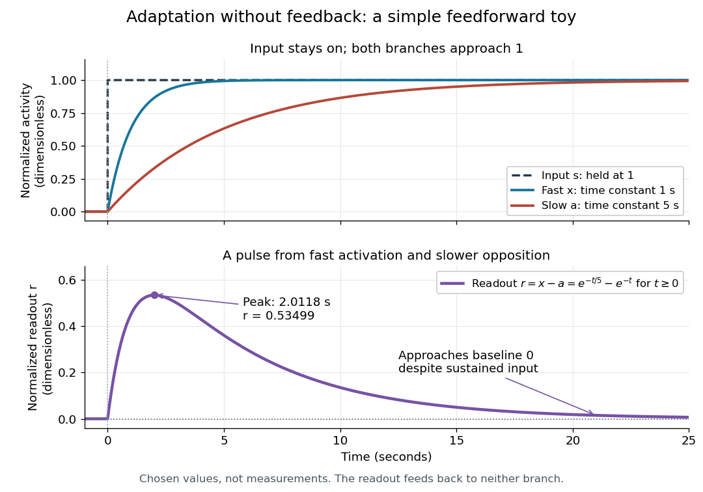

**[Figure 13](#image-a-sustained-unit-input-and-a-transient-readout-in-an-incoherent-feedforward-loop-toy). A sustained unit input and a transient readout in an incoherent feedforward loop toy**. Original computed curves for [time constants](analysis.md#time-constant) of $1$ and $5$ seconds, zero [initial conditions](differential-equation.md#initial-condition), and normalized [dimensionless variables](mathematics.md#dimensionless-variable). The upper panel shows the sustained input and the two branches; the lower panel shows the readout $r=x-a$, its maximum near $2.0118$ seconds, and its approach to the zero baseline. Values and time scales are chosen for illustration, not fitted to a measured [signal transduction](signal-transduction.md) pathway.

Find the pulse maximum by differentiating the [exponential functions](calculus.md#exponential-function). With numerical time in seconds, the [derivative](calculus.md#derivative) is

$$
r'(t)=-\frac15e^{-t/5}+e^{-t}.
$$

The stationary condition is $e^{-4t/5}=1/5$, so the [natural logarithm](calculus.md#natural-logarithm) gives

$$
t_{\mathrm{peak}}=\frac54\ln5\simeq2.0118\ \text{seconds},\qquad r_{\mathrm{peak}}=\frac45\,5^{-1/4}\simeq0.53499.
$$

Before this time the [derivative](calculus.md#derivative) is positive; afterwards it is negative. Together with $r(0)=0$ and $\lim_{t\to\infty}r(t)=0$, this proves that it is the unique pulse maximum. As another numerical check, at $t=10$ seconds $x\simeq0.999955$, $a\simeq0.864665$ and $r\simeq0.135290$: the slow branch is still catching up.

The subtraction $r=x-a$ is a mathematical readout, not a claim that an actual chemical [concentration](mathematical-physics.md#concentration) equals this difference for arbitrary inputs. Nonnegativity was established only for the specified upward step; other input histories can give a negative signed readout. Complete [signaling adaptation](#signaling-adaptation) here also relies on equal eventual branch gains: changing the readout to $r=x-0.9a$ leaves $r_*=0.1$ for $s=1$. This toy illustrates cancellation and different [time constants](analysis.md#time-constant); it does not establish molecular implementation or robustness to arbitrary parameter changes. Ma and colleagues' 2009 study separately analyzed biochemical [mathematical models](mathematics.md#mathematical-model) with [negative feedback](#negative-feedback) and [incoherent feedforward loops](#incoherent-feedforward-loop), identifying additional conditions for [signaling adaptation](#signaling-adaptation) in those models. [Ma et al., Cell 138 (2009): adaptive architectures and their kinetic conditions](https://cqb.pku.edu.cn/tanglab/pdf/78.pdf)

A historical connection to [feedback control](control-theory.md#closed-loop-control) comes from Yi, Huang, Simon and Doyle's 2000 analysis of a bacterial [chemotaxis](mathematical-biology.md#chemotaxis) model. They identified [integral action](control-theory.md#integral-action) in its regulation of [receptor](protein.md#receptor-biochemistry) activity: accumulated deviations alter a slower adjustment, which in turn changes the measured activity. At a stationary state, an adjustment that integrates a nonzero error cannot remain constant, explaining how zero error can follow. Their conclusion depended on stated biochemical assumptions and stable behavior; it was not a claim that every [biological cell](biological-cell.md) uses that mechanism. A transient pulse alone, as the [incoherent feedforward loop](#incoherent-feedforward-loop) toy shows, cannot identify the underlying [signaling feedback](#signaling-feedback) architecture. [Yi et al., Robust perfect adaptation in bacterial chemotaxis through integral feedback control, PNAS 97 (2000): Results and Discussion](https://groups.csail.mit.edu/mac/projects/amorphous/6.978/papers/doyle-PNAS-2000.pdf)

## Incoherent feedforward loop

↑ **Parent:** [Signal transduction](signal-transduction.md)

An [incoherent feedforward loop](#incoherent-feedforward-loop) carries influences from a shared input to a shared output along routes with opposite net signs. In the [signaling adaptation](#signaling-adaptation) toy, $s$ drives fast $x$ and slow $a$, which contribute with opposite signs to $r=x-a$. Despite the conventional word "loop", those routes do not return the output to an earlier stage: this arrangement is distinct from [negative feedback](#negative-feedback). Opposing routes alone do not guarantee complete [signaling adaptation](#signaling-adaptation). [Ma et al., Cell 138 (2009), p. 764: definition of an incoherent feedforward loop](https://cqb.pku.edu.cn/tanglab/pdf/78.pdf)

## Phytochrome

↑ **Parent:** [Signal transduction](signal-transduction.md)  
ⓦ [Wiki](https://en.wikipedia.org/wiki/Phytochrome)

A family of light-sensing [proteins](protein.md) with interconvertible red-absorbing and far-red-absorbing forms. [Phytochrome](#phytochrome) links [light](optics.md#light) perception to [plant](organism.md#plant) development, including the [lettuce red and far-red germination experiment](organism.md#lettuce-red-and-far-red-germination-experiment).[Biology 2e, §30.6 The Phytochrome System and the Red/Far-Red Response, Figure 30.38](biology-bibliography.md#biology-2e-by-mary-ann-clark-and-others)

## ↑ Ancestors (2)

1. [Biology](biology.md)
2. [Codex Wiki](README.md)

## ← Incoming links (33)

- [Acetylcholine](neuroscience.md#acetylcholine)
- [Adrenaline](#adrenaline)
- [Cell-surface receptor](protein.md#cell-surface-receptor)
- [Cellular differentiation](organism.md#cellular-differentiation)
- [Delayed negative feedback model](#delayed-negative-feedback-model)
- [Developmental integration](organism.md#developmental-integration)
- [FGF signalling](#fgf-signalling)
- [Hormone](#hormone)
- [Inositol trisphosphate](#inositol-trisphosphate)
- [Insulin](protein.md#insulin)
- [Ionotropic receptor](protein.md#ionotropic-receptor)
- [Islet perifusion experiment](#islet-perifusion-experiment)
- [Lettuce red and far-red germination experiment](organism.md#lettuce-red-and-far-red-germination-experiment)
- [Membrane protein](cell-membrane.md#membrane-protein)
- [Metabotropic receptor](protein.md#metabotropic-receptor)
- [Model organism evidence transfer](biology.md#model-organism-evidence-transfer)
- [Morphogen](biology.md#morphogen)
- [Negative feedback](#negative-feedback)
- [Neuron](neuroscience.md#neuron)
- [Nodal signalling](#nodal-signalling)
- [Solution](past-exam-of-the-zoology-course-of-the-university-of-cambridge/2025/paper-zm6.md#2/solution)
- [Plant hormone](#plant-hormone)
- [Plant physiology](biology.md#plant-physiology)
- [Positive feedback](#positive-feedback)
- [Protein tyrosine phosphatase](enzyme.md#protein-tyrosine-phosphatase)
- [Receptor (biochemistry)](protein.md#receptor-biochemistry)
- [Receptor phosphorylation assay](protein.md#receptor-phosphorylation-assay)
- [Second messenger](#second-messenger)
- [Signal amplification](#signal-amplification)
- [Signal transduction](signal-transduction.md)
- [Signaling adaptation](#signaling-adaptation)
- [Signaling feedback](#signaling-feedback)
- [Wnt signalling](#wnt-signalling)
