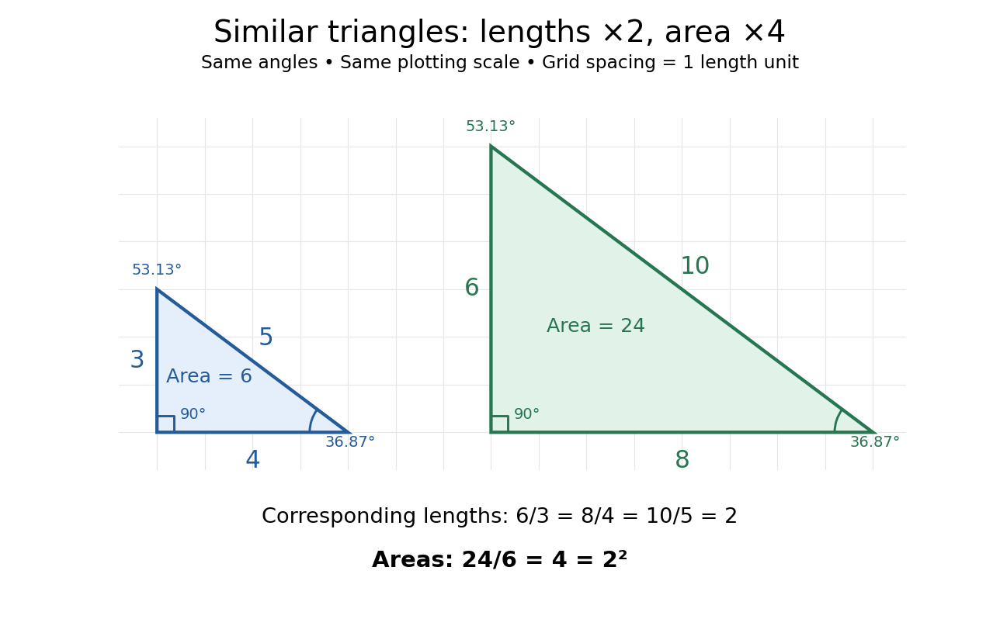

# Similar triangle

↑ **Parent:** [Triangle](triangle.md)

Two [triangles](triangle.md) are similar if a [Euclidean similarity](euclidean-similarity.md) maps one onto the other. Their corresponding [angles](angle.md) agree, and corresponding side [lengths](length.md) have a common positive ratio.

Specify the correspondence first: $A$ matches $A'$, $B$ matches $B'$ and $C$ matches $C'$. For [similar triangles](similar-triangle.md), the common scale factor $k>0$ satisfies

$$
\frac{|A'B'|}{|AB|}=\frac{|B'C'|}{|BC|}=\frac{|C'A'|}{|CA|}=k.
$$

The [ratios](ratio.md) compare matching sides in the same order. A [Euclidean similarity](euclidean-similarity.md) can also move, turn or reflect the [triangle](triangle.md); its orientation on the page is irrelevant. In the [Euclidean plane](euclidean-plane.md), matching just two interior [angles](angle.md) is enough: their sums force the third to match, and equal corresponding [angles](angle.md) force the side [ratios](ratio.md) to agree. This is the angle-angle (AA) criterion for [similar triangles](similar-triangle.md). Matching just one [angle](angle.md) is insufficient.

Scale the [right triangle](right-triangle.md) with vertices $(0,0)$, $(4,0)$ and $(0,3)$ by $k=2$. Its new vertices are $(0,0)$, $(8,0)$ and $(0,6)$, and its side [lengths](length.md) are $6,8,10$. The matching side [ratios](ratio.md) are $6/3=8/4=10/5=2$. Both [triangles](triangle.md) have a [right angle](right-angle.md) and the same two other interior [angles](angle.md), approximately $36.87^\circ$ and $53.13^\circ$. However, their [areas](surface-area.md) are $3\cdot4/2=6$ and $6\cdot8/2=24$: doubling [lengths](length.md) multiplies [area](surface-area.md) by four.

**[Figure 17](#image-similar-3-4-5-and-6-8-10-right-triangles-side-lengths-multiply-by-2-while-area-multiplies-by-2-2-4). Similar 3-4-5 and 6-8-10 right triangles: side lengths multiply by $2$, while area multiplies by $2^2=4$**.

Generally, a [Euclidean similarity](euclidean-similarity.md) multiplies both a base and its perpendicular height by $k$, so the [area](surface-area.md) becomes $\tfrac12(kb)(kh)=k^2\tfrac12bh$. This explains why an enlarged drawing needs four times as much surface when each [length](length.md) doubles. It also enables indirect measurement: under assumptions of level ground, vertical objects and parallel light rays, an object of height $3$ casting a shadow of [length](length.md) $4$ provides a [right triangle](right-triangle.md). Another object's shadow of [length](length.md) $8$ gives a [similar triangle](similar-triangle.md) and height $3(8/4)=6$. The shared [angles](angle.md) justify the inference; visual resemblance alone does not.

[Euclid's Elements](euclid-s-elements.md) VI, Definition 1 describes similarity using corresponding [angles](angle.md) and proportional sides. VI.4 establishes the implication from matching [angles](angle.md) to matching side [ratios](ratio.md), while VI.19 states the squared relation between side [ratios](ratio.md) and [areas](surface-area.md). These are documented ancient formulations of the principles used above, without establishing a first discoverer.[Euclid, Elements VI, Definition 1](https://mathcs.clarku.edu/~djoyce/elements/bookVI/defVI1.html)[Euclid, Elements VI.4](https://mathcs.clarku.edu/~djoyce/elements/bookVI/propVI4.html)[Euclid, Elements VI.19](https://mathcs.clarku.edu/~djoyce/elements/bookVI/propVI19.html)

## ↑ Ancestors (6)

1. [Triangle](triangle.md)
2. [Euclidean geometry](euclidean-geometry.md)
3. [Geometry and topology](geometry-and-topology-split.md)
4. [Area of mathematics](area-of-mathematics.md)
5. [Mathematics](mathematics-split.md)
6. [Codex Wiki](split.md)

## ← Incoming links (7)

- [Euclidean geometry](euclidean-geometry.md)
- [Pythagorean theorem](pythagorean-theorem.md)
- [Ratio](ratio.md)
- [Similar triangle](similar-triangle.md)
- [Spherical geometry](spherical-geometry.md)
- [Transverse magnification](transverse-magnification.md)
- [Triangle](triangle.md)
