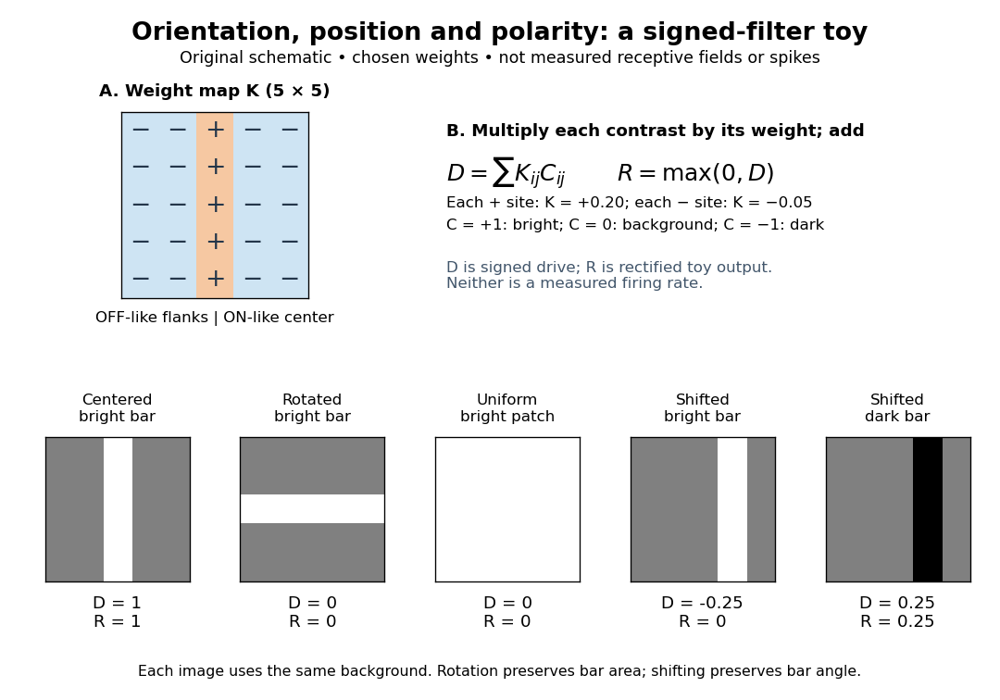

# Simple cell

↑ **Parent:** [Primary visual cortex](primary-visual-cortex.md)  
ⓦ [Wiki](https://en.wikipedia.org/wiki/Simple_cell)

A [simple cell](simple-cell.md) is a visual cortical [neuron](neuron.md) whose [receptive field](receptive-field.md) has spatially separable [ON and OFF receptive-field subregions](on-and-off-receptive-field-subregions.md). Elongated neighboring subregions give a preferred orientation and a sensitivity to the location and polarity of [visual contrast](visual-contrast.md). “Simple” describes the response organization; it does not describe a simpler [cell body](soma-biology.md) or a particular shape of [neuron](neuron.md).

Hubel and Wiesel's 1962 classification emphasized four observations: distinguishable [ON and OFF receptive-field subregions](on-and-off-receptive-field-subregions.md), summation within each region, antagonism between regions, and qualitative prediction of responses to differently shaped stimuli from those regions' arrangement. A slit fitting an elongated center was more effective than a smaller spot; a larger patch could invade opposing flanks and lose effectiveness. An edge separating bright and dark regions could be effective when its boundary matched the boundary between subregions. These were observations about [spike trains](spike-train.md), rather than an assertion of exact [linearity](linearity.md). [Hubel and Wiesel (1962), pp. 109–112: simple-field criteria and slit/edge experiments](https://www.gatsby.ucl.ac.uk/teaching/courses/tn1-2020/additional/systems/JPhysiol-1962-Hubel-106-54.pdf)

The following deliberately coarse [signed spatial filter model of a simple cell](signed-spatial-filter-model-of-a-simple-cell.md) makes the geometry easy to count. A centered bright bar contributes positively at five sites. Rotating it preserves its area but mixes positive and negative weights; shifting it preserves its orientation but changes which weights it samples. The model is useful because it predicts distinct effects of these three manipulations instead of treating any bright stimulus as equivalent.

**[Figure 46](#image-a-signed-toy-simple-cell-filter-separates-orientation-location-and-visual-contrast-polarity). A signed toy simple cell filter separates orientation, location and visual contrast polarity**. The $5\times5$ chosen weight map has a positive central column and negative flanks. Bright, unchanged and dark image values are $+1$, $0$ and $-1$. The [dot product](dot-product.md) gives signed drive $D$; a [rectified linear unit](rectified-linear-unit.md) gives toy output $R$. Centered, rotated, uniform, shifted-bright and shifted-dark examples give $D=1,0,0,-1/4,1/4$. Colors and weights are illustrative, not a measured [receptive field](receptive-field.md) or a map of identified [synapses](synapse.md).

A [simple cell](simple-cell.md) is not an ideal linear sensor. Its [spike train](spike-train.md) is nonnegative in event count, and [neural adaptation](neural-adaptation.md) can change responsiveness. The [signed spatial filter model of a simple cell](signed-spatial-filter-model-of-a-simple-cell.md) supplies a useful approximation to spatial drive and an explicit output rule. Comparing predictions with unseen stimuli is more informative than assuming the rule from the name “simple”. In contrast, the existing [complex cell](complex-cell.md) models explore tolerance to [phase](phase-waves.md) and local displacement.

**Table of contents**

- [Signed spatial filter model of a simple cell](signed-spatial-filter-model-of-a-simple-cell.md)

## ↑ Ancestors (4)

1. [Primary visual cortex](primary-visual-cortex.md)
2. [Neuroscience](neuroscience.md)
3. [Biology](biology-split.md)
4. [Codex Wiki](split.md)

## ← Incoming links (11)

- [Complex cell](complex-cell.md)
- [Gabor filter](gabor-filter.md)
- [Orientation-map self-organization](orientation-map-self-organization.md)
- [Orientation tuning curve](orientation-tuning-curve.md)
- [Solution](past-exam-of-the-mathematics-course-of-the-university-of-cambridge/2006/iii/paper-84/4/b/solution.md)
- [Solution](past-exam-of-the-mathematics-course-of-the-university-of-cambridge/2006/iii/paper-84/5/solution.md)
- [Solution](past-exam-of-the-mathematics-course-of-the-university-of-cambridge/2007/iii/paper-73/2/solution.md)
- [Solution](past-exam-of-the-mathematics-course-of-the-university-of-cambridge/2007/iii/paper-73/4/e/solution.md)
- [Pooling model of a complex cell](pooling-model-of-a-complex-cell.md)
- [Primary visual cortex](primary-visual-cortex.md)
- [Simple cell](simple-cell.md)
