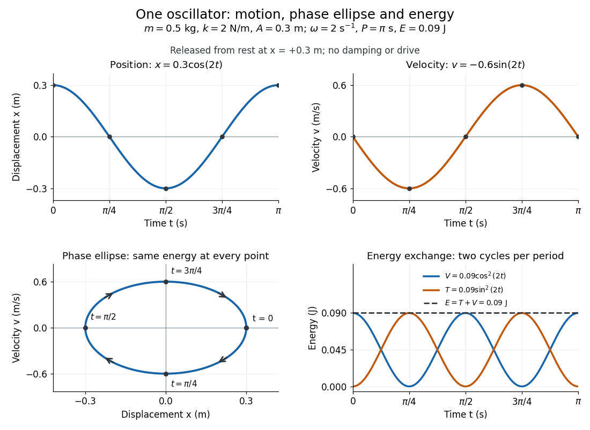

# Simple harmonic motion

↑ **Parent:** [One-dimensional conservative motion](one-dimensional-conservative-motion.md)  
ⓦ [Wiki](https://en.wikipedia.org/wiki/Simple_harmonic_motion)

[Simple harmonic motion](simple-harmonic-motion.md) is motion in which the [acceleration](acceleration.md) is proportional to the [displacement](displacement.md) from [equilibrium](equilibrium-point-of-a-dynamical-system.md) and points back towards it:

$$
\ddot x=-\omega^2x,\qquad \omega>0.
$$

Here $x$ is measured from [equilibrium](equilibrium-point-of-a-dynamical-system.md), and $\omega$ is the constant [angular frequency](angular-frequency.md). For a [point mass](point-mass.md) attached to an ideal [spring](spring.md), [Hooke's law](hooke-s-law.md) gives the restoring [force](force-split.md) $F=-kx$, with stiffness $k>0$, and [Newton's second law](newton-s-second-law.md) yields $\omega=\sqrt{k/m}$. The minus sign matters: for $x>0$ the [force](force-split.md) is negative, and for $x<0$ it is positive. A restoring [force](force-split.md) need not oppose [velocity](velocity.md); on the return towards [equilibrium](equilibrium-point-of-a-dynamical-system.md) it increases [speed](speed.md).

The general solution is

$$
x(t)=A\cos(\omega t+\varphi),\qquad
v(t)=-A\omega\sin(\omega t+\varphi),\qquad
P=\frac{2\pi}{\omega}.
$$

The [amplitude](wave-amplitude.md) $A\geq0$ and [oscillation phase](phase-waves.md) $\varphi$ encode the [initial conditions](initial-condition.md). We use $P$ for the [oscillation period](period-of-an-oscillation.md) to distinguish it from [kinetic energy](kinetic-energy.md) $T$. For $A>0$, the [oscillation period](period-of-an-oscillation.md) is independent of [amplitude](wave-amplitude.md), the property of [isochronous harmonic motion](isochronous-harmonic-motion.md). At $A=0$ the body remains at [equilibrium](equilibrium-point-of-a-dynamical-system.md). [MIT mechanics, Chapter 23, sections 23.2 and 23.3](https://ocw.mit.edu/courses/8-01sc-classical-mechanics-fall-2016/mit8_01scs22_chapter23.pdf)

Choose $m=0.5\,\mathrm{kg}$, $k=2\,\mathrm{N/m}$, and release the [mass](mass.md) from rest at [displacement](displacement.md) $A=0.3\,\mathrm m$. Then $\omega=2\,\mathrm{s^{-1}}$, $P=\pi\,\mathrm s$, and $\varphi=0$. Writing [time](time-in-physics.md) $t$ in seconds,

$$
x(t)=0.3\cos(2t)\,\mathrm m,\qquad
v(t)=-0.6\sin(2t)\,\mathrm{m/s}.
$$

At $t=0$ the [velocity](velocity.md) vanishes, but the [acceleration](acceleration.md) is $-1.2\,\mathrm{m/s^2}$: a [turning point](turning-point.md) is not a state of rest that persists. At $t=\pi/4\,\mathrm s$, the body crosses [equilibrium](equilibrium-point-of-a-dynamical-system.md) with [velocity](velocity.md) $-0.6\,\mathrm{m/s}$ and zero [acceleration](acceleration.md). At $t=\pi/2\,\mathrm s$ it reaches the opposite [turning point](turning-point.md), $x=-0.3\,\mathrm m$.

Taking [potential energy](potential-energy.md) zero at [equilibrium](equilibrium-point-of-a-dynamical-system.md), the same solution gives

$$
V(t)=\frac12kx(t)^2=0.09\cos^2(2t)\,\mathrm J,\qquad
T(t)=\frac12mv(t)^2=0.09\sin^2(2t)\,\mathrm J,
\qquad E=T+V=0.09\,\mathrm J.
$$

At each [turning point](turning-point.md) all [mechanical energy](mechanical-energy.md) is [potential energy](potential-energy.md); at each [equilibrium](equilibrium-point-of-a-dynamical-system.md) crossing it is [kinetic energy](kinetic-energy.md). Both repeat twice during one complete [position](position.md) cycle because squaring removes the sign. At $t=\pi/8\,\mathrm s$, for example, each contributes $0.045\,\mathrm J$.

**[Figure 10](#image-position-velocity-phase-ellipse-and-energy-exchange-for-a-mass-of-0-5-kg-on-a-spring-of-stiffness-2-n-m). Position, velocity, phase ellipse and energy exchange for a mass of 0.5 kg on a spring of stiffness 2 N/m**.

The physical [position](position.md) trace covers a line segment, $-0.3\leq x\leq0.3$ in metres. In the [phase plane](phase-plane.md), the paired [position](position.md) and [velocity](velocity.md) instead trace the [ellipse](ellipse.md)

$$
\frac{x^2}{(0.3\,\mathrm m)^2}+\frac{v^2}{(0.6\,\mathrm{m/s})^2}=1.
$$

This is precisely $mv^2/2+kx^2/2=E$, rewritten: the single conserved [mechanical energy](mechanical-energy.md) fixes the [amplitude](wave-amplitude.md) and the whole [ellipse](ellipse.md). It does not fix the starting [oscillation phase](phase-waves.md). At $x=0$ both $v=-0.6\,\mathrm{m/s}$ and $v=+0.6\,\mathrm{m/s}$ lie on it; [position](position.md) alone cannot distinguish them. Replacing $v$ by [momentum](momentum-split.md) $p=mv$ gives the equivalent [phase-space trajectory](phase-space-trajectory.md). The arrows show increasing [time](time-in-physics.md), clockwise in $(x,v)$ coordinates.

This closed [ellipse](ellipse.md) assumes a time-independent [spring](spring.md) and no [damping](damping.md) or applied drive. Adding a resisting [force](force-split.md) $-bv$, $b>0$, gives $m\ddot x+b\dot x+kx=0$ and $dE/dt=-bv^2\leq0$. An underdamped [damped harmonic oscillator](damped-harmonic-oscillator.md) spirals inward in the [phase plane](phase-plane.md), crossing successively smaller [energy](energy-split.md) contours. The ideal [harmonic oscillator](simple-harmonic-motion.md) is also useful beyond [springs](spring.md): near a smooth [potential energy](potential-energy.md) minimum with $V''(0)>0$, its [Taylor expansion](taylor-expansion.md) begins with $V(0)+V''(0)x^2/2$. For sufficiently small [displacements](displacement.md), this gives the same restoring [force](force-split.md) to leading order, explaining why [small oscillations](small-oscillation.md) share one solvable pattern.

**Table of contents**

- [U-tube liquid oscillation](u-tube-liquid-oscillation.md)
  - [Viscously damped U-tube oscillation](viscously-damped-u-tube-oscillation.md)
- [Harmonic chain](harmonic-chain.md)
  - [Quantum harmonic chain](quantum-harmonic-chain.md)
    - [Harmonic-chain normal-mode reality condition](harmonic-chain-normal-mode-reality-condition.md)
  - [Centre-of-mass zero mode of a harmonic chain](centre-of-mass-zero-mode-of-a-harmonic-chain.md)
  - [Continuum limit of a harmonic chain](continuum-limit-of-a-harmonic-chain.md)
- [Natural frequency](natural-frequency.md)
- [Rectangular-pulse cancellation of an undamped oscillator](rectangular-pulse-cancellation-of-an-undamped-oscillator.md)
- [Radial spring oscillator on a rotating guide](radial-spring-oscillator-on-a-rotating-guide.md)
- [Fixed-endpoint harmonic-oscillator action](fixed-endpoint-harmonic-oscillator-action.md)
- [Quartic oscillator](quartic-oscillator.md)
- [Isochronous harmonic motion](isochronous-harmonic-motion.md)

## ↑ Ancestors (6)

1. [One-dimensional conservative motion](one-dimensional-conservative-motion.md)
2. [Particle dynamics](particle-dynamics.md)
3. [Classical mechanics](classical-mechanics-split.md)
4. [Branches of physics](branches-of-physics.md)
5. [Physics](physics-split.md)
6. [Codex Wiki](split.md)

## ← Incoming links (42)

- [Cavendish torsion balance](cavendish-torsion-balance.md)
- [Diatomic bond stretch](diatomic-bond-stretch.md)
- [Gyrocompass oscillation](gyrocompass-oscillation.md)
- [Harmonic potential](harmonic-potential.md)
- [Latitude law of Foucault precession](latitude-law-of-foucault-precession.md)
- [Solution](past-exam-of-the-astrophysical-fluid-dynamics-course-of-the-university-of-cambridge/2013/paper-1/1/b/solution.md)
- [Solution](past-exam-of-the-astrophysical-fluid-dynamics-course-of-the-university-of-cambridge/2022/section-b/4/a/solution.md)
- [Solution](past-exam-of-the-formation-of-structure-in-the-universe-course-of-the-university-of-cambridge/2014/paper-1/2/solution.md)
- [Solution](past-exam-of-the-mathematics-course-of-the-university-of-cambridge/2005/ia/paper-4/11c/solution.md)
- [Solution](past-exam-of-the-mathematics-course-of-the-university-of-cambridge/2008/ia/paper-4/3b/solution.md)
- [Solution](past-exam-of-the-mathematics-course-of-the-university-of-cambridge/2014/iii/paper-59/3/solution.md)
- [Solution](past-exam-of-the-mathematics-course-of-the-university-of-cambridge/2015/ii/paper-4/33a/solution.md)
- [Solution](past-exam-of-the-mathematics-course-of-the-university-of-cambridge/2017/ia/paper-4/11a/b/iii/solution.md)
- [Solution](past-exam-of-the-mathematics-course-of-the-university-of-cambridge/2019/ia/paper-4/10a/b/iii/solution.md)
- [Solution](past-exam-of-the-mathematics-course-of-the-university-of-cambridge/2019/ii/paper-3/36e/solution.md)
- [Solution](past-exam-of-the-mathematics-course-of-the-university-of-cambridge/2022/ia/paper-4/9c/c/iii/solution.md)
- [Solution](past-exam-of-the-mathematics-course-of-the-university-of-cambridge/2022/ib/paper-1/14b/e/solution.md)
- [Solution](past-exam-of-the-mathematics-course-of-the-university-of-cambridge/2023/ib/paper-3/16c/b/v/solution.md)
- [Solution](past-exam-of-the-mathematics-course-of-the-university-of-cambridge/2023/ii/paper-4/15d/solution.md)
- [Solution](past-exam-of-the-physics-b-course-of-the-university-of-cambridge/2018/paper-2/section-b/b8/c/solution.md)
- [Solution](past-exam-of-the-physics-b-course-of-the-university-of-cambridge/2022/paper-1/section-b/b6/d/solution.md)
- [Solution](past-exam-of-the-physics-course-of-the-year-1-of-the-natural-sciences-course-of-the-university-of-cambridge/2018/section-a/1/solution.md)
- [Solution](past-exam-of-the-physics-course-of-the-year-1-of-the-natural-sciences-course-of-the-university-of-cambridge/2018/section-c/10/solution.md)
- [Solution](past-exam-of-the-physics-course-of-the-year-1-of-the-natural-sciences-course-of-the-university-of-cambridge/2018/section-e/15/b/solution.md)
- [Solution](past-exam-of-the-physics-course-of-the-year-1-of-the-natural-sciences-course-of-the-university-of-cambridge/2021/section-a/3/solution.md)
- [Solution](past-exam-of-the-physics-course-of-the-year-1-of-the-natural-sciences-course-of-the-university-of-cambridge/2021/section-b/8/b/solution.md)
- [Solution](past-exam-of-the-physics-course-of-the-year-1-of-the-natural-sciences-course-of-the-university-of-cambridge/2022/section-a/3/solution.md)
- [Solution](past-exam-of-the-physics-course-of-the-year-1-of-the-natural-sciences-course-of-the-university-of-cambridge/2024/paper-1/section-b/8/c/solution.md)
- [Solution](past-exam-of-the-theoretical-physics-i-course-of-the-university-of-cambridge/2018/2/c/solution.md)
- [Solution](past-exam-of-the-theoretical-physics-i-course-of-the-university-of-cambridge/2019/2/solution.md)
- [Period and small-angle limit of a conical pendulum](period-and-small-angle-limit-of-a-conical-pendulum.md)
- [Radiation damping of a harmonically oscillating charge](radiation-damping-of-a-harmonically-oscillating-charge.md)
- [Restoring force](restoring-force.md)
- [Rüchardt experiment](ruchardt-experiment.md)
- [Simple harmonic motion](simple-harmonic-motion.md)
- [Simple pendulum](simple-pendulum-split.md)
- [Small oscillation of a planar gas bubble in an annular liquid](small-oscillation-of-a-planar-gas-bubble-in-an-annular-liquid.md)
- [Spring constant](spring-constant.md)
- [Torsion constant](torsion-constant.md)
- [Trigonometric function](trigonometric-function.md)
- [Vertical oscillations of a floating cylinder](vertical-oscillations-of-a-floating-cylinder.md)
- [Vertical stellar orbit in a uniform slab](vertical-stellar-orbit-in-a-uniform-slab.md)
