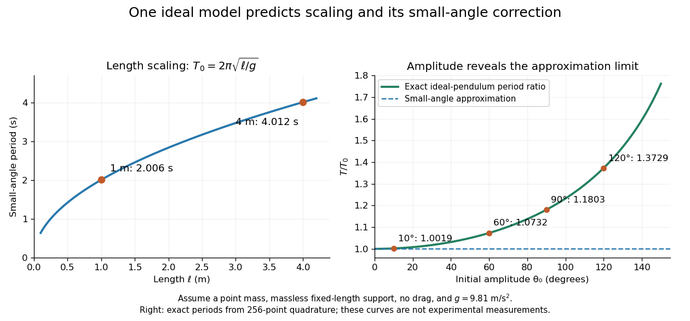

# Simple pendulum

↑ **Parent:** [Classical mechanics](classical-mechanics-split.md)

A point mass constrained to a fixed-length massless arm under uniform gravitational [acceleration](acceleration.md) is a simple pendulum. With no drag its angular equation is $\ddot\theta+(g/\ell)\sin\theta=0$. The [small-angle approximation](small-angle-approximation.md) yields [simple harmonic motion](simple-harmonic-motion.md), whereas the full restoring force is nonlinear. Adding drag gives a [damped pendulum](damped-pendulum.md).

For an ideal point mass $m$ swinging in a vertical plane, the [torque](torque.md) about the pivot is $-mg\ell\sin\theta$. Dividing by its [moment of inertia](moment-of-inertia.md) $m\ell^2$ gives the displayed equation. Both the inertia and the gravitational [torque](torque.md) scale with $m$, explaining why the point mass cancels. This derivation and the small-amplitude period are given in [Ling, Sanny and Moebs, University Physics, pendulums](https://openstax.org/books/university-physics-volume-1/pages/15-4-pendulums).

Released from rest at a small angular [amplitude](wave-amplitude.md) $\theta_0$, the linearized solution is $\theta(t)\simeq\theta_0\cos(\sqrt{g/\ell}\,t)$, with [oscillation period](period-of-an-oscillation.md) $T_0=2\pi\sqrt{\ell/g}$. For $g=9.81\,\mathrm{m/s^2}$, lengths one and four metres give $T_0\approx2.0061\,\mathrm s$ and $4.0121\,\mathrm s$. This same scaling follows from [dimensional analysis](dimensional-analysis.md); the dynamical calculation supplies the coefficient $2\pi$.

Finite angular [amplitude](wave-amplitude.md) changes the exact ideal period. [Conservation of energy](conservation-of-energy.md) gives $\dot\theta^2=(2g/\ell)(\cos\theta-\cos\theta_0)$ for release from rest. Integrating a quarter oscillation and substituting $\sin(\theta/2)=\sin(\theta_0/2)\sin\phi$ gives

$$
T(\theta_0)=4\sqrt{\frac\ell g}\,K\!\left(\sin\frac{\theta_0}2\right),\qquad
\frac{T(\theta_0)}{T_0}=\frac2\pi\int_0^{\pi/2}\frac{d\phi}{\sqrt{1-\sin^2(\theta_0/2)\sin^2\phi}},\quad 0<\theta_0<\pi.
$$

Here $K$ is the [complete elliptic integral of the first kind](complete-elliptic-integral-of-the-first-kind.md). The [small-angle approximation](small-angle-approximation.md) gives a ratio tending to one; at $10^\circ,60^\circ,90^\circ$, the ratios are approximately $1.00191,1.07318,1.18034$. Thus almost constant period at small [amplitude](wave-amplitude.md) has a quantitative limit. As $\theta_0\to\pi$, the period diverges, connecting to the [pendulum separatrix approach takes infinite time](pendulum-separatrix-approach-takes-infinite-time.md).

**[Figure 1](#image-length-scaling-and-finite-amplitude-period-corrections-for-an-ideal-simple-pendulum). Length scaling and finite-amplitude period corrections for an ideal simple pendulum**.

These predictions assume the specified ideal system. Drag changes the [mechanical energy](mechanical-energy.md); a massive support changes the [moment of inertia](moment-of-inertia.md). The distinction is useful in experiments: a change in period can test an approximation rather than merely indicate an arithmetic mistake.

**Table of contents**

- [Conical pendulum](conical-pendulum.md)
  - [Rotating bob experiment for a conical pendulum](rotating-bob-experiment-for-a-conical-pendulum.md)
  - [Period and small-angle limit of a conical pendulum](period-and-small-angle-limit-of-a-conical-pendulum.md)
- [Damped pendulum](damped-pendulum.md)
  - [Energy dissipation of a damped pendulum](energy-dissipation-of-a-damped-pendulum.md)

## ↑ Ancestors (4)

1. [Classical mechanics](classical-mechanics-split.md)
2. [Branches of physics](branches-of-physics.md)
3. [Physics](physics-split.md)
4. [Codex Wiki](split.md)

## ← Incoming links (9)

- [Damped pendulum](damped-pendulum.md)
- [Dimensional analysis](dimensional-analysis.md)
- [Mathematical model](mathematical-model.md)
- [Nondimensionalization](nondimensionalization.md)
- [Solution](past-exam-of-the-mathematics-course-of-the-university-of-cambridge/2006/ia/paper-4/4c/solution.md)
- [Solution](past-exam-of-the-mathematics-course-of-the-university-of-cambridge/2007/ii/paper-3/9c/solution.md)
- [Pendulum separatrix approach takes infinite time](pendulum-separatrix-approach-takes-infinite-time.md)
- [Period and small-angle limit of a conical pendulum](period-and-small-angle-limit-of-a-conical-pendulum.md)
- [Physics](physics-split.md)
