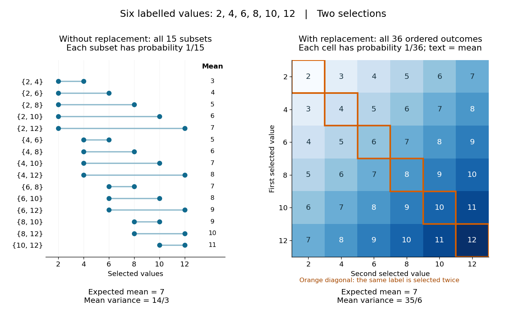

# Simple random sampling

↑ **Parent:** [Probability sampling](probability-sampling.md)

Here [simple random sampling](simple-random-sampling.md) means a random unordered [subset](subset.md) $A$ of exactly $n$ distinct labels from $\{1,\ldots,N\}$, with every size-$n$ [subset](subset.md) equally likely. The [sample size](sample-size.md) is fixed in advance, $1\leq n\leq N$, and [sampling without replacement](sampling-without-replacement.md) prevents duplicate units. This is [SRSWOR](simple-random-sampling.md); some texts also use "simple random sampling" for independent uniform draws with replacement, which is a different design.[Sampling Theory, Chapter 2, Simple Random Sampling, PDF pp. 1–4: replacement conventions and ordered versus unordered sample probabilities](sampling-theory/chapter-2-simple-random-sampling.md)

Every label has [inclusion probability](inclusion-probability.md) $n/N$, but equal [inclusion probabilities](inclusion-probability.md) alone are insufficient. For example, from six labels choose either $\{1,2,3\}$ or $\{4,5,6\}$ with [probability](probability.md) $1/2$. Each label is included with [probability](probability.md) $1/2$, yet eighteen of the twenty size-three [subsets](subset.md) are impossible: this is a two-group [cluster sampling](cluster-sampling.md) design. [Unequal probability sampling](unequal-probability-sampling.md) deliberately changes inclusion [probabilities](probability.md), often to improve precision for a particular [estimand](estimand.md), and generally requires an appropriately weighted [estimator](estimator.md) rather than the plain [sample mean](sample-mean.md).

Consider the original mathematical population with labelled values $(2,4,6,8,10,12)$, and let $n=2$. The fifteen equiprobable [subsets](subset.md), followed by their [sample means](sample-mean.md), are

$$
\begin{array}{c|rrrrr}
\text{first value }2&\{2,4\}:3&\{2,6\}:4&\{2,8\}:5&\{2,10\}:6&\{2,12\}:7\\
4&\{4,6\}:5&\{4,8\}:6&\{4,10\}:7&\{4,12\}:8&\\
6&\{6,8\}:7&\{6,10\}:8&\{6,12\}:9&&\\
8&\{8,10\}:9&\{8,12\}:10&&&\\
10&\{10,12\}:11&&&&
\end{array}
$$

Their [sample means](sample-mean.md) sum to $105$, giving [expected value](expected-value-split.md) $105/15=7$. Their squared deviations from $7$ sum to $70$, giving [variance](variance-split.md) $70/15=14/3$. This is an enumeration over hypothetical selections from six stipulated numbers, not measured survey data.

**[Figure 4](#image-all-fifteen-size-two-subsets-and-all-thirty-six-ordered-replacement-outcomes-from-six-labelled-values). All fifteen size-two subsets and all thirty-six ordered replacement outcomes from six labelled values**.

With independent uniform [sampling with replacement](sampling-with-replacement.md), the $6^2=36$ ordered outcomes each have [probability](probability.md) $1/36$. The two orders $(2,4)$ and $(4,2)$ are distinct outcomes, and $(2,2)$ is now possible. Forgetting order does not make the resulting unordered multisets equiprobable: $\{2,4\}$ has [probability](probability.md) $2/36$ but $\{2,2\}$ has [probability](probability.md) $1/36$. The thirty-six [sample means](sample-mean.md) still have [expected value](expected-value-split.md) $7$, but their squared deviations sum to $210$, giving [variance](variance-split.md) $210/36=35/6$. Avoiding duplicate labels improves precision for this fixed population.

**Table of contents**

- [Sample mean under simple random sampling](sample-mean-under-simple-random-sampling.md)
  - [Sampling fraction](sampling-fraction.md)

## ↑ Ancestors (6)

1. [Probability sampling](probability-sampling.md)
2. [Statistical inference](statistical-inference-split.md)
3. [Probability and statistics](probability-and-statistics-split.md)
4. [Area of mathematics](area-of-mathematics.md)
5. [Mathematics](mathematics-split.md)
6. [Codex Wiki](split.md)

## ← Incoming links (10)

- [Capture-recapture model](capture-recapture-model.md)
- [Closed-population capture-recapture model](closed-population-capture-recapture-model.md)
- [Discrete uniform distribution](discrete-uniform-distribution.md)
- [Finite population mean](finite-population-mean.md)
- [Inclusion probability](inclusion-probability.md)
- [Solution](past-exam-of-the-mathematics-course-of-the-university-of-cambridge/2013/iii/paper-32/2/a/solution.md)
- [Probability sampling](probability-sampling.md)
- [Sampling fraction](sampling-fraction.md)
- [Sampling without replacement](sampling-without-replacement.md)
- [Simple random sampling](simple-random-sampling.md)
