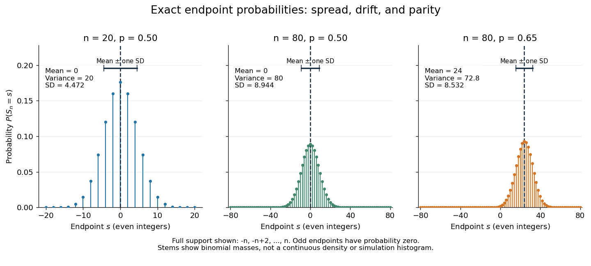

# Simple random walk on the integer line

↑ **Parent:** [Random walk on a graph](random-walk-on-a-graph.md)

A simple random walk on the [integer](integer-split.md) line starts at $S_0=0$ and takes [independent and identically distributed random variables](independent-and-identically-distributed-random-variables.md) $\xi_j$ as unit [increments](increment.md), with

$$
\mathbb P(\xi_j=+1)=p,\qquad \mathbb P(\xi_j=-1)=1-p,\qquad
S_n=\sum_{j=1}^n\xi_j,\qquad 0<p<1.
$$

The [simple symmetric random walk](simple-symmetric-random-walk.md) has $p=1/2$; a [biased random walk](biased-random-walk.md) has $p\ne1/2$. At $p=0$ or $p=1$ every step is deterministic, giving $S_n=-n$ or $S_n=n$ respectively.

Count the rightward steps using [indicator functions](indicator-function.md):

$$
B_n=\sum_{j=1}^n\mathbf1_{\{\xi_j=+1\}},\qquad
B_n\sim\operatorname{Binomial}(n,p),\qquad S_n=B_n-(n-B_n)=2B_n-n.
$$

Thus the endpoint is a shifted and rescaled [random variable](random-variable-split.md) with a [binomial distribution](binomial-distribution.md). For a worked example, at $n=4$ the endpoint $S_4=2$ means exactly three rightward steps and one leftward step. There are $\binom43=4$ possible orders, so its [probability](probability.md) is $4p^3(1-p)$, equal to $1/4$ in the fair case. More generally the [binomial coefficient](binomial-coefficient-split.md) counts the orders, giving the exact [probability mass function](probability-mass-function.md)

$$
\mathbb P(S_n=s)=
\begin{cases}
\displaystyle\binom{n}{(n+s)/2}p^{(n+s)/2}(1-p)^{(n-s)/2},
&s\in\{-n,-n+2,\ldots,n\},\\
0,&\text{otherwise}.
\end{cases}
$$

In particular, the endpoint must have the same [integer parity](parity-mathematics.md) as $n$: $S_n\equiv n\pmod2$. For $0<p<1$ the [support of a probability distribution](support-of-a-probability-distribution.md) is exactly $\{-n,-n+2,\ldots,n\}$. At $n=80$ only [even integers](even-number.md) in $[-80,80]$ are reachable; at $n=81$ only [odd integers](odd-integer.md) are reachable. This restriction is easy to lose if one draws a smooth curve instead of discrete [probability masses](probability-mass.md). The fair-walk counting argument is also presented in [Grinstead and Snell, Introduction to Probability, section 12.1](https://math.dartmouth.edu/~prob/prob/prob.pdf).

**[Figure 2](#image-exact-binomial-endpoint-probabilities-for-fair-walks-of-20-and-80-steps-and-a-biased-walk-of-80-steps-only-even-endpoints-are-possible). Exact binomial endpoint probabilities for fair walks of 20 and 80 steps and a biased walk of 80 steps; only even endpoints are possible.**

The endpoint identity and the [binomial distribution](binomial-distribution.md) give the [expected value](expected-value-split.md), [variance](variance-split.md), and [standard deviation](standard-deviation.md)

$$
\mathbb E S_n=n(2p-1),\qquad
\operatorname{Var}(S_n)=4np(1-p),\qquad
\sigma_n=2\sqrt{np(1-p)}.
$$

A short direct check gives $\mathbb E\xi_j=2p-1$ and $\mathbb E\xi_j^2=1$, hence $\operatorname{Var}(\xi_j)=1-(2p-1)^2=4p(1-p)$. Then apply [linearity of expectation](linearity-of-expectation.md) and the [variance of a sum](variance-of-a-sum.md) of [independent random variables](independent-random-variables.md).

The absolute width and the width relative to the number of steps answer different questions. In the fair case the [standard deviation](standard-deviation.md) grows from $\sqrt{20}\approx4.472$ to $\sqrt{80}\approx8.944$, while $\sigma_n/n$ shrinks from $0.2236$ to $0.1118$. At $n=80,p=0.65$, the [standard deviation](standard-deviation.md) is $\sqrt{72.8}\approx8.532$, or $0.9539$ times the fair width, and $\sigma_n/n\approx0.1067$. Centering and dividing by each walk's own [standard deviation](standard-deviation.md) gives, for $n>0$,

$$
Z_n=\frac{S_n-n(2p-1)}{2\sqrt{np(1-p)}},\qquad
\mathbb E Z_n=0,\qquad \operatorname{Var}(Z_n)=1.
$$

This rescaling equalizes the [variances](variance-split.md), not the entire [probability distributions](probability-distribution-split.md). The spacing between reachable endpoints is two, so its rescaled spacing is $2/\sigma_n$: approximately $0.4472$ for the fair $20$-step walk, $0.2236$ for the fair $80$-step walk, and $0.2344$ for the biased $80$-step walk.

The positions themselves are dependent. For $1\leq m\leq n$, $S_n=S_m+(S_n-S_m)$, where the second term is [independent](independent-random-variables.md) of $S_m$. Their [covariance](covariance.md) is therefore

$$
\operatorname{Cov}(S_m,S_n)=\operatorname{Var}(S_m)=4mp(1-p)>0.
$$

For example, in the fair case $S_1=1$ allows $S_2=0$ or $2$, whereas $S_1=-1$ allows $S_2=-2$ or $0$. Nevertheless the position process is a [Markov chain](markov-chain-split.md): given its current position, the next fresh [increment](increment.md) has no dependence on its past. Its [transition probabilities](transition-probability.md) are

$$
P(x,y)=\begin{cases}p,&y=x+1,\\1-p,&y=x-1,\\0,&\text{otherwise}.\end{cases}
$$

These [transition probabilities](transition-probability.md) are the same at every time and every [integer](integer-split.md) position: shifting both $x$ and $y$ by the same [integer](integer-split.md) leaves $P(x,y)$ unchanged. Thus the [Markov property](markov-property.md) and [independent increments](independent-increments.md) coexist with dependent positions.

**Table of contents**

- [Expected visits to the origin by a simple random walk](expected-visits-to-the-origin-by-a-simple-random-walk.md)
- [Simultaneous returns of independent simple random walks](simultaneous-returns-of-independent-simple-random-walks.md)
- [Biased random walk](biased-random-walk.md)
  - [Exponential martingale of a biased simple random walk](exponential-martingale-of-a-biased-simple-random-walk.md)
  - [Hitting time of a downward-biased walk reflected at an upper barrier](hitting-time-of-a-downward-biased-walk-reflected-at-an-upper-barrier.md)
  - [Diffusion limit of a weakly biased random walk](diffusion-limit-of-a-weakly-biased-random-walk.md)
  - [Maximum of a downward-biased random walk](maximum-of-a-downward-biased-random-walk.md)
  - [Reflected biased random walk on the nonnegative integers](reflected-biased-random-walk-on-the-nonnegative-integers.md)

## ↑ Ancestors (9)

1. [Random walk on a graph](random-walk-on-a-graph.md)
2. [Random walk](random-walk-split.md)
3. [Markov chain](markov-chain-split.md)
4. [Markov process](markov-process-split.md)
5. [Probability theory](probability-theory-split.md)
6. [Probability and statistics](probability-and-statistics-split.md)
7. [Area of mathematics](area-of-mathematics.md)
8. [Mathematics](mathematics-split.md)
9. [Codex Wiki](split.md)

## ← Incoming links (10)

- [Biased random walk](biased-random-walk.md)
- [Covariance function](covariance-function.md)
- [Independent increments](independent-increments.md)
- [Solution](past-exam-of-the-mathematics-course-of-the-university-of-cambridge/2019/ib/paper-4/9h/b/solution.md)
- [Solution](past-exam-of-the-mathematics-course-of-the-university-of-cambridge/2021/ia/paper-2/10e/b/i/solution.md)
- [Solution](past-exam-of-the-mathematics-course-of-the-university-of-cambridge/2021/ib/paper-4/7h/solution.md)
- [Solution](past-exam-of-the-mathematics-course-of-the-university-of-cambridge/2024/ia/paper-2/11f/i/solution.md)
- [Random walk](random-walk-split.md)
- [Simple random walk](simple-random-walk.md)
- [Stochastic process](stochastic-process-split.md)
