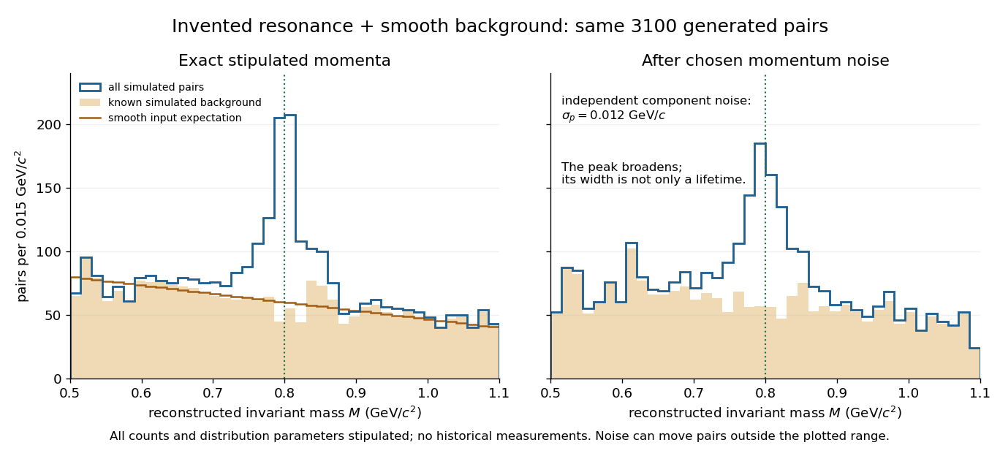

# Simulated two-track invariant-mass example

↑ **Parent:** [Invariant-mass selection of bubble-chamber events](invariant-mass-selection-of-bubble-chamber-events.md)

Take two stipulated oppositely charged daughters with equal [rest mass](invariant-mass.md) $m=0.14\,\mathrm{GeV}/c^2$ and exactly opposite [momenta](momentum-split.md) of magnitude $p=0.30\,\mathrm{GeV}/c$. Their total [momentum](momentum-split.md) is zero, so

$$
E_1=E_2=\sqrt{0.14^2+0.30^2}\,\mathrm{GeV}=0.33106\,\mathrm{GeV},\qquad
M=0.66212\,\mathrm{GeV}/c^2.
$$

This is a constructed event, not an identification of a historical [particle](particle-physics.md). Boosting both [four-momenta](four-momentum.md) by $\beta=0.60$ along the first daughter's direction gives total [energy](energy-split.md) $0.82765\,\mathrm{GeV}$ and total [momentum](momentum-split.md) $0.49659\,\mathrm{GeV}/c$. Substitution recovers the same [invariant mass](invariant-mass.md), although the laboratory [energy](energy-split.md) has increased.

The following independent simulation stipulates 700 signal combinations from a [Cauchy distribution](cauchy-distribution.md) centered at $0.80\,\mathrm{GeV}/c^2$ with scale $0.020\,\mathrm{GeV}/c^2$, truncated to $0.50<M<1.10\,\mathrm{GeV}/c^2$, plus 2400 background combinations whose density decreases linearly across that interval. Each combination is converted to a back-to-back two-daughter event with $m=0.14\,\mathrm{GeV}/c^2$. Independent isotropic directions are chosen, each Cartesian [momentum](momentum-split.md) component receives [normal distribution](normal-distribution.md) noise with [standard deviation](standard-deviation.md) $0.012\,\mathrm{GeV}/c$, and [invariant mass](invariant-mass.md) is reconstructed from the perturbed [momenta](momentum-split.md). All inputs and counts are invented. No historical experimental points or fitted historical parameters appear.

**[Figure 16](#image-a-stipulated-resonance-component-produces-an-excess-above-a-smooth-simulated-invariant-mass-background). A stipulated resonance component produces an excess above a smooth simulated invariant-mass background**. Original simulation of two-daughter events, with invented counts, a truncated Cauchy signal and a linearly falling background. The two panels share the same generated events. The right panel adds chosen momentum noise before reconstructing invariant mass; this is not an experimental discovery plot.

## ↑ Ancestors (8)

1. [Invariant-mass selection of bubble-chamber events](invariant-mass-selection-of-bubble-chamber-events.md)
2. [Alvarez hydrogen-bubble-chamber reconstruction and resonances](alvarez-hydrogen-bubble-chamber-reconstruction-and-resonances.md)
3. [Hydrogen bubble chamber](hydrogen-bubble-chamber.md)
4. [Bubble chamber](bubble-chamber.md)
5. [Particle detector](particle-detector.md)
6. [Particle detection](particle-detection-split.md)
7. [Physics](physics-split.md)
8. [Codex Wiki](split.md)
