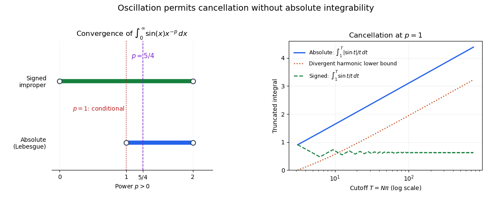

# Sine power kernel integrability

↑ **Parent:** [Improper integral](improper-integral.md)

For $p>0$, the [function](function-split.md) $x\mapsto\sin x/x^p$ is [Lebesgue integrable](lebesgue-integrable-function.md) on $(0,\infty)$ exactly when $1<p<2$. Near zero, $\sin x/x\to1$, so absolute integrability is equivalent to that of $x^{1-p}$, which requires $p<2$. At infinity, $p>1$ gives the upper bound $x^{-p}$. For $0<p\leq1$, on each [interval](interval-mathematics.md) $[k\pi,(k+1)\pi]$,

$$
\int_{k\pi}^{(k+1)\pi}\frac{|\sin x|}{x^p}\,dx\geq\frac{2}{((k+1)\pi)^p},
$$

and the corresponding [P-series](p-series.md) diverges.

The signed [improper integral](improper-integral.md) nevertheless converges for every $0<p<2$: near zero the same local comparison applies, and at infinity the [Dirichlet test for improper integrals](dirichlet-test-for-improper-integrals.md) uses the bounded antiderivative of [sine](sine.md) and the decreasing factor $x^{-p}\to0$. Thus $0<p\leq1$ gives [conditional convergence](conditional-convergence.md), while $1<p<2$ gives [absolute integrability](integrability.md). In particular, substituting $t=1/x$ turns $\int_0^1|x^{-1}\sin(1/x)|\,dx$ into the divergent tail $\int_1^\infty|\sin t|/t\,dt$.

**[Figure 24](#image-conditional-and-absolute-convergence-have-different-thresholds-for-a-sine-power-kernel). Conditional and absolute convergence have different thresholds for a sine power kernel**. The left panel assumes $p>0$ and excludes the open endpoints of each range. The right panel compares signed and absolute truncated integrals at $p=1$, with a divergent harmonic lower bound.

## ↑ Ancestors (8)

1. [Improper integral](improper-integral.md)
2. [Riemann integral](riemann-integral.md)
3. [Riemann integration](riemann-integration.md)
4. [Real analysis](real-analysis-split.md)
5. [Analysis](analysis-split.md)
6. [Area of mathematics](area-of-mathematics.md)
7. [Mathematics](mathematics-split.md)
8. [Codex Wiki](split.md)

## ← Incoming links (4)

- [Solution](past-exam-of-the-integration-course-of-the-university-of-oxford/2014/3/b/solution.md)
- [Solution](past-exam-of-the-integration-course-of-the-university-of-oxford/2015/2/a/solution.md)
- [Solution](past-exam-of-the-integration-course-of-the-university-of-oxford/2017/2/a/ii/solution.md)
- [Radial sine-power kernel integrability](radial-sine-power-kernel-integrability.md)
