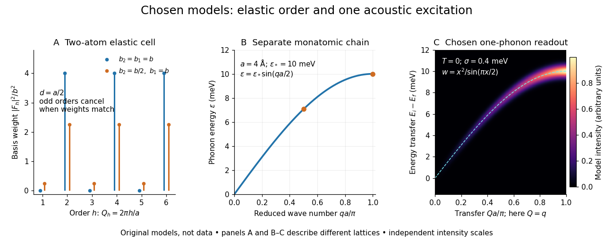

# Single-phonon neutron scattering model

↑ **Parent:** [Inelastic neutron scattering](inelastic-neutron-scattering.md)

Consider an original ideal one-dimensional monatomic [harmonic oscillator](simple-harmonic-motion.md) chain with neighbor separation $a$, [mass](mass.md) $M$ and nearest-neighbor restoring coefficient $K>0$. Its displacement equation is

$$
M\ddot u_r=K(u_{r+1}+u_{r-1}-2u_r).
$$

Substitute the [normal mode](normal-mode.md) $u_r=u_0e^{i(qra-\omega t)}$. Since $e^{iqa}+e^{-iqa}-2=-4\sin^2(qa/2)$,

$$
\omega(q)=2\sqrt{K/M}|\sin(qa/2)|,\qquad
\varepsilon(q)=\hbar\omega(q)=\varepsilon_*|\sin(qa/2)|.
$$

Choose $a=4$ [ångströms](angstrom.md) and $\varepsilon_*=10\,\mathrm{meV}$. This is one [acoustic phonon branch](acoustic-phonon-branch.md), distinct from the two-atom elastic example. It has $\varepsilon(\pi/(2a))=5\sqrt2\,\mathrm{meV}$ and $\varepsilon(\pi/a)=10\,\mathrm{meV}$.

For coherent creation of one [phonon](phonon.md) in a [crystal](crystal.md), the excitation's [wave vector](wavevector.md) $q$ and the measured transfer obey $Q=G+q$, with $G$ a [reciprocal lattice](reciprocal-lattice.md) vector. To connect the [dispersion relation](dispersion-relation-split.md) to an illustrative [intensity](intensity-physics.md), take zero [temperature](temperature-split.md), longitudinal displacements and the first interval $Q=q\in(0,\pi/a]$, choosing $G=0$. Expand the scattering phase to first order, $e^{iQ(ra+u_r)}\simeq e^{iQra}(1+iQu_r)$. The constant term supplies elastic scattering; the linear term creates one [phonon](phonon.md). Its displacement matrix element is proportional to $1/\sqrt{\omega}$, so the squared amplitude has weight $Q^2/\varepsilon(Q)$, apart from common factors. Normalize this weight to one at $Q=\pi/a$:

$$
x=\frac{Qa}{\pi},\qquad
w(x)=\frac{x^2}{\sin(\pi x/2)},\qquad 0<x\leq1.
$$

The limit $w(0)=0$ follows from $\sin(\pi x/2)\sim\pi x/2$. Set $\sigma=0.4\,\mathrm{meV}$ and replace the ideal sharp line by a normalized [Gaussian function](gaussian-function.md):

$$
J(Q,\Delta E)=\frac{w(x)}{\sqrt{2\pi}\sigma}
\exp\!\left[-\frac{(\Delta E-\varepsilon(Q))^2}{2\sigma^2}\right].
$$

This chosen broadening illustrates readout width; it is not a measured resolution or a full spectrometer resolution function. Integrating over all $\Delta E$ gives $w(x)$. The small negative-[energy](energy-split.md) tail is a broadening artifact, not a zero-[temperature](temperature-split.md) phonon-annihilation signal.

**[Figure 2](#image-chosen-elastic-reflection-weights-and-a-single-phonon-dispersion-intensity-model). Chosen elastic reflection weights and a single-phonon dispersion/intensity model**. Original models, not experimental data. Left: positive reciprocal-lattice orders for the two-atom cell, omitting forward scattering. Middle: the separate monatomic-chain branch. Right: the same branch with normalized longitudinal one-phonon weights and chosen Gaussian broadening. Elastic and inelastic intensities have independent arbitrary normalizations.

These panels separate three kinds of information: allowed [reciprocal lattice](reciprocal-lattice.md) positions, cancellation within a [crystal basis structure factor](crystal-basis-structure-factor.md), and an excitation's [energy](energy-split.md) as a function of [wave vector](wavevector.md). The chain has no magnetic degrees of freedom, optical branches, damping or multi-[phonon](phonon.md) processes. It illustrates how one excitation could be read; it proves nothing about the completeness of a real material's excitation spectrum.

## ↑ Ancestors (9)

1. [Inelastic neutron scattering](inelastic-neutron-scattering.md)
2. [Neutron scattering](neutron-scattering.md)
3. [Neutron](neutron-split.md)
4. [Nucleon](nucleon.md)
5. [Baryon](baryon.md)
6. [Hadron](hadron.md)
7. [Subatomic particle](subatomic-particle.md)
8. [Physics](physics-split.md)
9. [Codex Wiki](split.md)
