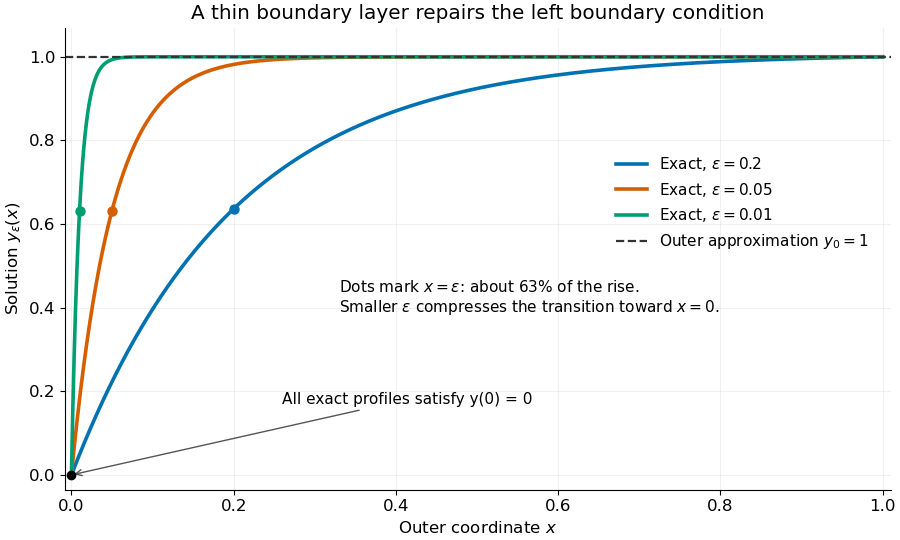

# Singular perturbation

↑ **Parent:** [Ordinary differential equation](ordinary-differential-equation.md)  
ⓦ [Wiki](https://en.wikipedia.org/wiki/Singular_perturbation)

A [singular perturbation](singular-perturbation-split.md) is a parameter-dependent problem whose limiting problem changes qualitatively as the parameter tends to zero. In an [ordinary differential equation](ordinary-differential-equation.md), a small coefficient of the highest [derivative](derivative.md) can reduce the order of the limiting [differential equation](differential-equation-split.md), preventing it from satisfying all the original [boundary conditions](boundary-condition.md). Different length or time scales often require different [asymptotic expansions](asymptotic-expansion-split.md).[§1.1.2, p. 2: regular and singular perturbations](asymptotic-analysis-and-singular-perturbation-theory-by-john-k-hunter.md)

Consider the [boundary value problem](boundary-value-problem-split.md)

$$
\epsilon y_\epsilon''+y_\epsilon'=0,\qquad 0<x<1,\qquad y_\epsilon(0)=0,\quad y_\epsilon(1)=1,\qquad \epsilon>0.
$$

This [second-order differential equation](second-order-differential-equation.md) is exactly solvable. Setting $v=y_\epsilon'$ gives the [first-order linear differential equation](first-order-linear-differential-equation.md) $\epsilon v'+v=0$, so $v=C e^{-x/\epsilon}$. One [integration](integral-split.md) and the two [boundary conditions](boundary-condition.md) give

$$
y_\epsilon(x)=\frac{1-e^{-x/\epsilon}}{1-e^{-1/\epsilon}}.
$$

Both [boundary conditions](boundary-condition.md) hold for every positive $\epsilon$. For numerical evaluation, write the same ratio as $\operatorname{expm1}(-x/\epsilon)/\operatorname{expm1}(-1/\epsilon)$, where $\operatorname{expm1}(t)$ evaluates the [exponential function](exponential-function.md) minus one without [catastrophic cancellation](catastrophic-cancellation.md) near $t=0$. Keep the denominator for finite $\epsilon$: at $\epsilon=0.2$ it is approximately $0.993262$, rather than exactly one.

Setting $\epsilon=0$ gives $y_0'=0$. The [outer solution](outer-expansion.md) selected by the right [boundary condition](boundary-condition.md) is therefore $y_0=1$, which fails the left [boundary condition](boundary-condition.md). The exact [exponential function](exponential-function.md) $e^{-x/\epsilon}$ shows how that mismatch is repaired: the solution rises from zero to almost one within a [boundary layer](boundary-layer.md) of width $x=O(\epsilon)$, using [Big O notation](big-o-notation.md). For each fixed $x>0$, $y_\epsilon(x)\to1$, while $y_\epsilon(0)=0$ always. This [pointwise convergence](pointwise-convergence.md) fails to be [uniform convergence](uniform-convergence.md) to the [outer solution](outer-expansion.md) on $[0,1]$, since $\sup_{0\leq x\leq1}|y_\epsilon(x)-1|=1$ for every $\epsilon>0$.

**[Figure 1](#image-exact-solutions-with-a-shrinking-left-boundary-layer). Exact solutions with a shrinking left boundary layer**. The exact normalized profiles at $\epsilon=0.2$, $0.05$, and $0.01$ satisfy both [boundary conditions](boundary-condition.md). The dashed [outer solution](outer-expansion.md) misses the left [boundary condition](boundary-condition.md). Colored dots mark $x=\epsilon$, where most of the initial rise has already occurred.

The coefficient $\epsilon$ is small, but its product with the [second derivative](second-derivative.md) need not be small. Direct [differentiation](differentiation.md) gives

$$
y_\epsilon'(x)=\frac{e^{-x/\epsilon}}{\epsilon(1-e^{-1/\epsilon})},\qquad
y_\epsilon''(x)=-\frac{e^{-x/\epsilon}}{\epsilon^2(1-e^{-1/\epsilon})}.
$$

At $x=\epsilon X$ with fixed $X\geq0$, these [derivatives](derivative.md) grow as $\epsilon^{-1}$ and $\epsilon^{-2}$ respectively as $\epsilon\to0^+$. Consequently $\epsilon y_\epsilon''$ and $y_\epsilon'$ have exactly equal magnitudes and opposite signs. Even away from the [boundary layer](boundary-layer.md), their magnitudes remain equal in this example; both become exponentially small at each fixed positive $x$. The [outer expansion](outer-expansion.md) neglects an exponentially small transient there, rather than establishing that one [derivative](derivative.md) term is smaller than the other everywhere.

To predict the width without knowing the exact solution, suppose an order-one change occurs over distance $\delta$. The [derivative](derivative.md) scales are $y'=O(\delta^{-1})$ and $y''=O(\delta^{-2})$. The [dominant balance](dominant-balance.md) $\epsilon/\delta^2\sim1/\delta$ gives $\delta\sim\epsilon$. The resulting [inner variable](inner-variable.md) $X=x/\epsilon$ makes the [boundary layer](boundary-layer.md) visible at a fixed scale. This is the useful feature of [singular perturbation](singular-perturbation-split.md): an apparently disappearing term identifies the missing structure when one measures its [derivatives](derivative.md) on the appropriate scale.

**Table of contents**

- [Beyond-all-orders boundary-value sensitivity](beyond-all-orders-boundary-value-sensitivity.md)
- [Adiabatic elimination](adiabatic-elimination.md)
- [Matched asymptotic expansion](matched-asymptotic-expansion.md)
  - [Endpoint derivative in a negative-drift boundary layer](endpoint-derivative-in-a-negative-drift-boundary-layer.md)
  - [Logistic crossover in a weakly nonlinear Euler equation](logistic-crossover-in-a-weakly-nonlinear-euler-equation.md)
    - [Nonlinear crossover delayed by a small unstable-mode coefficient](nonlinear-crossover-delayed-by-a-small-unstable-mode-coefficient.md)
  - [Nonlinear endpoint layer with a quadratic reaction](nonlinear-endpoint-layer-with-a-quadratic-reaction.md)
    - [One-third-power scaling at a nonlinear turning endpoint](one-third-power-scaling-at-a-nonlinear-turning-endpoint.md)
  - [Asymptotic matching condition](asymptotic-matching-condition.md)
  - [Square-root reaction problem with nested boundary layers](square-root-reaction-problem-with-nested-boundary-layers.md)
    - [First integral of a square-root reaction layer](first-integral-of-a-square-root-reaction-layer.md)
  - [Nested layers at an essential singular endpoint](nested-layers-at-an-essential-singular-endpoint.md)
  - [Matched expansion with square-root and logarithmic corrections](matched-expansion-with-square-root-and-logarithmic-corrections.md)
  - [Logarithmic matching in a small-exponent boundary layer](logarithmic-matching-in-a-small-exponent-boundary-layer.md)
  - [Gaussian interior layer of a conservative drift equation](gaussian-interior-layer-of-a-conservative-drift-equation.md)
  - [Oscillatory endpoint with a quadratically vanishing drift](oscillatory-endpoint-with-a-quadratically-vanishing-drift.md)
  - [First-order composite expansion for a positive drift](first-order-composite-expansion-for-a-positive-drift.md)
  - [Logarithmically enhanced nonlinear boundary layer](logarithmically-enhanced-nonlinear-boundary-layer.md)
  - [Boundary layer around a moving endpoint](boundary-layer-around-a-moving-endpoint.md)
  - [Square-root boundary layer at a vanishing drift](square-root-boundary-layer-at-a-vanishing-drift.md)
    - [Error-function logarithmic switchback](error-function-logarithmic-switchback.md)
  - [Overlap region](overlap-region.md)
  - [Intermediate asymptotic region](intermediate-asymptotic-region.md)
  - [Interior layer at a simple zero of advection](interior-layer-at-a-simple-zero-of-advection.md)
    - [Endpoint layers for reversed diffusion](endpoint-layers-for-reversed-diffusion.md)
  - [Distinguished limit](distinguished-limit.md)
  - [Inner expansion](inner-expansion.md)
    - [Square-root-degenerate endpoint layer](square-root-degenerate-endpoint-layer.md)
    - [Inner variable](inner-variable.md)
  - [Outer expansion](outer-expansion.md)
  - [Additive composite expansion](additive-composite-expansion.md)
  - [Multiplicative composite expansion](multiplicative-composite-expansion.md)
  - [Outflow boundary layer](outflow-boundary-layer.md)
  - [Switchback term](switchback-term.md)
    - [Logarithmic overlap creates a switchback term](logarithmic-overlap-creates-a-switchback-term.md)
- [Method of multiple scales](method-of-multiple-scales.md)
  - [Slow oscillator damping by a relaxing auxiliary variable](slow-oscillator-damping-by-a-relaxing-auxiliary-variable.md)
  - [Averaged oscillator damping by a power of velocity](averaged-oscillator-damping-by-a-power-of-velocity.md)
  - [Second-order resonance from quadratic oscillator coupling](second-order-resonance-from-quadratic-oscillator-coupling.md)
  - [Averaged amplitude for position-dependent damping](averaged-amplitude-for-position-dependent-damping.md)
    - [Absolute-value damping amplitude law](absolute-value-damping-amplitude-law.md)
    - [Van der Pol amplitude evolution](van-der-pol-amplitude-evolution.md)
      - [Shifted Van der Pol amplitude evolution](shifted-van-der-pol-amplitude-evolution.md)
    - [Odd position-dependent damping has zero first-order amplitude drift](odd-position-dependent-damping-has-zero-first-order-amplitude-drift.md)
  - [Secular term](secular-term.md)
  - [Whitham modulation theory](whitham-modulation-theory.md)
    - [Averaged Lagrangian](averaged-lagrangian.md)
      - [Modulated-wave first integral](modulated-wave-first-integral.md)
      - [Whitham modulation equation](whitham-modulation-equation.md)
        - [Wave-action density](wave-action-density.md)
          - [Wave-action conservation law](wave-action-conservation-law.md)
  - [Amplitude-phase equations for a weakly perturbed oscillator](amplitude-phase-equations-for-a-weakly-perturbed-oscillator.md)
    - [Oscillator coupled to slow damping feedback](oscillator-coupled-to-slow-damping-feedback.md)
    - [Velocity-only forcing in averaged oscillator equations](velocity-only-forcing-in-averaged-oscillator-equations.md)
      - [Quadratically damped oscillator](quadratically-damped-oscillator.md)
      - [Cubic velocity anti-damping](cubic-velocity-anti-damping.md)
    - [Conservative forcing in averaged oscillator equations](conservative-forcing-in-averaged-oscillator-equations.md)
  - [Slow time](slow-time.md)
  - [Weakly nonlinear expansion](weakly-nonlinear-expansion.md)
    - [Quadratic wave interaction](quadratic-wave-interaction.md)
      - [Resonant three-wave triad](resonant-three-wave-triad.md)
      - [Detuning of a wave resonance](detuning-of-a-wave-resonance.md)
      - [Phase matching for a quadratic wave interaction](phase-matching-for-a-quadratic-wave-interaction.md)
        - [Two-to-one resonance of dispersive waves](two-to-one-resonance-of-dispersive-waves.md)
          - [Explosive two-to-one amplitude system](explosive-two-to-one-amplitude-system.md)
  - [Harmonic balance](harmonic-balance.md)
  - [Solvability condition in the method of multiple scales](solvability-condition-in-the-method-of-multiple-scales.md)
  - [Parametric resonance](parametric-resonance.md)
    - [Primary instability tongue of a weak Mathieu oscillator](primary-instability-tongue-of-a-weak-mathieu-oscillator.md)
    - [Primary parametric resonance of a two-to-one oscillator pair](primary-parametric-resonance-of-a-two-to-one-oscillator-pair.md)
    - [Second instability tongue of a weak Mathieu oscillator](second-instability-tongue-of-a-weak-mathieu-oscillator.md)
      - [Slow amplitudes for the second Mathieu instability tongue](slow-amplitudes-for-the-second-mathieu-instability-tongue.md)
      - [Fourth-order edges of the second Mathieu instability tongue](fourth-order-edges-of-the-second-mathieu-instability-tongue.md)

## ↑ Ancestors (6)

1. [Ordinary differential equation](ordinary-differential-equation.md)
2. [Differential equation](differential-equation-split.md)
3. [Analysis](analysis-split.md)
4. [Area of mathematics](area-of-mathematics.md)
5. [Mathematics](mathematics-split.md)
6. [Codex Wiki](split.md)

## ← Incoming links (15)

- [Additive composite expansion](additive-composite-expansion.md)
- [Boundary layer](boundary-layer.md)
- [Divergent algebraic root in a singular perturbation](divergent-algebraic-root-in-a-singular-perturbation.md)
- [Gaussian drift primitives](gaussian-drift-primitives.md)
- [Inner variable](inner-variable.md)
- [Matched asymptotic expansion](matched-asymptotic-expansion.md)
- [Outer expansion](outer-expansion.md)
- [Solution](past-exam-of-the-mathematics-course-of-the-university-of-cambridge/2001/iii/paper-50/3/a/solution.md)
- [Solution](past-exam-of-the-mathematics-course-of-the-university-of-cambridge/2002/iii/paper-48/3/b/solution.md)
- [Solution](past-exam-of-the-mathematics-course-of-the-university-of-cambridge/2012/iii/paper-76/1/a/solution.md)
- [Solution](past-exam-of-the-mathematics-course-of-the-university-of-cambridge/2013/iii/paper-67/3/iii/solution.md)
- [Solution](past-exam-of-the-mathematics-course-of-the-university-of-cambridge/2022/ii/paper-4/6c/c/solution.md)
- [Regular perturbation](regular-perturbation.md)
- [Singular perturbation](singular-perturbation-split.md)
- [Square-root-degenerate endpoint layer](square-root-degenerate-endpoint-layer.md)
