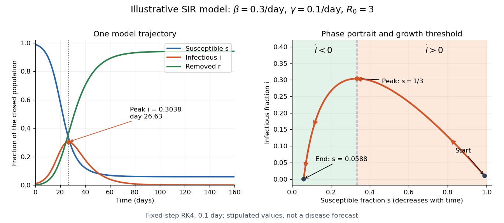

# SIR infection peak

↑ **Parent:** [SIR first integral](sir-first-integral.md)

If $i_0>0$ and $s_0>\gamma/\beta$, the [infectious compartment](infectious-compartment.md) initially grows. The [SIR model equations](sir-model-equations.md) give its unique later maximum when

$$
s_*=\frac{\gamma}{\beta}=\frac{1}{R_0}.
$$

Before this [SIR infection peak](sir-infection-peak.md), $\beta s-\gamma>0$; afterward it is negative because the [susceptible compartment](susceptible-compartment.md) keeps shrinking. Substituting $s_*$ into the [SIR first integral](sir-first-integral.md) gives

$$
i_{\mathrm{peak}}
=i_0+s_0-s_*+s_*\ln\frac{s_*}{s_0}.
$$

For the stipulated [initial value problem](initial-value-problem.md),

$$
s_*=\frac13,\qquad
i_{\mathrm{peak}}=1-\frac13+\frac13\ln\frac{1/3}{0.99}
\approx0.3038126824.
$$

Thus about $30.38\%$ of the modelled population belongs to the [infectious compartment](infectious-compartment.md) simultaneously at the [SIR infection peak](sir-infection-peak.md). This is a peak of the [infectious compartment](infectious-compartment.md), not of [incidence](incidence-epidemiology.md), whose flow is $\beta si$. If $s_0\leq\gamma/\beta$, the maximum is already $i_0$ at the start and the interior [SIR infection peak](sir-infection-peak.md) formula does not apply.

**[Figure 4](#image-time-evolution-and-phase-portrait-of-the-stipulated-sir-model). Time evolution and phase portrait of the stipulated SIR model**. The [SIR model equations](sir-model-equations.md) produce a [SIR infection peak](sir-infection-peak.md) near day $26.63$. The [phase portrait](phase-portrait.md) follows decreasing $s$ from right to left and changes from growth to decline of the [infectious compartment](infectious-compartment.md) at $s=1/3$. The [susceptible compartment](susceptible-compartment.md) remains nonempty as $i$ approaches zero. The curves use a fourth-order [Runge-Kutta method](runge-kutta-method.md) with a fixed step of $0.1$ day; all parameter values are illustrative.

The numerical [solution of a differential equation](solution-of-a-differential-equation.md) puts the [SIR infection peak](sir-infection-peak.md) at about day $26.63258$ with $i\approx0.303812682386$, agreeing with the [SIR first integral](sir-first-integral.md) to within $10^{-11}$. The accompanying generator checks nonnegative [fractions](fraction.md) and [conservation of population](conservation-of-population.md) without clipping or rescaling. For steps $0.4$, $0.2$ and $0.1$ day, the largest differences between successive numerical trajectories at shared times are approximately $1.086\times10^{-7}$ and $6.985\times10^{-9}$. Their ratio is $15.55$, close to the factor $16$ expected when a fourth-order [Runge-Kutta method](runge-kutta-method.md)'s step is halved.

## ↑ Ancestors (7)

1. [SIR first integral](sir-first-integral.md)
2. [SIR model](sir-model.md)
3. [Compartmental models (epidemiology)](compartmental-models-epidemiology.md)
4. [Mathematical biology](mathematical-biology-split.md)
5. [Branches of physics](branches-of-physics.md)
6. [Physics](physics-split.md)
7. [Codex Wiki](split.md)

## ← Incoming links (4)

- [Effective reproduction number](effective-reproduction-number.md)
- [SIR final removed fraction](sir-final-removed-fraction.md)
- [SIR infection peak](sir-infection-peak.md)
- [SIR model](sir-model.md)
