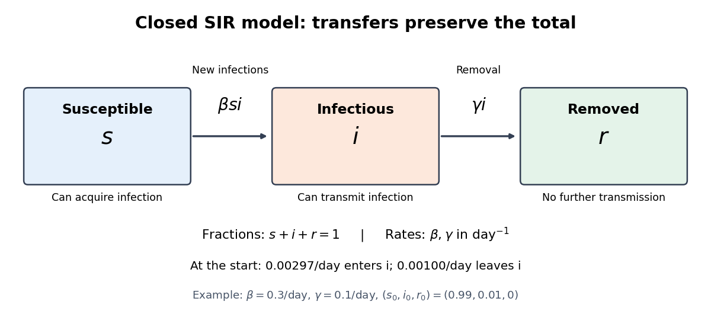

# SIR model

↑ **Parent:** [Compartmental models (epidemiology)](compartmental-models-epidemiology.md)

The [SIR model](sir-model.md) is a [mathematical model](mathematical-model.md) of an [epidemic](epidemic.md) that follows three groups: a [susceptible compartment](susceptible-compartment.md) whose members can acquire [infection](infection.md), an [infectious compartment](infectious-compartment.md) whose members can pass it on, and a [removed compartment](removed-compartment.md) whose members neither acquire nor pass on [infection](infection.md). The letters stand for susceptible, infectious and recovered or removed. Here we study the simplest closed, constant-parameter version, with [homogeneous mixing](homogeneous-mixing.md) and no births, deaths, migration or waning [immunity](immunity-medical.md). A person who leaves the [infectious compartment](infectious-compartment.md) never returns to the [susceptible compartment](susceptible-compartment.md) in this version.[Amir Ajorlou, MIT Lecture 20: Epidemics, slides 18 and 24](https://ocw.mit.edu/courses/1-022-introduction-to-network-models-fall-2018/fe3c864fd7d2d45ed7fe65e601d9c69e_MIT1_022F18_lec20.pdf)

The appeal of the [SIR model](sir-model.md) is that one can explain a rise and fall in the [infectious compartment](infectious-compartment.md) without changing anyone's behavior: fewer opportunities for new [infection](infection.md) eventually reverse the growth. The [SIR first integral](sir-first-integral.md) even determines the [SIR infection peak](sir-infection-peak.md) without computing its time. These are useful deductions from explicit assumptions. The stipulated numbers below illustrate the [mathematical model](mathematical-model.md); they are neither estimates for an actual disease nor a forecast or medical advice.

Kermack and McKendrick's 1927 paper, "A contribution to the mathematical theory of epidemics", in Proceedings of the Royal Society A, is an early foundation for the [SIR model](sir-model.md). Its DOI is `10.1098/rspa.1927.0118`, also recorded in the Royal Society's archive of contemporary referee reports.[Kermack and McKendrick, original 1927 paper](https://doi.org/10.1098/rspa.1927.0118)[Royal Society archive: contemporary referee report and publication record](https://catalogues.royalsociety.org/CalmView/Record.aspx?id=RR%2F35%2F131&src=CalmView.Catalog)

**[Figure 3](#image-transfers-between-the-three-compartments-of-the-sir-model). Transfers between the three compartments of the SIR model**. The [SIR model equations](sir-model-equations.md) transfer a [fraction](fraction.md) $\beta si$ per day from the [susceptible compartment](susceptible-compartment.md) to the [infectious compartment](infectious-compartment.md), and a [fraction](fraction.md) $\gamma i$ per day from the [infectious compartment](infectious-compartment.md) to the [removed compartment](removed-compartment.md). Each arrow contributes a loss to one group and an equal gain to another, giving [conservation of population](conservation-of-population.md).

**Table of contents**

- [Susceptible compartment](susceptible-compartment.md)
- [Infectious compartment](infectious-compartment.md)
- [Removed compartment](removed-compartment.md)
- [SIR model equations](sir-model-equations.md)
- [SIR first integral](sir-first-integral.md)
  - [SIR infection peak](sir-infection-peak.md)
- [SIR final removed fraction](sir-final-removed-fraction.md)
- [Farm-size stratified SIR model](farm-size-stratified-sir-model.md)
- [Discrete SIR epidemic on a graph](discrete-sir-epidemic-on-a-graph.md)
  - [Adjacency-matrix bound for a discrete SIR epidemic](adjacency-matrix-bound-for-a-discrete-sir-epidemic.md)
    - [Resolvent bound for a discrete SIR epidemic](resolvent-bound-for-a-discrete-sir-epidemic.md)
      - [Spectral condition for a small discrete SIR outbreak](spectral-condition-for-a-small-discrete-sir-outbreak.md)
- [Epidemic threshold for the closed SIR model](epidemic-threshold-for-the-closed-sir-model.md)
- [SIR susceptible-recovered identity](sir-susceptible-recovered-identity.md)
- [Stochastic SIR model](stochastic-sir-model.md)
  - [Two-event probability in a stochastic SIR model](two-event-probability-in-a-stochastic-sir-model.md)
  - [Chain-binomial epidemic model](chain-binomial-epidemic-model.md)

## ↑ Ancestors (5)

1. [Compartmental models (epidemiology)](compartmental-models-epidemiology.md)
2. [Mathematical biology](mathematical-biology-split.md)
3. [Branches of physics](branches-of-physics.md)
4. [Physics](physics-split.md)
5. [Codex Wiki](split.md)

## ← Incoming links (25)

- [Discrete SIR epidemic on a graph](discrete-sir-epidemic-on-a-graph.md)
- [Effective reproduction number](effective-reproduction-number.md)
- [Epidemic threshold for the closed SIR model](epidemic-threshold-for-the-closed-sir-model.md)
- [Homogeneous mixing](homogeneous-mixing.md)
- [Immunity (medical)](immunity-medical.md)
- [Infection](infection.md)
- [Infectious compartment](infectious-compartment.md)
- [Microparasite](microparasite.md)
- [Solution](past-exam-of-the-mathematics-course-of-the-university-of-cambridge/2001/iii/paper-52/3/solution.md)
- [Solution](past-exam-of-the-mathematics-course-of-the-university-of-cambridge/2002/iii/paper-57/3/a/solution.md)
- [Solution](past-exam-of-the-mathematics-course-of-the-university-of-cambridge/2002/iii/paper-57/3/b/solution.md)
- [Solution](past-exam-of-the-mathematics-course-of-the-university-of-cambridge/2002/iii/paper-57/3/c/solution.md)
- [Solution](past-exam-of-the-mathematics-course-of-the-university-of-cambridge/2002/iii/paper-57/4/solution.md)
- [Solution](past-exam-of-the-mathematics-course-of-the-university-of-cambridge/2016/iii/paper-207/3/a/solution.md)
- [Solution](past-exam-of-the-mathematics-course-of-the-university-of-cambridge/2016/iii/paper-207/3/b/solution.md)
- [Solution](past-exam-of-the-mathematics-course-of-the-university-of-cambridge/2016/iii/paper-207/3/c/solution.md)
- [Solution](past-exam-of-the-mathematics-course-of-the-university-of-cambridge/2016/iii/paper-207/3/d/solution.md)
- [Solution](past-exam-of-the-mathematics-course-of-the-university-of-cambridge/2025/iii/paper-207/2/d/i/solution.md)
- [Removed compartment](removed-compartment.md)
- [SIR final removed fraction](sir-final-removed-fraction.md)
- [SIR infection peak](sir-infection-peak.md)
- [SIR model](sir-model.md)
- [SIR model equations](sir-model-equations.md)
- [SIR susceptible-recovered identity](sir-susceptible-recovered-identity.md)
- [Susceptible compartment](susceptible-compartment.md)
