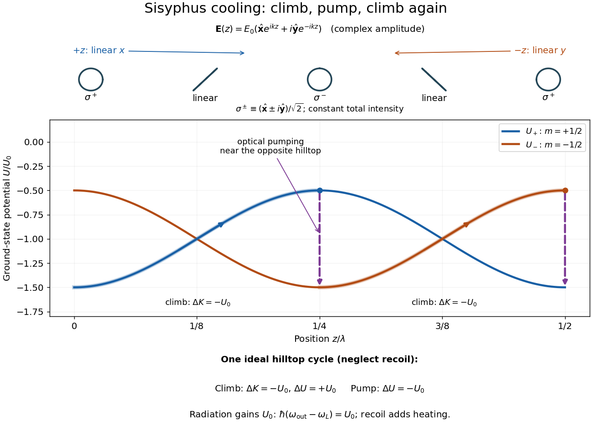

# Sisyphus cooling

↑ **Parent:** [Polarization-gradient cooling](polarization-gradient-cooling.md)  
ⓦ [Wiki](https://en.wikipedia.org/wiki/Sisyphus_cooling)

Finite [optical pumping](optical-pumping.md) time lets an atom climb a light-shift hill before transfer into a lower [magnetic sublevel](magnetic-sublevel.md). [Spontaneous emission](spontaneous-emission.md) dissipates the gained [potential energy](potential-energy.md); climbing alone is conservative.[§3 A, pp. 2027–2028, Figs. 3–4](laser-cooling-below-the-doppler-limit-by-polarization-gradients-simple-theoretical-models-by-jean-dalibard-and-claude-cohen-tannoudji.md)

To make the geometry and signs explicit, take an original choice of phase origin for equal opposing waves:

$$
\boldsymbol{\mathcal E}(z)=E_0\left(\hat{\mathbf x}e^{ikz}+i\hat{\mathbf y}e^{-ikz}\right),\quad
k=\frac{2\pi}{\lambda},\quad
\boldsymbol\epsilon_\pm=\frac{\hat{\mathbf x}\pm i\hat{\mathbf y}}{\sqrt2},\quad
w_\pm(z)=\frac{1\pm\cos(2kz)}2.
$$

The real [electric field](electric-field-split.md) is $\operatorname{Re}[\boldsymbol{\mathcal E}(z)e^{-i\omega_Lt}]$; $\lambda$ is [wavelength](wavelength.md). The fractions $w_\pm$ are squared projections onto the defined circular basis vectors, divided by total intensity. Their sum is one: interference changes [electromagnetic polarization](polarization-of-an-electromagnetic-wave.md) despite constant total intensity. At $z=0,\lambda/4,\lambda/2$ the field is respectively $\boldsymbol\epsilon_+,\boldsymbol\epsilon_-,\boldsymbol\epsilon_+$; halfway between these positions it is linearly polarized. Specifying the vectors avoids an observer-dependent verbal handedness convention.

For an illustrative $J_g=1/2\to J_e=3/2$ [angular momentum](angular-momentum.md) transition, use the squared [Clebsch-Gordan coefficients](clebsch-gordan-coefficients.md) $1$ and $1/3$ for the strong and weak circular couplings from each lower [magnetic sublevel](magnetic-sublevel.md). Interchanging circular components interchanges these strengths. The weighted sums are $w_++w_-/3=(2+\cos(2kz))/3$ and $w_-+w_+/3=(2-\cos(2kz))/3$. Rescaling their common negative shift gives

$$
U_+(z)=-U_0-\frac{U_0}{2}\cos(2kz),\qquad
U_-(z)=-U_0+\frac{U_0}{2}\cos(2kz),\qquad U_0>0.
$$

Both [potential energies](potential-energy.md) are negative relative to the unilluminated level. Each hill has height $U_0$, and opposite hills are displaced by $\lambda/4$. An atom starting at the $U_+$ minimum at $z=0$ loses $U_0$ of [kinetic energy](kinetic-energy.md) if it reaches $z=\lambda/4$ on that branch. A pump transfer there lowers its [potential energy](potential-energy.md) by $U_0$, leaving it at a $U_-$ minimum. The next uphill segment ends at $z=\lambda/2$, where the favoured transfer is reversed. Actual transfers are stochastic and need not occur exactly at these extrema.

**[Figure 16](#image-polarization-geometry-shifted-ground-states-and-a-sisyphus-energy-cycle). Polarization geometry, shifted ground states and a Sisyphus energy cycle**. Original schematic: pumping arrows join occupied hilltops to opposite minima. Ideal completed cycles neglect recoil; actual transfers are stochastic.

For one completed climb and pump, [conservation of energy](conservation-of-energy.md) gives $\Delta K=-U_0$, while the ground-state [potential energy](potential-energy.md) returns to its starting value. Neglecting recoil and treating the scattered [photon](photon.md) as the sole outgoing radiation change, $\hbar(\omega_{\rm out}-\omega_L)=U_0$. A potential drop is an internal-state reset, not an automatic equal upward kick in [kinetic energy](kinetic-energy.md). Random emission nevertheless adds [momentum](momentum-split.md) fluctuations and [recoil energy](recoil-energy.md), so useful cooling requires the dissipated energy to compete with that heating.

The [recoil energy](recoil-energy.md) $E_R=(\hbar k)^2/(2m)$ sets a different scale from $k_BT_D=\hbar\Gamma/2$. Conventional Sisyphus cooling reaches the recoil regime when reducing the hill height also weakens cooling; it is not a claim of arbitrarily small [temperature](temperature-split.md) at vanishing intensity. Subrecoil techniques need further physics.[p. 712, §§II B and III A](nobel-lecture-manipulating-atoms-with-photons-by-claude-cohen-tannoudji.md)

**Table of contents**

- [Delayed-pumping model of Sisyphus friction](delayed-pumping-model-of-sisyphus-friction.md)

## ↑ Ancestors (7)

1. [Polarization-gradient cooling](polarization-gradient-cooling.md)
2. [Sub-Doppler cooling](sub-doppler-cooling.md)
3. [Laser cooling](laser-cooling.md)
4. [Atomic measurement methods](atomic-measurement-methods.md)
5. [Atomic physics](atomic-physics-split.md)
6. [Physics](physics-split.md)
7. [Codex Wiki](split.md)

## ← Incoming links (3)

- [Solution](past-exam-of-the-atomic-and-optical-physics-course-of-the-university-of-cambridge/2012/paper-1/3/a/solution.md)
- [Solution](past-exam-of-the-atomic-and-optical-physics-course-of-the-university-of-cambridge/2014/paper-1/3/b/solution.md)
- [Solution](past-exam-of-the-atomic-and-optical-physics-course-of-the-university-of-cambridge/2016/paper-1/2/b/solution.md)
