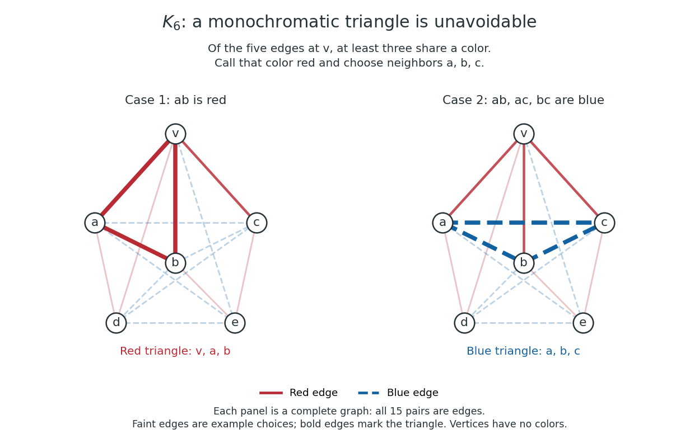

# Six-vertex monochromatic triangle argument

↑ **Parent:** [Ramsey number for triangles](ramsey-number-for-triangles.md)

Choose any [vertex](vertex-graph-theory.md) $v$ of a red-blue colored [complete graph](complete-graph.md) $K_6$. Its five incident [edges](edge-of-a-graph.md) go to the other five [vertices](vertex-graph-theory.md). By the [pigeonhole principle](pigeonhole-principle.md), at least three have the same color. Call their other endpoints $a,b,c$ and, after swapping color names if needed, suppose $va,vb,vc$ are red.

If any of $ab,ac,bc$ is red, it completes a red [triangle in a graph](triangle-in-a-graph.md) with $v$. If none is red, all three are blue, so $a,b,c$ themselves form a blue [triangle in a graph](triangle-in-a-graph.md). Both possibilities force a [monochromatic](monochromatic-set.md) [triangle in a graph](triangle-in-a-graph.md). This proves the upper bound for the [Ramsey number for triangles](ramsey-number-for-triangles.md) using only five incident [edges](edge-of-a-graph.md) and the three pairs among the selected neighbors; the colors of the other [edges](edge-of-a-graph.md) cannot defeat the argument.

**[Figure 2](#image-the-two-cases-after-choosing-three-red-neighbors-in-a-complete-graph-on-six-vertices). The two cases after choosing three red neighbors in a complete graph on six vertices**.

Both panels show all 15 [edges](edge-of-a-graph.md) of a [complete graph](complete-graph.md) on six [vertices](vertex-graph-theory.md). Faint colored [edges](edge-of-a-graph.md) are example choices outside the decisive argument; bold [edges](edge-of-a-graph.md) exhibit the forced [triangle in a graph](triangle-in-a-graph.md). The selected neighbor color could instead be blue, giving the same argument with the color names exchanged.

## ↑ Ancestors (9)

1. [Ramsey number for triangles](ramsey-number-for-triangles.md)
2. [Ramsey number](ramsey-number.md)
3. [Finite Ramsey theorem](finite-ramsey-theorem.md)
4. [Ramsey's theorem](ramsey-s-theorem.md)
5. [Ramsey theory](ramsey-theory-split.md)
6. [Combinatorics](combinatorics-split.md)
7. [Area of mathematics](area-of-mathematics.md)
8. [Mathematics](mathematics-split.md)
9. [Codex Wiki](split.md)

## ← Incoming links (1)

- [Ramsey number for triangles](ramsey-number-for-triangles.md)
