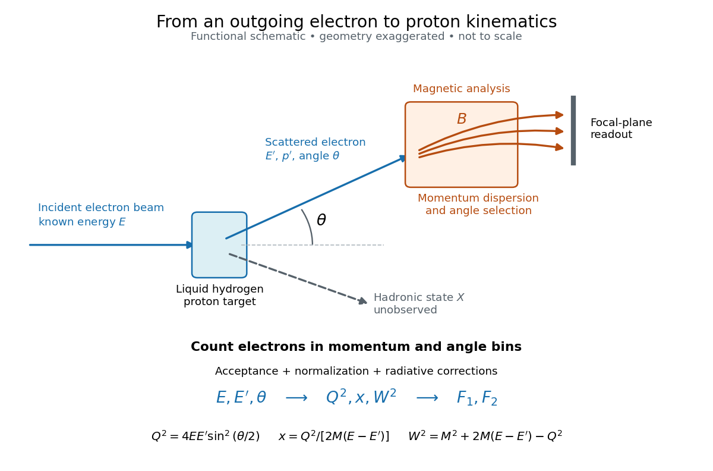

# SLAC-MIT spectrometer readout and corrections

↑ **Parent:** [SLAC-MIT deep inelastic electron scattering experiment](slac-mit-deep-inelastic-electron-scattering-experiment.md)

A movable [magnetic spectrometer](magnetic-spectrometer.md) selected scattered [electrons](electron.md) by [momentum](momentum-split.md) and [scattering angle](scattering-angle.md). [Magnetic fields](magnetic-field-split.md) dispersed [momenta](momentum-split.md) at the focal plane. With relativistic [electrons](electron.md), the inferred [momentum](momentum-split.md) determines outgoing [energy](energy-split.md) $E'$. Commissioning included steering the beam through the spectrometer at zero angle to check its optics and accepted [solid angle](solid-angle.md). Counters sorted events into [momentum](momentum-split.md) and angle bins. The acceptance entered the conversion from counts to [differential scattering cross-sections](differential-scattering-cross-section.md).[1990 Nobel lecture, Fig. 15, magnet optics; Fig. 33 and adjacent acceptance-calibration account](deep-inelastic-scattering-the-early-years-by-richard-edward-taylor.md)

**[Figure 5](#image-functional-electron-spectrometer-readout-for-deep-inelastic-scattering). Functional electron-spectrometer readout for deep inelastic scattering**. Original schematic, not an engineering drawing. The [magnetic spectrometer](magnetic-spectrometer.md) measures the outgoing [electron](electron.md); the inclusive final [hadron](hadron.md) state is unobserved.

[Radiative corrections](radiative-correction.md) matter because photon emission can move events from an [elastic scattering](elastic-scattering.md) peak into lower outgoing-[energy](energy-split.md) bins. The analyses subtracted the elastic radiative tail before unfolding inelastic radiation. Independent MIT and SLAC procedures provided a check. An uncorrected low-$E'$ tail alone therefore cannot establish [deep inelastic scattering](deep-inelastic-scattering.md).[Section IV.C, radiative-tail subtraction, unfolding and independent analyses; Figs. 6–8](deep-inelastic-scattering-experiments-on-the-proton-and-the-observation-of-scaling-by-henry-way-kendall.md)

## ↑ Ancestors (8)

1. [SLAC-MIT deep inelastic electron scattering experiment](slac-mit-deep-inelastic-electron-scattering-experiment.md)
2. [Deep inelastic scattering](deep-inelastic-scattering.md)
3. [Quantum chromodynamics](quantum-chromodynamics.md)
4. [Standard Model](standard-model-split.md)
5. [Quantum field theory](quantum-field-theory-split.md)
6. [Branches of physics](branches-of-physics.md)
7. [Physics](physics-split.md)
8. [Codex Wiki](split.md)
