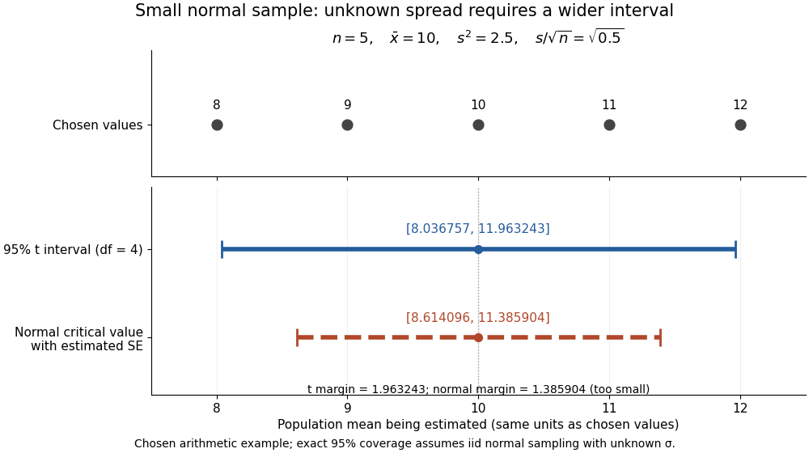

# Small normal sample mean confidence interval

↑ **Parent:** [Studentized normal sample mean](studentized-normal-sample-mean.md)

Under the [studentized normal sample mean](studentized-normal-sample-mean.md) assumptions, let $t_{q,\nu}$ denote the [quantile](quantile-function.md) at cumulative [probability](probability.md) $q$ of the [Student's t-distribution](student-s-t-distribution.md). For $0<\alpha<1$, rearranging the event $|T|\leq t_{1-\alpha/2,n-1}$ gives a [Student t confidence interval](student-t-confidence-interval.md) for the unknown [mean](expected-value-split.md) $\mu$ with exact [coverage probability](coverage-probability.md) $1-\alpha$. [NIST and SEMATECH e-Handbook of Statistical Methods; NIST/SEMATECH e-Handbook, Section 1.3.5.2: confidence limits for the mean, interval formula and repeated-sampling interpretation](nist-and-sematech-e-handbook-of-statistical-methods/1-3-5-2-confidence-limits-for-the-mean.md)

Choose the list $8,9,10,11,12$ as an original arithmetic example, not as reported measurements or a claim that these five numbers establish a [normal distribution](normal-distribution.md). If such values were obtained under the assumed [independent and identically distributed](independent-and-identically-distributed-random-variables.md) [normal distribution](normal-distribution.md) model with unknown $\sigma$, then

$$
n=5,\qquad\bar x=10,\qquad\sum_{i=1}^5(x_i-\bar x)^2=10,\qquad s^2=\frac{10}{4}=2.5,\qquad\frac{s}{\sqrt5}=\sqrt{0.5}.
$$

There are four [statistical degrees of freedom](statistical-degrees-of-freedom.md). For a 95% [confidence interval](confidence-interval.md), $t_{0.975,4}=2.776445105\ldots$, so

$$
\bar x\pm t_{0.975,4}\frac{s}{\sqrt5}=10\pm1.963243161\ldots=[8.036756839\ldots,\ 11.963243161\ldots].
$$

Using the [standard normal quantile](standard-normal-quantile.md) $z_{0.975}=1.959963985\ldots$ with the same estimated [standard error](standard-error.md) would give only $10\pm1.385903824\ldots$. That underestimates the correct margin by about 29.4%. Indeed its actual [coverage probability](coverage-probability.md) under this [normal distribution](normal-distribution.md) model is $\mathbb P(|t_4|\leq z_{0.975})\simeq0.8784$, rather than 0.95.

**[Figure 8](#image-chosen-five-value-example-estimating-the-spread-requires-a-wider-t-confidence-interval). Chosen five-value example: estimating the spread requires a wider t confidence interval**.

The observations, the [sample mean](sample-mean.md) and the [confidence interval](confidence-interval.md) all have different meanings. The bar estimates the population [mean](expected-value-split.md); it is not an interval intended to contain 95% of individual observations. In repeated [independent](independent-random-variables.md) samples of size five from the assumed [normal distribution](normal-distribution.md), 95% of intervals constructed using the exact $t$ [quantile](quantile-function.md) cover the same fixed $\mu$. This is not a 95% [posterior probability](posterior-probability.md) that the fixed [statistical parameter](statistical-parameter.md) lies in this particular realized interval. Such a probability requires a separate [Bayesian inference](bayesian-statistics-split.md) model.

For this four-degree case, the [cumulative distribution function](cumulative-distribution-function.md) has an especially simple form:

$$
F_4(t)=\frac12+\frac34a-\frac14a^3,\qquad a=\frac{t}{\sqrt{4+t^2}}.
$$

One can check the formula by [differentiation](differentiation.md): $F_4'(t)=\frac38(1+t^2/4)^{-5/2}=f_4(t)$, with limits zero and one at the two ends of the [real line](real-line.md). Solving the increasing equation $F_4(t)=0.975$ by the [bisection method](bisection-method.md) gives the [quantile](quantile-function.md) used above.

## ↑ Ancestors (9)

1. [Studentized normal sample mean](studentized-normal-sample-mean.md)
2. [Student's t-distribution](student-s-t-distribution.md)
3. [Continuous probability distribution](continuous-probability-distribution-split.md)
4. [Probability distribution](probability-distribution-split.md)
5. [Probability theory](probability-theory-split.md)
6. [Probability and statistics](probability-and-statistics-split.md)
7. [Area of mathematics](area-of-mathematics.md)
8. [Mathematics](mathematics-split.md)
9. [Codex Wiki](split.md)
