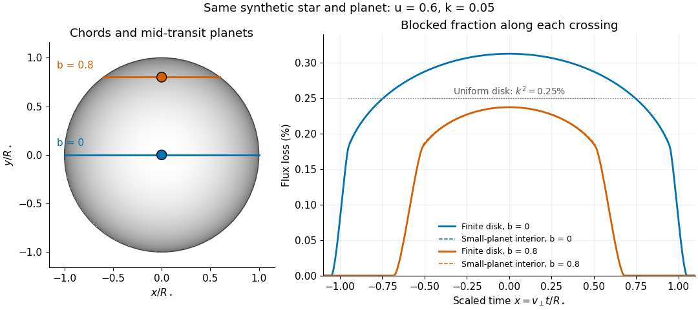

# Small-planet transit weighting

↑ **Parent:** [Limb darkening](limb-darkening.md)

A dark, opaque circular [planet](planet.md) of [radius](radius.md) $R_p$ blocks [specific intensity](spectral-radiance.md) over its overlap with the projected [star](star.md). With $k=R_p/R_\star$ and no [transit dilution](transit-dilution.md), the instantaneous [exoplanet transit depth](exoplanet-transit-depth.md) is exactly

$$
\delta=\frac{\displaystyle\int_{\rm overlap}I\,dA_{\rm proj}}{\pi R_\star^2\overline I}.
$$

When $k\ll1$, the entire planetary disk is inside the stellar disk, and [specific intensity](spectral-radiance.md) varies little across that disk, [small-planet transit weighting](small-planet-transit-weighting.md) reduces to

$$
\delta\simeq k^2\frac{I(\mu_p)}{\overline I}
=k^2\frac{1-u+u\mu_p}{1-u/3},\qquad
\mu_p=\sqrt{1-z^2},\qquad z<1-k.
$$

Here $z$ is the projected centre separation divided by $R_\star$. The numerator samples the local [specific intensity](spectral-radiance.md); the denominator normalizes by the whole [star](star.md)'s mean [specific intensity](spectral-radiance.md). The small-size argument and the distinction between full overlap and ingress are explicit in the original analytic treatment. [§2, p. L171, geometry; §5, p. L174, small-planet approximation restricted to the interior $z<1-p$](analytic-light-curves-for-planetary-transit-searches-by-kaisey-mandel-and-eric-agol.md)

For a short approximately straight crossing at constant transverse [velocity](velocity.md) $v_\perp$, write $x=v_\perp t/R_\star$ with $t=0$ at mid-transit, and let $b$ be the [transit impact parameter](transit-impact-parameter.md). Then $z^2=x^2+b^2$ and $\mu_p=\sqrt{1-b^2-x^2}$. With stipulated $u=0.6$ and $k=0.05$, a central crossing has mid-transit [exoplanet transit depth](exoplanet-transit-depth.md) approximately $0.003125$, whereas $b=0.8$ gives $0.002375$. A uniform disk would give $k^2=0.0025$ for either fully overlapping crossing. The brighter central chord produces a deeper dip and the off-centre chord a shorter crossing at the same $v_\perp$.

**[Figure 6](#image-two-transit-chords-across-the-same-synthetic-limb-darkened-disk-flux-distribution). Two transit chords across the same synthetic limb-darkened disk flux distribution**. Stipulated $u=0.6$ and $k=0.05$; the coloured curves integrate the occulted [specific intensity](spectral-radiance.md) over the finite planetary disk, including ingress and egress. Dashed curves show [small-planet transit weighting](small-planet-transit-weighting.md) only where the whole planetary disk is inside the [star](star.md). Horizontal dotted segments give the uniform-disk full-overlap depth $k^2$. The chord panel shows mid-transit positions; the horizontal coordinate in the [light curve](light-curve.md) is distance travelled divided by stellar [radius](radius.md), equivalent to scaled [time](time-in-physics.md) at constant transverse [velocity](velocity.md).

At fixed $z<1$ away from the edge, a two-dimensional [Taylor's theorem](taylor-s-theorem.md) expansion over the symmetric planetary disk cancels the first [derivatives](derivative.md); the first correction to the blocked [radiant flux](radiant-flux.md) is of order $k^4$ if the second [derivatives](derivative.md) remain bounded. This error estimate is not uniform at the edge, where the radial [derivative](derivative.md) of the [linear limb-darkening law](linear-limb-darkening-law.md) diverges. Ingress, egress, a grazing [exoplanet transit](exoplanet-transit.md), and a crossing of a [starspot](starspot.md) require the overlap [integral](integral-split.md) or a suitable more complete model. Inferring $k=\sqrt\delta$ without the local-to-mean [specific intensity](spectral-radiance.md) ratio can bias the estimated [planet](planet.md) [radius](radius.md).

## ↑ Ancestors (8)

1. [Limb darkening](limb-darkening.md)
2. [Spectral radiance](spectral-radiance.md)
3. [Radiance](radiance.md)
4. [Radiometry](radiometry-split.md)
5. [Optics](optics-split.md)
6. [Branches of physics](branches-of-physics.md)
7. [Physics](physics-split.md)
8. [Codex Wiki](split.md)

## ← Incoming links (1)

- [Small-planet transit weighting](small-planet-transit-weighting.md)
