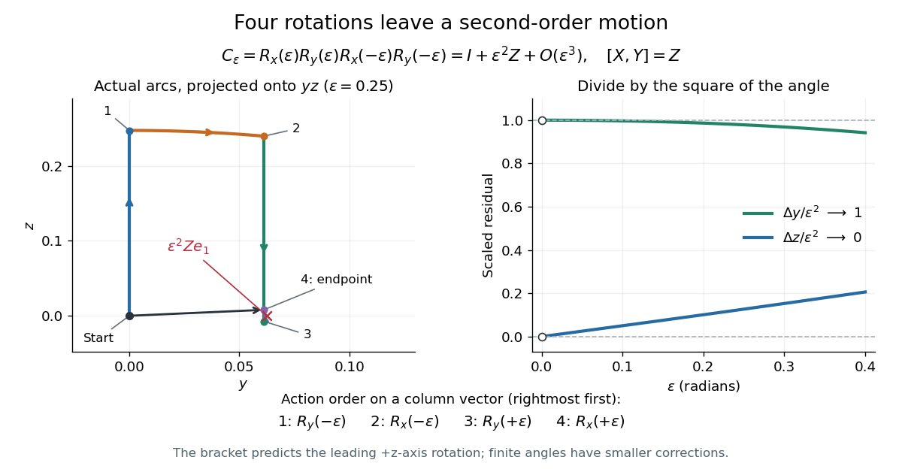

# Small rotation commutator

↑ **Parent:** [Lie bracket from local group commutators](lie-bracket-from-local-group-commutators.md)

Use the [cross-product Lie algebra](cross-product-lie-algebra.md) convention $X=\widehat{e_1}$, $Y=\widehat{e_2}$, $Z=\widehat{e_3}$, so $[X,Y]=Z$. Put $R_x(t)=\exp(tX)$ and $R_y(t)=\exp(tY)$, using the [matrix exponential](matrix-exponential.md). The finite [group commutator](group-commutator.md) is

$$
C_\varepsilon=R_x(\varepsilon)R_y(\varepsilon)R_x(-\varepsilon)R_y(-\varepsilon)=I+\varepsilon^2Z+O(\varepsilon^3).
$$

Here $\varepsilon\to0$ and [big O notation](big-o-notation.md) refers to any fixed [matrix norm](matrix-norm.md). Active [rotation matrices](rotation-matrix.md) act on column [vectors](vector.md) from right to left: first rotate about $y$ by $-\varepsilon$, then about $x$ by $-\varepsilon$, then about $y$ by $+\varepsilon$, and finally about $x$ by $+\varepsilon$. Swapping $x$ and $y$ replaces the product by its inverse and changes the leading [Lie bracket](lie-bracket.md) to $-Z$.

Writing $c=\cos\varepsilon$ and $s=\sin\varepsilon$, direct [matrix multiplication](matrix-multiplication.md) gives

$$
C_\varepsilon e_1=\begin{pmatrix}c^2+cs^2\\s^2(2c-c^2)\\s(c^3-c^2+s^2)\end{pmatrix}=e_1+\varepsilon^2e_2+O(\varepsilon^3).
$$

For $\varepsilon=0.1$ radians, $C_\varepsilon e_1\approx(0.999950208,0.009966462,0.000501230)$, whereas $e_1+\varepsilon^2Ze_1=(1,0.01,0)$. Thus the residual is a positive rotation about $z$ to leading order; at finite $\varepsilon$ it also has smaller components. The [Lie bracket](lie-bracket.md) captures the leading effect of the four moves rather than their entire finite motion. See [Etingof, Section 7.2, Proposition 7.11](https://ocw.mit.edu/courses/18-755-lie-groups-and-lie-algebras-ii-spring-2024/mit18_755_s24_lec_full.pdf#page=47).

**[Figure 1](#image-four-small-rotations-leave-the-motion-predicted-by-their-lie-bracket). Four small rotations leave the motion predicted by their Lie bracket**.

The left panel projects the actual four arcs onto the $yz$-plane for $\varepsilon=0.25$; the start and endpoint are close but distinct. The right panel divides the residual coordinates by $\varepsilon^2$, making the limit $(\Delta y/\varepsilon^2,\Delta z/\varepsilon^2)\to(1,0)$ visible. This is a numerical picture of $[X,Y]=Z$ in the [SO(3) Lie algebra](so-3-lie-algebra.md).

## ↑ Ancestors (9)

1. [Lie bracket from local group commutators](lie-bracket-from-local-group-commutators.md)
2. [Lie bracket](lie-bracket.md)
3. [Lie algebra](lie-algebra-split.md)
4. [Lie theory](lie-theory-split.md)
5. [Diagonal dominance](diagonal-dominance.md)
6. [Algebra](algebra-split.md)
7. [Area of mathematics](area-of-mathematics.md)
8. [Mathematics](mathematics-split.md)
9. [Codex Wiki](split.md)

## ← Incoming links (2)

- [Cross-product Lie algebra](cross-product-lie-algebra.md)
- [Lie algebra](lie-algebra-split.md)
