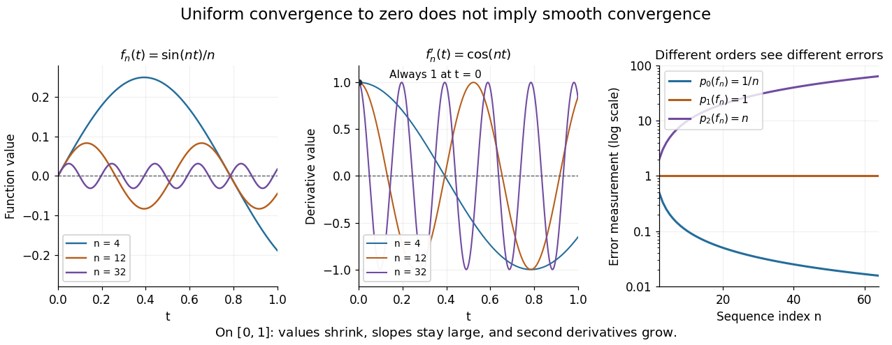

# Smooth convergence on a compact interval

↑ **Parent:** [Derivative seminorms on a compact interval](derivative-seminorms-on-a-compact-interval.md)

Smooth convergence on a compact [interval](interval-mathematics.md) requires [uniform convergence](uniform-convergence.md) of the [functions](function-split.md) and of their [derivatives](derivative.md) of every order separately, as measured by the [derivative seminorms](derivative-seminorms-on-a-compact-interval.md). The need for several scales is visible in

$$
f_n(t)=\frac{\sin(nt)}n,\qquad p_0(f_n)\leq\frac1n\longrightarrow0,
\qquad f_n'(t)=\cos(nt),\qquad p_1(f_n)=1.
$$

For $n\geq2$, $p_0(f_n)=1/n$ because $t=\pi/(2n)$ lies in $[0,1]$. The [derivative](derivative.md) has [supremum norm](supremum-norm.md) one for every $n$, already at $t=0$. Thus $f_n$ [converges uniformly](uniform-convergence.md) to zero, but fails the test for [smooth convergence](smooth-convergence-on-a-compact-interval.md) to zero. [Andreas Buttenschoen, Applied Functional Analysis, spaces of continuous and differentiable functions](https://www.buttenschoen.ca/MATH725/introduction/ck-spaces/) discusses this example and the family of smoothness measurements.

**[Figure 2](#image-shrinking-function-values-coexist-with-derivative-errors-of-size-one). Shrinking function values coexist with derivative errors of size one**.

More generally, for any fixed $K\geq0$, $h_n(t)=\sin(nt)/n^{K+1}$ has $p_K(h_n)\leq1/n$ but $p_{K+1}(h_n)=1$ for $n\geq2$. If a [norm](norm.md) $N$ induced the smooth [topology](topology-split.md), its [continuity](continuous-function.md) would give $N(f)\leq C p_K(f)$ for some finite $K$, while [continuity](continuous-function.md) of $p_{K+1}$ for $N$ would give $p_{K+1}(f)\leq C'N(f)$. Substituting $h_n$ contradicts these two bounds. [Smooth convergence](smooth-convergence-on-a-compact-interval.md) therefore cannot be reduced to one [norm](norm.md). Its beauty is that every finite order can be controlled without fixing a final order in advance.

## ↑ Ancestors (9)

1. [Derivative seminorms on a compact interval](derivative-seminorms-on-a-compact-interval.md)
2. [Fréchet space](frechet-space.md)
3. [Locally convex space](locally-convex-space.md)
4. [Topological vector space](topological-vector-space-split.md)
5. [Functional analysis](functional-analysis-split.md)
6. [Analysis](analysis-split.md)
7. [Area of mathematics](area-of-mathematics.md)
8. [Mathematics](mathematics-split.md)
9. [Codex Wiki](split.md)
