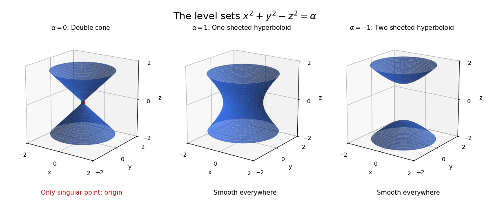

# Smooth locus of a nondegenerate real quadratic level set

↑ **Parent:** [Quadratic form](quadratic-form-split.md)

The [quadratic form gradient](quadratic-form-gradient.md) gives $Dq_x(h)=2x^TAh$. Since $A$ is invertible, this [linear map](linear-map.md) is nonzero exactly when $x\ne0$. The [regular level set theorem](regular-level-set-theorem.md) therefore makes every nonzero point of $C_\alpha$ a smooth point of dimension $n-1$. If $\alpha\ne0$, the entire level set is smooth.

If $\alpha=0$ and the level set contains a nonzero point, the form is an [indefinite quadratic form](indefinite-quadratic-form.md). Its only singular point is the origin. To prove this rather than merely observe a vanishing derivative, use [Sylvester's law of inertia](sylvester-s-law-of-inertia.md) to write $q=|u|^2-|v|^2$ with both sign spaces nonzero. The null vectors $e_i\pm f_j$ span the whole ambient space. Their straight-line curves through the origin lie in the cone. If a relatively open neighborhood of the origin in the cone were an [embedded submanifold](embedded-submanifold.md), its [tangent space](tangent-space.md) would contain all these directions and hence have dimension $n$. It would then be open in the ambient space, impossible for the zero set of this nonzero quadratic form. Thus the smooth locus is $C_0\setminus\{0\}$.

**[Figure 1](#image-three-levels-of-an-indefinite-quadratic-form-in-three-dimensions). Three levels of an indefinite quadratic form in three dimensions**. Original diagrams and generic model calculations generated by the adjacent Python script.

## ↑ Ancestors (6)

1. [Quadratic form](quadratic-form-split.md)
2. [Linear algebra](linear-algebra-split.md)
3. [Algebra](algebra-split.md)
4. [Area of mathematics](area-of-mathematics.md)
5. [Mathematics](mathematics-split.md)
6. [Codex Wiki](split.md)

## ← Incoming links (1)

- [Solution](past-exam-of-the-short-options-course-of-the-university-of-oxford/2017/4/b/ii/solution.md)
