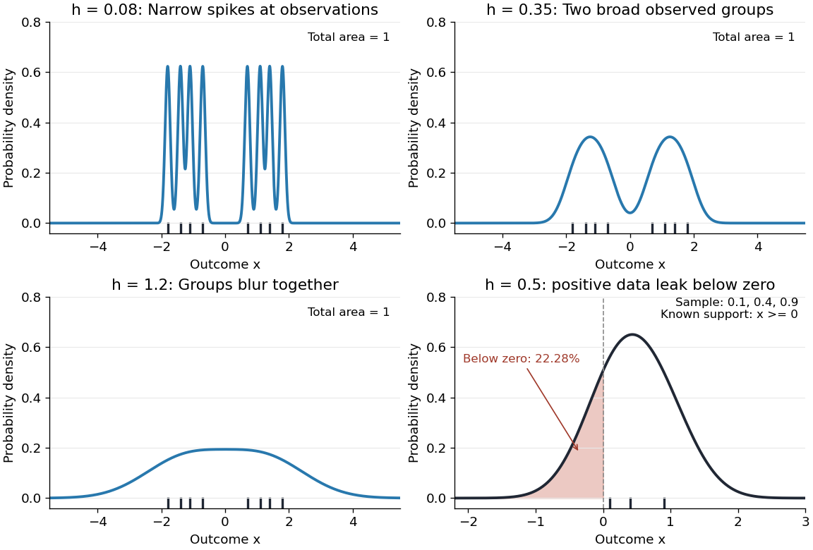

# Smoothing bandwidth

↑ **Parent:** [Kernel for nonparametric regression](kernel-for-nonparametric-regression.md)

A [smoothing bandwidth](smoothing-bandwidth.md) $h>0$ determines the scale over which a [regression kernel](kernel-for-nonparametric-regression.md) averages data, or a [kernel for density estimation](kernel-for-density-estimation.md) spreads each observation. It has the same units as the observations. In [kernel density estimation](kernel-density-estimation.md), changing $h$ changes the visible detail while preserving the total [integral](integral.md) one. For a [Gaussian density kernel](gaussian-density-kernel.md), each bump has [standard deviation](standard-deviation.md) $h$ and its individual contribution has peak height $1/(nh\sqrt{2\pi})$.

If the [smoothing bandwidth](smoothing-bandwidth.md) is too small relative to the spacings in a [statistical sample](statistical-sample.md), the [kernel density estimator](kernel-density-estimation.md) shows narrow spikes tied to individual observations: apparent peaks may be sampling accidents. If it is too large relative to features of the unknown [probability density function](probability-density-function.md), it blurs distinct groups together and spreads fitted [probability](probability.md) far from the observations. An intermediate [smoothing bandwidth](smoothing-bandwidth.md) can reveal broad structure, but visual smoothness alone cannot establish accuracy.

**[Figure 2](#image-the-same-sample-at-three-gaussian-bandwidths-and-leakage-below-zero-for-a-separate-positive-sample). The same sample at three Gaussian bandwidths, and leakage below zero for a separate positive sample**.

The first three panels use exactly $(-1.8,-1.4,-1.1,-0.7,0.7,1.1,1.4,1.8)$ with [smoothing bandwidths](smoothing-bandwidth.md) $0.08$, $0.35$ and $1.2$, respectively. Every curve has area one; the two groups in the observed [statistical sample](statistical-sample.md) become less distinct as $h$ increases. No true [probability density function](probability-density-function.md) is specified in this illustration, so the middle panel is illustrative, not a certified optimal fit. The fourth panel uses $(0.1,0.4,0.9)$ and $h=0.5$ to illustrate [boundary bias of a kernel density estimator](boundary-bias-of-a-kernel-density-estimator.md).

For a fixed nonnegative [kernel for density estimation](kernel-for-density-estimation.md) $K$ with finite squared [integral](integral.md), a [probability density function](probability-density-function.md) $f$ that is bounded and continuous at an interior point $x$ with $f(x)>0$, and a deterministic sequence $h=h_n\downarrow0$, the pointwise sampling [variance](variance-split.md) obeys

$$
\operatorname{Var}\bigl(\widehat f_{n,h}(x)\bigr)\sim\frac{f(x)}{nh}\int_{\mathbb R}K(u)^2\,du.
$$

Thus decreasing the [smoothing bandwidth](smoothing-bandwidth.md) increases the leading sampling [variance](variance-split.md) while reducing interior smoothing [bias of an estimator](bias-of-an-estimator.md): this is a [bias-variance tradeoff](bias-variance-tradeoff.md). The conditions $h_n\to0$ and $nh_n\to\infty$ express two goals, increasingly fine resolution and enough observations contributing locally. Practical methods such as [plug-in bandwidth selection](plug-in-bandwidth-selection.md) use the data to choose $h$; [pointwise optimal kernel bandwidth](pointwise-optimal-kernel-bandwidth.md) depends on local features of the unknown [probability density function](probability-density-function.md). The [smoothing bandwidth](smoothing-bandwidth.md) remains a tuning choice in [nonparametric statistics](nonparametric-statistics-split.md), and knowing the [support of a probability distribution](support-of-a-probability-distribution.md) can require more than a width adjustment near a boundary.

**Table of contents**

- [Plug-in bandwidth selection](plug-in-bandwidth-selection.md)
  - [Fourth-derivative pilot estimate of density curvature](fourth-derivative-pilot-estimate-of-density-curvature.md)

## ↑ Ancestors (9)

1. [Kernel for nonparametric regression](kernel-for-nonparametric-regression.md)
2. [Local polynomial regression](local-polynomial-regression.md)
3. [Nonparametric regression](nonparametric-regression.md)
4. [Nonparametric statistics](nonparametric-statistics-split.md)
5. [Statistical inference](statistical-inference-split.md)
6. [Probability and statistics](probability-and-statistics-split.md)
7. [Area of mathematics](area-of-mathematics.md)
8. [Mathematics](mathematics-split.md)
9. [Codex Wiki](split.md)

## ← Incoming links (23)

- [Boundary bias of a kernel density estimator](boundary-bias-of-a-kernel-density-estimator.md)
- [Canonical kernel for density estimation](canonical-kernel-for-density-estimation.md)
- [Gaussian kernel density worked example](gaussian-kernel-density-worked-example.md)
- [Integrated squared bias from a density jump](integrated-squared-bias-from-a-density-jump.md)
- [Integrated squared density curvature](integrated-squared-density-curvature.md)
- [Kernel density estimation](kernel-density-estimation.md)
- [Kernel for density estimation](kernel-for-density-estimation.md)
- [Nonparametric statistics](nonparametric-statistics-split.md)
- [Parametric-rate kernel estimation of a bandlimited density](parametric-rate-kernel-estimation-of-a-bandlimited-density.md)
- [Solution](past-exam-of-the-mathematics-course-of-the-university-of-cambridge/2004/iii/paper-42/1/solution.md)
- [Solution](past-exam-of-the-mathematics-course-of-the-university-of-cambridge/2004/iii/paper-42/4/solution.md)
- [Solution](past-exam-of-the-mathematics-course-of-the-university-of-cambridge/2007/iii/paper-49/4/solution.md)
- [Solution](past-exam-of-the-mathematics-course-of-the-university-of-cambridge/2008/iii/paper-42/6/solution.md)
- [Solution](past-exam-of-the-mathematics-course-of-the-university-of-cambridge/2010/iii/paper-31/2/solution.md)
- [Solution](past-exam-of-the-mathematics-course-of-the-university-of-cambridge/2012/iii/paper-39/5/solution.md)
- [Solution](past-exam-of-the-mathematics-course-of-the-university-of-cambridge/2014/iii/paper-34/2/solution.md)
- [Solution](past-exam-of-the-mathematics-course-of-the-university-of-cambridge/2014/iii/paper-34/3/solution.md)
- [Solution](past-exam-of-the-mathematics-course-of-the-university-of-cambridge/2016/iii/paper-206/5/a/solution.md)
- [Solution](past-exam-of-the-mathematics-course-of-the-university-of-cambridge/2017/iii/paper-210/1/solution.md)
- [Solution](past-exam-of-the-mathematics-course-of-the-university-of-cambridge/2018/iii/paper-210/2/solution.md)
- [Pointwise minimax rate for Lipschitz regression](pointwise-minimax-rate-for-lipschitz-regression.md)
- [Smoothing bandwidth](smoothing-bandwidth.md)
- [Smoothing parameter](smoothing-parameter.md)
