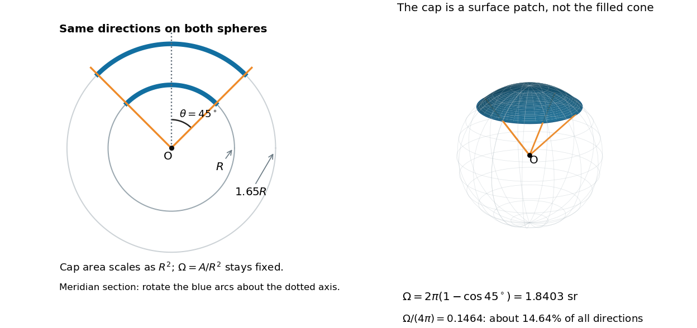

# Solid angle of a circular cone

↑ **Parent:** [Solid angle](solid-angle.md)

A [right circular cone](right-circular-cone.md) with vertex $O$ selects all directions within a half-opening [angle](angle.md) $\theta$ of its axis. Here $\theta$ is measured from the axis to a boundary direction, so the full opening in a meridian plane is $2\theta$. For $0\leq\theta\leq\pi$, interpret the selected directions as a [spherical cap](spherical-cap.md); for $\theta>\pi/2$, this is a region larger than a [hemisphere](hemisphere.md).

The [spherical coordinate system](spherical-coordinate-system.md) gives the [area element](area-element-of-a-surface.md) $dA=R^2\sin\alpha\,d\alpha\,d\phi$ on the [sphere](sphere.md). Dividing by $R^2$ and integrating over the cap yields

$$
d\Omega=\sin\alpha\,d\alpha\,d\phi,\qquad
\Omega=\int_0^{2\pi}\int_0^\theta\sin\alpha\,d\alpha\,d\phi
=2\pi(1-\cos\theta).
$$

The factor $\sin\alpha$ matters: a thin angular strip near a pole contains fewer directions than an equally wide strip near the equator. Treating equal intervals of both [spherical coordinates](spherical-coordinate-system.md) as equal [solid angles](solid-angle.md) would overcount the polar directions.

**[Figure 3](#image-one-set-of-directions-cuts-similar-spherical-caps-from-spheres-of-different-radii). One set of directions cuts similar spherical caps from spheres of different radii**. Original geometric construction with half-opening [angle](angle.md) $45^\circ$. Left: a meridian section of two concentric [spheres](sphere.md); rotating each blue arc about the dotted axis gives its cap. Right: the corresponding patch on the unit [sphere](sphere.md). The patch is curved, and its [surface area](surface-area.md), rather than the volume inside the cone, determines the [solid angle](solid-angle.md).

At $\theta=45^\circ$, the [solid angle](solid-angle.md) is $\pi(2-\sqrt2)\approx1.8403$ [steradians](steradian.md), or about $14.64\%$ of all directions. At $\theta=90^\circ$ it is $2\pi$ [steradians](steradian.md), and at $180^\circ$ it is $4\pi$ [steradians](steradian.md). For a small $\theta$ measured in [radians](radian.md), the [Taylor series](taylor-series.md) $\cos\theta=1-\theta^2/2+O(\theta^4)$ gives the [small-angle approximation](small-angle-approximation.md) $\Omega\approx\pi\theta^2$. Doubling a narrow half-opening [angle](angle.md) therefore approximately quadruples its coverage.

## ↑ Ancestors (7)

1. [Solid angle](solid-angle.md)
2. [Sphere](sphere.md)
3. [Euclidean geometry](euclidean-geometry-split.md)
4. [Geometry and topology](geometry-and-topology-split.md)
5. [Area of mathematics](area-of-mathematics.md)
6. [Mathematics](mathematics-split.md)
7. [Codex Wiki](split.md)

## ← Incoming links (1)

- [Solid angle of a disk](solid-angle-of-a-disk.md)
