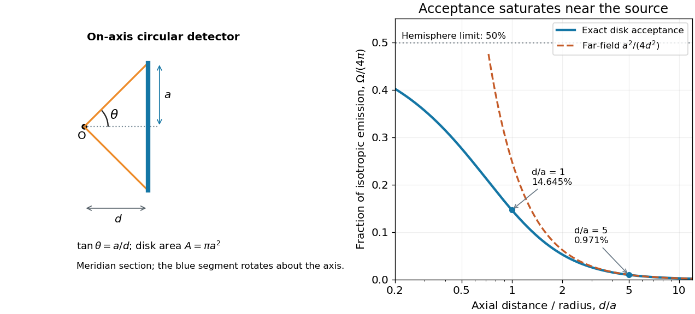

# Solid angle of a disk

↑ **Parent:** [Solid angle](solid-angle.md)

Consider a flat circular [disk](disk-mathematics.md) of [radius](radius.md) $a>0$, with its center a perpendicular distance $d>0$ from the viewpoint $O$. The line from $O$ to its center is normal to the [disk](disk-mathematics.md). Its rim defines a [right circular cone](right-circular-cone.md) with $\tan\theta=a/d$ and $\cos\theta=d/\sqrt{d^2+a^2}$. The [solid angle of a circular cone](solid-angle-of-a-circular-cone.md) immediately gives

$$
\boxed{\Omega=2\pi\left(1-\frac{d}{\sqrt{d^2+a^2}}\right).}
$$

For $a=d$, this is the same $45^\circ$ half-opening example: about $1.8403$ [steradians](steradian.md). Both the [radius](radius.md) and distance enter; doubling both leaves the [solid angle](solid-angle.md) unchanged.

A useful local version applies to a small surface patch of [area](surface-area.md) $dA$, at distance $r$ from $O$. If $\psi$ is the [angle](angle.md) between its [unit normal](unit-normal.md) and the line to $O$, its unsigned geometric contribution is

$$
d\Omega=\frac{|\cos\psi|\,dA}{r^2}.
$$

The numerator is the [projected area](projected-area.md). For a visible patch, perpendicular projection followed by radial projection onto a small piece of a [sphere](sphere.md) gives this formula. Integrating counts the directions once provided no direction encounters multiple counted patches. For an opaque detector, use its unoccluded face. At grazing view, the [projected area](projected-area.md) tends to zero.

For this on-axis [disk](disk-mathematics.md), a ring of [radius](radius.md) $\rho$ has $r=\sqrt{d^2+\rho^2}$ and $|\cos\psi|=d/r$. Its [polar coordinates](polar-coordinates.md) gives $dA=\rho\,d\rho\,d\phi$, so the same answer follows directly from the [surface integral](surface-integral.md):

$$
\Omega=2\pi\int_0^a\frac{d\,\rho}{(d^2+\rho^2)^{3/2}}\,d\rho
=2\pi\left(1-\frac{d}{\sqrt{d^2+a^2}}\right).
$$

The changing distance and obliquity are both already accounted for; an extra detector-wide cosine factor would count the projection twice.

**[Figure 4](#image-the-exact-solid-angle-of-an-on-axis-circular-detector-approaches-a-hemisphere-at-close-range). The exact solid angle of an on-axis circular detector approaches a hemisphere at close range**. Left: a meridian section, drawn with $a=d$. Right: the geometric acceptance fraction $\Omega/(4\pi)$ for a [point emitter](point-emitter.md) with [isotropy](isotropy.md), compared with the distant-source approximation $a^2/(4d^2)$. These are calculated geometric curves, not measured detector efficiencies. The dashed approximation is displayed outside its accurate range to show how it overestimates acceptance.

For $d\gg a$, the [Taylor series](taylor-series.md) of $(1+a^2/d^2)^{-1/2}$ gives

$$
\Omega=\frac{\pi a^2}{d^2}+O\!\left(\frac{a^4}{d^4}\right).
$$

Thus the accepted fraction of an ideal [point emitter](point-emitter.md)'s isotropic output is approximately $A/(4\pi d^2)$, where $A=\pi a^2$. This is the geometry behind the [inverse-square law](inverse-square-law.md) for a small detector. At fixed $a$, however, taking $d\to0^+$ gives $\Omega\to2\pi$, so the accepted fraction approaches $1/2$ rather than diverging.

For a chosen numerical example, let $a=1\,\mathrm{cm}$ and $d=5\,\mathrm{cm}$. The exact [solid angle](solid-angle.md) is approximately $0.122015$ [steradians](steradian.md), giving an acceptance fraction $0.00970966$. An ideal [point emitter](point-emitter.md) with [isotropy](isotropy.md) and total [radiant flux](radiant-flux.md) $1\,\mathrm{mW}$ would therefore send **about $9.71\,\mathrm{\mu W}$ onto the disk**. The distant-source approximation gives $10.0\,\mathrm{\mu W}$, about $3.0\%$ high. This calculation assumes unobstructed propagation and counts incident [radiant flux](radiant-flux.md); [photon absorption](photon-absorption.md), detector response, and any [optical attenuator](optical-attenuator.md) require separate factors.

## ↑ Ancestors (7)

1. [Solid angle](solid-angle.md)
2. [Sphere](sphere.md)
3. [Euclidean geometry](euclidean-geometry-split.md)
4. [Geometry and topology](geometry-and-topology-split.md)
5. [Area of mathematics](area-of-mathematics.md)
6. [Mathematics](mathematics-split.md)
7. [Codex Wiki](split.md)

## ← Incoming links (1)

- [Solid angle](solid-angle.md)
