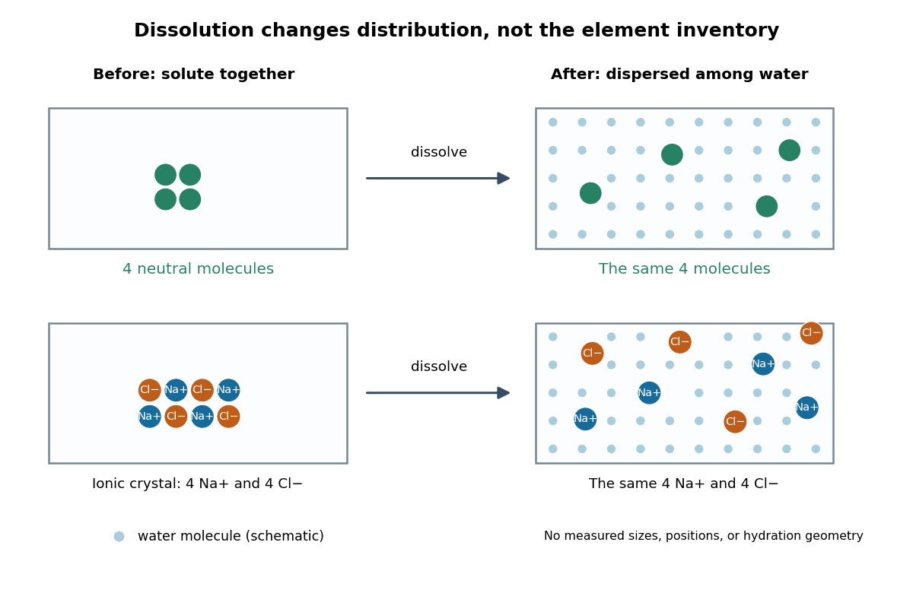

# Solution (chemistry)

↑ **Parent:** [Mixture](mixture-split.md)  
ⓦ [Wiki](https://en.wikipedia.org/wiki/Solution_(chemistry))

A [chemical solution](solution-chemistry.md) is a homogeneous [mixture](mixture-split.md) in which designated [solutes](solute.md) are distributed in a [solvent](solvent.md). Representative equal-[volume](volume-thermodynamics.md) samples have the same composition after mixing. Individual [molecules](molecule-split.md) and [ions](ion.md) remain distinguishable. The [solute](solute.md)/[solvent](solvent.md) labels describe their roles in this [mixture](mixture-split.md).[Chemistry 2e, §3.3, Solutions: homogeneity and solvent/solute conventions](chemistry-2e-by-paul-flowers-and-others/3-3-molarity.md)

A dissolved [solute](solute.md) is dispersed as [molecules](molecule-split.md), [chemical atoms](atom-physics.md), or [ions](ion.md), rather than as the larger [solid](solid.md) particles of a [particle suspension](suspension-chemistry-split.md). For example, [sucrose](sucrose.md) retains its [molecular formula](molecular-formula.md) during [dissolution](dissolution.md) in [water](water.md); a [chemical reaction](chemical-reaction-split.md) is not required. Dissolved [sodium chloride](sodium-chloride.md) supplies [sodium](sodium.md) [cations](cation.md) and [chloride](chloride.md) [anions](anion.md), surrounded by [water](water.md) [molecules](molecule-split.md) through [solvation](solvation.md). Dissolved does not mean chemically destroyed or converted into [water](water.md).[Chemistry 2e, §11.1, opening molecular and ionic examples and defining traits of solutions](chemistry-2e-by-paul-flowers-and-others/11-1-the-dissolution-process.md)

**[Figure 1](#image-dissolution-particle-identity). Dissolution disperses particles while preserving their chemical elements**. Original schematic with invented particle positions, not a microscopy image. Top: four generic neutral [molecules](molecule-split.md) retain their identity. Bottom: four [sodium](sodium.md) [cations](cation.md) and four [chloride](chloride.md) [anions](anion.md) separate from an [ionic crystal](ionic-crystal.md). Pale dots represent [water](water.md) [molecules](molecule-split.md); sizes, spacing, and counts are explanatory, not measured. [Solvation](solvation.md) surrounds each dissolved species; the diagram does not specify a [hydration shell](hydration-shell.md) geometry.

This makes a useful connection between microscopic identity and laboratory sampling. If a [chemical solution](solution-chemistry.md) is well mixed, the [amount of substance](amount-of-substance.md) in a measured portion follows from its [concentration](concentration.md) and [volume](volume-thermodynamics.md). A scoop from a poorly mixed [particle suspension](suspension-chemistry-split.md) need not represent the whole vessel. Visual clarity alone cannot establish composition or exclude a fine dispersion; the quantitative claim needs representative sampling.

**Table of contents**

- [Chemical speciation](chemical-speciation.md)
- [Regular solution](regular-solution.md)
- [Polymer solution](polymer-solution.md)
  - [Polymer aggregation](polymer-aggregation.md)
  - [Solvent quality](solvent-quality.md)
  - [Semidilute polymer solution](semidilute-polymer-solution.md)
    - [Semidilute osmotic pressure of a two-dimensional polymer solution](semidilute-osmotic-pressure-of-a-two-dimensional-polymer-solution.md)
    - [Concentration blob](concentration-blob.md)
      - [Good-solvent concentration-blob scaling](good-solvent-concentration-blob-scaling.md)
      - [Concentration-blob size in a theta solvent](concentration-blob-size-in-a-theta-solvent.md)
  - [Theta solvent](theta-solvent.md)
  - [Polymer overlap concentration](polymer-overlap-concentration.md)
    - [Polymer overlap volume fraction](polymer-overlap-volume-fraction.md)
    - [Two-dimensional polymer overlap fraction](two-dimensional-polymer-overlap-fraction.md)
  - [Poor solvent](poor-solvent.md)
    - [Polymer globule](polymer-globule.md)
  - [Theta temperature](theta-temperature.md)
  - [Flory–Huggins solution theory](flory-huggins-solution-theory.md)
    - [Binary Flory-Huggins polymer blend](binary-flory-huggins-polymer-blend.md)
      - [Long-chain limit of polymer-blend miscibility](long-chain-limit-of-polymer-blend-miscibility.md)
    - [Dilute-polymer free-energy expansion](dilute-polymer-free-energy-expansion.md)
    - [Symmetric Flory-Huggins polymer blend](symmetric-flory-huggins-polymer-blend.md)
      - [Polymer-blend interface width](polymer-blend-interface-width.md)
    - [Osmotic pressure in Flory-Huggins solution theory](osmotic-pressure-in-flory-huggins-solution-theory.md)
    - [Flory interaction parameter](flory-interaction-parameter.md)
    - [Critical point of a Flory–Huggins polymer solution](critical-point-of-a-flory-huggins-polymer-solution.md)
  - [Good solvent](good-solvent.md)
- [Solution mass and volume bookkeeping](solution-mass-and-volume-bookkeeping.md)
- [Solution preparation and volumetric calibration](solution-preparation-and-volumetric-calibration.md)
  - [Meniscus (liquid surface)](meniscus-liquid-surface.md)
- [Ionic strength](ionic-strength.md)
- [Solute](solute.md)
- [Solvent](solvent.md)
  - [Protic solvent](protic-solvent.md)
  - [Polar aprotic solvent](polar-aprotic-solvent.md)
- [Hydrodynamic size](hydrodynamic-size.md)
  - [Hydrodynamic radius](hydrodynamic-radius.md)
    - [Effective-sphere polymer drag](effective-sphere-polymer-drag.md)
- [Dilution](dilution.md)
  - [Serial dilution](serial-dilution.md)
- [Ideal solution](ideal-solution.md)
  - [Raoult's law](raoult-s-law.md)
    - [Ideal binary vapor composition](ideal-binary-vapor-composition.md)
  - [Entropy of mixing](entropy-of-mixing.md)
    - [Entropy of a two-species classical ideal gas](entropy-of-a-two-species-classical-ideal-gas.md)
  - [Gibbs free energy of mixing](gibbs-free-energy-of-mixing.md)
  - [Ideal-solution vapor-liquid equilibrium test](ideal-solution-vapor-liquid-equilibrium-test.md)
- [Filtration (chemistry)](filtration-chemistry.md)

## ↑ Ancestors (3)

1. [Mixture](mixture-split.md)
2. [Chemistry](chemistry-split.md)
3. [Codex Wiki](split.md)
