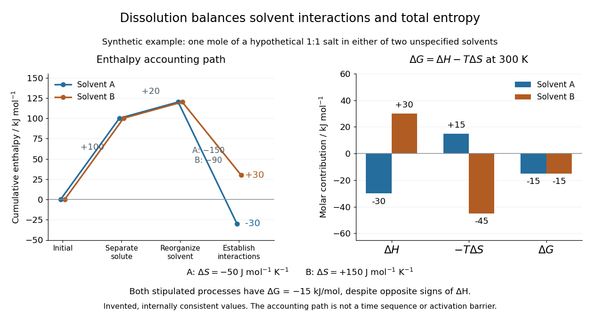

# Solvation thermodynamic balance

↑ **Parent:** [Solvation](solvation.md)

At fixed [temperature](temperature.md) and [pressure](pressure.md), compare fully specified initial and final states using

$$
\Delta G=\Delta H-T\Delta S.
$$

The [entropy](entropy.md) change is for the whole selected system, including both [solute](solute.md) and [solvent](solvent.md). Dispersing a [solute](solute.md) can increase accessible arrangements while orienting nearby [solvent](solvent.md) [molecules](molecule.md) restricts others. One picture of an ordered [hydration shell](hydration-shell.md) cannot determine the sign of the total [entropy](entropy.md) change. A negative [Gibbs free energy](gibbs-free-energy.md) change favors the specified process; it does not determine its [reaction rate](reaction-rate.md).[Opening definition and Table 16.3](chemistry-2e-by-paul-flowers-and-others/16-4-free-energy.md)

An illustrative [enthalpy](enthalpy.md) accounting path separates [solute](solute.md) constituents, reorganizes the [solvent](solvent.md), and establishes their interactions:

$$
\Delta H=\Delta H_{\mathrm{separate}}+\Delta H_{\mathrm{reorganize}}+\Delta H_{\mathrm{interact}}.
$$

This is a chosen decomposition between compatible states, not a measured sequence. If a gaseous-ion-to-[chemical solution](solution-chemistry.md) [solvation](solvation.md) term already includes [solvent](solvent.md) reorganization, do not add that reorganization a second time. [Lattice enthalpy from solution calorimetry](lattice-enthalpy-from-solution-calorimetry.md) gives the alternative [Hess's law](hess-s-law.md) route that combines lattice separation with the complete [hydration of ions](hydration-of-ions.md) term.[“The Formation of Solutions”, Figure 11.4](chemistry-2e-by-paul-flowers-and-others/11-1-the-dissolution-process.md)

**[Figure 20](#image-solvation-enthalpy-entropy-balance). Synthetic dissolution bookkeeping: solvent interactions change the enthalpy balance, while total entropy also enters the Gibbs free energy**. Original stipulated model for one [mole](mole-unit.md) of a hypothetical 1:1 [salt](salt-chemistry.md) at $300\,\mathrm K$, with two unspecified [solvents](solvent.md). No plotted value is a measurement or a claim about a named [chemical substance](chemical-substance.md). The accounting path is not a [reaction coordinate](reaction-coordinate.md) or an [activation energy](activation-energy.md).

The invented inputs are $+100$ for separation and $+20$ for [solvent](solvent.md) reorganization, in $\mathrm{kJ\,mol^{-1}}$. Interaction terms of $-150$ in [solvent](solvent.md) A and $-90$ in [solvent](solvent.md) B give $\Delta H_A=-30$ and $\Delta H_B=+30$. Stipulated total [entropy](entropy.md) changes of $-50$ and $+150\,\mathrm{J\,mol^{-1}\,K^{-1}}$ give $-T\Delta S_A=+15$ and $-T\Delta S_B=-45\,\mathrm{kJ\,mol^{-1}}$ at $300\,\mathrm K$. Both selected processes therefore have $\Delta G=-15\,\mathrm{kJ\,mol^{-1}}$. This deliberately constructed comparison shows why the signs of the [enthalpy](enthalpy.md) and [Gibbs free energy](gibbs-free-energy.md) changes need not agree; it does not predict either [solvent](solvent.md)'s [solubility](solubility.md).

For incremental [dissolution](dissolution.md) at a particular composition, the relevant [chemical potential](chemical-potential.md) difference also depends on [thermodynamic activities](thermodynamic-activity.md). At [chemical equilibrium](chemical-equilibrium.md) that driving difference vanishes. A quoted standard [Gibbs free energy](gibbs-free-energy.md) change and the finite change between arbitrary mixtures answer different questions; use compatible [standard states](standard-state.md) and the [reaction quotient](reaction-quotient.md) when discussing [solubility](solubility.md).

The motivating [calorimetry](calorimetry.md) experiment is especially instructive. A weighed [potassium chloride](potassium-chloride.md) sample dissolves in a known amount of [water](water.md) in a platinum-lined, shielded [calorimeter](calorimeter.md); a quartz-oscillator [thermometer](thermometer.md) and measured electrical heating provide the readouts. Electrical calibration before and after the reaction, comparison with a resistance [thermometer](thermometer.md), and checks on residual [water](water.md) and particle size constrain errors. The inspected authored article reports positive [enthalpy of solution](enthalpy-change-of-solution.md) at $298.15\,\mathrm K$ for the specified dilution, despite complete [dissolution](dissolution.md). This is a combined [enthalpy](enthalpy.md) balance, not an isolated [solvation free energy](solvation-free-energy.md) or direct single-ion [hydration of ions](hydration-of-ions.md) measurement. Shield tracking and final [concentration](concentration.md) matter; the existing [lattice enthalpy from solution calorimetry](lattice-enthalpy-from-solution-calorimetry.md) discussion gives the numerical result and the conversion limits.[Abstract, §§3–4 and conclusion; inspected indexed authored text, direct PMC access challenged](the-enthalpy-of-solution-of-srm-1655-kcl-in-h2o-by-marthada-v-kilday.md)

## ↑ Ancestors (7)

1. [Solvation](solvation.md)
2. [Solubility](solubility.md)
3. [Physical properties of salts](physical-properties-of-salts.md)
4. [Ionic bonding](ionic-bonding.md)
5. [Chemical bond](chemical-bond.md)
6. [Chemistry](chemistry-split.md)
7. [Codex Wiki](split.md)

## ← Incoming links (1)

- [Solvation](solvation.md)
