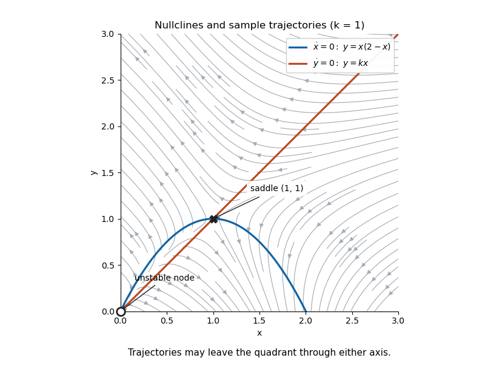

# Source-saddle pair in a quadratic planar system

↑ **Parent:** [Autonomous planar system](autonomous-planar-system.md)

The [nullclines](nullcline.md) meet at the origin and $P=(2-k,k(2-k))$. At the origin, the [Jacobian matrix](jacobian-matrix.md) has trace three, determinant $2-k>0$ and discriminant $1+4k>0$, giving an [unstable node](unstable-node.md). At $P$, its determinant is $k-2<0$, giving a [saddle equilibrium](saddle-equilibrium.md). The horizontal component is positive below the parabolic [nullcline](nullcline.md) and negative above it; the vertical component is positive above the straight [nullcline](nullcline.md) and negative below it. These signs determine the directional regions of the [phase portrait](phase-portrait.md).

**[Figure 2](#image-a-source-saddle-pair-in-a-quadratic-planar-system-at-k-1). A source-saddle pair in a quadratic planar system at $k=1$**.

The quadrant is not positively invariant: nonzero points on either axis have an outward-pointing component. Restricting a drawing to that quadrant does not keep its trajectories there. For $k>2$, only the saddle at the origin remains in the quadrant, and an [exponential Dulac multiplier for a quadratic planar system](exponential-dulac-multiplier-for-a-quadratic-planar-system.md) excludes nonconstant periodic orbits there.

## ↑ Ancestors (5)

1. [Autonomous planar system](autonomous-planar-system.md)
2. [Dynamical systems](dynamical-systems-split.md)
3. [Branches of physics](branches-of-physics.md)
4. [Physics](physics-split.md)
5. [Codex Wiki](split.md)

## ← Incoming links (1)

- [Source-saddle pair in a quadratic planar system](source-saddle-pair-in-a-quadratic-planar-system.md)
