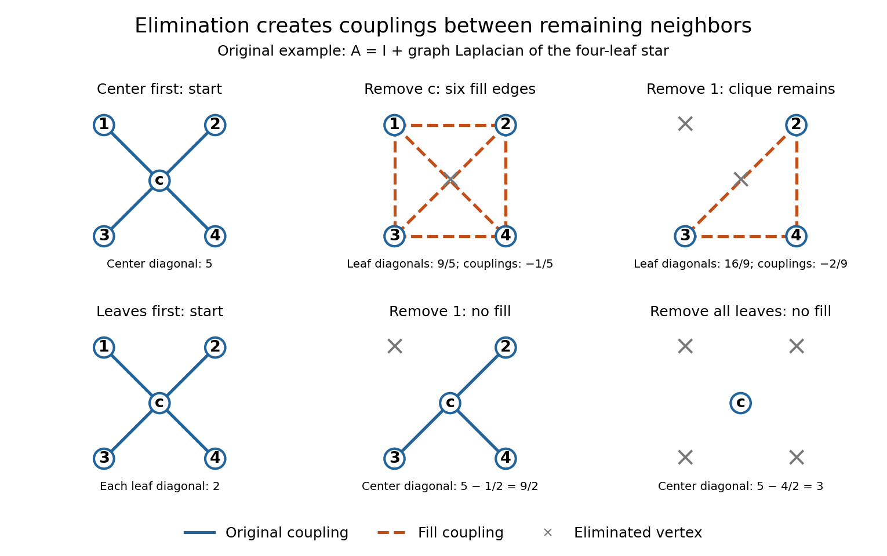
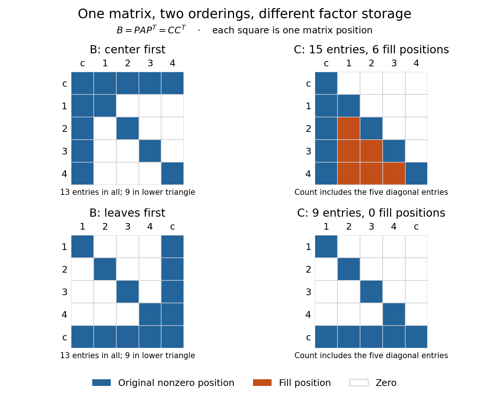

# Sparse elimination of a four-leaf star

↑ **Parent:** [Sparse Gaussian elimination](sparse-gaussian-elimination.md)

Take a [star graph](star-graph-theory.md) $G$ with center $c$ and four leaves $1,2,3,4$. Let $L_G$ be its [Laplacian matrix](laplacian-matrix.md) and $I$ the [identity matrix](identity-matrix.md). In the order $(c,1,2,3,4)$, the original example is

$$
A=I+L_G=\begin{pmatrix}
5&-1&-1&-1&-1\\
-1&2&0&0&0\\
-1&0&2&0&0\\
-1&0&0&2&0\\
-1&0&0&0&2
\end{pmatrix}.
$$

For a nonzero [vector](vector.md) $u$, its [quadratic form](quadratic-form-split.md) is

$$
u^TAu=u_c^2+\sum_{i=1}^4u_i^2+\sum_{i=1}^4(u_c-u_i)^2>0.
$$

Thus $A$ is a [symmetric positive-definite matrix](symmetric-positive-definite-matrix.md) and either ordering below admits a [Cholesky decomposition](cholesky-decomposition.md). Changing the ordering changes the work, rather than the mathematical solvability.

**Center first.** Eliminating $c$ with [pivot element](pivot-element.md) $5$ leaves the [Schur complement](schur-complement.md)

$$
S=2I_4-\frac15\mathbf1\mathbf1^T
=\frac15\begin{pmatrix}9&-1&-1&-1\\-1&9&-1&-1\\-1&-1&9&-1\\-1&-1&-1&9\end{pmatrix},
\qquad \mathbf1=(1,1,1,1)^T.
$$

Every pair of leaves now has coupling $-1/5$: six new [edges](edge-of-a-graph.md), hence six undirected [fill-in](fill-in.md) positions. The four remaining [vertices](vertex-graph-theory.md) form a [clique](clique-graph-theory.md). In the [Cholesky decomposition](cholesky-decomposition.md), the first column has $C_{cc}=\sqrt5$ and $C_{ic}=-1/\sqrt5$. The rest of the [lower triangular matrix](lower-triangular-matrix.md) is dense. To check that later cancellation does not remove its entries, after $r$ leaves have also been eliminated, the active leaf block is

$$
2I_{4-r}-\alpha_r\mathbf1\mathbf1^T,\qquad
\alpha_r=\frac{2}{10-r},\qquad 0\leq r\leq3.
$$

Indeed a leaf step sends $\alpha$ to $\alpha+\alpha^2/(2-\alpha)$. All active off-diagonal entries remain negative. The successive [pivot elements](pivot-element.md) in ordinary symmetric [Gaussian elimination](gaussian-elimination.md), equivalently the squared diagonals in the [Cholesky decomposition](cholesky-decomposition.md), are

$$
5,\quad\frac95,\quad\frac{16}9,\quad\frac74,\quad\frac{12}7.
$$

The [Cholesky decomposition](cholesky-decomposition.md) therefore stores $5+4+3+2+1=15$ nonzero entries, including its diagonal.

**Leaves first.** Permute to $(1,2,3,4,c)$. Each leaf has only one remaining neighbor, so its elimination changes only the center's diagonal, reducing it by $(-1)^2/2=1/2$. The successive [pivot elements](pivot-element.md) are $2,2,2,2,3$, and the exact [Cholesky decomposition](cholesky-decomposition.md) is

$$
PAP^T=CC^T,\qquad
C=\begin{pmatrix}
\sqrt2&0&0&0&0\\
0&\sqrt2&0&0&0\\
0&0&\sqrt2&0&0\\
0&0&0&\sqrt2&0\\
-1/\sqrt2&-1/\sqrt2&-1/\sqrt2&-1/\sqrt2&\sqrt3
\end{pmatrix}.
$$

There is no [fill-in](fill-in.md), and only $5+4=9$ nonzero entries in $C$. This is a concrete instance of [leaf elimination of a tree-pattern positive-definite matrix](leaf-elimination-of-a-tree-pattern-positive-definite-matrix.md); its general proof explains why the same idea works on every [tree](tree-graph-theory-split.md) pattern. The [minimum degree algorithm](minimum-degree-algorithm.md) also chooses a leaf at every nontrivial stage of this particular example, but that success gives no general optimality guarantee.

**[Figure 6](#image-eliminating-the-center-of-a-four-leaf-star-graph-creates-a-clique-eliminating-leaves-creates-no-fill-in). Eliminating the center of a four-leaf star graph creates a clique; eliminating leaves creates no fill-in**.

**[Figure 7](#image-the-same-symmetric-positive-definite-matrix-has-15-or-nine-nonzero-cholesky-decomposition-factor-entries-depending-on-its-ordering). The same symmetric positive-definite matrix has 15 or nine nonzero Cholesky decomposition factor entries, depending on its ordering**.

The input has 13 nonzero [matrix elements](matrix-element.md) when both symmetric halves are counted, or nine in its lower triangle. The six added undirected [edges](edge-of-a-graph.md) correspond to six added positions in one triangular factor, or 12 positions if both symmetric halves of the filled pattern are displayed. Comparing all 13 input entries directly with the 15 entries of $C$ would mix counting conventions.

## ↑ Ancestors (8)

1. [Sparse Gaussian elimination](sparse-gaussian-elimination.md)
2. [Gaussian elimination](gaussian-elimination.md)
3. [Numerical linear algebra](numerical-linear-algebra-split.md)
4. [Numerical analysis](numerical-analysis-split.md)
5. [Analysis](analysis-split.md)
6. [Area of mathematics](area-of-mathematics.md)
7. [Mathematics](mathematics-split.md)
8. [Codex Wiki](split.md)

## ← Incoming links (1)

- [Fill-in](fill-in.md)
