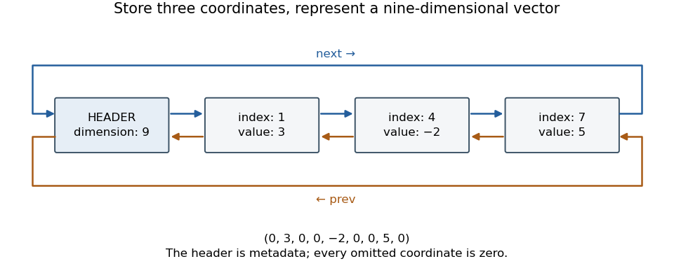

# Sparse linked vector representation

↑ **Parent:** [Sparse vector](sparse-vector.md)

Represent a finite [sparse vector](sparse-vector.md) by a sorted [doubly linked list](doubly-linked-list.md) of its nonzero coordinates. A [list header](list-header.md) stores the dimension; every ordinary [linked list node](linked-list-node.md) stores a distinct valid coordinate index, its nonzero value, and predecessor and successor references. In a [circular linked list](circular-linked-list.md), the endpoints connect to the header, and an all-zero [vector](vector.md) has the header linked to itself in both directions. The [representation invariant](representation-invariant.md) requires strictly increasing ordinary indices, valid bounds and mutually consistent forward and backward links. The [abstraction function](abstraction-function.md) assigns zero to every coordinate absent from the list. The header is metadata, never an ordinary coordinate.

For example, $(0,3,0,0,-2,0,0,5,0)$ has dimension nine and only three stored coordinates. The header's index field can store nine even though nine is not a valid coordinate index. Keeping the header distinct is therefore essential when searching for or removing entries.

**[Figure 21](#image-a-circular-sparse-linked-vector-representation-stores-only-nonzero-coordinates). A circular sparse linked vector representation stores only nonzero coordinates**.

**Table of contents**

- [Sorted sparse dot product](sorted-sparse-dot-product.md)

## ↑ Ancestors (8)

1. [Sparse vector](sparse-vector.md)
2. [Compressed sensing](compressed-sensing.md)
3. [Sparse optimization](sparse-optimization.md)
4. [Numerical analysis](numerical-analysis-split.md)
5. [Analysis](analysis-split.md)
6. [Area of mathematics](area-of-mathematics.md)
7. [Mathematics](mathematics-split.md)
8. [Codex Wiki](split.md)

## ← Incoming links (2)

- [Solution](past-exam-of-the-year-1-of-the-computer-science-course-of-the-university-of-oxford/2018/imperative-programming/3/b/i/solution.md)
- [Sparse linked vector representation](sparse-linked-vector-representation.md)
