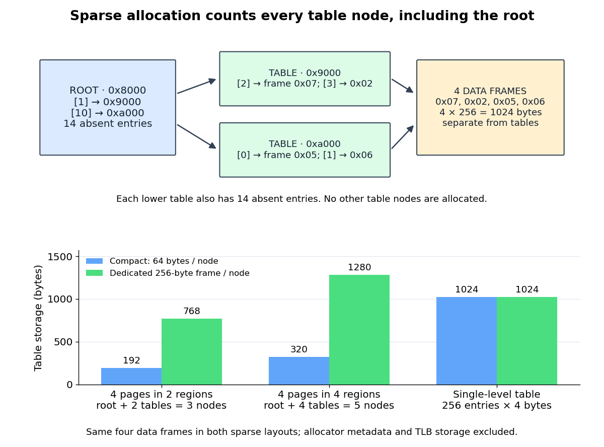

# Sparse page table allocation

↑ **Parent:** [Multi-level page table](multi-level-page-table.md)

Use the [two-level address translation](two-level-address-translation.md) model and map exactly four resident virtual [memory pages](memory-page.md), numbered `0x12`, `0x13`, `0xa0`, and `0xa1`. Assign their data [page frames](page-frame.md) to `0x07`, `0x02`, `0x05`, and `0x06`, respectively. Only two root indices occur: 1 and 10. Allocate exactly three table nodes: the root at `0x8000`, the lower-level table for root index 1 at `0x9000`, and the lower-level table for root index 10 at `0xa000`. Root entries 1 and 10 reference those tables; all other root entries are absent. Lower-level entries 2 and 3 in the first table and entries 0 and 1 in the second table hold the four mappings; every other lower-level entry is absent. Use the read-only permissions already specified for virtual [memory page](memory-page.md) `0x12`; let the other three mappings permit user reads and writes, with no execution, and let both populated root entries permit user reads and writes.

Each root index covers 16 virtual [memory pages](memory-page.md), hence $16\cdot256=4096$ [bytes](byte.md) of the [address space](address-space.md). A compact table node occupies $16\cdot4=64$ [bytes](byte.md). The three nodes therefore require $3\cdot64=192$ [bytes](byte.md) of table storage, including the root and all absent entry slots in the allocated nodes. A single-level [array](array-data-structure.md) requires $256\cdot4=1024$ [bytes](byte.md) for the same [address space](address-space.md), saving $1024-192=832$ [bytes](byte.md) in the compact model. Four data [page frames](page-frame.md) occupy another $4\cdot256=1024$ [bytes](byte.md); those contents are separate from table storage.

If instead the allocator dedicates a whole 256-[byte](byte.md) [page frame](page-frame.md) to every table node, the three nodes consume 768 [bytes](byte.md), leaving $3(256-64)=576$ [bytes](byte.md) unused within those allocations. The single-level table fills four such [page frames](page-frame.md) and still consumes 1024 [bytes](byte.md). Thus this example saves 256 [bytes](byte.md) of allocated table storage under that alternative policy. Neither accounting includes allocator metadata, [operating-system process](process-computing.md) records, or [translation lookaside buffer](translation-lookaside-buffer.md) storage; data allocations are the same in both designs.

**[Figure 42](#image-all-table-nodes-for-four-mapped-pages-and-the-footprint-change-when-the-same-four-pages-occupy-four-root-regions). All table nodes for four mapped pages, and the footprint change when the same four pages occupy four root regions**.

Placement matters as well as mapping count. Four virtual [memory pages](memory-page.md) `0x12`, `0x42`, `0x72`, and `0xa2` require the root plus four lower-level tables: five nodes, 320 compact [bytes](byte.md), or 1280 [bytes](byte.md) with a dedicated [page frame](page-frame.md) per node. Only four data [page frames](page-frame.md) are still required. Let $g$ be the number of distinct root indices represented by the mappings. With no retained empty lower-level tables, table storage is $64(1+g)$ compact [bytes](byte.md) or $256(1+g)$ allocated [bytes](byte.md) under the dedicated-[page frame](page-frame.md) policy. Even an empty [address space](address-space.md) retains the root in this accounting, so $g=0$ costs 64 or 256 [bytes](byte.md).

For a fully populated [address space](address-space.md), $g=16$: 17 nodes cost 1088 compact [bytes](byte.md) or 4352 allocated [bytes](byte.md). The single-level table remains 1024 [bytes](byte.md). Sparse allocation is therefore a conditional space benefit; scattered mappings, node allocation granularity, and the root's overhead can reverse it. Additional dependent lookups on a [TLB miss](tlb-miss.md) also have a cost, but node counts alone establish no universal execution-time ordering.

## ↑ Ancestors (7)

1. [Multi-level page table](multi-level-page-table.md)
2. [Page table](page-table.md)
3. [Paging](paging.md)
4. [Virtual memory](virtual-memory.md)
5. [Operating system](operating-system.md)
6. [Computer science](computer-science-split.md)
7. [Codex Wiki](split.md)
