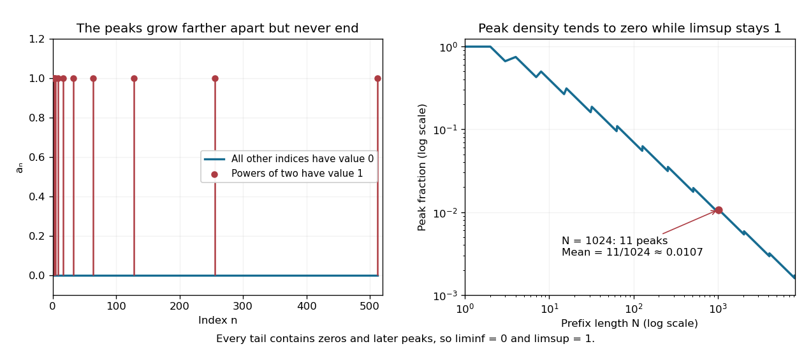

# Sparse peaks can determine a limit superior

↑ **Parent:** [Limit superior](limit-superior.md)

Define a [sequence](sequence.md) by $a_n=1$ when $n$ is a power of two, including $1=2^0$, and $a_n=0$ otherwise. Every [tail of a sequence](tail-of-a-sequence.md) contains both a later power of two and a later nonpower. Therefore **$\liminf a_n=0$ and $\limsup a_n=1$**, and the [sequence](sequence.md) does not converge. Its peak indices become increasingly sparse, yet never stop appearing.

Through index $N\geq1$, the number of peaks is $1+\lfloor\log_2N\rfloor$, so their fraction is

$$
\frac{1+\lfloor\log_2N\rfloor}{N}\longrightarrow0.
$$

The [set](set-split.md) of powers of two has [natural density](natural-density.md) zero. The same fraction is the [Cesàro mean](cesaro-mean.md) of the first $N$ terms, which tends to zero even though the [limit superior](limit-superior.md) stays one. At $N=1024$, eleven peaks give mean $11/1024\approx0.0107422$. An average and a long-run upper edge answer different questions about the same [sequence](sequence.md).

**[Figure 19](#image-peaks-of-zero-natural-density-retain-a-limit-superior-of-one-while-their-cesaro-means-tend-to-zero). Peaks of zero natural density retain a limit superior of one while their Cesàro means tend to zero**. Left: the indicator [sequence](sequence.md) has peaks at powers of two; every sufficiently late tail still contains peaks and zeros. Right: the exact peak count divided by $N$ decreases overall toward zero, with jumps when a new power of two enters the count. These finite plots illustrate formulas valid at every positive [integer](integer.md) index.

## ↑ Ancestors (8)

1. [Limit superior](limit-superior.md)
2. [Sequence](sequence.md)
3. [Sequence and series](sequence-and-series.md)
4. [Real analysis](real-analysis-split.md)
5. [Analysis](analysis-split.md)
6. [Area of mathematics](area-of-mathematics.md)
7. [Mathematics](mathematics-split.md)
8. [Codex Wiki](split.md)

## ← Incoming links (2)

- [Limit superior](limit-superior.md)
- [Subsequential limit](subsequential-limit.md)
