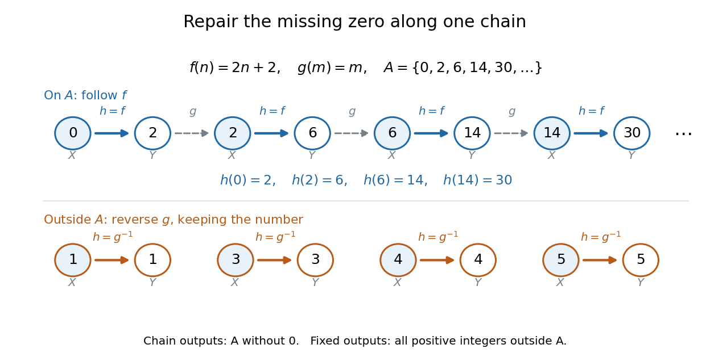

# Sparse-shift bijection between nonnegative and positive integers

↑ **Parent:** [Cantor-Schröder-Bernstein theorem](cantor-schroder-bernstein-theorem.md)

Take $X=\{0,1,2,\ldots\}$, the [nonnegative integers](natural-number.md), and $Y=\{1,2,3,\ldots\}$, the [positive integers](positive-integer.md). Choose the [injections](injective-function.md)

$$
f:X\to Y,\qquad f(n)=2n+2,
\qquad
g:Y\to X,\qquad g(m)=m.
$$

Here $g$ is an [inclusion map](inclusion-map.md), while $f$ reaches only the positive [even integers](even-number.md). In particular, $f$ is not a [bijection](bijection.md): it misses every positive [odd integer](odd-integer.md). Simply using the [inverse function](inverse-function.md) of $g$ on its [image](image-of-a-function.md) misses input zero.

The remedy is to follow the alternating [injections](injective-function.md) starting at the missing input zero:

$$
0_X\mathrel{\mathop{\longrightarrow}^{f}}2_Y
\mathrel{\mathop{\longrightarrow}^{g}}2_X
\mathrel{\mathop{\longrightarrow}^{f}}6_Y
\mathrel{\mathop{\longrightarrow}^{g}}6_X
\mathrel{\mathop{\longrightarrow}^{f}}14_Y
\mathrel{\mathop{\longrightarrow}^{g}}14_X\longrightarrow\cdots.
$$

The subscripts distinguish an input in $X$ from an output in $Y$, even when their numerical values agree. The resulting [subset](subset.md) of $X$ is $A=\{0,2,6,14,30,\ldots\}$. Its [sequence](sequence.md) of members satisfies $a_0=0$ and $a_{k+1}=2a_k+2$, giving $a_k=2^{k+1}-2$ by [mathematical induction](mathematical-induction.md). Define the [function](function-split.md)

$$
h(n)=\begin{cases}
2n+2,&n\in A,\\
n,&n\in X\setminus A.
\end{cases}
$$

**[Figure 3](#image-a-bijection-moves-only-the-sequence-0-2-6-14-ldots). A bijection moves only the sequence $0,2,6,14,\ldots$**. The upper row alternates the original [injections](injective-function.md) $f$ and $g$. Solid blue arrows are the chosen [bijection](bijection.md) $h=f$ on $A$; dashed gray arrows only continue the chain. Below, examples outside $A$ use $h=g^{-1}$ and keep their numerical values. Every displayed number belongs to the explicitly constructed example.

The [image](image-of-a-function.md) $h(A)=\{2,6,14,30,\ldots\}=A\setminus\{0\}$ covers all the positive members of $A$ exactly once. The other inputs cover $Y\setminus A$ exactly once by staying fixed. These output [sets](set-split.md) are disjoint and their [union](set-union.md) is $Y$, proving that $h$ is a [bijection](bijection.md). In particular, $h(0)=2$, $h(2)=6$, $h(6)=14$, while $h(1)=1$ and $h(4)=4$.

For completeness, its [inverse function](inverse-function.md) is

$$
h^{-1}(m)=\begin{cases}
(m-2)/2,&m\in A\setminus\{0\},\\
m,&m\in Y\setminus A.
\end{cases}
$$

The familiar [bijection](bijection.md) $n\mapsto n+1$ also works, but this example shows something more specific: the two chosen [injections](injective-function.md) can repair the missing zero by moving only a sparse [sequence](sequence.md) of inputs. The repair never has to shift the entire [set](set-split.md).

## ↑ Ancestors (7)

1. [Cantor-Schröder-Bernstein theorem](cantor-schroder-bernstein-theorem.md)
2. [Cardinal number](cardinal-number-split.md)
3. [Set theory](set-theory-split.md)
4. [Foundations of mathematics](foundations-of-mathematics-split.md)
5. [Area of mathematics](area-of-mathematics.md)
6. [Mathematics](mathematics-split.md)
7. [Codex Wiki](split.md)
