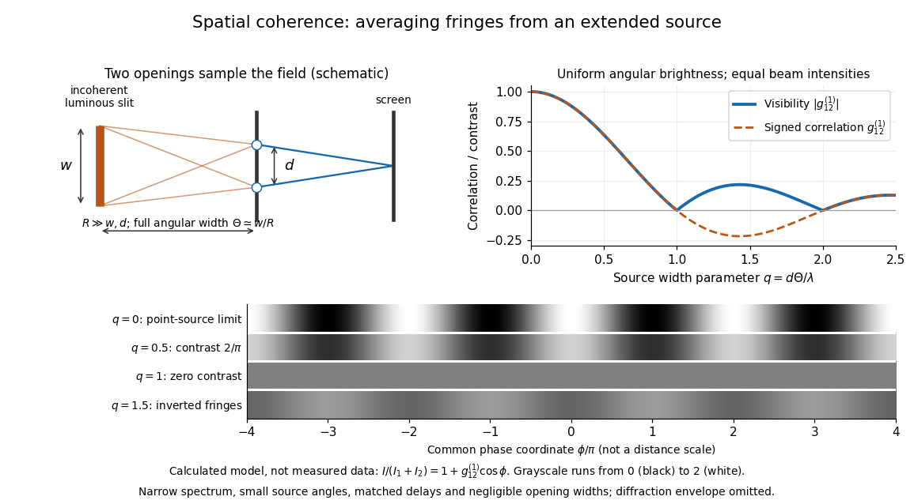

# Spatial optical coherence

↑ **Parent:** [First-order optical coherence](first-order-optical-coherence.md)

[Spatial optical coherence](spatial-optical-coherence.md) compares field samples at different positions, usually across a transverse plane at equal time. Two small openings separated by $d$ sample this correlation: recombine their [light](light.md) with nearly matched travel times and measure [interferometric visibility](interferometric-visibility.md) near the central [interference fringes](interference-fringe.md). A narrow opening in front of a broad-spectrum lamp can improve transverse [spatial optical coherence](spatial-optical-coherence.md) while leaving its short [temporal optical coherence](temporal-optical-coherence.md). These are separate controls: narrow spectral selection by itself need not make an extended source spatially coherent. MIT's lecture notes illustrate the two-opening test and these contrasting source preparations. [MIT 2.71/2.710, lecture 22, slides 3–5: spatial sampling and source examples](https://ocw.mit.edu/courses/2-71-optics-spring-2009/bebe78c6a2ae2603a0d1a3ea85e0b4ca_MIT2_71S09_lec22.pdf).

To isolate source width, stipulate a distant, narrowband source with uniform angular brightness on $-\Theta/2\leq\alpha\leq\Theta/2$, and mutually uncorrelated emission from distinct source directions. Here $\Theta\ll1$ is the full angular width in [radians](radian.md), $\lambda$ the common [wavelength](wavelength.md), and the two openings are separated by $d$ along the same transverse direction as the source extent. Neglect amplitude differences across the openings. Each source direction contributes a [phase difference](phase-difference.md) approximately $2\pi d\alpha/\lambda$. Averaging its complex cross term gives

$$
g^{(1)}_{12}(0)=\frac1\Theta\int_{-\Theta/2}^{\Theta/2}e^{i2\pi d\alpha/\lambda}\,d\alpha
=\frac{\sin(\pi d\Theta/\lambda)}{\pi d\Theta/\lambda},
\qquad \mathcal V=\left|\frac{\sin(\pi q)}{\pi q}\right|,
\qquad q=\frac{d\Theta}{\lambda}.
$$

The [sinc function](sinc-function.md) is extended continuously to one at $q=0$. The sign convention in the exponential depends on which opening is numbered first; the symmetric model gives the same real result either way. Equal detected single-opening [light intensities](light-intensity.md) make the magnitude equal to [interferometric visibility](interferometric-visibility.md). A displaced source center adds a deterministic [wave phase](phase-waves.md), shifting the [interference fringes](interference-fringe.md) without changing their contrast.

**[Figure 28](#image-calculated-spatial-optical-coherence-for-a-stipulated-uniform-incoherent-angular-source-wider-sources-wash-out-and-invert-interference-fringes). Calculated spatial optical coherence for a stipulated uniform incoherent angular source: wider sources wash out and invert interference fringes**.

The strips show $I/(I_1+I_2)=1+g^{(1)}_{12}(0)\cos\phi$ with equal single-opening [light intensities](light-intensity.md), a common [phase difference](phase-difference.md) coordinate $\phi$ and no [single-slit diffraction](single-slit-diffraction.md) envelope. At $q=1/2$, contrast is $2/\pi\approx0.636620$; at $q=1$, it vanishes. At $q=3/2$, the correlation is $-2/(3\pi)\approx-0.212207$: weak fringes return with bright and dark positions exchanged. For $\lambda=500\,\mathrm{nm}$ and $d=0.5\,\mathrm{mm}$, the first zero occurs at $\Theta=1\,\mathrm{mrad}$. This is a calculated example, not an experimental measurement or a universal source-width law.

A proposed source-width control follows directly from this model: illuminate two fixed openings with a distant adjustable luminous slit of full width $w$ at distance $R$, so $\Theta\approx w/R$ under the [small-angle approximation](small-angle-approximation.md), and hold $d$ and the spectral selection fixed. Increasing $w$ overlays more mutually incoherent, displaced [interference fringe](interference-fringe.md) patterns. Record profiles over several near-central fringes, measure each opening separately and correct intensity imbalance as in [first-order optical coherence](first-order-optical-coherence.md). Restrict the recorded region so the path difference stays small compared with the [optical coherence length](optical-coherence-length.md), and resolve the fringes with the detector. Real source nonuniformity, finite opening widths and spectral spread modify the stipulated [sinc function](sinc-function.md) law. This protocol is a model-based extension of the verified two-opening method, not a claim that the plotted curves were measured.

Thus an extended incoherent source can give locally excellent [wave interference](interference-wave-propagation.md) when the sampled separation is small, and almost none when it is larger. The useful scale $d\Theta\sim\lambda$ expresses how source extent limits the aperture over which coherent addition is available. The same angular averaging explains why narrowing a source opening can recover visible [interference fringes](interference-fringe.md), even without narrowing its [optical spectrum](optical-spectrum.md).

## ↑ Ancestors (7)

1. [First-order optical coherence](first-order-optical-coherence.md)
2. [Optical coherence](optical-coherence.md)
3. [Physical optics](physical-optics.md)
4. [Optics](optics-split.md)
5. [Branches of physics](branches-of-physics.md)
6. [Physics](physics-split.md)
7. [Codex Wiki](split.md)

## ← Incoming links (5)

- [Incoherent imaging](incoherent-imaging.md)
- [Optical coherence](optical-coherence.md)
- [Optical coherence length](optical-coherence-length.md)
- [Point spread function](point-spread-function.md)
- [Spatial optical coherence](spatial-optical-coherence.md)
