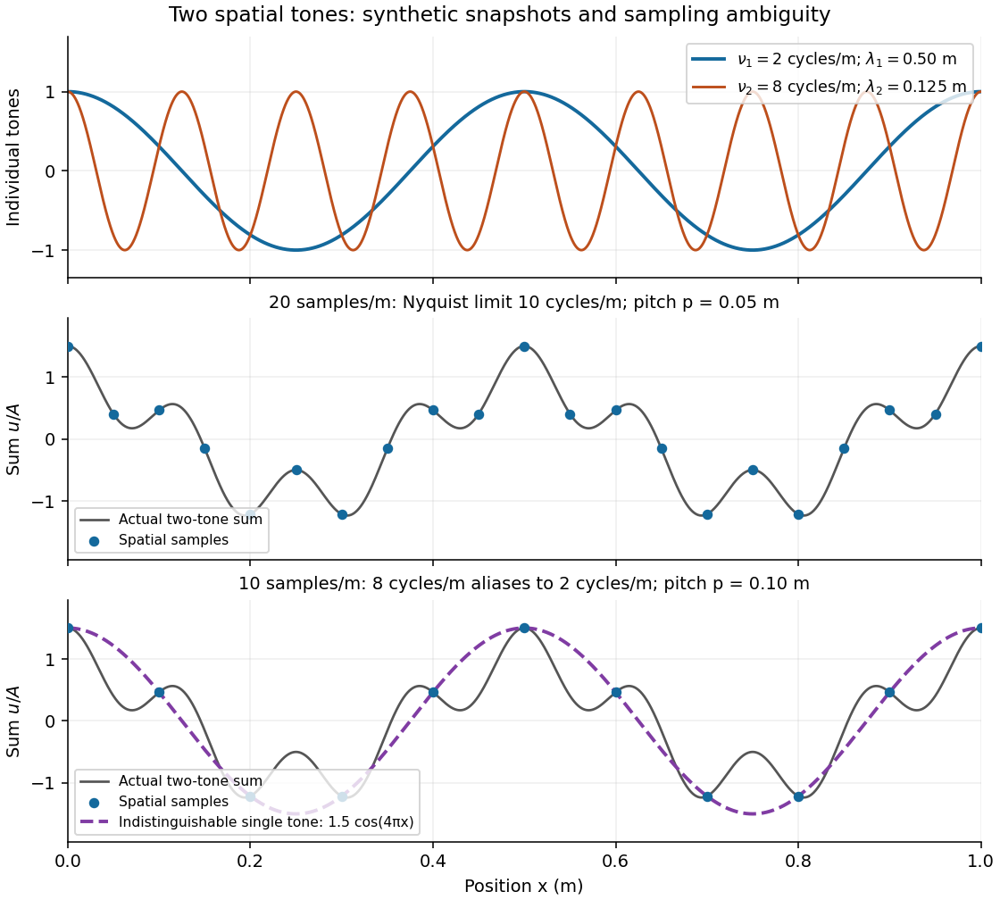

# Spatial sampling of a wave

↑ **Parent:** [Wavenumber](wavenumber.md)

In [spatial sampling of a wave](spatial-sampling-of-a-wave.md), a detector records a [wave](wave.md) at positions $x_n=np$ separated by pitch $p>0$. Angular [wavenumbers](wavenumber.md) differing by $2\pi m/p$, with [integers](integer.md) $m$, give identical samples of a complex [Fourier mode](fourier-mode.md):

$$
e^{i(k+2\pi m/p)np}=e^{iknp}.
$$

This is spatial [aliasing](aliasing.md). To distinguish arbitrary [sinusoids](sinusoid.md) within a prescribed band, require $|k|<\pi/p$, equivalently $|\nu_x|<1/(2p)$, the [Nyquist spatial frequency](nyquist-spatial-frequency.md). Thus $p<\lambda_{\min}/2$ for the shortest allowed [wavelength](wavelength.md). At equality a [sine](sine.md) can vanish at every sample, so phase information can be lost. The [Nyquist–Shannon sampling theorem](nyquist-shannon-sampling-theorem.md) states the precise reconstruction conditions for a [bandlimited function](bandlimited-function.md); a finite scan introduces further limitations.

The synthetic two-tone snapshot is

$$
\frac{u(x)}A=\cos(2\pi\nu_1x)+\frac12\cos(2\pi\nu_2x),\qquad \nu_1=2\,\mathrm{m^{-1}},\quad \nu_2=8\,\mathrm{m^{-1}},
$$

where both $\nu_j$ count cycles per metre. The component [wavelengths](wavelength.md) are $0.50\,\mathrm m$ and $0.125\,\mathrm m$. With $p=0.05\,\mathrm m$, both lie below the [Nyquist spatial frequency](nyquist-spatial-frequency.md) of $10$ cycles per metre. With $p=0.10\,\mathrm m$, the $8$-cycle component aliases to the $2$-cycle component: at every $x_n=n/10$, $\cos(2\pi\cdot8x_n)=\cos(2\pi\cdot2x_n)$. The sampled sum is therefore indistinguishable from $1.5\cos(4\pi x)$, although the continuous curves differ between samples. Drawing lines between sample points cannot resolve this ambiguity.

**[Figure 10](#image-synthetic-two-tone-spatial-waveform-fine-samples-distinguish-the-components-coarse-samples-hide-the-shorter-wavelength). Synthetic two-tone spatial waveform: fine samples distinguish the components, coarse samples hide the shorter wavelength**.

## ↑ Ancestors (7)

1. [Wavenumber](wavenumber.md)
2. [Wave equation](wave-equation-split.md)
3. [Partial differential equation](partial-differential-equation-split.md)
4. [Analysis](analysis-split.md)
5. [Area of mathematics](area-of-mathematics.md)
6. [Mathematics](mathematics-split.md)
7. [Codex Wiki](split.md)

## ← Incoming links (2)

- [Spatial sampling of a wave](spatial-sampling-of-a-wave.md)
- [Wavelength](wavelength.md)
